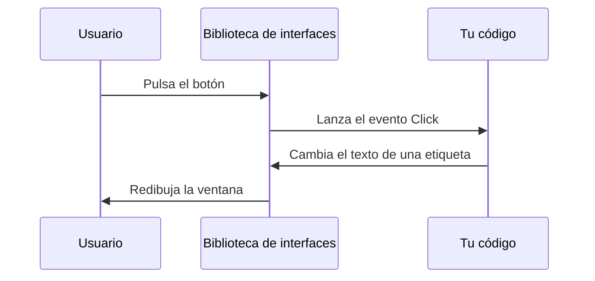
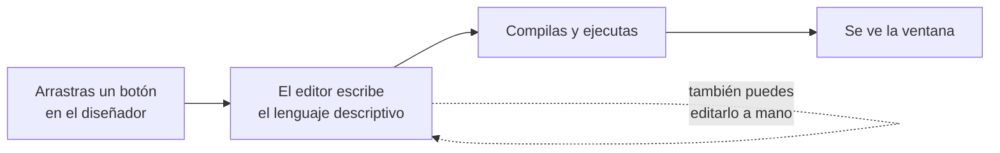
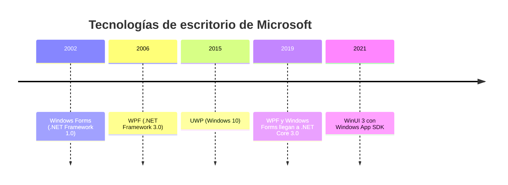
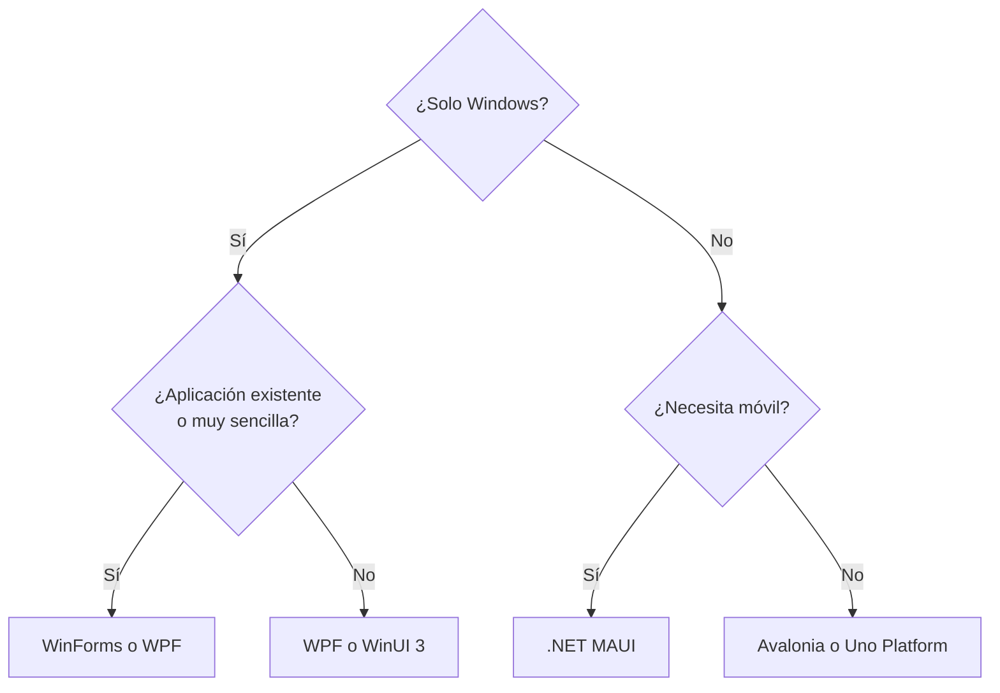

# 1. Tecnologías de interfaces gráficas

[⬅️ Volver a la unidad](./README.md)

**CE que trabaja este tema:** RA1 a.

## Índice

- [1.1. Qué hay debajo de una ventana](#11-qué-hay-debajo-de-una-ventana)
- [1.2. Tres formas de construir una interfaz](#12-tres-formas-de-construir-una-interfaz)
  - [1.2.1. Todo en código](#121-todo-en-código)
  - [1.2.2. Un lenguaje descriptivo](#122-un-lenguaje-descriptivo)
  - [1.2.3. Un editor visual](#123-un-editor-visual)
- [1.3. Tecnologías de interfaces en .NET](#13-tecnologías-de-interfaces-en-net)
  - [1.3.1. Las que son de una plataforma: WinForms, WPF y WinUI 3](#131-las-que-son-de-una-plataforma-winforms-wpf-y-winui-3)
  - [1.3.2. Las multiplataforma: .NET MAUI, Avalonia y Uno](#132-las-multiplataforma-net-maui-avalonia-y-uno)
  - [1.3.3. Comparativa](#133-comparativa)
- [1.4. Tecnologías fuera de .NET](#14-tecnologías-fuera-de-net)
- [1.5. Lenguajes descriptivos: la misma ventana, cinco veces](#15-lenguajes-descriptivos-la-misma-ventana-cinco-veces)
- [1.6. Editores visuales: propietarios y libres](#16-editores-visuales-propietarios-y-libres)
- [1.7. Cómo elegir una tecnología](#17-cómo-elegir-una-tecnología)
- [1.8. Por qué WPF en este módulo](#18-por-qué-wpf-en-este-módulo)
- [Resumen](#resumen)
- [Ejercicios de reflexión](#ejercicios-de-reflexión)

---

## 1.1. Qué hay debajo de una ventana

Cada día usas decenas de interfaces gráficas: el explorador de archivos, un editor de texto, la aplicación del banco en el móvil. Todas parecen distintas, pero por dentro hacen lo mismo:

1. **Dibujar** una ventana y unos **controles** (botones, cajas de texto, listas) en la pantalla.
2. **Esperar** a que el usuario haga algo: un clic, una tecla, cambiar el tamaño.
3. **Avisar** al código de que ha pasado algo, mediante un **evento**.
4. **Volver a dibujar** lo que haya cambiado.

Ese ciclo (dibujar, esperar, avisar, redibujar) lo gestiona una **biblioteca de interfaces gráficas** (*GUI toolkit*). Tú no escribes el bucle que escucha el ratón ni dibujas cada píxel del botón: pides «un botón con este texto» y dices «cuando lo pulsen, ejecuta esto».



Los eventos ya los conoces: en la unidad anterior los construiste con delegados y `event`. Una biblioteca de interfaces los usa en cada control. Lo que cambia entre una tecnología y otra es **cómo se describe la ventana**, **qué controles trae** y **en qué sistemas funciona**. De eso trata este tema.

> 📝 **Nota del Profesor**: aprender una biblioteca de interfaces no es memorizar controles. Es entender estas cuatro ideas (controles, distribución, eventos y datos), que se repiten en todas. Por eso casi todo lo que aprendas con WPF te servirá en otra tecnología.

---

## 1.2. Tres formas de construir una interfaz

### 1.2.1. Todo en código

La forma más directa es crear los controles con instrucciones, como cualquier otro objeto. En C#, con WPF, una ventana mínima con un botón sería así:

```csharp
var boton = new Button { Content = "Guardar", Width = 120, Height = 32 };
boton.Click += (emisor, e) => MessageBox.Show("Guardado");

var ventana = new Window { Title = "Socios", Content = boton };
ventana.Show();
```

Es un estilo **imperativo**: describes los **pasos** para construir la ventana. Funciona, pero tiene un inconveniente: para saber cómo se verá hay que ejecutar mentalmente el código. Con quince controles anidados, el resultado se pierde entre las instrucciones.

### 1.2.2. Un lenguaje descriptivo

La alternativa es **describir** cómo es la ventana en un lenguaje aparte, normalmente basado en XML, y dejar que la biblioteca construya los objetos. Es un estilo **declarativo**: dices **qué** quieres, no cómo crearlo.

```xml
<Window Title="Socios">
    <Button Content="Guardar"
            Width="120"
            Height="32" />
</Window>
```

La estructura se ve de un vistazo y la jerarquía de controles coincide con la jerarquía del texto. Además, quien diseña la apariencia y quien programa el comportamiento pueden trabajar en ficheros distintos. En WPF este lenguaje se llama **XAML**; otras tecnologías tienen el suyo (apartado 1.5).

El comportamiento (qué hace el botón al pulsarlo) sigue escribiéndose en C#, en un fichero aparte. La interfaz se reparte así:

| Parte | Se escribe en | Responde a |
|-------|---------------|------------|
| **Apariencia y estructura** | Lenguaje descriptivo (XAML) | ¿Qué controles hay y dónde? |
| **Comportamiento** | Lenguaje de programación (C#) | ¿Qué pasa cuando el usuario actúa? |

### 1.2.3. Un editor visual

Escribir el lenguaje descriptivo a mano es posible, pero a veces es más cómodo **arrastrar controles** sobre una ventana y cambiar sus propiedades en un panel. Eso es un **editor visual** (o diseñador): una herramienta que muestra la ventana tal y como se verá y **genera por ti** el código o la descripción correspondiente.



Un editor visual **no sustituye** a entender el código que genera. Si no sabes leerlo, no sabrás corregirlo cuando el diseñador no haga lo que quieres. Por eso el criterio de evaluación habla de *analizar* y *modificar* el código generado (temas 2 y 3).

> ⚠️ **Cuidado**: no confundas el **editor visual** (una herramienta del entorno de desarrollo) con el **lenguaje descriptivo** (el formato en que se guarda la ventana). El diseñador de Visual Studio es el editor; XAML es el lenguaje.

---

## 1.3. Tecnologías de interfaces en .NET

.NET ofrece varias bibliotecas de interfaces gráficas. Se pueden agrupar por una pregunta: **¿para cuántos sistemas sirven?**

- **Nativas de una plataforma** (*nativas*): se construyen para un sistema operativo y aprovechan todo lo que este ofrece.
- **Multiplataforma**: una misma base de código funciona en varios sistemas, a cambio de depender de una capa intermedia.



### 1.3.1. Las que son de una plataforma: WinForms, WPF y WinUI 3

**Windows Forms (WinForms).** La más antigua (2002). Envuelve los controles clásicos de Windows. Su diseñador es muy sencillo: arrastras y suéltas, y Visual Studio genera **código C#** (no un lenguaje descriptivo) en un fichero `Formulario.Designer.cs`. Sigue funcionando en .NET y es habitual en aplicaciones de gestión ya existentes. Su límite es el aspecto: personalizar mucho un control cuesta.

**WPF (*Windows Presentation Foundation*).** Aparece en 2006 y es la que usarás en este módulo. Dibuja todo con gráficos vectoriales (se ve nítido a cualquier resolución), describe la interfaz en **XAML** y tiene un sistema de **enlace de datos** (*data binding*) muy completo que facilita arquitecturas como MVVM. Es solo para Windows y sigue manteniéndose junto a cada versión de .NET.

**WinUI 3.** La biblioteca moderna de Microsoft para Windows. Usa XAML, un aspecto actual (estilo Fluent) y se distribuye con el **Windows App SDK**. Comparte muchas ideas con WPF, pero es más reciente y tiene un ecosistema menor.

> 🔁 **Transferencia**: UWP fue la tecnología de Microsoft para aplicaciones de la Tienda de Windows 10. Muchos de sus conceptos pasaron a WinUI 3. Si ves «UWP» en un tutorial antiguo, piensa que es el antecesor directo de WinUI 3, no de WPF.

### 1.3.2. Las multiplataforma: .NET MAUI, Avalonia y Uno

**.NET MAUI.** Heredera de Xamarin.Forms. Con un único proyecto genera aplicaciones para **Android, iOS, macOS y Windows**. Usa XAML. Está pensada sobre todo para aplicaciones móviles.

**Avalonia.** Biblioteca de código abierto con un XAML muy parecido al de WPF. Dibuja ella misma los controles, de modo que se ven igual en **Windows, macOS y Linux** (y también en móvil y en el navegador). Es la opción natural para llevar a Linux una aplicación de escritorio con ideas de WPF.

**Uno Platform.** Usa la misma interfaz de programación que WinUI y la lleva a Windows, Android, iOS, macOS, Linux y el navegador.

Las tres comparten una idea: **el mismo XAML** (o muy parecido) sirve para varios sistemas. El coste es una capa más entre tu código y el sistema operativo, y algo menos de acceso a las particularidades de cada plataforma.

### 1.3.3. Comparativa

| Tecnología | Sistemas | Lenguaje descriptivo | Editor visual | Cuándo tiene sentido |
|------------|----------|----------------------|---------------|----------------------|
| **WinForms** | Windows | Ninguno (el diseñador genera C#) | Sí, muy sencillo | Mantener aplicaciones de gestión existentes; formularios rápidos |
| **WPF** | Windows | XAML | Sí | Aplicaciones de escritorio para Windows con interfaz rica y arquitectura cuidada |
| **WinUI 3** | Windows | XAML | Sí | Aplicaciones nuevas para Windows con el aspecto actual del sistema |
| **.NET MAUI** | Android, iOS, macOS, Windows | XAML | Vista previa en vivo | Una app móvil con un solo código |
| **Avalonia** | Windows, macOS, Linux (y más) | XAML (AXAML) | Vista previa, según el entorno | Escritorio multiplataforma, incluido Linux |
| **Uno Platform** | Windows, móvil, macOS, Linux, navegador | XAML | Según el entorno | Compartir código con WinUI en muchos destinos |

> 💡 **Tip del Examinador**: *«¿Es WPF multiplataforma?»* No. WPF es **nativo de Windows**. Para llevar una interfaz parecida a Linux o macOS se usa Avalonia; para móvil, .NET MAUI.

---

## 1.4. Tecnologías fuera de .NET

El mundo de las interfaces no se acaba en .NET. Conviene conocer las demás, porque te las encontrarás en otros proyectos y porque comparten las mismas ideas.

| Tecnología | Lenguaje de programación | Cómo se describe la interfaz | Sistemas |
|------------|--------------------------|------------------------------|----------|
| **JavaFX** | Java | FXML (XML) o código | Windows, macOS, Linux |
| **Swing** | Java | Código | Windows, macOS, Linux |
| **Qt** | C++ o Python | Ficheros `.ui` (XML) o QML | Escritorio, móvil y sistemas empotrados |
| **Android (vistas)** | Kotlin o Java | XML de diseño | Android |
| **Jetpack Compose** | Kotlin | Código declarativo | Android |
| **SwiftUI** | Swift | Código declarativo | Sistemas de Apple |
| **Flutter** | Dart | Código declarativo (*widgets*) | Móvil, escritorio y web |
| **Web (HTML, CSS y JavaScript)** | JavaScript o TypeScript | HTML | Navegador; escritorio con Electron o WebView2 |

Fíjate en que hay dos familias:

- **Descripción aparte** (XAML, FXML, XML de Android, `.ui` de Qt, HTML): la ventana está en un fichero que no es código de programación.
- **Declarativo dentro del código** (Compose, SwiftUI, Flutter): la ventana se describe con código, pero con un estilo declarativo (cada función devuelve «lo que se ve» en lugar de dar órdenes).

> 🔁 **Transferencia**: si conoces JavaFX, el paso a WPF es corto. FXML y XAML son parientes: ambos son XML, ambos se unen a una clase de código (el controlador en JavaFX, la clase parcial en WPF) y ambos permiten enlace de datos. Quien viene de Java encontrará en la guía de la unidad anterior las equivalencias de lenguaje.

---

## 1.5. Lenguajes descriptivos: la misma ventana, cinco veces

Para ver qué se parecen, esta es la misma pantalla en cinco tecnologías: una etiqueta y un botón «Guardar».

**XAML (WPF, WinUI, MAUI, Avalonia):**

```xml
<StackPanel>
    <TextBlock Text="Nombre del socio" />
    <Button Content="Guardar"
            Click="Guardar_Click" />
</StackPanel>
```

**FXML (JavaFX):**

```xml
<VBox>
    <Label text="Nombre del socio" />
    <Button text="Guardar"
            onAction="#guardar" />
</VBox>
```

**XML de diseño de Android:**

```xml
<LinearLayout android:orientation="vertical"
              android:layout_width="match_parent"
              android:layout_height="wrap_content">
    <TextView android:text="Nombre del socio" />
    <Button android:text="Guardar"
            android:onClick="guardar" />
</LinearLayout>
```

**HTML (web):**

```html
<div>
    <span>Nombre del socio</span>
    <button onclick="guardar()">Guardar</button>
</div>
```

**QML (Qt):**

```qml
Column {
    Text { text: "Nombre del socio" }
    Button {
        text: "Guardar"
        onClicked: guardar()
    }
}
```

Compáralos. En los cinco hay:

| Idea | XAML | FXML | Android | HTML | QML |
|------|------|------|---------|------|-----|
| **Contenedor** que ordena a sus hijos | `StackPanel` | `VBox` | `LinearLayout` | `div` | `Column` |
| **Control** de texto | `TextBlock` | `Label` | `TextView` | `span` | `Text` |
| **Control** de pulsación | `Button` | `Button` | `Button` | `button` | `Button` |
| **Propiedad** del control | `Content="…"` | `text="…"` | `android:text="…"` | contenido del elemento | `text: "…"` |
| **Evento** unido a un manejador | `Click="…"` | `onAction="…"` | `android:onClick="…"` | `onclick="…"` | `onClicked: …` |

La **estructura de árbol** (contenedores con controles dentro), las **propiedades** y los **eventos** son comunes. Cambian los nombres. Por eso, cuando domines WPF, otra tecnología te costará días y no meses.

> 📝 **Nota del Profesor**: observa que ninguno de los cinco ejemplos dice dónde está cada control en píxeles. Todos usan contenedores que **reparten el espacio** según las reglas de cada tipo. Es una decisión de diseño importante: la ventana se adapta a otro tamaño o a otro idioma sin recalcular posiciones a mano. En el tema 4 lo verás en detalle.

---

## 1.6. Editores visuales: propietarios y libres

Cada tecnología tiene herramientas para diseñar ventanas sin escribir toda la descripción a mano.

| Herramienta | Para qué tecnología | Tipo de licencia |
|-------------|---------------------|------------------|
| **Diseñador de Visual Studio** | WinForms, WPF, WinUI, MAUI | Propietaria (Visual Studio Community es gratuita para estudiantes y uso personal) |
| **Scene Builder** | JavaFX | Libre |
| **Qt Designer** y **Qt Design Studio** | Qt | Libre en su edición comunitaria y propietaria en la comercial |
| **Editor de diseño de Android Studio** | Vistas de Android | Gratuita |
| **Vista previa de Avalonia** | Avalonia | Libre, dentro de Visual Studio, Rider o VS Code |
| **Figma** | Diseño de la interfaz, sin generar el programa | Propietaria con plan gratuito |

Hay una diferencia importante entre:

- **Herramientas de diseño** (como Figma, que usaste en la UD1): producen un **prototipo** de cómo se verá y se comportará la aplicación. No generan el programa.
- **Editores de interfaz** (como el diseñador de Visual Studio): producen el **código o la descripción real** que se compila.

El prototipo de la UD1 es, por tanto, el **plano**. El editor visual de esta unidad es una de las herramientas con las que construyes el edificio.

> ✅ **Buena práctica**: usa el diseñador para lo que hace bien (colocar, probar tamaños, explorar propiedades) y el editor de texto para lo que hace mejor (cambios precisos, copiar y pegar, comparar versiones). En WPF lo normal es combinar ambos con la **vista dividida**: XAML a un lado y ventana al otro.

---

## 1.7. Cómo elegir una tecnología

No existe «la mejor» biblioteca de interfaces. Existe la que encaja con las condiciones del proyecto. Estas son las preguntas que se hace un equipo antes de decidir:

| Criterio | Pregunta | Ejemplo |
|----------|----------|---------|
| **Plataformas** | ¿En qué sistemas tiene que funcionar? | Solo Windows: WPF o WinUI. También Linux: Avalonia. También móvil: MAUI |
| **Madurez** | ¿Está probada y documentada? ¿Hay quien la mantenga? | Las más antiguas tienen más ejemplos y componentes |
| **Ecosistema** | ¿Hay bibliotecas de componentes, informes, pruebas? | El ecosistema de WPF es muy amplio |
| **Aspecto** | ¿Cuánto hay que personalizar el diseño? | Una marca con estilo propio pide una tecnología que dibuje sus controles |
| **Rendimiento y recursos** | ¿Equipos modestos, muchos datos, gráficos? | Una interfaz con miles de filas necesita virtualización |
| **Equipo** | ¿Qué sabe ya el equipo? | Equipo de C#: WPF, WinUI, MAUI o Avalonia. Equipo de Java: JavaFX |
| **Mantenimiento** | ¿Cuánto durará la aplicación? ¿Quién la mantendrá? | Una aplicación de gestión que vivirá diez años necesita una base estable |



El diagrama es una **simplificación** para pensar, no una regla. Para cada proyecto real se pesan todos los criterios de la tabla.

> 💡 **Tip del Examinador**: una pregunta típica es *«¿qué tecnología elegirías para esta aplicación y por qué?»*. La respuesta que puntúa no es un nombre, sino una **justificación con criterios**: plataformas necesarias, equipo, mantenimiento y personalización.

---

## 1.8. Por qué WPF en este módulo

Este módulo usa **WPF** por razones que se pueden explicar con los criterios de arriba:

1. **Escritorio para Windows.** Las aplicaciones de gestión que hacen las empresas de tu entorno son, con mucha frecuencia, de escritorio y para Windows. Es el destino que has diseñado en la UD1.
2. **Madurez y ecosistema.** Tiene años de documentación, ejemplos, componentes de terceros y herramientas de informes y de pruebas, que usarás más adelante.
3. **XAML y enlace de datos completos.** WPF permite ver con claridad cómo se separan la vista y la lógica, y es la tecnología en la que nació el patrón **MVVM** (temas 8 y 11).
4. **Visual Studio.** Es el entorno que ya usas y tiene el mejor soporte para ella.
5. **Transferibles.** Lo que aprendas (XAML, controles, eventos, *binding*, MVVM) sirve, con cambios pequeños, en WinUI 3, MAUI, Avalonia y Uno.

> ⚠️ **Cuidado**: elegir WPF aquí no significa que sea siempre la mejor opción. Significa que es una buena **herramienta para aprender** estos conceptos y que además se usa en el mundo laboral. Para un proyecto nuevo tendrás que justificar la elección con los criterios del apartado anterior.

---

## Resumen

- Una biblioteca de interfaces gráficas dibuja ventanas y controles, espera acciones del usuario y las comunica al código mediante **eventos**.
- Una interfaz se puede construir **en código** (imperativo), con un **lenguaje descriptivo** (declarativo) o con un **editor visual** que genera uno de los dos.
- Un editor visual no sustituye a entender el código que genera.
- En .NET hay tecnologías **nativas de una plataforma** (WinForms, WPF, WinUI 3) y **multiplataforma** (.NET MAUI, Avalonia, Uno Platform).
- WPF es **nativa de Windows**, usa **XAML** y tiene un sistema de enlace de datos muy completo.
- Fuera de .NET existen JavaFX, Qt, Android, Compose, SwiftUI, Flutter y la web. Comparten las ideas de contenedores, controles, propiedades y eventos.
- Se elige una tecnología por criterios (plataformas, madurez, ecosistema, aspecto, rendimiento, equipo y mantenimiento), no por moda.
- Un prototipo de diseño (UD1) no es un editor de interfaces: el primero es el plano; el segundo, una herramienta de construcción.

---

## Ejercicios de reflexión

1. Una cadena de gimnasios quiere una aplicación de recepción para los puestos de sus centros (todos con Windows) y, más adelante, una aplicación para que los socios reserven clases desde el móvil. ¿Qué tecnologías elegirías para cada una? ¿Compartirían código? Justifica la respuesta con los criterios del apartado 1.7.
2. Compara el XAML y el HTML del apartado 1.5. ¿Qué elementos del XAML equivalen a `div`, `span` y `button`? ¿Qué se parece y qué es distinto entre el modelo de eventos de ambos?
3. Un compañero dice que «con el diseñador no hace falta saber XAML». Enumera dos situaciones concretas en las que le haría falta.
4. Busca una aplicación de escritorio que uses y averigua con qué tecnología está hecha. ¿Es nativa de una plataforma o multiplataforma? ¿Por qué crees que eligieron esa?

---

[⬅️ Volver a la unidad](./README.md)
