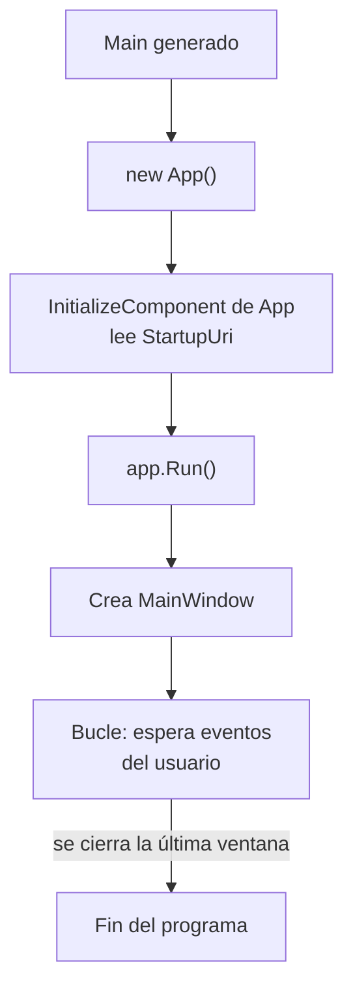
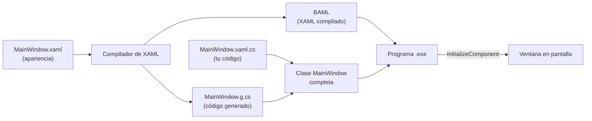
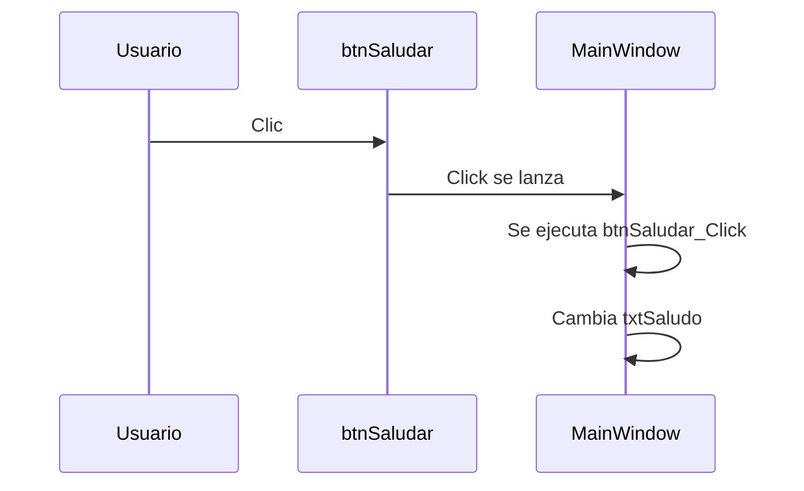
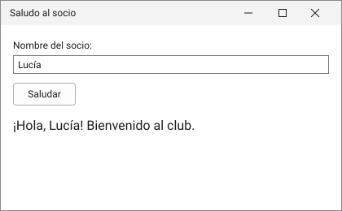

# 2. Tu primera aplicación WPF con el editor visual

[⬅️ Volver a la unidad](./README.md)

**CE que trabaja este tema:** RA1 b, e.

## Índice

- [2.1. Qué es WPF](#21-qué-es-wpf)
- [2.2. Crear el proyecto](#22-crear-el-proyecto)
- [2.3. Qué contiene el proyecto](#23-qué-contiene-el-proyecto)
  - [2.3.1. El fichero del proyecto](#231-el-fichero-del-proyecto)
  - [2.3.2. Los ficheros de la aplicación y de la ventana](#232-los-ficheros-de-la-aplicación-y-de-la-ventana)
- [2.4. Cómo arranca la aplicación](#24-cómo-arranca-la-aplicación)
- [2.5. XAML y C#: una clase en dos ficheros](#25-xaml-y-c-una-clase-en-dos-ficheros)
  - [2.5.1. Clase parcial e `InitializeComponent`](#251-clase-parcial-e-initializecomponent)
  - [2.5.2. Qué hay en la cabecera de un XAML](#252-qué-hay-en-la-cabecera-de-un-xaml)
- [2.6. El editor visual](#26-el-editor-visual)
  - [2.6.1. Las ventanas que necesitas](#261-las-ventanas-que-necesitas)
  - [2.6.2. Arrastrar un control: qué genera el diseñador](#262-arrastrar-un-control-qué-genera-el-diseñador)
  - [2.6.3. Cambiar propiedades](#263-cambiar-propiedades)
- [2.7. Leer lo que genera el editor](#27-leer-lo-que-genera-el-editor)
- [2.8. Darle vida: un evento](#28-darle-vida-un-evento)
- [2.9. Ejemplo integrador: saludo al socio](#29-ejemplo-integrador-saludo-al-socio)
- [2.10. Ejecutar, depurar y recargar](#210-ejecutar-depurar-y-recargar)
- [2.11. Errores frecuentes](#211-errores-frecuentes)
- [Resumen](#resumen)
- [Ejercicios de reflexión](#ejercicios-de-reflexión)

---

## 2.1. Qué es WPF

**WPF** (*Windows Presentation Foundation*) es la biblioteca de interfaces gráficas de .NET para Windows que ya conoces del tema anterior. Apareció en 2006 con .NET Framework 3.0 y hoy forma parte de .NET: se instala con la carga de trabajo «Desarrollo de escritorio de .NET» de Visual Studio.

Tres ideas la definen:

- **Interfaz descrita en XAML.** La ventana está en un fichero con extensión `.xaml`, y el comportamiento, en un fichero de C#.
- **Gráficos vectoriales.** Todo se dibuja como formas, no como imágenes de píxeles fijos, así que se ve nítido a cualquier tamaño y en cualquier pantalla.
- **Controles que se pueden recomponer.** Un botón puede contener un texto, una imagen o varios controles a la vez, y su aspecto se puede cambiar por completo sin tocar su código.

Una aplicación WPF **es un programa de C# normal**: tiene clases, propiedades y eventos como los de la unidad anterior. Lo único que cambia es que, en lugar de escribir en la consola, **crea objetos de ventana y de controles** y reacciona a sus eventos.

| En la unidad anterior | En WPF |
|-----------------------|--------|
| `Console.WriteLine(texto)` | Asignar `Text` a un control |
| `Console.ReadLine()` | Leer la propiedad `Text` de un `TextBox` |
| Un programa que termina | Un programa que **espera** eventos hasta que se cierre la ventana |
| El método `Main` | Lo genera el compilador (apartado 2.4) |

> 📝 **Nota del Profesor**: la gran diferencia con la consola es que **tú no decides el orden** en que pasan las cosas. El usuario pulsa un botón, escribe en una caja, cierra la ventana… y tu código reacciona. A esto se le llama **programación dirigida por eventos**.

---

## 2.2. Crear el proyecto

En Visual Studio 2026 (en español):

1. `Archivo > Nuevo > Proyecto` (`Ctrl+Mayús+N`).
2. En el buscador de plantillas escribe `WPF` y elige **Aplicación WPF** (la de **C#** que **no** dice «.NET Framework»). Pulsa **Siguiente**.
3. **Nombre del proyecto:** `SaludoSocio`. **Ubicación:** la carpeta del repositorio de la unidad en tu equipo. Pulsa **Siguiente**.
4. En la pantalla de información adicional, elige la versión **LTS vigente de .NET** (la que indique tu profesor). Pulsa **Crear**.

Visual Studio crea el proyecto y abre `MainWindow.xaml` en el diseñador.

> ⚠️ **Cuidado**: hay dos plantillas casi iguales. «Aplicación WPF» crea un proyecto para **.NET moderno**. «Aplicación WPF (.NET Framework)» crea uno para la versión antigua de Windows, con un fichero de proyecto distinto y sin los *implicit usings*. En este módulo siempre se usa la primera.

> ✅ **Buena práctica**: crea los proyectos **dentro de la carpeta del repositorio**, y no en el escritorio. El `.gitignore` de la raíz ya excluye `bin/`, `obj/` y `.vs/`, así que lo que subas al repositorio será solo tu código.

---

## 2.3. Qué contiene el proyecto

En el **Explorador de soluciones** (`Ver > Explorador de soluciones`, `Ctrl+Alt+L`) verás algo como esto:

```text
SaludoSocio/
├── Dependencias/            ← paquetes y bibliotecas que usa el proyecto (se ven en el IDE)
├── App.xaml                 ← la aplicación (recursos, ventana de inicio)
│   └── App.xaml.cs
├── AssemblyInfo.cs          ← información del ensamblado (apenas lo tocarás)
├── MainWindow.xaml          ← la ventana principal (su apariencia)
│   └── MainWindow.xaml.cs   ← el código de la ventana (code-behind)
└── SaludoSocio.csproj       ← el fichero del proyecto (se ve con doble clic)
```

Los ficheros `.xaml.cs` aparecen **colgando** de su `.xaml` en el Explorador de soluciones, porque pertenecen a la misma ventana.

### 2.3.1. El fichero del proyecto

Haz doble clic en el nombre del proyecto (o `Clic derecho > Editar archivo de proyecto`). Es un XML breve:

```xml
<Project Sdk="Microsoft.NET.Sdk">

  <PropertyGroup>
    <OutputType>WinExe</OutputType>
    <TargetFramework>net10.0-windows</TargetFramework>
    <Nullable>enable</Nullable>
    <ImplicitUsings>enable</ImplicitUsings>
    <UseWPF>true</UseWPF>
  </PropertyGroup>

</Project>
```

| Línea | Qué significa |
|-------|---------------|
| `OutputType` = `WinExe` | Es un programa de **ventanas**. Una aplicación de consola usa `Exe`; la diferencia es que `WinExe` no abre una consola al ejecutarla |
| `TargetFramework` = `net10.0-windows` | Se compila para .NET y **solo para Windows**. El sufijo `-windows` da acceso a las bibliotecas de Windows (entre ellas, WPF) |
| `Nullable` e `ImplicitUsings` | Los mismos de la unidad anterior |
| `UseWPF` = `true` | **Añade WPF al proyecto**: referencias, compilación de XAML y espacios de nombres |

> 🔁 **Transferencia**: en WinForms la propiedad equivalente es `UseWindowsForms`. Si cambias `UseWPF` a `false`, el proyecto deja de compilar los ficheros XAML.

### 2.3.2. Los ficheros de la aplicación y de la ventana

| Fichero | Contiene | Lo editarás… |
|---------|----------|--------------|
| `App.xaml` | La clase `App` (la aplicación): ventana de inicio y recursos compartidos | A veces (estilos, tema, ventana inicial) |
| `App.xaml.cs` | El código de `App`: normalmente vacío | Casi nunca al principio |
| `MainWindow.xaml` | La **apariencia** de la ventana principal | **Constantemente** |
| `MainWindow.xaml.cs` | El **comportamiento** de la ventana: manejadores de eventos | **Constantemente** |
| `AssemblyInfo.cs` | Dónde buscar los recursos de tema | Nunca |

A `MainWindow.xaml.cs` se le llama ***code-behind*** («código detrás»): es el código que hay «detrás» de la ventana. Tiene este aspecto al crear el proyecto, una vez quitados los `using` que no se usan:

```csharp
using System.Windows;

namespace SaludoSocio;

/// <summary>
/// Lógica de interacción para MainWindow.xaml
/// </summary>
public partial class MainWindow : Window
{
    public MainWindow()
    {
        InitializeComponent();
    }
}
```

La plantilla de Visual Studio añade bastantes `using` que no se usan (`System.Text`, `System.Windows.Data`…). Puedes quitarlos con la acción rápida (`Ctrl+.` sobre el aviso) o dejarlos: no afectan al funcionamiento.

---

## 2.4. Cómo arranca la aplicación

Cuando ejecutas un programa de consola, empieza por `Main`. En WPF también, pero **no lo escribes tú**: el compilador lo genera a partir de `App.xaml`.

```xml
<Application x:Class="SaludoSocio.App"
             xmlns="http://schemas.microsoft.com/winfx/2006/xaml/presentation"
             xmlns:x="http://schemas.microsoft.com/winfx/2006/xaml"
             xmlns:local="clr-namespace:SaludoSocio"
             StartupUri="MainWindow.xaml">
    <Application.Resources>

    </Application.Resources>
</Application>
```

La propiedad clave es `StartupUri="MainWindow.xaml"`: indica **qué ventana se abre al arrancar**. El compilador genera, en un fichero oculto, algo equivalente a esto:

```csharp
// Código generado (no lo escribes tú)
[System.STAThread]
public static void Main()
{
    var app = new SaludoSocio.App();
    app.InitializeComponent();   // aplica StartupUri y los recursos
    app.Run();                    // abre la ventana y espera eventos
}
```

`app.Run()` **no termina** hasta que se cierra la última ventana. Mientras tanto, WPF escucha el ratón y el teclado y lanza los eventos.



> 💡 **Tip del Examinador**: *«¿Dónde está el método `Main` de una aplicación WPF?»* Lo genera el compilador a partir de `App.xaml`; no aparece en tus ficheros. Si quieres controlar el arranque (por ejemplo, abrir una ventana de inicio de sesión primero), puedes quitar `StartupUri` y abrir la ventana desde código en `OnStartup`.

---

## 2.5. XAML y C#: una clase en dos ficheros

### 2.5.1. Clase parcial e `InitializeComponent`

Abre `MainWindow.xaml`:

```xml
<Window x:Class="SaludoSocio.MainWindow"
        xmlns="http://schemas.microsoft.com/winfx/2006/xaml/presentation"
        xmlns:x="http://schemas.microsoft.com/winfx/2006/xaml"
        xmlns:d="http://schemas.microsoft.com/expression/blend/2008"
        xmlns:mc="http://schemas.openxmlformats.org/markup-compatibility/2006"
        xmlns:local="clr-namespace:SaludoSocio"
        mc:Ignorable="d"
        Title="MainWindow"
        Height="450"
        Width="800">
    <Grid>

    </Grid>
</Window>
```

La primera línea es la más importante: `x:Class="SaludoSocio.MainWindow"`. Dice que **este XAML describe la clase `SaludoSocio.MainWindow`**. Y esa clase, en `MainWindow.xaml.cs`, se declara como `partial`. Son **dos mitades de la misma clase**:

| Mitad | Fichero | La escribe |
|-------|---------|------------|
| Apariencia: controles, nombres y enlaces a eventos | `MainWindow.xaml` | Tú (con el diseñador o a mano) |
| Comportamiento: manejadores de eventos | `MainWindow.xaml.cs` | Tú |
| Pegamento: campos de los controles con nombre, `InitializeComponent` | `MainWindow.g.cs` (en `obj/`) | **El compilador** |

La clase parcial ya la conoces de la unidad anterior; aquí es donde se usa de verdad.

El compilador convierte el XAML en un formato binario (**BAML**) que se incrusta en el programa, y genera el tercer fichero, `MainWindow.g.cs`. En él, `InitializeComponent` carga ese XAML compilado y crea los controles:

```csharp
// Código generado en obj/ (resumido; no lo edites)
public partial class MainWindow : System.Windows.Window, System.Windows.Markup.IComponentConnector
{
    private bool _contentLoaded;

    public void InitializeComponent()
    {
        if (_contentLoaded)
        {
            return;
        }
        _contentLoaded = true;
        var resourceLocater = new System.Uri("/SaludoSocio;component/mainwindow.xaml", System.UriKind.Relative);
        System.Windows.Application.LoadComponent(this, resourceLocater);
    }
}
```

Por eso el constructor de tu ventana **tiene que llamar a `InitializeComponent()`**: sin esa llamada, la ventana se abre vacía. El diagrama resume el proceso.



> ⚠️ **Cuidado**: los ficheros `.g.cs` son **generados**. Si los modificas, el compilador los vuelve a escribir y pierdes los cambios. Tampoco los verás en el Explorador de soluciones (están en `obj/`). Todo lo que quieras cambiar, cámbialo en tu `.xaml` o en tu `.xaml.cs`.

### 2.5.2. Qué hay en la cabecera de un XAML

Las líneas `xmlns` (*XML namespaces*) indican **de dónde salen los nombres** que usas en el documento. Equivalen a los `using` de C#:

| Declaración | Para qué sirve |
|-------------|----------------|
| `xmlns="…/presentation"` | El espacio de nombres **por defecto**: `Window`, `Button`, `TextBox`, `Grid`… |
| `xmlns:x="…/xaml"` | Palabras propias de XAML con prefijo `x:`: `x:Class`, `x:Name`, `x:Key` |
| `xmlns:d` y `mc:Ignorable="d"` | Atributos que **solo usa el diseñador** (por ejemplo, datos de ejemplo). En la ejecución se ignoran |
| `xmlns:local="clr-namespace:…"` | Para usar **tus propias clases** en el XAML con el prefijo `local:` |

Las direcciones que empiezan por `http://schemas.microsoft.com/…` **no son páginas web**: son identificadores que el compilador reconoce. No hay que abrirlas ni cambiarlas.

> 📝 **Nota del Profesor**: de momento solo necesitas recordar `x:Class` (enlaza el XAML con su clase) y `x:Name` (da nombre a un control para usarlo desde C#). El resto de la cabecera la escribe Visual Studio.

---

## 2.6. El editor visual

### 2.6.1. Las ventanas que necesitas

El **diseñador XAML** de Visual Studio muestra, por defecto, la ventana arriba y el código XAML abajo (**vista dividida**). Puedes cambiar la disposición con los botones de la esquina inferior del diseñador (solo diseño, solo XAML o dividida) y alternar entre vertical y horizontal.

| Herramienta | Menú | Para qué |
|-------------|------|----------|
| **Cuadro de herramientas** | `Ver > Cuadro de herramientas` | Lista de controles para **arrastrar** a la ventana |
| **Propiedades** | `Ver > Ventana Propiedades` (`F4`) | Ver y cambiar las **propiedades** del control seleccionado, y asociar **eventos** (pestaña con un rayo) |
| **Esquema del documento** | `Ver > Otras ventanas > Esquema del documento` | El **árbol de controles** de la ventana, para seleccionar uno aunque esté tapado |
| **Explorador de soluciones** | `Ver > Explorador de soluciones` | Los ficheros del proyecto |

> ✅ **Buena práctica**: trabaja con **la vista dividida**. Cada vez que cambies algo en el diseñador, mira qué ha cambiado en el XAML. Es la forma más rápida de aprender XAML y de detectar cosas que no esperabas.

### 2.6.2. Arrastrar un control: qué genera el diseñador

Prueba lo siguiente con un proyecto nuevo:

1. Abre el **Cuadro de herramientas** y, en *Controles WPF comunes*, arrastra un **Button** sobre la ventana, hacia la esquina superior izquierda.
2. Mira el XAML. Dentro del `<Grid>` ha aparecido algo como:

```xml
<Button Content="Button"
        HorizontalAlignment="Left"
        Margin="52,41,0,0"
        VerticalAlignment="Top"
        Width="75"
        Height="23" />
```

3. Arrastra el botón unos píxeles a la derecha y mira cómo cambia **`Margin`** (los cuatro números son los márgenes izquierdo, superior, derecho e inferior).

Qué ha hecho el diseñador:

| Atributo | Qué hace |
|----------|----------|
| `Content="Button"` | El texto del botón |
| `HorizontalAlignment="Left"` y `VerticalAlignment="Top"` | Lo **ancla** a la esquina superior izquierda del contenedor |
| `Margin="52,41,0,0"` | Lo separa 52 por la izquierda y 41 por arriba. **Es lo que coloca el botón** |
| `Width` y `Height` | Tamaño fijo |

> ⚠️ **Cuidado**: colocar los controles arrastrándolos genera **márgenes con valores absolutos**, y la ventana no se adapta bien si cambia de tamaño. El diseñador es cómodo para empezar, pero los paneles de distribución (`Grid`, `StackPanel`…) hacen mucho mejor ese trabajo. Los verás en el tema 4; el ejemplo de este tema los usa ya, de forma sencilla.

### 2.6.3. Cambiar propiedades

Selecciona el botón y mira la ventana **Propiedades**. Cambia el texto de `Content` por «Guardar» y el nombre (campo `Name` en la parte superior) por `btnGuardar`. En el XAML verás:

```xml
<Button x:Name="btnGuardar"
        Content="Guardar"
        HorizontalAlignment="Left"
        Margin="52,41,0,0"
        VerticalAlignment="Top"
        Width="75"
        Height="23" />
```

El diseñador y el XAML son **dos vistas del mismo documento**: lo que cambias en uno se ve en el otro. Puedes escribir directamente en el XAML y el diseñador se actualiza.

**Nombres de los controles.** `x:Name` da un nombre al control y el compilador genera un **campo** con ese nombre en `MainWindow`, para poder usarlo desde C# (`btnGuardar.Content = "Hecho"`). En este módulo los nombres llevan un prefijo en minúsculas que indica el tipo de control, y después el nombre en `PascalCase`:

| Prefijo | Control | Ejemplo |
|---------|---------|---------|
| `txt` | `TextBox` y `TextBlock` | `txtNombre`, `txtSaludo` |
| `btn` | `Button` | `btnGuardar` |
| `lst` | `ListBox` | `lstSocios` |
| `cmb` | `ComboBox` | `cmbCategoria` |
| `chk` | `CheckBox` | `chkActivo` |
| `dtp` | `DatePicker` | `dtpFecha` |

> ✅ **Buena práctica**: **solo pongas nombre a los controles a los que tu código necesite acceder**. Un `TextBlock` fijo de «Nombre:» no necesita nombre. Más adelante, con MVVM, casi ningún control tendrá.

---

## 2.7. Leer lo que genera el editor

Una competencia clave de esta unidad es **analizar el código que genera la herramienta** y, cuando haga falta, modificarlo. Lee un XAML de arriba abajo como lo haría el compilador:

```xml
<Window x:Class="SaludoSocio.MainWindow"
        …
        Title="Saludo al socio"
        Height="260"
        Width="420">
    <StackPanel Margin="16">
        <TextBlock Text="Nombre del socio:" />
        <TextBox x:Name="txtNombre"
                 Margin="0,4,0,12" />
        <Button x:Name="btnSaludar"
                Content="Saludar"
                Click="btnSaludar_Click" />
    </StackPanel>
</Window>
```

| Pregunta | Dónde se ve |
|----------|-------------|
| ¿De qué clase es esta ventana? | `x:Class="SaludoSocio.MainWindow"` |
| ¿Qué título tiene y qué tamaño? | `Title`, `Height` y `Width` en la etiqueta `Window` |
| ¿Cuáles son sus controles? | Los **elementos hijos** de `Window` |
| ¿Cómo están ordenados? | El contenedor: aquí, `StackPanel` (los apila de arriba abajo) |
| ¿Qué controles puede tocar el código? | Los que tienen `x:Name` |
| ¿Qué pasa al pulsar el botón? | El atributo `Click` apunta al método `btnSaludar_Click` |

**Reglas para leer XAML:**

- Cada **elemento** (`Button`, `TextBox`) es un **objeto** que se crea.
- Cada **atributo** (`Content`, `Margin`) es una **propiedad** que se asigna.
- Los elementos **anidados** son los hijos: la jerarquía del XML es la jerarquía de controles.
- Un atributo con el nombre de un **evento** (`Click`) enlaza ese evento con un método de la clase.

> 💡 **Tip del Examinador**: una pregunta típica es *«¿qué hace este XAML?»* con un fragmento de unas diez líneas. Respóndela recorriendo estas cuatro preguntas: qué clase, qué controles, cómo están ordenados y qué eventos tienen.

---

## 2.8. Darle vida: un evento

Un botón sin acción no sirve para nada. Hay tres formas de enlazar su evento `Click` con un método:

1. **Doble clic en el control** en el diseñador. Visual Studio añade en el XAML `Click="btnSaludar_Click"` y crea en el *code-behind* un método vacío con ese nombre.
2. **Pestaña de eventos** de la ventana Propiedades (el icono del rayo): escribes el nombre del método a la derecha de `Click` o haces doble clic para que cree uno.
3. **A mano:** escribes el atributo en el XAML y el método en el C#.

El método que crea Visual Studio tiene esta forma:

```csharp
private void btnSaludar_Click(object sender, RoutedEventArgs e)
{
    // aquí va tu código
}
```

Es un **manejador de eventos** (*event handler*) con la firma que ya conoces de la unidad anterior: `object sender` es el control que lanzó el evento y `RoutedEventArgs e` lleva información del evento. El nombre sigue el patrón `<nombreDelControl>_<Evento>`.



La unión entre el atributo `Click="btnSaludar_Click"` y el método **la hace el compilador** al generar `MainWindow.g.cs`: es el equivalente a escribir `btnSaludar.Click += btnSaludar_Click;` en el constructor. Por eso, si el nombre del XAML y el del método no coinciden, el proyecto **no compila**.

> 🔁 **Transferencia**: es el mismo mecanismo de la unidad anterior: un evento, un manejador y una suscripción con `+=`. Aquí el XAML te evita escribir la suscripción. Más adelante (tema 10) verás que existe una forma mejor de reaccionar a un botón: los **comandos**.

---

## 2.9. Ejemplo integrador: saludo al socio

Vamos a construir una ventana que pida el nombre de un socio y lo salude. Proyecto: `SaludoSocio`. El código completo está en la carpeta [`ejemplos/02-SaludoSocio`](./ejemplos/02-SaludoSocio).

**Paso 1. Cambia los datos de la ventana.** En el XAML de la ventana, cambia `Title` por `Saludo al socio`, `Height` por `260` y `Width` por `420`.

**Paso 2. Sustituye el `Grid` por un `StackPanel`.** Un `StackPanel` apila sus hijos de arriba abajo, con lo que no tienes que calcular posiciones. Ponle `Margin="16"` para separar el contenido del borde.

**Paso 3. Añade los controles** arrastrándolos al diseñador, o escribiéndolos en el XAML, dentro del `StackPanel`:

```xml
<StackPanel Margin="16">
    <TextBlock Text="Nombre del socio:" />
    <TextBox x:Name="txtNombre"
             Margin="0,4,0,12" />
    <Button x:Name="btnSaludar"
            Content="Saludar"
            Padding="16,4"
            HorizontalAlignment="Left"
            Click="btnSaludar_Click" />
    <TextBlock x:Name="txtSaludo"
               Margin="0,16,0,0"
               FontSize="16" />
</StackPanel>
```

Tres controles tienen nombre porque el código los necesita: `txtNombre` (para **leer** lo que escribe el usuario), `btnSaludar` (porque tiene el evento) y `txtSaludo` (para **escribir** el resultado). El `TextBlock` de la etiqueta no necesita nombre.

**Paso 4. Escribe el manejador** en `MainWindow.xaml.cs`:

```csharp
private void btnSaludar_Click(object sender, RoutedEventArgs e)
{
    var nombre = txtNombre.Text.Trim();

    txtSaludo.Text = nombre.Length == 0
        ? "Escribe primero un nombre."
        : $"¡Hola, {nombre}! Bienvenido al club.";
}
```

Es C# de la unidad anterior: lee una propiedad (`Text`), la procesa (`Trim()`) y asigna otra. Los controles son objetos con propiedades.

**Paso 5. Ejecuta** con `F5`. Escribe «Lucía» y pulsa **Saludar**:

<!-- captura recreada: sustituir -->


| Acción del usuario | Resultado en `txtSaludo` |
|--------------------|--------------------------|
| Pulsa **Saludar** con la caja vacía | `Escribe primero un nombre.` |
| Escribe `Lucía` y pulsa **Saludar** | `¡Hola, Lucía! Bienvenido al club.` |
| Escribe `   Lucía   ` (con espacios) y pulsa **Saludar** | `¡Hola, Lucía! Bienvenido al club.` |

**Actividad.** Cambia el programa para que, además, muestre en `txtSaludo` cuántos caracteres tiene el nombre («Tu nombre tiene 5 letras»). ¿Qué propiedad de `string` usas? ¿En qué línea del manejador lo añades?

---

## 2.10. Ejecutar, depurar y recargar

| Acción | Menú | Atajo | Qué hace |
|--------|------|-------|----------|
| **Iniciar depuración** | `Depurar > Iniciar depuración` | `F5` | Compila, ejecuta y permite parar en puntos de interrupción |
| **Iniciar sin depurar** | `Depurar > Iniciar sin depurar` | `Ctrl+F5` | Compila y ejecuta sin depurador (arranca antes) |
| **Detener** | `Depurar > Detener depuración` | `Mayús+F5` | Cierra la aplicación |

Mientras la aplicación se ejecuta **con depuración** (`F5`), puedes modificar el XAML y ver el cambio al instante, sin cerrar la aplicación ni volver a compilar. Es la **Recarga activa de XAML** (*XAML Hot Reload*). Pruébalo: con la ventana abierta, cambia en el XAML el `FontSize` del saludo de `16` a `24` y guarda (`Ctrl+S`): la ventana se actualiza.

Un **punto de interrupción** en la primera línea del manejador (clic en el margen izquierdo del editor, o `F9`) detiene el programa cuando pulses el botón. Así puedes ver el valor de `nombre` antes de que se asigne `txtSaludo`. Ya lo practicaste con el depurador de la unidad anterior; aquí funciona igual.

> ✅ **Buena práctica**: usa `F5` mientras desarrollas y la Recarga activa para ajustar márgenes, tamaños y colores sin esperas. Ten presente que **la Recarga activa se ocupa del XAML**: los cambios en el código C# tienen más límites y, si no se aplican, hay que detener y volver a ejecutar.

---

## 2.11. Errores frecuentes

| Síntoma | Causa habitual | Solución |
|---------|----------------|----------|
| Error de compilación diciendo que `MainWindow` no contiene una definición del método `btnSaludar_Click` | El atributo `Click` del XAML apunta a un método que no existe o que se llama distinto | Crea el método con **exactamente** ese nombre y la firma `(object sender, RoutedEventArgs e)` |
| La ventana se abre **vacía** o falla al arrancar | Falta la llamada a `InitializeComponent()` en el constructor, o se ha cambiado `x:Class` y ya no coincide con la clase de C# | Restablece la llamada o haz coincidir `x:Class` con `namespace` y nombre de la clase |
| Error por un **nombre duplicado** (`x:Name` repetido) | Dos controles con el mismo nombre en la misma ventana | Cambia uno de los nombres |
| `NullReferenceException` al usar un control en el constructor, antes de `InitializeComponent()` | Los controles se crean dentro de `InitializeComponent()`, así que antes valen `null` | Usa los controles **después** de esa llamada |
| Al ejecutar, **no se abre ninguna ventana** | `StartupUri` apunta a un fichero que no existe, o falta en `App.xaml` | Corrige el nombre o abre la ventana desde código |
| Mis cambios en un fichero `.g.cs` han desaparecido | Es un fichero generado por el compilador | Haz el cambio en el `.xaml` o en el `.xaml.cs` |
| En el diseñador aparece un error y no se ve la ventana | Un error de sintaxis en el XAML (etiqueta sin cerrar, atributo mal escrito) | Mira la **Lista de errores** y el subrayado en el XAML |
| El proyecto creado no compila al abrirlo en otro equipo | Falta la carga de trabajo «Desarrollo de escritorio de .NET» | Ábrela desde el **Instalador de Visual Studio** |

> ⚠️ **Cuidado**: no pegues código de ejemplos de internet que mencionen `Application.Current.MainWindow.Show()` o `new MainWindow().Show()` en `App.xaml.cs` **sin quitar `StartupUri`**. Si haces las dos cosas, la ventana se abre dos veces.

---

## Resumen

- WPF es la biblioteca de interfaces gráficas de .NET para Windows. Una aplicación WPF es un programa de C# que **espera eventos**.
- El proyecto se crea con la plantilla **Aplicación WPF** (no la de .NET Framework). Su fichero `.csproj` lleva `OutputType` = `WinExe`, `TargetFramework` = `net10.0-windows` (con sufijo `-windows`) y `UseWPF` = `true`.
- `App.xaml` define la aplicación y su ventana de inicio (`StartupUri`). El método `Main` lo genera el compilador.
- Cada ventana es **una clase en dos ficheros**: el `.xaml` (apariencia) y el `.xaml.cs` (*code-behind*, comportamiento), unidos por `x:Class` y una clase `partial`.
- `InitializeComponent()` carga el XAML compilado y crea los controles. **Debe llamarse en el constructor**. Los ficheros `.g.cs` se generan y no se editan.
- El **editor visual** tiene el Cuadro de herramientas, la ventana Propiedades y el Esquema del documento. Al arrastrar un control, genera XAML (con `Margin` y alineaciones), que se puede leer y editar a mano.
- `x:Name` da nombre a un control para usarlo desde C#. En este módulo, con prefijo (`txtNombre`, `btnSaludar`), y solo si el código lo necesita.
- Un atributo `Click="…"` enlaza el evento con un método del *code-behind*. El nombre y la firma deben coincidir o el proyecto no compila.
- Se ejecuta con `F5` (con depurador) o `Ctrl+F5`, y la **Recarga activa de XAML** aplica cambios del XAML sin reiniciar.

---

## Ejercicios de reflexión

1. En el ejemplo, ¿por qué `txtSaludo` tiene `x:Name` y el `TextBlock` de «Nombre del socio:» no? ¿Qué cambiaría si lo nombraras?
2. Quita la llamada `InitializeComponent();` del constructor de `MainWindow` y ejecuta. ¿Qué ocurre y por qué? Explícalo con lo que hace ese método.
3. Cambia el nombre del método `btnSaludar_Click` en el C# (sin tocar el XAML) y compila. ¿Qué error aparece y dónde? ¿Qué parte del compilador lo detecta?
4. Abre la carpeta `obj/Debug/net10.0-windows` de un proyecto compilado y busca `MainWindow.g.cs`. Localiza `InitializeComponent`. ¿Qué dos cosas hace que no hayas escrito tú?
5. Arrastra tres botones al diseñador sin usar ningún contenedor. Mira los `Margin` que genera el diseñador. ¿Qué pasaría si el usuario maximiza la ventana? ¿Y si cambia el idioma y los textos son más largos?

---

[⬅️ Volver a la unidad](./README.md)
