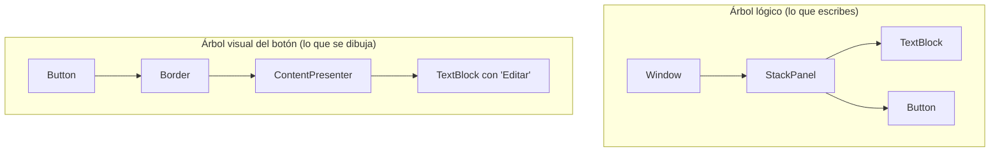
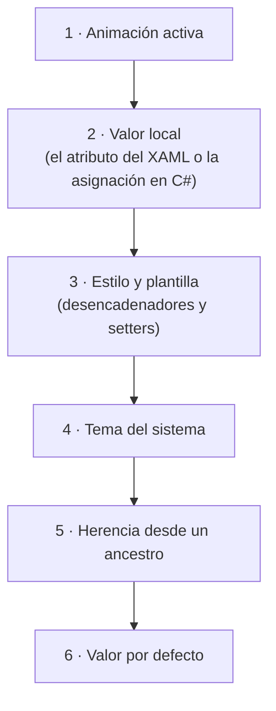

# 3. XAML: describir la interfaz

[⬅️ Volver a la unidad](./README.md)

**CE que trabaja este tema:** RA1 e, f.

## Índice

- [3.1. XAML es XML que crea objetos](#31-xaml-es-xml-que-crea-objetos)
- [3.2. Formas de dar valor a una propiedad](#32-formas-de-dar-valor-a-una-propiedad)
  - [3.2.1. Como atributo y conversores de tipo](#321-como-atributo-y-conversores-de-tipo)
  - [3.2.2. Como elemento de propiedad](#322-como-elemento-de-propiedad)
  - [3.2.3. Como contenido](#323-como-contenido)
- [3.3. Extensiones de marcado](#33-extensiones-de-marcado)
- [3.4. Espacios de nombres](#34-espacios-de-nombres)
- [3.5. Árbol lógico y árbol visual](#35-árbol-lógico-y-árbol-visual)
- [3.6. Propiedades de dependencia](#36-propiedades-de-dependencia)
  - [3.6.1. Por qué existen](#361-por-qué-existen)
  - [3.6.2. De dónde sale el valor de una propiedad](#362-de-dónde-sale-el-valor-de-una-propiedad)
  - [3.6.3. Propiedades adjuntas](#363-propiedades-adjuntas)
- [3.7. Modificar a mano lo que genera el diseñador](#37-modificar-a-mano-lo-que-genera-el-diseñador)
  - [3.7.1. Un antes y un después](#371-un-antes-y-un-después)
  - [3.7.2. Ayudas del editor de XAML](#372-ayudas-del-editor-de-xaml)
  - [3.7.3. Formato del XAML](#373-formato-del-xaml)
- [3.8. Ejemplo integrador: la ficha de un socio](#38-ejemplo-integrador-la-ficha-de-un-socio)
- [3.9. Errores frecuentes](#39-errores-frecuentes)
- [Resumen](#resumen)
- [Ejercicios de reflexión](#ejercicios-de-reflexión)

---

## 3.1. XAML es XML que crea objetos

En el tema anterior leíste XAML sin conocer sus reglas. Ahora las vas a conocer, porque los criterios de esta unidad piden **analizar** y **modificar** el código que genera el editor.

La idea central cabe en una frase:

> **Cada elemento de un XAML es un objeto que se crea, y cada atributo es una propiedad que se asigna.**

Estas dos formas de crear un botón hacen exactamente lo mismo:

```xml
<Button Content="Guardar"
        Width="120" />
```

```csharp
var boton = new Button();
boton.Content = "Guardar";
boton.Width = 120;
```

El segundo fragmento es C# de la unidad anterior. El primero es la versión **declarativa**: dices cómo es el objeto y WPF lo crea. Por eso se pueden cambiar propiedades en el XAML sin escribir una línea de C#.

| XAML | Equivale en C# a |
|------|------------------|
| `<Button>` | `new Button()` |
| `Content="Guardar"` | `boton.Content = "Guardar";` |
| Un elemento dentro de otro | Añadirlo como hijo o como contenido |
| `Click="btnGuardar_Click"` | `boton.Click += btnGuardar_Click;` |
| `x:Name="btnGuardar"` | Un campo `btnGuardar` en la clase |

> 📝 **Nota del Profesor**: todo lo que se puede hacer en XAML se puede hacer en C#, pero **no al revés** (el XAML no tiene bucles ni condiciones). La regla práctica: la **estructura y la apariencia** van en XAML; la **lógica**, en C#.

---

## 3.2. Formas de dar valor a una propiedad

### 3.2.1. Como atributo y conversores de tipo

La forma más habitual es como **atributo**: el valor siempre se escribe como texto entre comillas.

```xml
<TextBlock Text="Socio: Lucía Pérez"
           FontSize="22"
           FontWeight="Bold"
           Foreground="DarkBlue"
           Margin="0,8,0,0"
           Visibility="Collapsed" />
```

Pero `Margin` no es un texto, es un objeto `Thickness`; `Foreground` es un `Brush`, y `FontWeight`, una estructura. ¿Cómo se convierte el texto en cada tipo? Lo hacen unos **conversores de tipo** (*type converters*) que WPF aplica por ti.

| Propiedad | Tipo | Valores válidos como texto |
|-----------|------|----------------------------|
| `Margin`, `Padding` | `Thickness` | `"8"` (los cuatro lados), `"16,4"` (horizontal, vertical) o `"0,8,0,0"` (izquierda, arriba, derecha, abajo) |
| `Foreground`, `Background` | `Brush` | Un nombre de color (`"Red"`), un valor hexadecimal `"#RRGGBB"` o `"#AARRGGBB"` con transparencia |
| `FontWeight` | `FontWeight` | `"Normal"`, `"SemiBold"`, `"Bold"`… |
| `Visibility` | Enumeración | `"Visible"`, `"Hidden"` o `"Collapsed"` |
| `Width`, `FontSize` | `double` | `"120"` o `"14.5"` (el separador decimal es siempre el punto) |
| `IsEnabled` | `bool` | `"True"` o `"False"` |

> ⚠️ **Cuidado**: los conversores solo funcionan en XAML. En C# **no existe** `new Thickness(16, 4)`: el constructor pide uno, o cuatro valores (`new Thickness(16, 4, 16, 4)`). Y los colores en C# se escriben como `Brushes.Red` o `new SolidColorBrush(Color.FromRgb(…))`. Si traduces XAML a C#, esto es lo primero que falla.

### 3.2.2. Como elemento de propiedad

Algunos valores son demasiado complejos para escribirlos como texto. Un degradado, por ejemplo, tiene dos colores, una dirección y unas posiciones. Para esos casos, la propiedad se escribe como un **elemento hijo** con la forma `Tipo.Propiedad`:

```xml
<Button Content="Editar">
    <Button.Background>
        <LinearGradientBrush StartPoint="0,0"
                             EndPoint="1,1">
            <GradientStop Color="#E3F2FD"
                          Offset="0" />
            <GradientStop Color="#90CAF9"
                          Offset="1" />
        </LinearGradientBrush>
    </Button.Background>
</Button>
```

`<Button.Background>` no crea un objeto `Background`: dice «**lo que hay dentro es el valor de la propiedad `Background` del botón**». A esto se le llama **sintaxis de elemento de propiedad** (*property element syntax*).

| Sintaxis | Cuándo se usa | Ejemplo |
|----------|---------------|---------|
| **Atributo** | El valor es simple (texto, número, color con nombre) | `Background="LightBlue"` |
| **Elemento de propiedad** | El valor es un objeto complejo con sus propias propiedades | `<Button.Background>…</Button.Background>` |

> ✅ **Buena práctica**: usa siempre el atributo cuando se pueda. El XAML será más corto y más fácil de leer.

### 3.2.3. Como contenido

Casi todos los elementos tienen una propiedad «principal» que se puede escribir **entre la etiqueta de apertura y la de cierre**, sin nombrarla. Es la **propiedad de contenido** (*content property*).

| Elemento | Su propiedad de contenido | Qué significa |
|----------|---------------------------|---------------|
| `Button`, `Label`, `Window` | `Content` | `<Button>Guardar</Button>` es igual que `<Button Content="Guardar" />` |
| `StackPanel`, `Grid` | `Children` | Los elementos que contiene son sus hijos |
| `TextBlock` | `Inlines` | El texto y los elementos `Run`, `Bold`, `Italic`… que lleva dentro |
| `ComboBox`, `ListBox` | `Items` | Los elementos de la lista |

```xml
<TextBlock>
    <Run Text="Cuota mensual: " />
    <Run Text="35,00 €"
         FontWeight="Bold" />
</TextBlock>
```

Aquí los dos `Run` van **dentro** del `TextBlock` y se añaden a su colección `Inlines` sin escribir `<TextBlock.Inlines>`. Gracias a ello se mezclan en una misma línea fragmentos con formato distinto.

---

## 3.3. Extensiones de marcado

Cuando un valor no es un texto fijo sino que **se calcula** o **se busca en otro sitio**, se escribe entre llaves `{ }`. Son las **extensiones de marcado** (*markup extensions*).

```xml
<TextBlock Text="{x:Static local:FichaClub.Nombre}" />
```

Esta línea no asigna el texto literal «x:Static…»: le dice a WPF «**busca el valor del miembro estático `Nombre` de la clase `FichaClub` y úsalo**». Las que vas a usar en esta unidad son:

| Extensión | Qué hace | Se estudia en |
|-----------|----------|---------------|
| `{x:Static clase.miembro}` | Toma el valor de una constante o miembro estático | Este tema |
| `{x:Null}` | Asigna `null` | Este tema |
| `{StaticResource clave}` | Busca un recurso por su clave **una vez**, al cargar | Tema 7 |
| `{DynamicResource clave}` | Busca un recurso y **reacciona si cambia** | Tema 7 |
| `{Binding ruta}` | Enlaza la propiedad a un dato: **enlace de datos** | Tema 9 |
| `{TemplateBinding …}` | Usada en plantillas de control | Más adelante |

Dentro de las llaves, el primer nombre es la extensión y el resto son sus parámetros (`{Binding Path=Nombre, Mode=TwoWay}`).

> ⚠️ **Cuidado**: si quieres escribir un texto que empiece por `{`, WPF lo toma por una extensión y falla. Se escapa poniendo `{}` delante: `Text="{}{No es una extensión}"`.

---

## 3.4. Espacios de nombres

Ya viste en el tema 2 que la cabecera de un XAML declara **espacios de nombres XML** (`xmlns`), que equivalen a los `using` de C#. Hay dos formas de usarlos:

- **Sin prefijo** (el principal): `xmlns="…/presentation"` da acceso a los controles de WPF, que se escriben sin prefijo (`Button`).
- **Con prefijo**: `xmlns:prefijo="…"` y, después, `prefijo:Nombre`.

| Prefijo | Declaración | Para qué sirve |
|---------|-------------|----------------|
| `x:` | `xmlns:x="http://schemas.microsoft.com/winfx/2006/xaml"` | Palabras propias de XAML: `x:Class`, `x:Name`, `x:Key`, `x:Static`, `x:Null`, `x:Type` |
| `local:` | `xmlns:local="clr-namespace:FichaSocio"` | **Tus propias clases**: las que están en el espacio de nombres de tu proyecto |
| `d:` y `mc:` | Los dos con direcciones de Microsoft | Atributos que **solo usa el diseñador** y se ignoran al ejecutar |

Para usar una clase de **otro ensamblado** (una biblioteca tuya, un paquete NuGet), la declaración añade el nombre del ensamblado:

```xml
xmlns:modelo="clr-namespace:Club.Modelo;assembly=Club.Modelo"
```

Con eso, `<modelo:Socio />` crea un objeto de la clase `Club.Modelo.Socio`. Lo usarás con la biblioteca del dominio del proyecto del curso.

> 💡 **Tip del Examinador**: *«¿Qué es `local:` en un XAML?»* Es el prefijo que el diseñador declara para los tipos de **tu propio proyecto**; sirve para poder usar tus clases (convertidores, controles, datos) en el XAML.

---

## 3.5. Árbol lógico y árbol visual

Como los elementos se anidan, un XAML forma un **árbol**. En WPF hay dos árboles.

**Árbol lógico:** lo que **escribiste**. La ventana, sus paneles y sus controles, tal como aparecen en el XAML.

**Árbol visual:** lo que se **dibuja**. Cada control se compone de otros más pequeños: un botón, por ejemplo, está formado por un borde y, dentro, el contenido y su texto.



Los nombres exactos de las piezas internas de un control **dependen del tema visual** de Windows; lo importante es la idea: un control es un conjunto de piezas más simples.

| | Árbol lógico | Árbol visual |
|---|--------------|--------------|
| Qué contiene | Tus elementos | Tus elementos **y** las piezas internas de cada control |
| Para qué sirve | Herencia de valores (`FontSize`), recursos, `DataContext` | Dibujar, medir, eventos de ratón (tema 6) |
| Dónde se ve | Esquema del documento | **Árbol visual activo** |

**Árbol visual activo** (*Live Visual Tree*): mientras depuras una aplicación con `F5`, abre `Depurar > Ventanas > Árbol visual activo`. Muestra el árbol visual real de la ventana en ejecución, y al seleccionar un nodo se resalta el control correspondiente y se ven sus propiedades. Es la herramienta para responder a «¿por qué mi control no se ve donde yo quiero?».

También se puede recorrer el árbol desde C# con `LogicalTreeHelper` y `VisualTreeHelper`:

```csharp
using System.Diagnostics;
using System.Windows;
using System.Windows.Media;

public static void MostrarArbolVisual(DependencyObject elemento, int nivel = 0)
{
    Debug.WriteLine($"{new string(' ', nivel * 2)}{elemento.GetType().Name}");

    for (var i = 0; i < VisualTreeHelper.GetChildrenCount(elemento); i++)
    {
        MostrarArbolVisual(VisualTreeHelper.GetChild(elemento, i), nivel + 1);
    }
}
```

> 🔁 **Transferencia**: es la misma idea que el DOM de una página web (el árbol de elementos HTML) y que la jerarquía de `View` en Android. Las herramientas de desarrollo del navegador (*Inspeccionar elemento*) hacen lo que el Árbol visual activo de Visual Studio.

---

## 3.6. Propiedades de dependencia

### 3.6.1. Por qué existen

En la unidad anterior viste las **propiedades** de C#: un campo privado con `get` y `set`. Las propiedades de los controles de WPF (`Width`, `FontSize`, `Background`, `Text`…) son algo más: son **propiedades de dependencia** (*dependency properties*).

Una propiedad normal guarda un valor. Una propiedad de dependencia **calcula** su valor a partir de varias fuentes y avisa cuando cambia. Eso permite cosas que una propiedad normal no puede:

- **Valor por defecto** definido una sola vez para todos los controles.
- **Herencia:** si pones `FontSize` en la ventana, todos los controles de dentro lo heredan.
- **Estilos y desencadenadores:** cambiar el valor según una condición («si el ratón está encima, letra más grande»).
- **Enlace de datos:** una propiedad puede **depender** de otra o de un dato (de ahí el nombre).
- **Animaciones** que cambian el valor con el tiempo.

Puedes ver cómo se declara una si, en Visual Studio, haces `F12` (*Ir a la definición*) sobre `FontSize`. Verás dos miembros:

```csharp
// En la clase Control (simplificado)
public static readonly DependencyProperty FontSizeProperty = …;   // el «registro» de la propiedad

public double FontSize                                             // la propiedad que usas
{
    get => (double)GetValue(FontSizeProperty);
    set => SetValue(FontSizeProperty, value);
}
```

La propiedad que usas (`FontSize`) es un envoltorio sobre un valor que guarda WPF (`FontSizeProperty`). Cuando escribes `FontSize="22"` en el XAML o `boton.FontSize = 22` en C#, **los dos van a parar al mismo sitio**.

> 📝 **Nota del Profesor**: de momento solo usas propiedades de dependencia que ya existen. En el tema 9 crearás una propia para entender cómo se enlazan los datos. Lo que debes retener ahora: casi todas las propiedades de un control son de dependencia, y por eso su valor puede venir de más sitios que de la línea donde lo escribiste.

### 3.6.2. De dónde sale el valor de una propiedad

Fíjate en esta ventana:

```xml
<Window FontSize="14">
    <StackPanel>
        <TextBlock Text="Normal" />
        <TextBlock Text="Grande" FontSize="22" />
    </StackPanel>
</Window>
```

El primer `TextBlock` **no declara** `FontSize`, pero se ve con tamaño 14. ¿De dónde lo saca? De su ancestro: `FontSize`, `FontFamily`, `FontWeight`, `Foreground` o `IsEnabled` son propiedades que **se heredan** por el árbol lógico. El segundo la declara y se queda con la suya.

Cuando varias fuentes dan valor a la misma propiedad, WPF aplica un **orden de prioridad**. Este es el orden simplificado, de mayor a menor:



Para ver el orden en acción, mira este botón que crece cuando pasas el ratón por encima:

```xml
<Button Content="Pasa el ratón"
        FontSize="14">
    <Button.Style>
        <Style TargetType="Button">
            <Style.Triggers>
                <Trigger Property="IsMouseOver"
                         Value="True">
                    <Setter Property="FontSize"
                            Value="24" />
                </Trigger>
            </Style.Triggers>
        </Style>
    </Button.Style>
</Button>
```

Funciona **solo si quitas** `FontSize="14"` del botón. Con él, el valor local (nivel 2) gana al estilo (nivel 3) y el desencadenador no tiene efecto. Es un error muy frecuente.

> ⚠️ **Cuidado**: si un estilo o un desencadenador «no hace nada», busca si la propiedad tiene **valor local** en el elemento. Ese valor se impone siempre que no haya una animación. Los estilos se estudian en el tema 7.

| Propiedad | ¿Se hereda? |
|-----------|-------------|
| `FontSize`, `FontFamily`, `FontWeight`, `FontStyle` | Sí |
| `Foreground` | Sí |
| `IsEnabled` | Sí (un panel deshabilitado deshabilita lo que contiene) |
| `DataContext` | Sí (tema 9) |
| `Background`, `Margin`, `Width` | **No** |

> 💡 **Tip del Examinador**: una pregunta típica es *«¿por qué un `TextBlock` dentro de una ventana con `FontSize="14"` tiene letra de 14 sin que se lo hayas puesto?»* Porque `FontSize` es una propiedad de dependencia que **se hereda** del elemento padre. Algunos controles, como los menús, usan en su lugar la fuente del sistema.

### 3.6.3. Propiedades adjuntas

Hay propiedades que **no pertenecen** al elemento donde se escriben. Se declaran en otra clase y se «adjuntan» al elemento. Se reconocen por el nombre en dos partes, `Clase.Propiedad`:

```xml
<Grid>
    <Button Content="Aceptar"
            Grid.Row="1"
            Grid.Column="0" />
</Grid>
```

`Grid.Row` no es una propiedad de `Button`: es una propiedad que **define `Grid`** y que cualquier hijo puede llevar. Así el `Grid` sabe en qué fila va cada hijo, aunque el botón no sepa nada de cuadrículas. Son las **propiedades adjuntas** (*attached properties*), un tipo de propiedad de dependencia.

Desde C# se asignan con un método estático:

```csharp
Grid.SetRow(boton, 1);
Grid.SetColumn(boton, 0);
```

Las que más usarás: `Grid.Row`, `Grid.Column`, `Grid.RowSpan`, `Grid.ColumnSpan`, `DockPanel.Dock` y `Canvas.Left`/`Canvas.Top` (tema 4), y `ToolTipService` (tema 5).

---

## 3.7. Modificar a mano lo que genera el diseñador

### 3.7.1. Un antes y un después

El diseñador es cómodo, pero genera un XAML que **conviene limpiar**. Este es el botón que obtuvimos en el tema 2 al arrastrarlo:

```xml
<Grid>
    <Button x:Name="btnGuardar"
            Content="Guardar"
            HorizontalAlignment="Left"
            Margin="52,41,0,0"
            VerticalAlignment="Top"
            Width="75"
            Height="23" />
</Grid>
```

Tiene tres problemas:

1. **`Margin="52,41,0,0"`** coloca el botón con píxeles absolutos. Si el contenedor cambia, el botón no se adapta.
2. **`Width` y `Height` fijos** (75 × 23). Si el texto es más largo (otro idioma, otra fuente), se corta.
3. **Alineaciones por defecto del diseñador** que no expresan una intención.

Lo corregimos a mano, poniéndolo dentro de un `StackPanel` (tema 4) y dejando que el botón se ajuste a su contenido:

```xml
<StackPanel Margin="16">
    <Button x:Name="btnGuardar"
            Content="Guardar"
            Padding="16,4"
            HorizontalAlignment="Left" />
</StackPanel>
```

| Cambio | Por qué |
|--------|---------|
| Quitar `Width` y `Height` | El botón mide lo que necesita su contenido |
| `Padding="16,4"` | El espacio **interior** da el aspecto de botón, en lugar de un tamaño fijo |
| `Margin` solo en el contenedor | Una separación única (múltiplo de 8) en lugar de coordenadas por control |
| Se conserva `x:Name` | Porque el código lo necesita |

Es exactamente lo que pide el criterio **f** («se ha modificado el código generado por el editor visual»): partir de lo que genera la herramienta y **adaptarlo** a lo que necesita la aplicación.

### 3.7.2. Ayudas del editor de XAML

El editor de texto de Visual Studio entiende XAML y te ayuda:

| Ayuda | Cómo usarla |
|-------|-------------|
| **IntelliSense** | Al escribir `<` o un atributo aparece la lista de elementos o propiedades válidos. `Ctrl+Espacio` la abre a mano |
| **Información rápida** | Pasa el ratón sobre un elemento o propiedad para ver su tipo y su descripción |
| **Ir a la definición** | `F12` sobre un elemento o una propiedad abre su definición |
| **Subrayado de errores** | Etiquetas sin cerrar, propiedades inexistentes, valores no válidos; el detalle está en la Lista de errores |
| **Generación del manejador** | Al escribir `Click=` aparece la opción `<Nuevo controlador de eventos>` que crea el método |
| **Comentarios** | `<!-- así se comenta -->`. `Ctrl+K, Ctrl+C` comenta la selección |

### 3.7.3. Formato del XAML

Visual Studio **no toma** el formato del XAML del `.editorconfig` como el de C#: se configura en `Herramientas > Opciones > Editor de texto > XAML > Formato`. Para que cada atributo vaya en su propia línea (la convención de este módulo cuando un elemento tiene más de dos atributos), en la sección **Espaciado** marca la opción de colocar cada atributo en una línea independiente. Después puedes aplicar el formato a un documento con `Ctrl+K, Ctrl+D`.

> ✅ **Buena práctica**: formatea el XAML antes de cada *commit*. Los cambios de formato mezclados con los de contenido hacen que una revisión de código sea imposible de leer.

---

## 3.8. Ejemplo integrador: la ficha de un socio

Vamos a construir una **ficha** con la cabecera del club, un recuadro con los datos de un socio y un botón con degradado. No hay código de comportamiento: es XAML. El proyecto completo está en [`ejemplos/03-FichaSocio`](./ejemplos/03-FichaSocio).

```xml
<Window x:Class="FichaSocio.MainWindow"
        …
        xmlns:local="clr-namespace:FichaSocio"
        Title="Ficha del socio"
        Height="300"
        Width="420"
        FontFamily="Segoe UI"
        FontSize="14">
    <StackPanel Margin="16">
        <TextBlock Text="{x:Static local:FichaClub.Nombre}"
                   FontSize="22"
                   FontWeight="Bold" />
        <Border Margin="0,8,0,0"
                Padding="12"
                BorderBrush="Gray"
                BorderThickness="1"
                CornerRadius="4">
            <StackPanel>
                <TextBlock Text="Socio: Lucía Pérez" />
                <TextBlock Margin="0,4,0,0">
                    <Run Text="Cuota mensual: " />
                    <Run Text="35,00 €"
                         FontWeight="Bold" />
                </TextBlock>
                <Button Content="Editar"
                        Margin="0,12,0,0"
                        Padding="16,4"
                        HorizontalAlignment="Left">
                    <Button.Background>
                        <LinearGradientBrush StartPoint="0,0"
                                             EndPoint="1,1">
                            <GradientStop Color="#E3F2FD"
                                          Offset="0" />
                            <GradientStop Color="#90CAF9"
                                          Offset="1" />
                        </LinearGradientBrush>
                    </Button.Background>
                </Button>
            </StackPanel>
        </Border>
    </StackPanel>
</Window>
```

Y la clase de C# de la que sale el nombre del club:

```csharp
namespace FichaSocio;

public static class FichaClub
{
    public const string Nombre = "Club Deportivo Las Encinas";
}
```

**Qué técnicas de este tema aparecen:**

| Fragmento | Técnica |
|-----------|---------|
| `FontFamily` y `FontSize` en `Window` | **Herencia** de propiedades: todos los `TextBlock` los reciben |
| `FontSize="22"` en el título | **Valor local**: gana a la herencia |
| `Margin="0,8,0,0"`, `Padding="16,4"` | **Conversores de tipo** (`Thickness`) |
| `{x:Static local:FichaClub.Nombre}` | **Extensión de marcado** y espacio de nombres `local:` |
| `<Run Text="…" />` dentro de `TextBlock` | **Propiedad de contenido** (`Inlines`) |
| `<Button.Background>` | **Elemento de propiedad** para un valor complejo |
| `Border` con un `StackPanel` dentro | `Border` tiene **un solo hijo**, por eso se pone un panel |

### La misma ventana en C#

El proyecto incluye `VentanaEnCodigo.cs`: la misma ventana escrita **solo con código**, que no se usa al arrancar y está para comparar. Un fragmento:

```csharp
var cuota = new TextBlock { Margin = new Thickness(0, 4, 0, 0) };
cuota.Inlines.Add(new Run("Cuota mensual: "));
cuota.Inlines.Add(new Run("35,00 €") { FontWeight = FontWeights.Bold });

var editar = new Button
{
    Content = "Editar",
    Margin = new Thickness(0, 12, 0, 0),
    Padding = new Thickness(16, 4, 16, 4),
    HorizontalAlignment = HorizontalAlignment.Left,
    Background = new LinearGradientBrush
    {
        StartPoint = new Point(0, 0),
        EndPoint = new Point(1, 1),
        GradientStops =
        {
            new GradientStop(Color.FromRgb(0xE3, 0xF2, 0xFD), 0),
            new GradientStop(Color.FromRgb(0x90, 0xCA, 0xFA), 1)
        }
    }
};
```

Compáralo con el XAML. Los dos hacen lo mismo, pero en C# hay que crear cada objeto, anidar a mano con `Children` y `Child`, y traducir cada conversor de tipo. Es más largo y su estructura se ve peor.

> 📝 **Nota del Profesor**: en la versión en C# la jerarquía de controles se pierde entre las instrucciones; en el XAML se lee de un vistazo. Esa es la razón de ser de los lenguajes descriptivos que viste en el tema 1.

**Actividad.** En `MainWindow.xaml` cambia el `FontSize` de la ventana a 18. ¿Qué textos cambian de tamaño y cuáles no? Después, quita el `FontSize="22"` del título. ¿Qué tamaño tiene ahora y por qué?

---

## 3.9. Errores frecuentes

| Síntoma | Causa habitual | Solución |
|---------|----------------|----------|
| El diseñador no muestra la ventana y subraya una etiqueta | Falta cerrar un elemento (`<Button>` sin `</Button>` ni `/>`) | Cierra la etiqueta; el compilador de XAML es estricto |
| Error al escribir `FontSize="grande"` | El valor no se puede convertir al tipo de la propiedad | Usa un valor válido (un número) |
| Un estilo o desencadenador no tiene efecto | La propiedad tiene **valor local** en el elemento | Quita el atributo del elemento y déjalo en el estilo |
| Error con `{x:Static …}`: «no se puede resolver el tipo» | Falta declarar el prefijo `local:` o el miembro no es `public static` | Declara el `xmlns` y comprueba que la clase y el miembro son públicos y estáticos |
| `Grid.Row` parece no hacer nada | Está fuera de un `Grid` (por ejemplo, en un `StackPanel`) | Las propiedades adjuntas solo las usa el contenedor que las define |
| Un texto que empieza por `{` provoca un error | Se interpreta como extensión de marcado | Escápalo con `{}` delante |
| Un decimal escrito con coma da error | El separador decimal del XAML es el punto | `FontSize="14.5"`, no `"14,5"` |
| Al traducir XAML a C#, `new Thickness(16, 4)` no compila | Los atajos del XAML no existen en C# | Escribe los cuatro valores |

---

## Resumen

- Un **elemento** de XAML crea un objeto y un **atributo** asigna una propiedad. Todo lo que se hace en XAML se puede hacer en C#, pero la estructura se ve mucho mejor en XAML.
- Una propiedad se da como **atributo** (con **conversores de tipo** que convierten el texto), como **elemento de propiedad** (`<Button.Background>`) para valores complejos, o como **contenido** (`Content`, `Children`, `Inlines`, `Items`).
- Las **extensiones de marcado** (`{x:Static}`, `{StaticResource}`, `{Binding}`) calculan o buscan un valor. Se escapan con `{}`.
- Los **espacios de nombres** (`xmlns`) declaran de dónde salen los nombres. `local:` da acceso a tus clases; con `assembly=` se llega a otras bibliotecas.
- Hay un **árbol lógico** (lo que escribes) y un **árbol visual** (lo que se dibuja). El **Árbol visual activo** muestra el segundo con la aplicación en marcha.
- Las propiedades de los controles son **propiedades de dependencia**: su valor se calcula (animación, valor local, estilo, tema, herencia y valor por defecto) y pueden enlazarse a datos.
- Las **propiedades adjuntas** (`Grid.Row`) las define un contenedor y las usan sus hijos.
- Modificar el código generado por el diseñador significa **limpiarlo**: quitar tamaños y márgenes absolutos, usar un contenedor adecuado y conservar solo los nombres necesarios.
- El formato del XAML se configura en las opciones de Visual Studio, no en el `.editorconfig`.

---

## Ejercicios de reflexión

1. Escribe en C# el botón `<Button Content="Aceptar" Margin="8" Foreground="DarkRed" IsEnabled="False" />`. ¿Qué diferencias hay para el margen y para el color?
2. Una ventana tiene `Foreground="Blue"` y dentro un `TextBlock` con `Text="Hola"`. ¿De qué color se ve el texto? ¿Y si el `TextBlock` tuviera `Foreground="Red"`? ¿Y si en lugar de `Foreground` fuera `Background`: se hereda?
3. Para el ejemplo del botón que crece al pasar el ratón: ¿por qué no funciona si el botón tiene `FontSize="14"` como atributo? Propón dos formas de arreglarlo.
4. ¿Por qué `Grid.Row` se llama «propiedad adjunta»? ¿Quién la define y quién la usa?
5. Arrastra dos botones y un cuadro de texto a una ventana con el diseñador. Anota todo lo que **no** te gusta del XAML que genera y corrígelo a mano, justificando cada cambio.

---

[⬅️ Volver a la unidad](./README.md)
