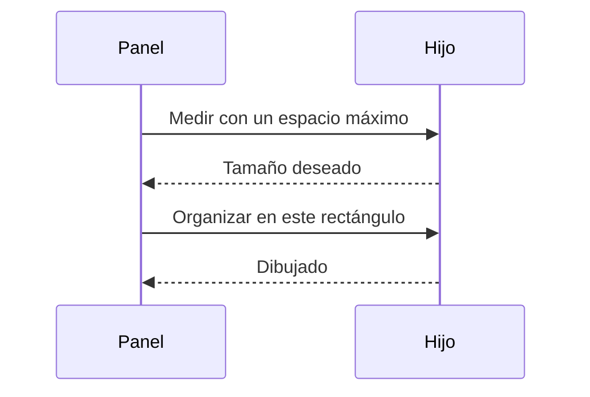
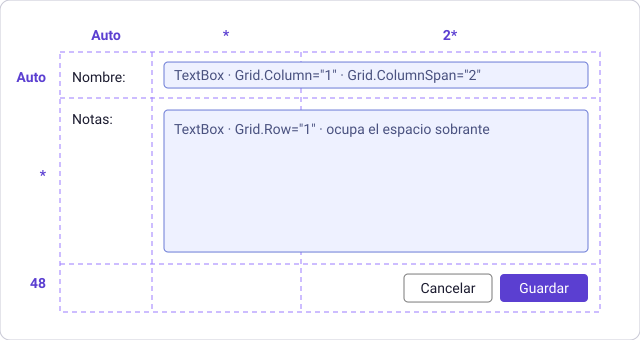
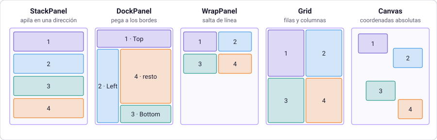
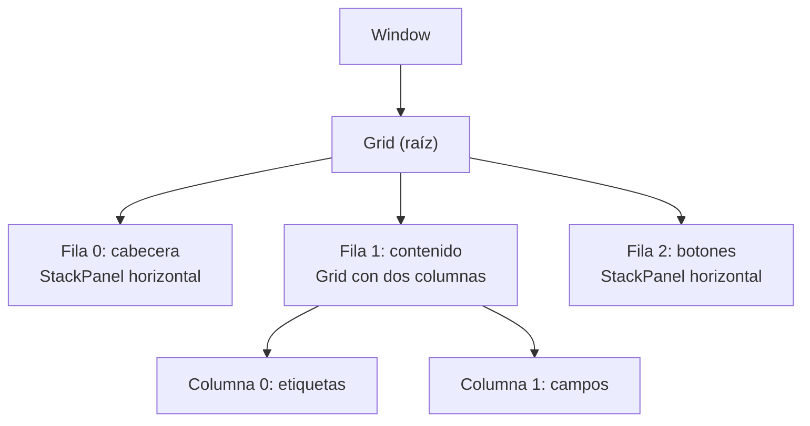

# 4. Paneles y distribución

[⬅️ Volver a la unidad](./README.md)

**CE que trabaja este tema:** RA1 c.

## Índice

- [4.1. Colocar sin fijar posiciones](#41-colocar-sin-fijar-posiciones)
- [4.2. Cómo reparte el espacio WPF](#42-cómo-reparte-el-espacio-wpf)
  - [4.2.1. Medir y organizar](#421-medir-y-organizar)
  - [4.2.2. Las propiedades de distribución](#422-las-propiedades-de-distribución)
  - [4.2.3. Margen, relleno y borde](#423-margen-relleno-y-borde)
- [4.3. `StackPanel`](#43-stackpanel)
- [4.4. `Grid`](#44-grid)
  - [4.4.1. Filas y columnas](#441-filas-y-columnas)
  - [4.4.2. Colocar y combinar celdas](#442-colocar-y-combinar-celdas)
  - [4.4.3. Sintaxis corta de .NET 10](#443-sintaxis-corta-de-net-10)
  - [4.4.4. Dividir con `GridSplitter`](#444-dividir-con-gridsplitter)
- [4.5. `DockPanel`](#45-dockpanel)
- [4.6. `WrapPanel` y `UniformGrid`](#46-wrappanel-y-uniformgrid)
- [4.7. `Canvas`](#47-canvas)
- [4.8. Elegir el panel](#48-elegir-el-panel)
- [4.9. Anidar paneles y diseñar para cualquier tamaño](#49-anidar-paneles-y-diseñar-para-cualquier-tamaño)
- [4.10. El editor visual y la distribución](#410-el-editor-visual-y-la-distribución)
- [4.11. Ejemplo integrador: el formulario de alta de un socio](#411-ejemplo-integrador-el-formulario-de-alta-de-un-socio)
- [4.12. Errores frecuentes](#412-errores-frecuentes)
- [Resumen](#resumen)
- [Ejercicios de reflexión](#ejercicios-de-reflexión)

---

## 4.1. Colocar sin fijar posiciones

En el tema 2 arrastraste un botón y el diseñador le puso `Margin="52,41,0,0"`: 52 píxeles desde la izquierda y 41 desde arriba. Funciona hasta que algo cambia:

- El usuario **maximiza** la ventana y los controles se quedan pegados a la esquina.
- El texto de una etiqueta es más largo en otro idioma y **se corta**.
- La pantalla tiene otra **resolución** o el usuario amplía el texto de Windows.

Una interfaz profesional no se coloca control a control con coordenadas. Se **describe cómo se reparte el espacio** y se deja que WPF calcule las posiciones. Para eso existen los **paneles** (*layout panels*): contenedores que ordenan a sus hijos según una regla.

| Enfoque | Cómo se coloca | Qué pasa al cambiar el tamaño |
|---------|----------------|-------------------------------|
| **Posiciones absolutas** | Cada control con sus coordenadas | Nada: se queda donde está |
| **Paneles** | Cada panel aplica una regla de reparto | Los controles se recolocan y se estiran según la regla |

Este tema cubre el criterio **c** (*utilizar las funciones del editor para ubicar los componentes*): no solo dónde arrastrar, sino **qué contenedor** elegir para que la ventana se adapte.

> 📝 **Nota del Profesor**: es el mismo problema que resolvió la web con CSS (*flexbox* y *grid*) y Android con `LinearLayout` y `ConstraintLayout`. Si has hecho una página adaptable, ya tienes la mitad de la idea.

---

## 4.2. Cómo reparte el espacio WPF

### 4.2.1. Medir y organizar

Un panel coloca a sus hijos en **dos pasadas**:

1. **Medir** (*measure*): el panel le pregunta a cada hijo «¿cuánto espacio necesitas si te doy este máximo?». El hijo responde con su **tamaño deseado**.
2. **Organizar** (*arrange*): con todas las respuestas, el panel **asigna a cada hijo un rectángulo** y el hijo se dibuja dentro.



Por eso el tamaño final de un control **no siempre** es el que escribiste en `Width`: el panel puede darle más (si el control se estira) o menos (si no cabe). El tamaño real, una vez colocado, se lee en las propiedades `ActualWidth` y `ActualHeight` (de solo lectura).

### 4.2.2. Las propiedades de distribución

Todos los controles (los que heredan de `FrameworkElement`) tienen estas propiedades:

| Propiedad | Valores | Qué hace |
|-----------|---------|----------|
| `Width`, `Height` | Número o `Auto` (por defecto) | Tamaño **fijo**. Con `Auto` el control mide lo que necesita |
| `MinWidth`, `MinHeight` | Número | Tamaño **mínimo** que no se baja nunca |
| `MaxWidth`, `MaxHeight` | Número | Tamaño **máximo** |
| `HorizontalAlignment` | `Left`, `Center`, `Right`, `Stretch` | Cómo se coloca en el **ancho** de su espacio |
| `VerticalAlignment` | `Top`, `Center`, `Bottom`, `Stretch` | Cómo se coloca en el **alto** de su espacio |
| `Margin` | Una, dos o cuatro cifras | Separación por **fuera** |
| `Visibility` | `Visible`, `Hidden`, `Collapsed` | Si se ve y si ocupa sitio |

**El valor por defecto de las alineaciones es `Stretch`**: un control, si el panel se lo permite, se **estira** hasta ocupar todo el espacio que le asignan. Por eso un `TextBox` dentro de un `StackPanel` vertical ocupa todo el ancho sin que le pongas `Width`. Para que un botón no se estire hay que **anclarlo** con `HorizontalAlignment="Left"` (o `Center`, `Right`).

`Hidden` y `Collapsed` esconden el control, pero **no son iguales**:

| `Visibility` | ¿Se ve? | ¿Ocupa espacio? |
|--------------|---------|-----------------|
| `Visible` | Sí | Sí |
| `Hidden` | No | **Sí** (deja un hueco) |
| `Collapsed` | No | **No** (los demás se recolocan) |

> ✅ **Buena práctica**: evita `Width` y `Height` fijos en los controles. Usa `MinWidth` (un mínimo razonable) y deja que el panel y el contenido hagan el resto. Los tamaños fijos se reservan para elementos que de verdad lo son (iconos, imágenes).

### 4.2.3. Margen, relleno y borde

Cada control está rodeado de varias capas. Dos de ellas se confunden con frecuencia:

| Propiedad | Dónde actúa | Quién la tiene |
|-----------|-------------|----------------|
| `Margin` | **Fuera** del control, entre él y sus vecinos | Todos los controles |
| `Padding` | **Dentro** del control, entre su borde y su contenido | Los controles con contenido (`Button`, `TextBox`, `Border`…) |
| `BorderThickness` | El grosor del **borde** | `Border` y los controles con borde |

```xml
<Button Content="Guardar"
        Margin="0,0,8,0"
        Padding="16,4" />
```

El botón tiene 16 puntos de aire a izquierda y derecha del texto y 4 arriba y abajo (`Padding`), y deja 8 a su derecha para el siguiente control (`Margin`).

`Margin` y `Padding` admiten tres formas, las mismas del tema 3: `"8"` (los cuatro lados), `"16,4"` (horizontal y vertical) o `"izquierda,arriba,derecha,abajo"`.

> ✅ **Buena práctica**: usa **múltiplos de 8** (4, 8, 16, 24…) para márgenes y rellenos, como se aplicó en el diseño de la UD1. El resultado es más ordenado y más fácil de mantener.

---

## 4.3. `StackPanel`

El `StackPanel` **apila** a sus hijos en una dirección: de arriba abajo (`Orientation="Vertical"`, por defecto) o de izquierda a derecha (`Horizontal`).

```xml
<StackPanel>
    <TextBlock Text="Nombre:" />
    <TextBox />
    <Button Content="Guardar"
            HorizontalAlignment="Left" />
</StackPanel>
```

En vertical, cada hijo ocupa **todo el ancho** y **solo el alto que necesita**. En horizontal es al revés. Es el panel más sencillo y el que más usarás para grupos pequeños (una columna de campos, una fila de botones).

```xml
<StackPanel Orientation="Horizontal"
            HorizontalAlignment="Right">
    <Button Content="Cancelar"
            Margin="0,0,8,0" />
    <Button Content="Guardar" />
</StackPanel>
```

> ⚠️ **Cuidado**: en la dirección de apilado, el `StackPanel` **da a cada hijo todo el espacio que pida**, como si no hubiera límite. Un `ListBox` con cien elementos dentro de un `StackPanel` vertical **crece a los cien elementos** y no muestra barra de desplazamiento. Para listas, usa un `Grid` con una fila `*` o un `DockPanel`.

---

## 4.4. `Grid`

El `Grid` reparte el espacio en una **cuadrícula de filas y columnas**. Es el panel más potente y es el que se usa como raíz de casi cualquier ventana.

### 4.4.1. Filas y columnas

Las filas se declaran en `Grid.RowDefinitions` y las columnas en `Grid.ColumnDefinitions`. El tamaño de cada una admite tres formas:

| Valor | Nombre | Qué significa |
|-------|--------|---------------|
| `Auto` | Automático | Lo que **necesite su contenido** |
| Un número (`48`) | Fijo | Exactamente esos píxeles |
| `*` o `2*` | Proporcional (*estrella*) | Un **reparto del espacio que sobra**, según el número delante del `*` |

```xml
<Grid>
    <Grid.ColumnDefinitions>
        <ColumnDefinition Width="Auto" />
        <ColumnDefinition Width="*" />
        <ColumnDefinition Width="2*" />
    </Grid.ColumnDefinitions>
    <Grid.RowDefinitions>
        <RowDefinition Height="Auto" />
        <RowDefinition Height="*" />
        <RowDefinition Height="48" />
    </Grid.RowDefinitions>
</Grid>
```

Este `Grid` tiene tres columnas y tres filas. La primera columna se ajusta a su contenido; con el espacio que queda, la tercera recibe **el doble** que la segunda (1 parte frente a 2). La fila central se queda con el alto que sobra, entre una fila automática arriba y una fija de 48 abajo.



Si no declaras filas ni columnas, el `Grid` tiene **una sola celda**. Si declaras unas pero no las otras, tiene una sola de las que faltan.

> 💡 **Tip del Examinador**: *«¿Qué diferencia hay entre `Auto` y `*`?»* `Auto` mide **lo que necesita el contenido**. `*` **reparte lo que sobra** del espacio disponible. Una fila `Auto` crece con su contenido; una fila `*` crece con la ventana.

### 4.4.2. Colocar y combinar celdas

Cada hijo del `Grid` elige su celda con propiedades adjuntas (tema 3): `Grid.Row` y `Grid.Column`, **empezando en 0**. Si no las pones, el hijo va a la celda (0, 0).

```xml
<TextBlock Grid.Row="0"
           Grid.Column="0"
           Text="Nombre:" />
<TextBox Grid.Row="0"
         Grid.Column="1"
         Grid.ColumnSpan="2" />
```

Con `Grid.RowSpan` y `Grid.ColumnSpan` un control **ocupa varias celdas**. El `TextBox` de arriba empieza en la columna 1 y ocupa dos columnas.

En una misma celda **caben varios controles** y se dibujan unos sobre otros, en el orden en que están escritos. Se usa para superponer (por ejemplo, un indicador de carga sobre una lista) y es también la causa del error más común del `Grid`: olvidar `Grid.Row` y que todos los controles acaben apilados en la celda (0, 0).

> 🔁 **Transferencia**: `Grid.Row` y `Grid.Column` equivalen a `grid-row` y `grid-column` de CSS Grid, y `RowSpan` y `ColumnSpan` a `grid-row: span 2`. En Android, el equivalente es `GridLayout`.

### 4.4.3. Sintaxis corta de .NET 10

Declarar cada fila y cada columna con una etiqueta es largo. Desde **.NET 10**, las filas y las columnas se pueden escribir como **una lista separada por comas** en una sola propiedad:

```xml
<Grid ColumnDefinitions="Auto, *, 2*"
      RowDefinitions="Auto, *, 48">
    …
</Grid>
```

Es **exactamente el mismo `Grid`** del apartado 4.4.1, en dos líneas. Los valores admitidos son los mismos: `Auto`, un número o una estrella.

> 📝 **Nota del Profesor**: verás las dos formas. Las etiquetas `RowDefinitions` y `ColumnDefinitions` aparecen en cualquier código o tutorial anterior a .NET 10, y es lo que genera el diseñador al arrastrar divisiones. La forma corta es más cómoda al escribir a mano y para ver de un vistazo la estructura. En este módulo se usan las dos y se te indica cuál en cada ejemplo.

### 4.4.4. Dividir con `GridSplitter`

Un `GridSplitter` es una **barra que el usuario arrastra** para cambiar el tamaño de dos columnas (o dos filas) contiguas, como el divisor entre un árbol de carpetas y su contenido.

```xml
<Grid ColumnDefinitions="200, 5, *">
    <ListBox Grid.Column="0" />
    <GridSplitter Grid.Column="1"
                  HorizontalAlignment="Stretch" />
    <TextBox Grid.Column="2" />
</Grid>
```

Requisitos: el divisor ocupa **su propia columna** (aquí, la de 5 píxeles) y debe **estirarse** (`HorizontalAlignment="Stretch"`) para que sea visible y se pueda agarrar.

---

## 4.5. `DockPanel`

El `DockPanel` **pega** a sus hijos a los bordes: arriba, abajo, izquierda o derecha. Cada hijo indica su borde con la propiedad adjunta `DockPanel.Dock`. El **último hijo rellena** el espacio que queda (`LastChildFill`, por defecto `True`).

```xml
<DockPanel>
    <TextBlock DockPanel.Dock="Top"
               Text="Cabecera" />
    <TextBlock DockPanel.Dock="Bottom"
               Text="Pie" />
    <ListBox DockPanel.Dock="Left"
             Width="160" />
    <TextBox />
</DockPanel>
```

Es la estructura típica de una ventana de escritorio: menú y barra de herramientas arriba, barra de estado abajo, un panel lateral y el contenido en el centro. **El orden importa**: el primer hijo se pega primero y ocupa el borde completo; el siguiente, lo que queda.

> ⚠️ **Cuidado**: si no pones `DockPanel.Dock` a un hijo, se pega a la izquierda por defecto. Y si el último hijo no debe rellenar, usa `LastChildFill="False"`.

---

## 4.6. `WrapPanel` y `UniformGrid`

**`WrapPanel`** coloca los hijos en fila (o en columna) y, cuando no caben, **salta a la siguiente línea**. Sirve para etiquetas, miniaturas o botones que deben acomodarse al ancho de la ventana.

```xml
<WrapPanel>
    <Button Content="Infantil" Margin="0,0,8,8" />
    <Button Content="Adulto" Margin="0,0,8,8" />
    <Button Content="Senior" Margin="0,0,8,8" />
</WrapPanel>
```

**`UniformGrid`** (en `System.Windows.Controls.Primitives`) es una cuadrícula donde **todas las celdas miden lo mismo**. No hace falta definir filas ni columnas: con `Rows` y `Columns` basta, y cada hijo ocupa la siguiente celda. Es ideal para un teclado numérico o un tablero.

```xml
<UniformGrid Columns="3">
    <Button Content="1" />
    <Button Content="2" />
    <Button Content="3" />
    <Button Content="4" />
    <Button Content="5" />
    <Button Content="6" />
</UniformGrid>
```

---

## 4.7. `Canvas`

El `Canvas` es la excepción: **coloca con coordenadas absolutas**, con las propiedades adjuntas `Canvas.Left` y `Canvas.Top`. No estira ni reparte nada.

```xml
<Canvas>
    <Ellipse Canvas.Left="40"
             Canvas.Top="24"
             Width="80"
             Height="80"
             Fill="SteelBlue" />
    <TextBlock Canvas.Left="56"
               Canvas.Top="116"
               Text="Pista 1" />
</Canvas>
```

Es la elección correcta para **dibujos, gráficos, mapas** o elementos que flotan sobre otros. Es la **mala** elección para formularios y pantallas de datos, porque es justo el problema del apartado 4.1.

---

## 4.8. Elegir el panel

Los cinco paneles con el mismo contenido (cuatro elementos numerados) quedan así:



| Panel | Regla de reparto | Úsalo para |
|-------|------------------|------------|
| `StackPanel` | Apila en una dirección | Grupos pequeños: una columna de campos, una fila de botones |
| `Grid` | Filas y columnas | Formularios, estructura general de una ventana, cualquier cosa alineada en columnas |
| `DockPanel` | Pega a los bordes y rellena el centro | El esqueleto: menú, barra de herramientas, barra de estado, panel lateral |
| `WrapPanel` | Línea a línea, saltando al llegar al borde | Etiquetas, miniaturas, botones de opciones |
| `UniformGrid` | Celdas iguales | Teclados, tableros, paneles de botones del mismo tamaño |
| `Canvas` | Coordenadas absolutas | Dibujos, gráficos, elementos superpuestos |

> ✅ **Buena práctica**: ante la duda, usa un **`Grid`** como raíz de la ventana y **`StackPanel`** para los grupos pequeños dentro de sus celdas.

Además de los paneles, hay otros contenedores que usarás para afinar la distribución:

| Contenedor | Para qué |
|------------|----------|
| `Border` | **Un solo hijo** con borde, esquinas redondeadas y relleno |
| `ScrollViewer` | Añade **barras de desplazamiento** cuando el contenido no cabe |
| `Viewbox` | **Escala** su contenido (texto incluido) para ocupar el espacio |
| `GroupBox` y `Expander` | Agrupan controles con un título; el segundo se pliega |

---

## 4.9. Anidar paneles y diseñar para cualquier tamaño

Las ventanas reales **combinan** paneles: un `Grid` o `DockPanel` para la estructura general y, dentro de cada zona, paneles más pequeños.



Para que la ventana funcione bien con cualquier tamaño:

1. **Las filas y columnas que deben crecer, en `*`.** Las que se ajustan a su contenido, en `Auto`. Pocas medidas fijas.
2. **Controles estirados** (`Stretch`, el valor por defecto) para que ocupen su celda, y **anclados** (`Left`, `Right`) los que no deban estirarse.
3. **Tamaños mínimos** (`MinWidth`, `MinHeight`) en la ventana, para que nunca quede inutilizable.
4. **`ScrollViewer`** alrededor de lo que pueda ser largo.
5. **Márgenes en múltiplos de 8** y la misma separación entre controles del mismo tipo.

Para un cuadro de diálogo pequeño, que debe ajustarse a su contenido, `SizeToContent="WidthAndHeight"` en la ventana hace que mida lo que necesitan sus controles.

> 📝 **Nota del Profesor**: en la UD1 diseñaste la aplicación sobre una ventana de **1280 × 720**, pero el usuario la puede **maximizar** o hacer más pequeña. Esa es la razón de que la distribución importe: la misma ventana tiene que verse bien en cualquier tamaño sin tocar nada. Prueba siempre tus ventanas **cambiando el tamaño** a mano.

Hay una herramienta de depuración útil: en un `Grid`, `ShowGridLines="True"` **dibuja las líneas** de filas y columnas, para ver cómo se reparte. Solo debe usarse mientras diseñas; quítalo antes de entregar.

---

## 4.10. El editor visual y la distribución

El diseñador de Visual Studio sirve para colocar en un `Grid` sin escribir las definiciones a mano:

- **Crear filas y columnas.** Al seleccionar un `Grid` aparecen **reglas** en sus bordes; haz clic en ellas para añadir una división, y arrastra una división para moverla.
- **Ajustar las medidas.** Cada fila y columna muestra un icono con su tipo (`Auto`, fijo o estrella) que se cambia al hacer clic.
- **Mover un control a una celda.** Al arrastrar, el diseñador asigna `Grid.Row` y `Grid.Column`.
- **Ver la estructura.** El **Esquema del documento** muestra el árbol de paneles y controles, y permite seleccionar uno aunque esté tapado.
- **Restablecer el diseño.** Con el botón derecho sobre un control, el menú **Diseño** permite quitar márgenes y tamaños fijos o volver a estirarlo.

> ⚠️ **Cuidado**: el diseñador, al arrastrar sobre un `Grid`, tiende a rellenar `Margin`, `HorizontalAlignment`, `VerticalAlignment`, `Width` y `Height` (tema 2). Después de arrastrar, **revisa el XAML** y deja solo lo que expresa una intención: lo ideal es que el control quede solo con su celda y, a lo sumo, un margen.

---

## 4.11. Ejemplo integrador: el formulario de alta de un socio

Vamos a diseñar el formulario de alta de un socio con la estructura del diagrama del apartado 4.9. El proyecto completo está en [`ejemplos/04-AltaSocio`](./ejemplos/04-AltaSocio).

**Estructura.** Un `Grid` raíz de tres filas:

| Fila | Alto | Contenido |
|------|------|-----------|
| 0 | `Auto` | El título «Alta de socio» |
| 1 | `*` | El formulario (se lleva el espacio sobrante) |
| 2 | `Auto` | Los botones **Cancelar** y **Guardar** |

La fila 1 contiene a su vez un `Grid` de dos columnas (`Auto` para las etiquetas, `*` para los campos) y cuatro filas (`Auto` las tres primeras, `*` la de notas).

```xml
<Window x:Class="AltaSocio.MainWindow"
        …
        Title="Alta de socio"
        Height="360"
        Width="520"
        MinHeight="320"
        MinWidth="420">
    <Grid Margin="16">
        <Grid.RowDefinitions>
            <RowDefinition Height="Auto" />
            <RowDefinition Height="*" />
            <RowDefinition Height="Auto" />
        </Grid.RowDefinitions>

        <TextBlock Grid.Row="0"
                   Text="Alta de socio"
                   FontSize="22"
                   FontWeight="SemiBold"
                   Margin="0,0,0,16" />

        <Grid Grid.Row="1"
              ColumnDefinitions="Auto, *"
              RowDefinitions="Auto, Auto, Auto, *">
            <TextBlock Grid.Row="0"
                       Grid.Column="0"
                       Text="Nombre:"
                       VerticalAlignment="Center"
                       Margin="0,0,16,8" />
            <TextBox Grid.Row="0"
                     Grid.Column="1"
                     Margin="0,0,0,8" />
            <!-- Correo y Categoría siguen el mismo patrón -->
            <TextBlock Grid.Row="3"
                       Grid.Column="0"
                       Text="Notas:"
                       Margin="0,0,16,8" />
            <TextBox Grid.Row="3"
                     Grid.Column="1"
                     AcceptsReturn="True"
                     TextWrapping="Wrap"
                     VerticalScrollBarVisibility="Auto"
                     Margin="0,0,0,8" />
        </Grid>

        <StackPanel Grid.Row="2"
                    Orientation="Horizontal"
                    HorizontalAlignment="Right"
                    Margin="0,8,0,0">
            <Button Content="Cancelar"
                    Padding="16,4"
                    Margin="0,0,8,0" />
            <Button Content="Guardar"
                    Padding="16,4"
                    IsDefault="True" />
        </StackPanel>
    </Grid>
</Window>
```

Fíjate en las decisiones:

| Decisión | Motivo |
|----------|--------|
| Fila del medio en `*`, las otras en `Auto` | El formulario crece con la ventana; título y botones se quedan de su tamaño |
| Columna de etiquetas `Auto` y la de campos `*` | Las etiquetas se ajustan a la más larga y los campos ocupan todo el ancho que queda |
| `VerticalAlignment="Center"` en las etiquetas | Se alinean con el centro de la caja de texto |
| Fila de notas en `*` | El cuadro de notas se estira hacia abajo |
| `HorizontalAlignment="Left"` y `MinWidth` en el `ComboBox` | No necesita ocupar todo el ancho, pero sí un mínimo cómodo |
| Botones en un `StackPanel` horizontal anclado a la derecha | Convención de los cuadros de diálogo en Windows |
| `IsDefault="True"` en **Guardar** | Se activa con `Intro` |
| `MinWidth` y `MinHeight` en la ventana | No se puede reducir hasta romper la distribución |
| Márgenes de 8 y 16 | Múltiplos de 8 |

**Comprueba cómo se adapta.** Ejecuta la aplicación y cambia el tamaño de la ventana, también maximizándola:

| Cambio | Resultado |
|--------|-----------|
| Hacerla más ancha | Los campos de texto se ensanchan; las etiquetas, no; los botones siguen a la derecha |
| Hacerla más alta | El cuadro de notas crece; el resto no |
| Intentar hacerla muy pequeña | Se detiene en 420 × 320 |
| Maximizar | La misma estructura, con campos muy anchos |

> 🔁 **Transferencia**: si lo hubieras hecho con posiciones absolutas, la versión maximizada tendría un formulario diminuto pegado a la esquina. Con paneles, el diseño responde igual en **cualquier tamaño y resolución**, y eso mismo se hace con `flexbox` en la web o con `ConstraintLayout` en Android.

**Actividad.** Añade un campo «Teléfono» entre «Correo» y «Categoría». ¿Qué tienes que cambiar en las filas del `Grid`? ¿Y en los `Grid.Row` de los controles que están por debajo? Piensa qué haría el diseñador si insertaras la fila arrastrando.

---

## 4.12. Errores frecuentes

| Síntoma | Causa habitual | Solución |
|---------|----------------|----------|
| Todos los controles aparecen **apilados** en una esquina del `Grid` | Falta `Grid.Row` y `Grid.Column`: todos van a la celda (0, 0) | Asigna la celda de cada control |
| Un control con `Grid.Row="5"` aparece en la última fila | Si la fila no existe, WPF lo coloca en la **última** sin avisar | Declara todas las filas y revisa los índices (empiezan en 0) |
| El `ListBox` dentro de un `StackPanel` no tiene barra de desplazamiento | El `StackPanel` le da toda la altura que pida | Ponlo en un `Grid` con una fila `*` o en un `DockPanel` |
| Un texto se **corta** o se sale del botón | `Width` o `Height` fijos | Quita el tamaño fijo y usa `Padding`, `MinWidth` o un panel |
| El botón ocupa todo el ancho | `HorizontalAlignment` es `Stretch` por defecto | Ponlo en `Left`, `Center` o `Right` |
| El `GridSplitter` no se ve ni se puede arrastrar | No tiene su propia columna o no está estirado | Dale una columna y `HorizontalAlignment="Stretch"` |
| La caja de texto no ocupa todo el ancho de su celda | El panel padre es un `StackPanel` horizontal, o la columna es `Auto` | Usa una columna `*` en un `Grid` |
| Un control desaparece pero deja un hueco | `Visibility="Hidden"` | Usa `Collapsed` para que no ocupe sitio |
| La ventana es incómoda al maximizarla | Medidas fijas en filas y columnas | Cambia a `*` y `Auto` y quita tamaños absolutos |
| Un formulario hecho con `Canvas` no se adapta | `Canvas` usa posiciones absolutas | Cámbialo por un `Grid` |

---

## Resumen

- Una interfaz profesional se **describe con reglas de reparto** en lugar de posiciones absolutas, para que se adapte al tamaño, la resolución y el idioma.
- WPF coloca en **dos pasadas** (medir y organizar). El tamaño final lo decide el panel; se lee en `ActualWidth` y `ActualHeight`.
- Las alineaciones valen `Stretch` por defecto. `Margin` es la separación **por fuera**; `Padding`, **por dentro**. `Collapsed` no ocupa espacio; `Hidden` sí. Se recomiendan los múltiplos de 8.
- `StackPanel` apila (cuidado con las listas); `Grid` reparte en filas y columnas con `Auto`, fijo y `*`; `DockPanel` pega a los bordes; `WrapPanel` salta de línea; `UniformGrid` hace celdas iguales; `Canvas` coloca por coordenadas.
- En un `Grid`, los hijos eligen celda con `Grid.Row` y `Grid.Column` (desde 0) y se combinan con `RowSpan` y `ColumnSpan`. Desde .NET 10 se pueden definir filas y columnas con una lista: `ColumnDefinitions="Auto, *"`.
- Ante la duda: un `Grid` como raíz y `StackPanel` para los grupos pequeños. Las ventanas reales **combinan** paneles anidados.
- Se prueba la distribución **cambiando el tamaño** de la ventana, y `ShowGridLines` ayuda mientras se diseña.
- El diseñador crea filas y columnas, pero deja márgenes y tamaños fijos que hay que revisar en el XAML.

---

## Ejercicios de reflexión

1. Una ventana tiene un `StackPanel` con un `TextBox` y un `Button`. El `TextBox` ocupa todo el ancho, pero el botón también, y no quieres eso. ¿Qué propiedad cambias y a qué valor? ¿Por qué el `TextBox` se estira sin que hayas puesto nada?
2. Quieres una ventana con un menú arriba, una barra de estado abajo, un panel de filtros a la izquierda y la tabla de socios ocupando el resto. ¿Qué panel usarías como raíz? Dibuja el árbol de paneles.
3. Una columna de un `Grid` es `Auto` y otra es `*`. La ventana se ensancha 200 píxeles. ¿Cuál de las dos crece? ¿Y si se escribe un texto muy largo en la columna `Auto`?
4. Explica con tus palabras la diferencia entre `Margin` y `Padding` con un botón como ejemplo. ¿Cuál usarías para separar dos botones? ¿Y para que el texto no toque el borde?
5. Un compañero te enseña un formulario que se ve bien a 1280 × 720 y deja de verse bien al maximizar. Sin ver el código, ¿qué tres problemas sospechas? ¿Cómo lo comprobarías?
6. Escribe la sintaxis corta de .NET 10 para un `Grid` con dos columnas (una de 120 píxeles y otra proporcional) y tres filas (la primera y la última automáticas y la central proporcional).

---

[⬅️ Volver a la unidad](./README.md)
