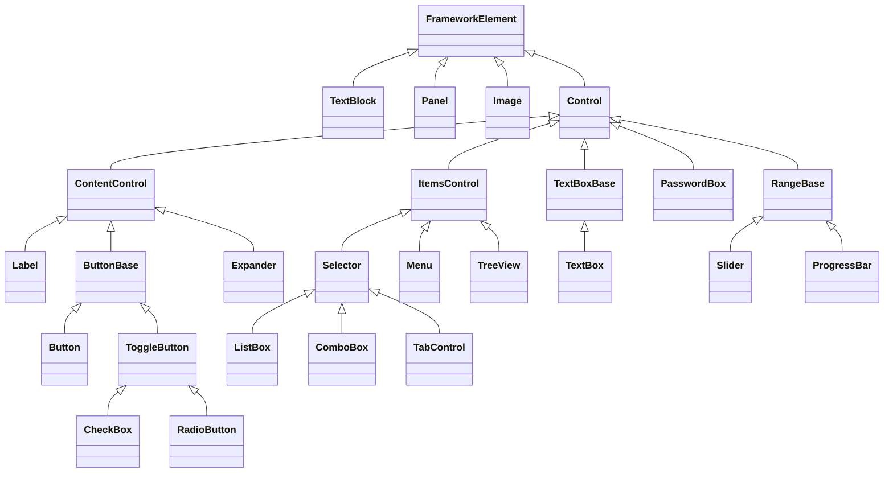
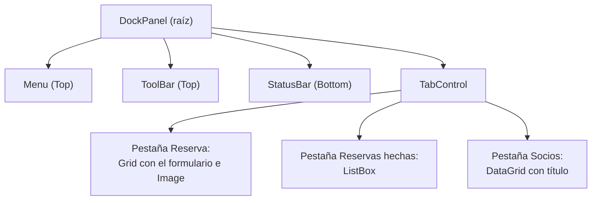

# 5. Controles y sus propiedades

[⬅️ Volver a la unidad](./README.md)

**CE que trabaja este tema:** RA1 d.

## Índice

- [5.1. Qué es un control](#51-qué-es-un-control)
- [5.2. Modificar las propiedades de un control](#52-modificar-las-propiedades-de-un-control)
  - [5.2.1. Cuatro sitios donde cambiar una propiedad](#521-cuatro-sitios-donde-cambiar-una-propiedad)
  - [5.2.2. Propiedades comunes de aspecto y comportamiento](#522-propiedades-comunes-de-aspecto-y-comportamiento)
- [5.3. Mostrar y escribir texto](#53-mostrar-y-escribir-texto)
  - [5.3.1. `TextBlock`](#531-textblock)
  - [5.3.2. `Label` y las teclas de acceso](#532-label-y-las-teclas-de-acceso)
  - [5.3.3. `TextBox`](#533-textbox)
  - [5.3.4. `PasswordBox`](#534-passwordbox)
  - [5.3.5. Cuál elegir](#535-cuál-elegir)
- [5.4. Botones](#54-botones)
- [5.5. Elegir entre opciones](#55-elegir-entre-opciones)
  - [5.5.1. `CheckBox`](#551-checkbox)
  - [5.5.2. `RadioButton`](#552-radiobutton)
  - [5.5.3. `ComboBox` y `ListBox`](#553-combobox-y-listbox)
  - [5.5.4. Qué control para qué dato](#554-qué-control-para-qué-dato)
- [5.6. Fechas y valores numéricos](#56-fechas-y-valores-numéricos)
- [5.7. Imágenes](#57-imágenes)
- [5.8. Organizar y mostrar muchos datos](#58-organizar-y-mostrar-muchos-datos)
- [5.9. Menús, barras de herramientas y barra de estado](#59-menús-barras-de-herramientas-y-barra-de-estado)
- [5.10. Accesibilidad](#510-accesibilidad)
- [5.11. Las pautas de la UD1 en WPF](#511-las-pautas-de-la-ud1-en-wpf)
- [5.12. Ejemplo integrador: reserva de pistas](#512-ejemplo-integrador-reserva-de-pistas)
- [5.13. Errores frecuentes](#513-errores-frecuentes)
- [Resumen](#resumen)
- [Ejercicios de reflexión](#ejercicios-de-reflexión)

---

## 5.1. Qué es un control

Un **control** es un elemento de la interfaz con el que el usuario interactúa o que le muestra información: un botón, una caja de texto, una lista. Los controles de WPF forman una **jerarquía de clases**, como las que viste en la unidad anterior, y entender esa jerarquía explica por qué se comportan como lo hacen.



Las ramas más importantes:

| Familia | Qué la define | Ejemplos |
|---------|---------------|----------|
| **`ContentControl`** | Tiene **un único contenido** (`Content`), que puede ser un texto o cualquier otro control | `Button`, `Label`, `CheckBox`, `RadioButton`, `Expander`, `Window` |
| **`ItemsControl`** | Muestra una **colección de elementos** (`Items`) | `ListBox`, `ComboBox`, `TabControl`, `Menu`, `TreeView` |
| **`RangeBase`** | Tiene un **valor dentro de un rango** (`Minimum`, `Maximum`, `Value`) | `Slider`, `ProgressBar` |
| **Entrada de texto** | Permite **escribir** | `TextBox`, `PasswordBox` |

Fíjate en que `TextBlock`, `Image` y los paneles **no son `Control`**: son más ligeros, no se pueden «pulsar» ni recibir el foco, y no se les puede cambiar la plantilla.

> 📝 **Nota del Profesor**: que un `Button` sea un `ContentControl` es muy potente. Significa que su contenido no es solo texto: puede ser un panel con una imagen y un texto, o una cuadrícula. La misma idea se aplica a las demás clases de la familia. Aprende la familia y conocerás a la vez diez controles.

---

## 5.2. Modificar las propiedades de un control

El criterio **d** pide **modificar las propiedades de los componentes para adecuarlas a las necesidades de la aplicación**. Un control sin tocar rara vez sirve tal cual: hay que cambiar su texto, su tamaño, su color, su comportamiento.

### 5.2.1. Cuatro sitios donde cambiar una propiedad

| Dónde | Cuándo se aplica | Cómo | Úsalo para |
|-------|------------------|------|------------|
| **Ventana Propiedades** del diseñador | En diseño | Seleccionas el control y editas el valor; el diseñador escribe el XAML por ti | Explorar qué propiedades hay y probar valores |
| **XAML** | Al crear la ventana | `<Button FontSize="16" />` | Valores **fijos** de diseño |
| **C#** (*code-behind*) | **Al ejecutar** | `btnGuardar.IsEnabled = false;` | Valores que **dependen de lo que hace el usuario** |
| **Estilos** | Al crear la ventana, **para muchos controles a la vez** | Un `Style` (tema 7) | Aspecto repetido en toda la aplicación |

Las tres primeras trabajan sobre **la misma propiedad**; solo cambia cuándo y desde dónde se asigna:

```xml
<Button x:Name="btnGuardar"
        Content="Guardar"
        IsEnabled="False" />
```

```csharp
btnGuardar.IsEnabled = true;   // más tarde, al cumplirse una condición
```

La ventana **Propiedades** (`F4`) agrupa las propiedades por categorías y tiene un cuadro de búsqueda. Cuando cambias un valor, aparece en el XAML como **valor local** (tema 3). Si te equivocas, haz clic en el cuadradito junto al nombre de la propiedad y elige **Restablecer valor** para que desaparezca del XAML.

> ✅ **Buena práctica**: las propiedades que **no cambian** en toda la vida de la ventana, al XAML; las que **cambian según lo que haga el usuario**, a C#. Y lo que se repite en muchos controles, a un estilo (tema 7).

### 5.2.2. Propiedades comunes de aspecto y comportamiento

Además de las de distribución (tema 4), casi todos los controles comparten estas:

| Propiedad | Qué hace | Ejemplo |
|-----------|----------|---------|
| `Content` / `Text` / `Header` | El texto o contenido principal | `Content="Guardar"` |
| `FontFamily`, `FontSize`, `FontWeight`, `FontStyle` | La **fuente** (se hereda) | `FontSize="14"` |
| `Foreground`, `Background` | Color del texto y del fondo | `Foreground="DarkRed"` |
| `IsEnabled` | Si el usuario puede interactuar (gris si es `False`; **se hereda** hacia los hijos) | `IsEnabled="False"` |
| `Visibility` | Si se ve y si ocupa sitio | `Visibility="Collapsed"` |
| `Opacity` | Transparencia de 0 a 1 | `Opacity="0.6"` |
| `ToolTip` | Texto que aparece al dejar el ratón encima | `ToolTip="Guarda la ficha"` |
| `Cursor` | Forma del puntero sobre el control | `Cursor="Hand"` |
| `IsTabStop`, `TabIndex` | Si recibe el foco con el tabulador y en qué orden (apartado 5.10) | `TabIndex="2"` |
| `Name` / `x:Name` | El nombre para usarlo desde C# | `x:Name="btnGuardar"` |

> 💡 **Tip del Examinador**: *«¿Qué diferencia hay entre `IsEnabled="False"` y `Visibility="Collapsed"`?»* El primero **deja el control visible pero inactivo** (en gris); el segundo lo **quita** de la pantalla y de la distribución. Se usa el primero cuando una acción no está disponible *todavía* y se quiere que el usuario sepa que existe.

---

## 5.3. Mostrar y escribir texto

### 5.3.1. `TextBlock`

El `TextBlock` **muestra texto de solo lectura**. Es el control más ligero y el que más usarás para etiquetas, títulos y resultados.

```xml
<TextBlock Text="Socio: Lucía Pérez" />
```

Para textos largos hay que decidir qué pasa cuando no caben:

| Propiedad | Valores | Efecto |
|-----------|---------|--------|
| `TextWrapping` | `NoWrap` (por defecto), `Wrap` | `Wrap` salta de línea al llegar al borde |
| `TextTrimming` | `None`, `CharacterEllipsis`, `WordEllipsis` | Corta con puntos suspensivos (`…`) cuando no cabe en una línea |
| `TextAlignment` | `Left`, `Center`, `Right`, `Justify` | Alineación del texto dentro del control |

```xml
<TextBlock TextWrapping="Wrap"
           Text="Este texto es largo y se ajusta a las líneas que necesite según el ancho disponible." />

<TextBlock TextTrimming="CharacterEllipsis"
           Text="Este texto, en cambio, se corta con puntos suspensivos si no cabe." />
```

Con **elementos en línea** (*inlines*) se mezclan formatos en un mismo párrafo. Ya viste `Run` en el tema 3; estos son los demás:

```xml
<TextBlock TextWrapping="Wrap">
    La cuota se paga <Bold>antes del día 5</Bold>, y la baja debe
    comunicarse <Italic>por escrito</Italic>.<LineBreak />
    Consulta las <Underline>condiciones</Underline>.
</TextBlock>
```

`Bold`, `Italic` y `Underline` son atajos de `Span` con una propiedad cambiada; `LineBreak` fuerza un salto de línea.

Un `Hyperlink` dentro de un `TextBlock` crea un **enlace**. En .NET moderno, abrir una dirección web exige un manejador que **inicie el navegador**:

```xml
<TextBlock>
    Más información en
    <Hyperlink NavigateUri="https://example.org/club"
               RequestNavigate="Hyperlink_RequestNavigate">la web del club</Hyperlink>.
</TextBlock>
```

```csharp
private void Hyperlink_RequestNavigate(object sender, RequestNavigateEventArgs e)
{
    Process.Start(new ProcessStartInfo(e.Uri.AbsoluteUri) { UseShellExecute = true });
    e.Handled = true;
}
```

`UseShellExecute = true` es necesario en .NET: sin él, `Process.Start` intenta ejecutar la dirección como si fuera un programa y falla. (`RequestNavigateEventArgs` está en `System.Windows.Navigation` y `Process`, en `System.Diagnostics`.)

### 5.3.2. `Label` y las teclas de acceso

El `Label` es un `ContentControl` que muestra una **etiqueta de un campo**. Se parece al `TextBlock`, pero tiene una función que el otro no tiene: las **teclas de acceso** (*access keys*, antes «mnemónicos»).

```xml
<Label Content="_Nombre:"
       Target="{Binding ElementName=txtNombre}" />
<TextBox x:Name="txtNombre" />
```

Un **guion bajo** delante de una letra la convierte en tecla de acceso: la letra se subraya al pulsar `Alt` y, con `Alt+N`, el foco pasa al control indicado en `Target`. La propiedad `Target` lleva un *binding* hacia el nombre del control; es un adelanto del enlace de datos del tema 9, de momento cópialo tal cual.

| Quieres… | Escribe |
|----------|---------|
| Una tecla de acceso en la `N` | `Content="_Nombre:"` |
| Un guion bajo literal | `Content="mi__campo"` (se duplica) |
| Que el foco vaya a otro control | `Target="{Binding ElementName=nombreDelControl}"` |

Las teclas de acceso también funcionan en botones (`Content="_Guardar"`), casillas, botones de opción y menús.

### 5.3.3. `TextBox`

El `TextBox` es la **caja de texto editable**. Sus propiedades principales:

| Propiedad | Qué hace |
|-----------|----------|
| `Text` | El texto actual (se lee y se escribe) |
| `MaxLength` | Máximo de caracteres que se pueden escribir |
| `IsReadOnly` | Se puede seleccionar y copiar, pero no modificar |
| `AcceptsReturn` | Si es `True`, `Intro` crea una línea nueva: caja **multilínea** |
| `TextWrapping`, `VerticalScrollBarVisibility` | Ajuste de línea y barra de desplazamiento (en multilínea) |
| `CharacterCasing` | Fuerza `Upper` o `Lower` mientras se escribe |
| `SpellCheck.IsEnabled` | Activa el corrector ortográfico (hay que indicar el idioma con `Language="es-ES"`) |
| `SelectionStart`, `SelectionLength`, `SelectedText` | El texto seleccionado |

```xml
<TextBox x:Name="txtNotas"
         AcceptsReturn="True"
         TextWrapping="Wrap"
         VerticalScrollBarVisibility="Auto"
         SpellCheck.IsEnabled="True"
         Language="es-ES" />
```

En C#, el contenido se lee y se escribe con `Text`, y hay métodos útiles como `Clear()`, `Focus()` o `SelectAll()`:

```csharp
var nombre = txtNombre.Text.Trim();
txtNombre.Clear();
txtNombre.Focus();
```

> ⚠️ **Cuidado**: `Text` es **siempre un `string`**. Si necesitas un número, tendrás que convertirlo, y el usuario puede escribir cualquier cosa. Usa `TryParse` (unidad anterior) y, mejor aún, valida (tema 11).

### 5.3.4. `PasswordBox`

El `PasswordBox` es un `TextBox` que **oculta** lo que se escribe, para contraseñas o PIN.

```xml
<PasswordBox x:Name="pwdPin"
             MaxLength="4"
             PasswordChar="●" />
```

El texto se lee con la propiedad **`Password`** (no `Text`): `pwdPin.Password`.

| Particularidad | Por qué |
|----------------|---------|
| No tiene `Text`, tiene `Password` | Para que no se confunda con un texto normal |
| `Password` **no admite enlace de datos** directo | Es una decisión de seguridad; se resuelve en el tema 11 |
| No puedes mostrar el texto con un interruptor | Si lo necesitas, se hace con dos controles y código |

> ⚠️ **Cuidado**: `PasswordBox` oculta lo que se ve, pero **no protege** lo que haces con la contraseña después. No la guardes en ficheros, en el registro ni en ninguna base de datos **en texto plano**. Cómo guardar contraseñas de forma segura queda fuera de esta unidad.

### 5.3.5. Cuál elegir

| Control | Editable | Para | Cuándo |
|---------|----------|------|--------|
| `TextBlock` | No | Mostrar texto | Títulos, resultados, textos fijos. **El de por defecto** |
| `Label` | No | Etiqueta de un campo | Cuando hace falta una **tecla de acceso** o un contenido que no sea texto |
| `TextBox` | Sí | Escribir texto | Datos que escribe el usuario |
| `PasswordBox` | Sí (oculto) | Contraseñas y PIN | Datos que no deben verse |

---

## 5.4. Botones

El `Button` es un `ContentControl`: su `Content` puede ser un texto o **cualquier otro control**.

```xml
<Button Content="_Guardar"
        Padding="16,4"
        IsDefault="True"
        Click="btnGuardar_Click" />
```

| Propiedad | Qué hace |
|-----------|----------|
| `Content` | El texto o el contenido |
| `Click` | El evento principal (se estudia en el tema 6) |
| `IsDefault` | Se activa al pulsar `Intro`. Es el botón principal de un formulario |
| `IsCancel` | Se activa al pulsar `Esc`. Útil en cuadros de diálogo |
| `Padding` | Espacio entre el borde del botón y su contenido |

Como el contenido puede ser cualquier cosa, un botón con **imagen y texto** se hace con un panel:

```xml
<Button Padding="12,4">
    <StackPanel Orientation="Horizontal">
        <Image Source="/Imagenes/guardar.png"
               Width="16"
               Height="16" />
        <TextBlock Text="Guardar"
                   Margin="8,0,0,0" />
    </StackPanel>
</Button>
```

Otros botones de la misma familia:

| Control | Comportamiento |
|---------|----------------|
| `Button` | Se pulsa y se suelta |
| `ToggleButton` | **Se queda pulsado** (`IsChecked`): como un interruptor |
| `RepeatButton` | **Repite** el evento mientras se mantiene pulsado (como las flechas de una barra de desplazamiento) |

---

## 5.5. Elegir entre opciones

### 5.5.1. `CheckBox`

Una **casilla de verificación** representa un valor lógico. Su propiedad `IsChecked` es de tipo **`bool?`**, es decir, admite `True`, `False` y `null`.

```xml
<CheckBox x:Name="chkLuz"
          Content="_Luz artificial"
          IsChecked="True" />
```

```csharp
if (chkLuz.IsChecked == true)
{
    // la casilla está marcada
}
```

> ⚠️ **Cuidado**: como `IsChecked` es `bool?`, **no se puede escribir** `if (chkLuz.IsChecked)`. Compara con `== true`, o con `is true`. Es un error de compilación frecuente.

El valor `null` es el tercer estado, **indeterminado**: una casilla que representa a un grupo en el que unos elementos están marcados y otros no. Se activa con `IsThreeState="True"` cuando el usuario también puede llegar a él con el ratón. Lo más habitual es el patrón de la **casilla «Todos»**: el estado indeterminado lo pone tu código, y el usuario solo marca o desmarca.

```xml
<CheckBox x:Name="chkTodos"
          Content="_Todos los extras"
          Click="chkTodos_Click" />
<CheckBox x:Name="chkRaqueta"
          Content="Alquiler de ra_queta"
          Margin="24,4,0,0"
          Click="chkExtra_Click" />
<CheckBox x:Name="chkLuz"
          Content="_Luz artificial"
          Margin="24,4,0,0"
          Click="chkExtra_Click" />
```

```csharp
private void chkTodos_Click(object sender, RoutedEventArgs e)
{
    var marcado = chkTodos.IsChecked == true;
    chkRaqueta.IsChecked = marcado;
    chkLuz.IsChecked = marcado;
}

private void chkExtra_Click(object sender, RoutedEventArgs e)
{
    chkTodos.IsChecked = (chkRaqueta.IsChecked, chkLuz.IsChecked) switch
    {
        (true, true) => true,
        (false, false) => false,
        _ => null
    };
}
```

Si las dos están marcadas, «Todos» se marca; si ninguna, se desmarca; si solo una, queda **indeterminada**. Es C# de la unidad anterior: una tupla y una expresión `switch`.

### 5.5.2. `RadioButton`

Los **botones de opción** permiten elegir **una sola** entre varias. Al marcar uno, se desmarca el resto del grupo.

```xml
<RadioButton x:Name="rbIndividual"
             GroupName="tipo"
             Content="_Individual"
             IsChecked="True" />
<RadioButton x:Name="rbDobles"
             GroupName="tipo"
             Content="Do_bles" />
```

Los botones de opción forman un grupo de dos maneras:

- **Por contenedor:** los que están en el mismo panel forman **un grupo**.
- **Por `GroupName`:** los que comparten el mismo nombre de grupo, estén donde estén. Es la forma que conviene cuando hay **dos grupos en el mismo panel**.

Se lee con `IsChecked == true`. Un grupo debe empezar siempre con **una opción marcada**, para que el estado sea válido desde el principio.

### 5.5.3. `ComboBox` y `ListBox`

Cuando las opciones son **muchas**, se usan listas.

| Control | Cómo se ve | Selección | Cuándo |
|---------|------------|-----------|--------|
| `ComboBox` | Desplegable: ocupa una línea | Una | Pocas decenas de opciones, poco espacio |
| `ListBox` | Lista siempre visible | Una o varias (`SelectionMode`) | Más opciones, o varias a la vez |

```xml
<ComboBox x:Name="cmbCategoria"
          SelectedIndex="1">
    <ComboBoxItem Content="Infantil" />
    <ComboBoxItem Content="Adulto" />
    <ComboBoxItem Content="Senior" />
</ComboBox>

<ListBox x:Name="lstReservas"
         SelectionMode="Extended" />
```

| Propiedad | Qué hace |
|-----------|----------|
| `SelectedIndex` | Posición del elemento elegido (empieza en 0; **-1 = ninguno**) |
| `SelectedItem` | El elemento elegido (`null` si no hay) |
| `SelectedItems` | Todos los elegidos (`ListBox` con selección múltiple) |
| `IsEditable` | En un `ComboBox`, permite además **escribir** un valor propio |
| `SelectionMode` | `Single`, `Multiple` o `Extended` (con `Ctrl` y `Mayús`) en un `ListBox` |
| `Items` | La colección de elementos: `Items.Add(…)`, `Items.Clear()`, `Items.Count` |

Se les pueden añadir elementos en XAML o desde C#:

```csharp
lstReservas.Items.Add("DD/MM/AAAA · Pista 1 · 60 min");
lstReservas.Items.Clear();
```

> ⚠️ **Cuidado**: si declaras los elementos de un `ComboBox` en XAML con `ComboBoxItem`, `SelectedItem` devuelve un **`ComboBoxItem`**, no el texto. Para leer el texto hay que acceder a su contenido: `((ComboBoxItem)cmbCategoria.SelectedItem).Content`. Si los elementos son cadenas añadidas desde C#, `SelectedItem` devuelve la cadena. En el tema 9 verás cómo llenarlos con objetos de tu modelo y evitar este problema.

### 5.5.4. Qué control para qué dato

La UD1 lo resume así: **el tipo de control se elige por la naturaleza del dato**.

| Dato | Control | Motivo |
|------|---------|--------|
| Sí o no | `CheckBox` | Dos estados, independiente de lo demás |
| Una opción entre **pocas** (2 a 5), todas visibles | `RadioButton` | Se ven todas las opciones y se compara |
| Una opción entre **bastantes** | `ComboBox` | Ocupa una línea |
| Una opción entre **muchas**, o varias a la vez | `ListBox` | Se ven varias y se puede elegir más de una |
| Una **fecha** | `DatePicker` | Evita errores de formato |
| Un **número dentro de un rango** | `Slider` o campo numérico | Impide valores fuera de rango |
| Texto **libre** | `TextBox` | No hay opciones que ofrecer |

> 📝 **Nota del Profesor**: cada vez que sustituyes un `TextBox` por un control que ofrece opciones, **eliminas una categoría entera de errores**: el usuario no puede escribir «adlto» ni una fecha imposible. Es la regla de la UD1 «minimizar la memorización y prevenir los fallos desde el diseño».

---

## 5.6. Fechas y valores numéricos

**`DatePicker`** es un campo de fecha con un calendario desplegable. Su valor es `SelectedDate`, de tipo **`DateTime?`** (puede estar vacío).

```xml
<DatePicker x:Name="dtpFecha"
            DisplayDateStart="2020-01-01" />
```

```csharp
if (dtpFecha.SelectedDate is { } fecha)
{
    txtResultado.Text = fecha.ToString("dd/MM/yyyy");
}
```

| Propiedad | Qué hace |
|-----------|----------|
| `SelectedDate` | La fecha elegida (`DateTime?`) |
| `DisplayDateStart`, `DisplayDateEnd` | Rango de fechas que se pueden elegir |
| `BlackoutDates` | Fechas **no seleccionables** (festivos, por ejemplo) |
| `FirstDayOfWeek` | Primer día de la semana en el calendario |

`Calendar` es el calendario suelto, sin caja de texto.

**`Slider`** permite elegir un número moviendo un deslizador. **`ProgressBar`** muestra un progreso. Los dos son de la familia `RangeBase`:

```xml
<Slider x:Name="sldDuracion"
        Minimum="30"
        Maximum="120"
        Value="60"
        TickFrequency="30"
        TickPlacement="BottomRight"
        IsSnapToTickEnabled="True" />

<ProgressBar Minimum="0"
             Maximum="100"
             Value="40"
             Height="16" />
```

| Propiedad | Qué hace |
|-----------|----------|
| `Minimum`, `Maximum`, `Value` | El rango y el valor actual (`double`) |
| `TickFrequency`, `TickPlacement` | Marcas del deslizador y dónde se dibujan |
| `IsSnapToTickEnabled` | El valor salta **solo** a las marcas (30, 60, 90 y 120 en el ejemplo) |
| `IsIndeterminate` | En una `ProgressBar`, muestra una animación continua cuando no se sabe cuánto falta |

> ⚠️ **Cuidado**: el evento `ValueChanged` de un `Slider` **se lanza mientras se construye la ventana**, porque al cargar el XAML se asignan `Minimum`, `Maximum` y `Value`. Si en el manejador usas un control que está **más abajo** en el XAML, todavía no existe y obtienes `NullReferenceException`. Lo verás en el ejemplo integrador.

---

## 5.7. Imágenes

El control **`Image`** muestra una imagen. Su propiedad `Source` indica de dónde sale, y `Stretch` cómo se adapta a su espacio.

```xml
<Image Source="/Imagenes/pista.png"
       Width="96"
       Stretch="Uniform" />
```

| `Stretch` | Efecto |
|-----------|--------|
| `None` | Tamaño original |
| `Fill` | Rellena el espacio **deformando** la imagen |
| `Uniform` | Cabe entera **manteniendo la proporción** (por defecto) |
| `UniformToFill` | Rellena el espacio manteniendo la proporción y **recorta** lo que sobra |

**Dónde guardar las imágenes.** Lo habitual es **incrustarlas en el programa** como recursos, para que viajen dentro del `.exe`:

1. Crea una carpeta `Imagenes` en el proyecto y copia en ella las imágenes (PNG, JPG, BMP, GIF o ICO).
2. Marca cada una como **Recurso**: en el Explorador de soluciones, selecciona la imagen y, en la ventana Propiedades, cambia **Acción de compilación** a *Recurso*. En el fichero del proyecto queda así:

```xml
<ItemGroup>
  <Resource Include="Imagenes\pista.png" />
</ItemGroup>
```

3. Usa una **URI** en `Source`. Hay dos formas equivalentes:

```xml
<Image Source="/Imagenes/pista.png" />
<Image Source="pack://application:,,,/Imagenes/pista.png" />
```

Desde C#, la forma completa (`pack://`) es la que se usa:

```csharp
imgPista.Source = new BitmapImage(new Uri("pack://application:,,,/Imagenes/pista.png"));
```

`pack://application:,,,/` significa «dentro de esta aplicación» (las comas son parte de la sintaxis).

> ⚠️ **Cuidado**: **nunca uses direcciones de internet** (`http://…`) en un `Source`, aunque funcione en el ejemplo de un tutorial. La imagen no se vería sin conexión, retrasaría la apertura de la ventana, depende de que el sitio siga existiendo y revela a un tercero que se ha abierto tu aplicación.

> 💡 **Tip del Examinador**: *«¿Por qué no se ve una imagen que has añadido al proyecto?»* Casi siempre, porque su **acción de compilación** no es *Recurso* (o *Contenido*): el fichero está en la carpeta, pero no dentro del programa. La segunda causa es la ruta mal escrita.

WPF **no lee SVG** directamente (ni en `Image` ni en `Source`). Los iconos de las barras de herramientas se pueden dibujar con una **fuente de iconos** de Windows (`Segoe Fluent Icons` en Windows 11, `Segoe MDL2 Assets` en Windows 10) usando un `TextBlock` con el carácter correspondiente, o con PNG de varias resoluciones.

**El icono de la ventana.** Una aplicación sin icono propio muestra el genérico de Windows en la barra de título, en la barra de tareas y en `Alt+Tab`. El icono de una ventana se da con su propiedad `Icon`, con un fichero **`.ico`** incrustado como *Recurso*, igual que cualquier imagen:

```xml
<Window x:Class="ClubDeportivo.MainWindow"
        …
        Title="Club deportivo"
        Icon="/Imagenes/club.ico">
```

Un `.ico` no es una imagen, sino **varias**: el mismo dibujo en 16, 32, 48 y 256 píxeles. Windows elige la que necesita en cada sitio (la pequeña para la barra de título, la grande para `Alt+Tab`), y por eso se ve nítido en todos. Se crea con un editor de imágenes gratuito (GIMP lo exporta directamente) o desde un PNG con ImageMagick:

```bash
magick logo.png -define icon:auto-resize=256,48,32,16 club.ico
```

El icono de la ventana no es el del fichero `.exe` que se ve en el Explorador de archivos. Ese se pone en el proyecto:

| Icono | Dónde se ve | Cómo se pone |
|-------|-------------|--------------|
| De la **ventana** | Barra de título, barra de tareas, `Alt+Tab` | `Icon="/Imagenes/club.ico"` en la ventana (cada ventana puede tener el suyo) |
| De la **aplicación** | El `.exe` en el Explorador y los accesos directos | `<ApplicationIcon>Imagenes\club.ico</ApplicationIcon>` en el `.csproj` (en Visual Studio, `Propiedades del proyecto > Aplicación > Win32 Resources > Icono`) |

Si una ventana no tiene `Icon`, Windows usa el de la aplicación; por eso basta con `ApplicationIcon` cuando todas las ventanas llevan el mismo.

> ⚠️ **Cuidado**: no descargues iconos de webs ni los conviertas con servicios en línea: no sabes con qué licencia se publican, y subir imágenes a un servicio de conversión es mandar tus ficheros a un tercero. Dibújalo tú (en Figma, en la UD1, ya hiciste el UI Kit) o usa iconos con una licencia libre que lo permita y cita la fuente.

---

## 5.8. Organizar y mostrar muchos datos

| Control | Para qué | Notas |
|---------|----------|-------|
| **`TabControl`** | Varias **secciones** en la misma ventana (pestañas) | Cada `TabItem` tiene `Header` y su contenido |
| **`Expander`** | Una zona que se **pliega y despliega** | `Header` e `IsExpanded`. Bueno para opciones avanzadas |
| **`GroupBox`** | Agrupa controles con un **título** | `Header` |
| **`ListView`** | Lista con **columnas** de solo lectura | Se define con `GridView` |
| **`DataGrid`** | **Tabla** de datos con cabeceras, orden y edición | La más completa; sirve para listados y mantenimientos |
| **`TreeView`** | Datos **jerárquicos** (carpetas, categorías) | Con `TreeViewItem` anidados |

**Pestañas y secciones plegables:**

```xml
<TabControl>
    <TabItem Header="Reserva">
        <!-- contenido de la pestaña -->
    </TabItem>
    <TabItem Header="Reservas hechas">
        <ListBox x:Name="lstReservas" />
    </TabItem>
</TabControl>

<Expander Header="Opciones avanzadas">
    <PasswordBox x:Name="pwdPin" />
</Expander>
```

**Tabla con `DataGrid`.** Se llena con una colección de objetos, y cada columna muestra una propiedad de esos objetos:

```csharp
public record Socio(string Nombre, string Categoria, int Antiguedad);

dgSocios.ItemsSource = new List<Socio>
{
    new("Lucía Pérez", "Adulto", 4),
    new("Mateo Ruiz", "Infantil", 1)
};
```

```xml
<DataGrid x:Name="dgSocios"
          AutoGenerateColumns="False"
          IsReadOnly="True"
          CanUserAddRows="False">
    <DataGrid.Columns>
        <DataGridTextColumn Header="Nombre"
                            Binding="{Binding Nombre}"
                            Width="*" />
        <DataGridTextColumn Header="Categoría"
                            Binding="{Binding Categoria}" />
        <DataGridTextColumn Header="Antigüedad (años)"
                            Binding="{Binding Antiguedad}" />
    </DataGrid.Columns>
</DataGrid>
```

`{Binding Nombre}` significa «**muestra aquí la propiedad `Nombre` de cada elemento**»: es enlace de datos y se explica en el tema 9. Con `AutoGenerateColumns="True"` el `DataGrid` crea una columna por propiedad sin que lo definas, aunque con los nombres de las propiedades como cabeceras.

**Lista con columnas (`ListView`):**

```xml
<ListView x:Name="lvSocios">
    <ListView.View>
        <GridView>
            <GridViewColumn Header="Nombre"
                            DisplayMemberBinding="{Binding Nombre}"
                            Width="160" />
            <GridViewColumn Header="Categoría"
                            DisplayMemberBinding="{Binding Categoria}"
                            Width="100" />
        </GridView>
    </ListView.View>
</ListView>
```

**Árbol (`TreeView`):**

```xml
<TreeView>
    <TreeViewItem Header="Pistas"
                  IsExpanded="True">
        <TreeViewItem Header="Cubiertas">
            <TreeViewItem Header="Pista 1" />
        </TreeViewItem>
        <TreeViewItem Header="Exteriores">
            <TreeViewItem Header="Pista 2" />
            <TreeViewItem Header="Pista 3" />
        </TreeViewItem>
    </TreeViewItem>
</TreeView>
```

| Si necesitas… | Usa |
|---------------|-----|
| Mostrar una lista sencilla de textos | `ListBox` |
| Una lista con varias columnas **solo para ver** | `ListView` con `GridView` |
| Una tabla donde **ordenar, redimensionar o editar** | `DataGrid` |
| Datos con **niveles** | `TreeView` |

> 🔁 **Transferencia**: `DataGrid` ≈ `JTable` en Swing y `TableView` en JavaFX; `TabControl` ≈ `TabPane`; `TreeView` es `TreeView` en casi todas las tecnologías. Los nombres cambian, la idea no.

---

## 5.9. Menús, barras de herramientas y barra de estado

Una ventana de escritorio completa suele tener tres franjas: el **menú** arriba, una **barra de herramientas** debajo y una **barra de estado** abajo. Con lo que sabes del tema 4, el esqueleto es un `DockPanel`:

```xml
<DockPanel>
    <Menu DockPanel.Dock="Top">…</Menu>
    <ToolBar DockPanel.Dock="Top">…</ToolBar>
    <StatusBar DockPanel.Dock="Bottom">…</StatusBar>

    <!-- el contenido ocupa lo que queda -->
    <TabControl>…</TabControl>
</DockPanel>
```

**`Menu`.** Cada `MenuItem` puede contener otros `MenuItem`, que forman el submenú. `Separator` dibuja una línea divisoria.

```xml
<Menu DockPanel.Dock="Top">
    <MenuItem Header="_Archivo">
        <MenuItem Header="_Nueva reserva"
                  Click="btnNueva_Click" />
        <Separator />
        <MenuItem Header="_Salir"
                  InputGestureText="Alt+F4"
                  Click="mnuSalir_Click" />
    </MenuItem>
    <MenuItem Header="A_yuda">
        <MenuItem Header="_Acerca de…"
                  Click="mnuAcercaDe_Click" />
    </MenuItem>
</Menu>
```

| Propiedad | Qué hace |
|-----------|----------|
| `Header` | El texto de la opción (con `_` para la tecla de acceso) |
| `InputGestureText` | **Muestra** el atajo a la derecha (solo texto: no lo crea) |
| `IsCheckable` e `IsChecked` | La opción se **marca y desmarca** |
| `Click` | El evento cuando se elige |

> ⚠️ **Cuidado**: `InputGestureText="Ctrl+N"` solo **escribe** «Ctrl+N» en el menú. **No hace que ese atajo funcione.** Los atajos reales se crean con comandos y asociaciones de teclas (temas 6 y 10); hasta entonces, escribe solo atajos que ya existen en Windows, como `Alt+F4`.

**Menú contextual.** Cualquier control tiene una propiedad `ContextMenu` para el menú del botón derecho. Las **órdenes de edición** ya hechas por WPF (cortar, copiar, pegar, deshacer) se enlazan con `Command`, y entonces el texto, el atajo y la activación los gestiona WPF:

```xml
<TextBox x:Name="txtNotas">
    <TextBox.ContextMenu>
        <ContextMenu>
            <MenuItem Command="ApplicationCommands.Cut" />
            <MenuItem Command="ApplicationCommands.Copy" />
            <MenuItem Command="ApplicationCommands.Paste" />
        </ContextMenu>
    </TextBox.ContextMenu>
</TextBox>
```

**`ToolBar`.** Una fila de botones con las acciones más frecuentes. Los controles que se ponen dentro (`Button`, `ToggleButton`, `ComboBox`, `Separator`…) adoptan el aspecto de la barra.

```xml
<ToolBar DockPanel.Dock="Top">
    <Button Content="Nueva reserva"
            ToolTip="Vacía el formulario para una reserva nueva"
            Click="btnNueva_Click" />
    <Separator />
    <ToggleButton x:Name="tglNegrita"
                  Content="N" />
</ToolBar>
```

**`StatusBar`.** Una franja inferior con información del estado de la aplicación («Listo», «3 reservas», el progreso de una operación). Cada elemento va en un `StatusBarItem`:

```xml
<StatusBar DockPanel.Dock="Bottom">
    <StatusBarItem>
        <TextBlock x:Name="txtEstado"
                   Text="Listo" />
    </StatusBarItem>
</StatusBar>
```

> ✅ **Buena práctica**: toda acción del menú que se use con frecuencia debe tener también su botón en la barra de herramientas **con `ToolTip`**, y reutilizar **el mismo manejador** (en el ejemplo, `btnNueva_Click` lo comparten el menú y el botón). Si el mismo trabajo está escrito dos veces, tarde o temprano dejarán de coincidir.

---

## 5.10. Accesibilidad

Una interfaz accesible puede usarse **sin ratón**, con un **lector de pantalla** (el Narrador de Windows) y por personas con poca visión. En WPF gran parte se consigue con propiedades que ya conoces.

| Qué | Cómo en WPF |
|-----|-------------|
| **Usar solo el teclado** | Teclas de acceso con `_`; botón `IsDefault` (`Intro`) y `IsCancel` (`Esc`); atajos |
| **Orden lógico del tabulador** | El orden por defecto es el del XAML; `TabIndex` lo cambia y `IsTabStop="False"` excluye un control. Lo mejor es **escribir el XAML en el orden en que se debe recorrer** |
| **Foco inicial** | Que la ventana empiece en el primer campo útil: `txtSocio.Focus()` cuando la ventana se carga |
| **Nombre para el lector de pantalla** | `AutomationProperties.Name="Duración en minutos"` en los controles que **no llevan texto** (imágenes, deslizadores, iconos) |
| **Etiqueta de un campo** | Un `Label` con `Target` hace de nombre accesible del campo |
| **Información extra** | `AutomationProperties.HelpText` y `ToolTip` |
| **Contraste y tamaño** | Los de la UD1: no depender solo del color y usar tamaños de letra legibles |

```xml
<Slider x:Name="sldDuracion"
        AutomationProperties.Name="Duración en minutos" />

<Image Source="/Imagenes/pista.png"
       AutomationProperties.Name="Esquema de una pista de tenis" />
```

El foco inicial también se puede poner desde el XAML con `FocusManager.FocusedElement`, aunque la forma más simple es llamar a `Focus()` al cargar la ventana (ver el ejemplo).

> 💡 **Tip del Examinador**: *«¿Cómo comprobarías que una pantalla es accesible por teclado?»* Cierra el ratón y recorre todo con `Tab` y `Mayús+Tab`: el orden tiene que ser lógico, cada control debe verse con el foco y todas las acciones deben poder hacerse sin ratón.

> 🔁 **Transferencia**: `AutomationProperties.Name` es el equivalente del atributo `aria-label` de HTML y del `contentDescription` de Android. La UD6 verá cómo estas mismas propiedades sirven para **automatizar pruebas** de la interfaz.

---

## 5.11. Las pautas de la UD1 en WPF

La UD1 estableció unas pautas de diseño. Así se aplican con los controles de este tema:

| Pauta de la UD1 | Cómo se aplica en WPF |
|-----------------|-----------------------|
| **Elegir el control según el dato** (opción única entre pocas: `RadioButton`; binaria: `CheckBox`; muchas: lista) | Apartado 5.5.4 |
| **Minimizar la memorización y prevenir errores** | `DatePicker`, `ComboBox` y `Slider` en lugar de `TextBox`; `MaxLength`; rangos en `Slider` y `DisplayDateStart` |
| **Menús** en una **zona fija**, arriba, en cascada | `Menu` en `DockPanel.Dock="Top"` |
| **Menús contextuales**: sin cascadas, **máximo diez opciones** y nunca el único camino a una función | `ContextMenu` pequeño, con acciones que también están en el menú principal |
| **Los usuarios deben poder cerrar o redimensionar** las ventanas | Ventanas redimensionables (`ResizeMode` por defecto) con `MinWidth` y `MinHeight` |
| **Tablas con título y cabeceras claras** | Un `TextBlock` de título sobre el `DataGrid` y `Header` descriptivo en cada columna |
| **Fuente uniforme y de tamaño cómodo** | `FontFamily` y `FontSize` en la ventana (se heredan, tema 3) y, más adelante, en un estilo (tema 7) |
| **Iconos sencillos que se entiendan** | `ToolTip` en cada botón de la barra de herramientas |
| **Mensajes de error útiles** | `MessageBox` con título, mensaje claro e icono (tema 6) |
| **Accesibilidad** | Apartado 5.10 |

> 📝 **Nota del Profesor**: las pautas de la UD1 no son una teoría aparte: cada una se materializa en una propiedad o en un control concreto. Cuando un diseño de Figma te pida «un selector de categoría», ahora sabes que la pregunta es **qué control es el adecuado para ese dato**.

---

## 5.12. Ejemplo integrador: reserva de pistas

Vamos a reunir lo del tema en una aplicación: una ventana para **reservar pistas** de un club. Cuenta con menú, barra de herramientas, barra de estado, tres pestañas y casi todos los controles de este tema. El proyecto completo está en [`ejemplos/05-ReservaPista`](./ejemplos/05-ReservaPista).

**Estructura de la ventana (tema 4):**



**Controles de la pestaña «Reserva»:**

| Campo | Control | Por qué ese control |
|-------|---------|---------------------|
| Socio | `TextBox` (`MaxLength="60"`) | Texto libre |
| Pista | `ComboBox` | Pocas opciones, una línea |
| Fecha | `DatePicker` | Evita fechas mal escritas |
| Duración | `Slider` (30 a 120, de 30 en 30) | Número en un rango, con saltos |
| Tipo | Dos `RadioButton` con `GroupName` | Una opción entre dos, todas visibles |
| Extras | `CheckBox`: «Todos» y dos extras | Valores lógicos independientes |
| PIN opcional | `PasswordBox` (`MaxLength="4"`) dentro de un `Expander` | Dato que no debe verse; es avanzado, se pliega |
| Esquema | `Image` como recurso | Imagen incrustada con URI relativa |

Cada etiqueta es un `Label` con tecla de acceso (`_Socio`, `_Pista`…) y `Target`. El botón **Reservar** es `IsDefault` y la imagen y el deslizador llevan `AutomationProperties.Name`.

**El código de comportamiento** está en `MainWindow.xaml.cs`. Lo más importante, el manejador de **Reservar**, **valida antes de actuar** y devuelve el foco al campo con el error:

```csharp
private void btnReservar_Click(object sender, RoutedEventArgs e)
{
    var socio = txtSocio.Text.Trim();
    if (socio.Length == 0)
    {
        MessageBox.Show("Escribe el nombre del socio.", "Falta un dato",
            MessageBoxButton.OK, MessageBoxImage.Warning);
        txtSocio.Focus();
        return;
    }

    if (dtpFecha.SelectedDate is not { } fecha)
    {
        MessageBox.Show("Elige la fecha de la reserva.", "Falta un dato",
            MessageBoxButton.OK, MessageBoxImage.Warning);
        dtpFecha.Focus();
        return;
    }

    var pista = ((ComboBoxItem)cmbPista.SelectedItem).Content;
    var tipo = rbIndividual.IsChecked == true ? "individual" : "dobles";
    // … se recogen los extras …

    var linea = $"{fecha:dd/MM/yyyy} · {pista} · {sldDuracion.Value:0} min · {tipo} · {socio}";
    lstReservas.Items.Add(linea);
    txtEstado.Text = $"Reserva de {socio} añadida.";
}
```

Y el del deslizador, con la **trampa** del apartado 5.6:

```csharp
private void sldDuracion_ValueChanged(object sender, RoutedPropertyChangedEventArgs<double> e)
{
    // Este evento se lanza ya durante InitializeComponent, antes de que exista txtDuracion
    if (txtDuracion is null)
    {
        return;
    }

    txtDuracion.Text = $"{e.NewValue:0} min";
}
```

**Prueba la aplicación así:**

| Prueba | Resultado esperado |
|--------|--------------------|
| Pulsar **Reservar** con todo vacío | Aviso «Escribe el nombre del socio», y el foco vuelve a la caja |
| Escribir un nombre y pulsar **Reservar** sin fecha | Aviso «Elige la fecha», y el foco pasa al selector de fecha |
| Mover el deslizador | Solo se detiene en 30, 60, 90 y 120, y el texto de al lado cambia |
| Marcar **Todos los extras** | Se marcan los otros dos |
| Desmarcar solo **Luz artificial** | **Todos** queda en estado indeterminado |
| Pulsar `Alt+S` | El foco va a la caja del socio |
| Elegir **Nueva reserva** (menú o barra) | El formulario se vacía y la barra de estado lo indica |
| Recorrer todo con `Tab` | Orden lógico, de arriba abajo |
| Pestaña **Socios** | La tabla muestra tres socios, con su título encima |

**Actividad.** Añade un cuarto extra, «Agua», y haz que la casilla **Todos** siga funcionando. ¿Cuántos sitios del código tocas? ¿Qué problema ves en este diseño cuando crezca el número de extras? (Lo resolverá el enlace de datos del tema 9.)

---

## 5.13. Errores frecuentes

| Síntoma | Causa habitual | Solución |
|---------|----------------|----------|
| `if (chk.IsChecked)` no compila | `IsChecked` es `bool?` | Compara: `chk.IsChecked == true` |
| `NullReferenceException` al cargar la ventana, en un `ValueChanged` o `SelectionChanged` | El evento se lanza durante `InitializeComponent`, antes de que existan los controles que declaras después | Comprueba `is null`, o declara en el XAML antes el control que usa el manejador |
| `SelectedItem` devuelve `System.Windows.Controls.ComboBoxItem: …` en lugar del texto | Los elementos son `ComboBoxItem` | Usa `((ComboBoxItem)combo.SelectedItem).Content` |
| `SelectedItem` es `null` y la aplicación falla | No hay nada seleccionado | Pon un `SelectedIndex` inicial o comprueba `null` |
| Dos grupos de `RadioButton` se «pisan» | Están en el mismo panel sin `GroupName` | Dales un `GroupName` distinto a cada grupo |
| La imagen no se ve | Acción de compilación incorrecta o ruta mal escrita | *Recurso* y una URI correcta (`/Imagenes/pista.png`) |
| El atajo que se muestra en el menú (`Ctrl+N`) no funciona | `InputGestureText` solo es texto | Crea el atajo con comandos y teclas (temas 6 y 10) |
| `TabControl.SelectionChanged` se dispara al elegir en un `ComboBox` de dentro | El evento **sube** por el árbol (tema 6) | Comprueba que `e.OriginalSource` es el `TabControl` |
| El enlace de un `Hyperlink` no abre nada | Falta el manejador de `RequestNavigate` o `UseShellExecute = true` | Añade el manejador (apartado 5.3.1) |
| La tecla de acceso no funciona | `_` mal colocado o repetido en dos controles | Una letra distinta para cada control de la ventana |
| El `DataGrid` está vacío | No se ha asignado `ItemsSource`, o los nombres de las propiedades de `Binding` no coinciden | Revisa la asignación y la ventana **Salida**, que avisa de los *bindings* que fallan |

---

## Resumen

- Los controles forman una **jerarquía**: `ContentControl` (un contenido: `Button`, `Label`, `CheckBox`…), `ItemsControl` (una colección: `ListBox`, `ComboBox`, `TabControl`, `Menu`…) y `RangeBase` (un valor en un rango: `Slider`, `ProgressBar`).
- Una propiedad se modifica en la **ventana Propiedades**, en el **XAML** (valores fijos), en **C#** (valores que cambian al ejecutar) o en un **estilo** (aspecto repetido).
- **Texto:** `TextBlock` muestra (con `Run`, `Bold`, `Hyperlink`…), `Label` etiqueta y da **teclas de acceso** (`_`), `TextBox` se escribe y `PasswordBox` oculta (con `Password`).
- **Opciones:** `CheckBox` (`IsChecked` es `bool?`), `RadioButton` (con `GroupName`), `ComboBox` y `ListBox`. El control se elige **según el dato**.
- **Valores:** `DatePicker` (`DateTime?`), `Slider` y `ProgressBar`. El `ValueChanged` se lanza durante la construcción de la ventana.
- **Imágenes:** `Image` con la imagen incrustada como **Recurso** y una URI `pack://` o relativa. Nunca imágenes de internet. El icono de la ventana es un `.ico` en su propiedad `Icon`; el del `.exe`, `ApplicationIcon` en el proyecto.
- **Organizar y mostrar datos:** `TabControl`, `Expander`, `GroupBox`, `ListView`, `DataGrid` y `TreeView`.
- Una ventana de escritorio se organiza con `DockPanel`: `Menu` y `ToolBar` arriba, `StatusBar` abajo. `InputGestureText` solo muestra el atajo; no lo crea.
- La **accesibilidad** se consigue con teclas de acceso, orden de tabulación, foco inicial y `AutomationProperties.Name`.
- Las **pautas de la UD1** (tipo de control según el dato, menús, tablas con título, mensajes útiles) se aplican con propiedades y controles concretos.

---

## Ejercicios de reflexión

1. Para cada dato, elige un control y justifícalo con las pautas de la UD1: el día de nacimiento de un socio, su categoría (infantil, adulto o senior), si acepta recibir correos, las actividades a las que se apunta (puede ser más de una) y el número de personas de una reserva (de 1 a 8).
2. ¿Qué diferencia hay entre usar un `TextBlock` y un `Label` como etiqueta de un campo? ¿Cuándo es imprescindible el segundo?
3. Un `ComboBox` con `ComboBoxItem` en el XAML devuelve en `SelectedItem` algo que no es una cadena. ¿Por qué? ¿Cómo lo arreglarías, de dos maneras distintas?
4. Escribe, sin mirar el apartado 5.5.1, el código de la casilla «Todos» con otros tres extras. ¿Qué te molesta del resultado? ¿Cómo lo mejorarías con lo que has visto en el tema 4 y en este?
5. Abre el ejemplo `05-ReservaPista`, mueve el control `txtDuracion` por encima del `Slider` en el XAML y quita la comprobación `is null`. ¿Se ejecuta bien? ¿Por qué?
6. Recorre con `Tab` una aplicación de Windows que uses a diario (el Explorador de archivos, un editor). Anota tres cosas que le falten para ser plenamente accesible por teclado.

---

[⬅️ Volver a la unidad](./README.md)
