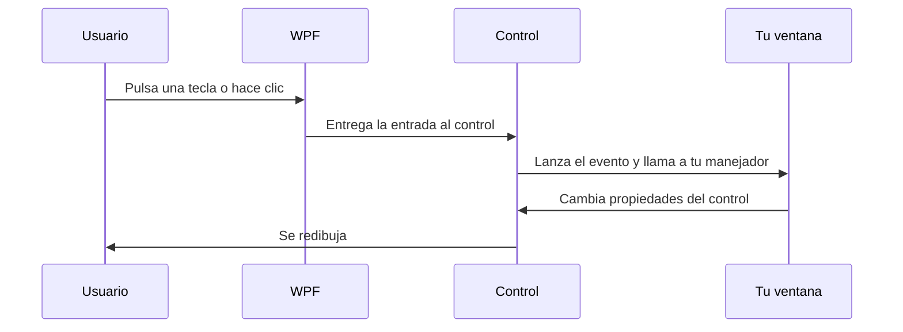
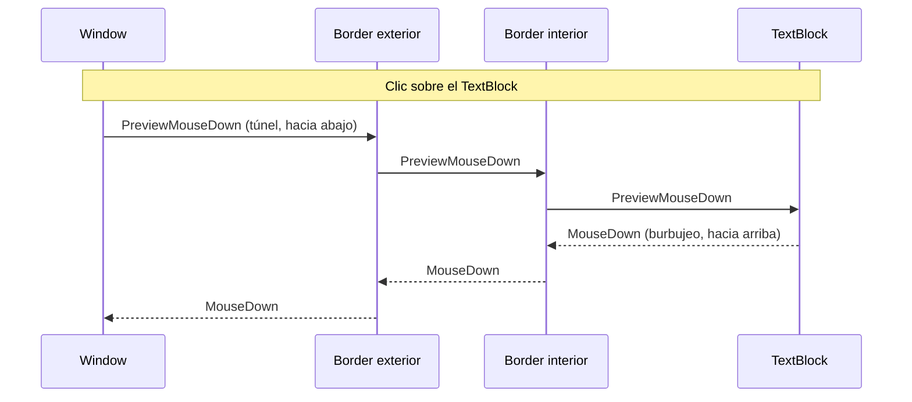

# 6. Eventos

[⬅️ Volver a la unidad](./README.md)

**CE que trabaja este tema:** RA1 g.

## Índice

- [6.1. Una aplicación que reacciona](#61-una-aplicación-que-reacciona)
- [6.2. Los manejadores de eventos](#62-los-manejadores-de-eventos)
  - [6.2.1. Asociar un evento a un método](#621-asociar-un-evento-a-un-método)
  - [6.2.2. La firma: `sender` y los argumentos](#622-la-firma-sender-y-los-argumentos)
  - [6.2.3. Un manejador para varios controles](#623-un-manejador-para-varios-controles)
  - [6.2.4. Suscribirse desde código](#624-suscribirse-desde-código)
- [6.3. Eventos enrutados](#63-eventos-enrutados)
  - [6.3.1. El problema: un botón con contenido](#631-el-problema-un-botón-con-contenido)
  - [6.3.2. Burbujeo y túnel](#632-burbujeo-y-túnel)
  - [6.3.3. `Source`, `OriginalSource` y `Handled`](#633-source-originalsource-y-handled)
  - [6.3.4. Delegar en un contenedor](#634-delegar-en-un-contenedor)
- [6.4. Eventos de la ventana](#64-eventos-de-la-ventana)
- [6.5. Teclado](#65-teclado)
- [6.6. Ratón](#66-ratón)
- [6.7. Atajos de teclado](#67-atajos-de-teclado)
- [6.8. Diálogos y `MessageBox`](#68-diálogos-y-messagebox)
  - [6.8.1. `MessageBox`](#681-messagebox)
  - [6.8.2. Diálogos del sistema para ficheros](#682-diálogos-del-sistema-para-ficheros)
- [6.9. Cómo escribir un buen manejador](#69-cómo-escribir-un-buen-manejador)
- [6.10. Ejemplo integrador: un bloc de notas](#610-ejemplo-integrador-un-bloc-de-notas)
- [6.11. Errores frecuentes](#611-errores-frecuentes)
- [Resumen](#resumen)
- [Ejercicios de reflexión](#ejercicios-de-reflexión)

---

## 6.1. Una aplicación que reacciona

Una aplicación gráfica **no tiene un principio y un final como un programa de consola**: se abre, espera, y cada acción del usuario (un clic, una tecla, cerrar la ventana) provoca una reacción. Cada una de esas acciones llega a tu código como un **evento**.

Los eventos ya los conoces de la unidad anterior: un **publicador** declara un `event`, y los **suscriptores** añaden un método con `+=`. En WPF cada control es un publicador y tu ventana es el suscriptor.

| En la unidad anterior | En WPF |
|-----------------------|--------|
| El publicador es una clase tuya (`Termostato`) | Es un control (`Button`, `TextBox`, `Window`…) |
| El evento se lanza con `OnCambio(…)` | Lo lanza WPF cuando pasa algo (un clic, una tecla…) |
| El suscriptor se añade con `+=` | Se asocia con un atributo del XAML (o con `+=`) |
| Los datos van en un `EventArgs` | Van en un `EventArgs` más rico: `KeyEventArgs`, `MouseButtonEventArgs`… |



Cada control tiene decenas de eventos. Estos son los que usarás con más frecuencia:

| Control | Evento | Cuándo se lanza |
|---------|--------|-----------------|
| `Button` | `Click` | Se pulsa y se suelta el botón |
| `TextBox` | `TextChanged` | Cambia el texto |
| `TextBox` | `SelectionChanged` | Cambia la selección o el cursor |
| `CheckBox` | `Checked`, `Unchecked`, `Click` | Se marca, se desmarca o se pulsa |
| `ComboBox`, `ListBox` | `SelectionChanged` | Cambia el elemento elegido |
| `Slider` | `ValueChanged` | Cambia el valor |
| `Window` | `Loaded`, `Closing`, `Closed` | La ventana se carga, se va a cerrar, se ha cerrado |
| Cualquier control | `KeyDown`, `MouseDown`, `GotFocus`… | Teclado, ratón, foco |

> 📝 **Nota del Profesor**: la pregunta de este tema es siempre la misma: **¿qué evento me interesa, de qué control y qué hago cuando se lanza?** Si sabes responderla, sabes programar una interfaz con WPF.

---

## 6.2. Los manejadores de eventos

### 6.2.1. Asociar un evento a un método

Un **manejador de eventos** (*event handler*) es el método que se ejecuta cuando se lanza el evento. Hay varias formas de asociarlo; todas hacen lo mismo:

| Forma | Cómo |
|-------|------|
| **Doble clic en el control** (diseñador) | Visual Studio asocia el **evento por defecto** del control (`Click` en un botón, `TextChanged` en una caja, `SelectionChanged` en una lista) y crea el método |
| **Pestaña de eventos** de la ventana Propiedades (icono del rayo) | Cualquier evento: haces doble clic a su derecha y Visual Studio crea el método |
| **Escribir el atributo en el XAML** | `Click="btnGuardar_Click"` y, al escribirlo, el IntelliSense ofrece `<Nuevo controlador de eventos>` |
| **Escribir `+=` en C#** | `btnGuardar.Click += btnGuardar_Click;` (apartado 6.2.4) |

Para el XAML y el código siguientes:

```xml
<Button x:Name="btnGuardar"
        Content="Guardar"
        Click="btnGuardar_Click" />
```

```csharp
private void btnGuardar_Click(object sender, RoutedEventArgs e)
{
    // lo que ocurre al pulsar
}
```

el compilador comprueba que el método **existe** y que su **firma** coincide con la del evento. El nombre sigue la costumbre `<control>_<Evento>`: es el que genera Visual Studio y el que se admite en las convenciones del módulo.

> ⚠️ **Cuidado**: si **borras un manejador** del `.xaml.cs` pero dejas el atributo en el XAML (o al revés), el proyecto no compila. Si quieres quitar un evento, bórralo **en los dos sitios**, mejor desde la ventana Propiedades.

### 6.2.2. La firma: `sender` y los argumentos

Todos los manejadores tienen **dos parámetros**, como el patrón de eventos de .NET que viste en la unidad anterior:

| Parámetro | Qué es |
|-----------|--------|
| `sender` (`object`) | **El objeto que tiene suscrito el manejador** (casi siempre el control que lo lanzó) |
| `e` (un `EventArgs`) | **Los datos del evento**: cuál es el tipo depende del evento |

El tipo de `e` te dice qué información trae:

| Tipo de `e` | Eventos | Información útil |
|-------------|---------|------------------|
| `RoutedEventArgs` | `Click`, `Loaded`, `GotFocus` | `Source`, `OriginalSource`, `Handled` |
| `KeyEventArgs` | `KeyDown`, `KeyUp` | `Key`, `IsRepeat` |
| `TextCompositionEventArgs` | `PreviewTextInput` | `Text` (lo que se va a escribir) |
| `MouseButtonEventArgs` | `MouseDown`, `MouseLeftButtonDown` | `ChangedButton`, `ClickCount`, `GetPosition(…)` |
| `MouseWheelEventArgs` | `MouseWheel` | `Delta` (la cantidad de giro) |
| `SelectionChangedEventArgs` | `SelectionChanged` | `AddedItems`, `RemovedItems` |
| `RoutedPropertyChangedEventArgs<double>` | `Slider.ValueChanged` | `OldValue`, `NewValue` |
| `CancelEventArgs` | `Window.Closing` | `Cancel` (poner a `true` para impedirlo) |

Cuando necesitas saber **qué control disparó** el evento, conviertes `sender`:

```csharp
private void Boton_Click(object sender, RoutedEventArgs e)
{
    if (sender is Button boton)
    {
        txtResultado.Text = $"Has pulsado {boton.Content}";
    }
}
```

El patrón `is Button boton` comprueba el tipo y lo convierte a la vez (unidad anterior).

### 6.2.3. Un manejador para varios controles

Si tres botones hacen casi lo mismo, escribir tres manejadores duplica código. Se puede asociar **el mismo método** a todos y distinguirlos por `sender`. La propiedad **`Tag`**, que existe en todos los controles y admite cualquier objeto, sirve para llevar un dato extra:

```xml
<Button Content="Infantil" Tag="15" Click="Categoria_Click" />
<Button Content="Adulto"   Tag="35" Click="Categoria_Click" />
<Button Content="Senior"   Tag="25" Click="Categoria_Click" />
```

```csharp
private void Categoria_Click(object sender, RoutedEventArgs e)
{
    var boton = (Button)sender;
    txtCuota.Text = $"{boton.Content}: {boton.Tag} € al mes";
}
```

> ✅ **Buena práctica**: un manejador compartido, con `sender` y `Tag` (o `Name`) para distinguir, es mejor que tres copias. Cuando la diferencia entre botones es grande, mejor manejadores distintos que llamen a un método común.

### 6.2.4. Suscribirse desde código

Todo lo que hace el atributo del XAML se puede hacer con `+=`, como en la unidad anterior. Es útil cuando el control **se crea desde código** o cuando se quiere **dejar de escuchar** con `-=`:

```csharp
public MainWindow()
{
    InitializeComponent();

    btnGuardar.Click += btnGuardar_Click;                       // un método
    btnGuardar.Click += (emisor, e) => txtEstado.Text = "Hecho"; // una lambda

    btnGuardar.Click -= btnGuardar_Click;                       // se deja de escuchar
}
```

Una lambda no se puede quitar con `-=` (no tiene nombre), así que, si habrá que dejar de escuchar, usa un método.

> 💡 **Tip del Examinador**: *«¿Qué diferencia hay entre asociar el evento en el XAML y con `+=`?»* Ninguna en el resultado: el compilador convierte el atributo en un `+=` dentro de `InitializeComponent`. La diferencia es de comodidad: el XAML es más visible y el código permite quitar el manejador o asociarlo en un momento concreto.

---

## 6.3. Eventos enrutados

### 6.3.1. El problema: un botón con contenido

En el tema 5 viste que un botón puede contener una imagen y un texto. Cuando el usuario hace clic **sobre el texto**, ¿quién recibe el clic: el `TextBlock`, el `StackPanel` que lo contiene o el `Button`? Para el usuario, ha pulsado «el botón». Pero el ratón está encima del `TextBlock`.

Si el evento solo se lanzara en el elemento que está bajo el puntero, habría que suscribirse a cada pieza interior del botón. La solución de WPF son los **eventos enrutados** (*routed events*): un evento que **viaja por el árbol de elementos** (el árbol visual del tema 3) y puede ser atendido por cualquiera de los elementos por los que pasa.

### 6.3.2. Burbujeo y túnel

Un evento enrutado puede recorrer el árbol de tres maneras:

| Estrategia | Dirección | Nombre | Para qué |
|------------|-----------|--------|----------|
| **Directo** (*direct*) | Solo en el elemento donde se origina | `MouseEnter`, `MouseLeave` | Como un evento normal de .NET |
| **Burbujeo** (*bubbling*) | **Hacia arriba**: del elemento al padre, al abuelo… hasta la ventana | `MouseDown`, `KeyDown`, `Click` | Que un contenedor atienda lo que ocurre dentro |
| **Túnel** (*tunneling*) | **Hacia abajo**: de la ventana hacia el elemento | `PreviewMouseDown`, `PreviewKeyDown` | Que un contenedor **intervenga antes** que el elemento |

Los eventos de túnel se reconocen porque su nombre **empieza por `Preview`**. Suelen ir en parejas: `PreviewMouseDown` baja por el árbol y, después, `MouseDown` sube.



Primero se lanza la versión **túnel**, de fuera adentro; después, la de **burbujeo**, de dentro afuera. El proyecto [`ejemplos/06-LaboratorioEventos`](./ejemplos/06-LaboratorioEventos) lo muestra: dos bordes anidados con un texto dentro, y una lista donde cada manejador escribe qué evento recibe y quién lo origina.

```csharp
private void Rastro(object sender, MouseButtonEventArgs e)
{
    var receptor = ((FrameworkElement)sender).Name;
    var origen = (e.OriginalSource as FrameworkElement)?.Name;

    lstRastro.Items.Add($"{e.RoutedEvent.Name} en {receptor} (origen: {origen})");
}
```

Al hacer clic sobre el texto del centro, la lista debe mostrar:

```text
PreviewMouseDown en bordeExterior (origen: txtCentro)
PreviewMouseDown en bordeInterior (origen: txtCentro)
PreviewMouseDown en txtCentro (origen: txtCentro)
MouseDown en txtCentro (origen: txtCentro)
MouseDown en bordeInterior (origen: txtCentro)
MouseDown en bordeExterior (origen: txtCentro)
```

> 🔁 **Transferencia**: es el mismo modelo del DOM de una página web: los eventos de JavaScript **burbujean** (`bubbles`) y se pueden interceptar antes con la **fase de captura** (`capture`). Lo que en HTML es `addEventListener(…, true)`, en WPF es un evento `Preview…`.

### 6.3.3. `Source`, `OriginalSource` y `Handled`

Los argumentos de un evento enrutado (`RoutedEventArgs`) llevan tres datos clave:

| Propiedad | Qué contiene |
|-----------|--------------|
| `sender` | El elemento **donde está el manejador** que se está ejecutando |
| `e.Source` | El elemento que **originó** el evento, desde el punto de vista del árbol lógico |
| `e.OriginalSource` | El elemento **exacto** (a veces una pieza interior del control) donde se produjo |
| `e.Handled` | Si es `true`, el evento ya está **atendido**: **deja de propagarse** |

Poner **`e.Handled = true`** detiene el viaje: los manejadores de los demás elementos **no se ejecutan**. Se usa para decir «esto ya lo he gestionado yo»:

```csharp
private void txtSocios_PreviewTextInput(object sender, TextCompositionEventArgs e)
{
    // Si lo que se va a escribir no son solo cifras, se descarta antes de que llegue al cuadro
    e.Handled = !e.Text.All(char.IsDigit);
}
```

Este manejador usa un evento de túnel (`PreviewTextInput`) para **impedir** que se escriban caracteres que no sean cifras. Como se ejecuta **antes** de que el texto llegue al `TextBox`, basta con marcarlo como atendido para que ese texto no se escriba.

En el laboratorio, la casilla «Detener el evento en el borde interior» pone `e.Handled = true` en `PreviewMouseDown` del borde interior. Entonces la lista muestra solo los dos primeros mensajes: el túnel se detiene y los manejadores del burbujeo no llegan a ejecutarse. Cuando un evento `Preview…` queda marcado como atendido, los manejadores de su pareja de burbujeo **tampoco** se ejecutan.

> ⚠️ **Cuidado**: `Button` **marca como atendido** el `MouseLeftButtonDown` para poder generar su `Click`. Por eso un `MouseDown` de burbujeo asociado a un contenedor **no se entera** de los clics sobre los botones que contiene. Para eso hay dos soluciones: usar el evento `PreviewMouseDown`, que baja antes, o atender el propio `Click` (apartado siguiente).

### 6.3.4. Delegar en un contenedor

El burbujeo permite un patrón muy cómodo, la **delegación**: en lugar de asociar el evento a cada hijo, se asocia **una sola vez al contenedor**. Para ello, el evento se escribe con el nombre de la clase que lo define (`Button.Click`), como una propiedad adjunta:

```xml
<StackPanel Orientation="Horizontal"
            Button.Click="Categoria_Click">
    <Button Content="Infantil" Tag="15" />
    <Button Content="Adulto" Tag="35" />
    <Button Content="Senior" Tag="25" />
</StackPanel>
```

```csharp
private void Categoria_Click(object sender, RoutedEventArgs e)
{
    if (e.OriginalSource is not Button boton)
    {
        return;
    }

    txtCuota.Text = $"{boton.Content}: {boton.Tag} € al mes";
}
```

El `Click` de cada botón **sube** hasta el `StackPanel`, donde se atiende. Aquí `sender` es el panel (donde está el manejador) y `OriginalSource` es el botón concreto. Es la forma de reaccionar a cualquier control que se añada más tarde al panel, sin tocar el XAML.

---

## 6.4. Eventos de la ventana

Una ventana lanza eventos a lo largo de su vida. Los que más se usan:

| Evento | Cuándo | Usos típicos |
|--------|--------|--------------|
| `Loaded` | La ventana y sus controles ya están creados y cargados | Dar el foco inicial; cargar datos |
| `ContentRendered` | La ventana se ha dibujado por primera vez | Algo que necesita ver la pantalla |
| `Activated` y `Deactivated` | La ventana gana o pierde el foco del usuario | Actualizar datos al volver |
| `SizeChanged` | Cambia el tamaño | Reajustar algo que el diseño no resuelve |
| **`Closing`** | **Se va a cerrar** (se puede cancelar) | **Preguntar si hay cambios sin guardar** |
| `Closed` | Ya se ha cerrado | Liberar recursos |

El evento `Closing` es el más útil: su argumento (`CancelEventArgs`) tiene una propiedad `Cancel` que, puesta a `true`, **impide cerrar la ventana**:

```csharp
private void Window_Closing(object? sender, CancelEventArgs e)
{
    if (!_modificado)
    {
        return;
    }

    var respuesta = MessageBox.Show(
        "Hay cambios sin guardar. ¿Quieres salir sin guardarlos?",
        "Bloc de notas",
        MessageBoxButton.YesNo,
        MessageBoxImage.Warning,
        MessageBoxResult.No);

    if (respuesta == MessageBoxResult.No)
    {
        e.Cancel = true;
    }
}
```

Y para el foco inicial, `Loaded` con una lambda (la ventana no está lista dentro del constructor):

```csharp
public MainWindow()
{
    InitializeComponent();
    Loaded += (_, _) => txtSocio.Focus();
}
```

> 📝 **Nota del Profesor**: `Window_Closing` se llama **siempre que se cierra** la ventana, sea con la cruz, con `Alt+F4` o llamando a `Close()` desde un botón de «Salir». Por eso es el sitio para comprobar los cambios sin guardar: así no hace falta repetir la comprobación en cada camino.

---

## 6.5. Teclado

Cuando se pulsa una tecla, WPF lanza varios eventos, de túnel y de burbujeo:

| Evento | Cuándo | Argumentos |
|--------|--------|------------|
| `PreviewKeyDown` y `KeyDown` | Se pulsa una tecla (se repite si se mantiene) | `KeyEventArgs`: `Key` |
| `PreviewKeyUp` y `KeyUp` | Se suelta | `KeyEventArgs` |
| `PreviewTextInput` y `TextInput` | Se va a **escribir texto** (ya con mayúsculas, acentos…) | `TextCompositionEventArgs`: `Text` |

Para saber **qué tecla** se ha pulsado, `e.Key` es un valor de la enumeración `Key`. Las **teclas modificadoras** (`Ctrl`, `Mayús`, `Alt`) se consultan en `Keyboard.Modifiers`:

```csharp
private void txtContenido_PreviewKeyDown(object sender, KeyEventArgs e)
{
    if (e.Key == Key.F5)
    {
        // F5 inserta la fecha y la hora en la posición del cursor
        var texto = DateTime.Now.ToString("HH:mm dd/MM/yyyy");
        var inicio = txtContenido.SelectionStart;
        txtContenido.SelectedText = texto;
        txtContenido.CaretIndex = inicio + texto.Length;
        e.Handled = true;
    }
}
```

```csharp
if (e.Key == Key.S && Keyboard.Modifiers == ModifierKeys.Control)
{
    // Ctrl + S
}
```

Dos eventos de teclado que se confunden:

| | `KeyDown` | `TextInput` |
|---|-----------|-------------|
| Qué recibe | La **tecla física** (`Key.A`, `Key.Enter`, `Key.F5`) | El **texto** que produce (`"a"`, `"A"`, `"ñ"`) |
| Úsalo para | Teclas de función, flechas, `Intro`, atajos | **Filtrar** lo que se escribe |

También hay eventos de **foco**: `GotFocus` y `LostFocus` se lanzan cuando un control recibe o pierde el foco. `LostFocus` es el momento natural para validar un campo cuando el usuario sale de él.

> ⚠️ **Cuidado**: filtrar con `PreviewTextInput` **no cubre pegar** con `Ctrl+V` ni arrastrar texto. Si el campo debe aceptar solo cifras, hay que añadir también un manejador de pegado con `DataObject.AddPastingHandler`. Y, sea como sea, el valor se **vuelve a validar** al leerlo (tema 11).

> ⚠️ **Cuidado**: cuando se pulsa una tecla junto con `Alt`, `e.Key` vale `Key.System` y la tecla real está en `e.SystemKey`.

---

## 6.6. Ratón

| Evento | Cuándo | Observaciones |
|--------|--------|---------------|
| `MouseEnter`, `MouseLeave` | El puntero entra o sale del elemento | Directos |
| `MouseMove` | El puntero se mueve sobre el elemento | Se lanza muchas veces por segundo |
| `MouseDown`, `MouseUp` | Se pulsa o suelta **cualquier** botón | `e.ChangedButton` dice cuál |
| `MouseLeftButtonDown`, `MouseLeftButtonUp`, `MouseRightButtonDown`… | Un botón concreto | Más cómodos si te interesa solo uno |
| `MouseDoubleClick` | Doble clic (en controles como `ListBox`, `DataGrid`…) | |
| `MouseWheel` | Se gira la rueda | `e.Delta` positivo hacia arriba |

La información del puntero se obtiene del argumento. El método **`GetPosition`** da las coordenadas **relativas a un elemento**:

```csharp
private void cnvPista_MouseMove(object sender, MouseEventArgs e)
{
    var posicion = e.GetPosition(cnvPista);
    txtPosicion.Text = $"x = {posicion.X:0}, y = {posicion.Y:0}";
}

private void cnvPista_MouseLeftButtonDown(object sender, MouseButtonEventArgs e)
{
    var posicion = e.GetPosition(cnvPista);
    var punto = new Ellipse { Width = 16, Height = 16, Fill = Brushes.SteelBlue };

    Canvas.SetLeft(punto, posicion.X - 8);
    Canvas.SetTop(punto, posicion.Y - 8);
    cnvPista.Children.Add(punto);
}
```

Aquí se usa un `Canvas` (tema 4): es de las pocas situaciones en las que las **coordenadas absolutas** son lo adecuado. También se puede saber qué botones están pulsados (`e.LeftButton == MouseButtonState.Pressed`) y combinar con las teclas modificadoras.

```csharp
private void txtContenido_PreviewMouseWheel(object sender, MouseWheelEventArgs e)
{
    // Ctrl + rueda cambia el tamaño de la letra; sin Ctrl, la rueda desplaza el texto como siempre
    if (Keyboard.Modifiers != ModifierKeys.Control)
    {
        return;
    }

    var tamano = txtContenido.FontSize + (e.Delta > 0 ? 1 : -1);
    txtContenido.FontSize = Math.Clamp(tamano, 8, 48);
    e.Handled = true;
}
```

Aquí `e.Handled = true` evita que, además de cambiar el tamaño, el texto se desplace.

> 💡 **Tip del Examinador**: *«¿Por qué `MouseMove` puede ralentizar la aplicación?»* Porque se lanza **cientos de veces por segundo**. El manejador debe hacer lo mínimo (leer la posición y actualizar un texto, como arriba) y nada costoso.

---

## 6.7. Atajos de teclado

Los atajos (`Ctrl+N`, `Ctrl+S`…) se podrían construir con `KeyDown` y `Keyboard.Modifiers`, pero es incómodo: hay que gestionarlos en cada control, no se ven en los menús y no se deshabilitan solos. WPF los resuelve con **comandos**. Un comando es una **acción con nombre** (Nuevo, Abrir, Guardar…) que se puede lanzar desde un menú, un botón o un atajo, y que sabe si está disponible.

WPF trae comandos **predefinidos** en `ApplicationCommands` (`New`, `Open`, `Save`, `Cut`, `Copy`, `Paste`, `Undo`…), cada uno con **su atajo habitual**: `Ctrl+N`, `Ctrl+O`, `Ctrl+S`, `Ctrl+X`… Se usan en tres pasos.

**1. Se vincula el comando a un método** en la ventana, con `CommandBinding`:

```xml
<Window.CommandBindings>
    <CommandBinding Command="ApplicationCommands.Save"
                    Executed="Guardar_Executed"
                    CanExecute="Guardar_CanExecute" />
</Window.CommandBindings>
```

**2. Se escribe el código**:

```csharp
private void Guardar_Executed(object sender, ExecutedRoutedEventArgs e)
{
    Guardar();
}

private void Guardar_CanExecute(object sender, CanExecuteRoutedEventArgs e)
{
    e.CanExecute = _modificado;
}
```

`Executed` es lo que hace el comando. `CanExecute` responde **si está disponible**: si devuelve `false`, el atajo no hace nada y las opciones de menú y botones que usen el comando **se ponen en gris solas**.

**3. Se usa el comando** en un menú, un botón o con el atajo:

```xml
<MenuItem Header="_Guardar"
          Command="ApplicationCommands.Save" />
```

La opción de menú **muestra el atajo** (`Ctrl+S`) por sí sola, sin `InputGestureText`, y se activa o desactiva según `CanExecute`. El atajo `Ctrl+S` funciona en toda la ventana.

Si quieres **otro atajo** para un comando, se añade con `KeyBinding`:

```xml
<Window.InputBindings>
    <KeyBinding Gesture="Ctrl+Shift+S"
                Command="ApplicationCommands.SaveAs" />
</Window.InputBindings>
```

Los comandos de **edición** (`Cut`, `Copy`, `Paste`, `Undo`) funcionan **sin escribir código**: se aplican al control que tiene el foco, por ejemplo un `TextBox`, que ya sabe atenderlos.

| Quieres… | Usa |
|----------|-----|
| Una acción con atajo, que se pueda usar desde menú y barra de herramientas y se desactive sola | Un **comando** (`ApplicationCommands`) |
| Reaccionar a una tecla concreta en un control (como `F5` en el cuadro de texto) | `PreviewKeyDown` o `KeyDown` |
| Una tecla de acceso para un control de un formulario | El guion bajo (`_`) del tema 5 |

> 📝 **Nota del Profesor**: de momento solo usas comandos predefinidos. En el tema 10 verás cómo se crean los tuyos y cómo `ICommand` sustituye a `Click` en MVVM. Lo importante ahora es la idea: **separar «qué hace la acción» de «desde dónde se lanza»**.

> 🔁 **Transferencia**: es el mismo concepto que las *actions* de Swing y de JavaFX y los `Intent` de Android: una acción que varios elementos de la interfaz pueden compartir.

---

## 6.8. Diálogos y `MessageBox`

### 6.8.1. `MessageBox`

`MessageBox.Show` muestra un mensaje en una ventana **modal**: el usuario tiene que cerrarla antes de seguir con la ventana de la aplicación, y la ejecución del código **se detiene** en esa línea hasta que responde. Devuelve un `MessageBoxResult` con el botón que pulsó.

```csharp
var respuesta = MessageBox.Show(
    "Hay cambios sin guardar. ¿Quieres guardarlos?",   // el mensaje
    "Bloc de notas",                                   // el título
    MessageBoxButton.YesNoCancel,                      // los botones
    MessageBoxImage.Question,                          // el icono
    MessageBoxResult.Cancel);                          // el botón por defecto

if (respuesta == MessageBoxResult.Yes)
{
    // guardar
}
```

Las opciones de botones e iconos:

| `MessageBoxButton` | Botones |
|--------------------|---------|
| `OK` | Aceptar |
| `OKCancel` | Aceptar, Cancelar |
| `YesNo` | Sí, No |
| `YesNoCancel` | Sí, No, Cancelar |
| `AbortRetryIgnore` (.NET 10) | Anular, Reintentar, Ignorar |
| `RetryCancel` (.NET 10) | Reintentar, Cancelar |
| `CancelTryContinue` (.NET 10) | Cancelar, Volver a intentar, Continuar |

Los iconos más usados son `Information` (informar), `Question` (preguntar), `Warning` (advertir) y `Error` (algo ha fallado). Con los botones nuevos de .NET 10 el resultado puede ser también `Abort`, `Retry`, `Ignore`, `TryAgain` o `Continue`.

También hay una versión con **propietario**, que centra el mensaje sobre la ventana: `MessageBox.Show(this, "…", "Título")`.

Las pautas de la UD1 sobre **mensajes** se concretan así:

| Pauta | En la práctica |
|-------|----------------|
| El mensaje debe **explicar** qué ha pasado y qué puede hacer el usuario | «No se ha podido guardar el fichero. Comprueba que tienes permiso de escritura» y no «Error 5» |
| Un **título** que identifique la aplicación o el tipo de mensaje | `"Falta un dato"`, `"Bloc de notas"` |
| **Icono acorde a la gravedad** | `Information`, `Warning` o `Error`, sin mezclarlos |
| Botones que **respondan a la pregunta** | Con `YesNo`, redacta una pregunta que se conteste con sí o no |
| El botón por defecto, **el menos destructivo** | `MessageBoxResult.No` o `Cancel` al borrar o salir sin guardar |
| **No abusar**: un mensaje por cada acción molesta | Avisa de lo que el usuario necesita saber, no de cada cosa que sale bien |

> ⚠️ **Cuidado**: `MessageBox` solo sirve para un **mensaje corto con pocos botones**. Si necesitas que el usuario introduzca datos o elija entre opciones, usa una **ventana propia** como diálogo (tema 7).

### 6.8.2. Diálogos del sistema para ficheros

Windows ofrece diálogos estándar para elegir ficheros. En WPF están en `Microsoft.Win32`:

| Clase | Para qué |
|-------|----------|
| `OpenFileDialog` | Elegir un fichero para **abrir** (con `Multiselect`, varios) |
| `SaveFileDialog` | Elegir dónde **guardar** |
| `OpenFolderDialog` | Elegir una **carpeta** |

Se muestran con `ShowDialog()`, que devuelve **`bool?`**: `true` si el usuario aceptó, `false` o `null` si canceló. Hay que **comprobar** el resultado antes de usar el nombre del fichero:

```csharp
var dialogo = new OpenFileDialog
{
    Filter = "Texto (*.txt)|*.txt|Todos los ficheros (*.*)|*.*"
};

if (dialogo.ShowDialog(this) == true)
{
    var contenido = File.ReadAllText(dialogo.FileName);
}
```

El **filtro** (`Filter`) es una lista de pares «descripción|patrón» separados por `|`. Y como un fichero puede no existir, estar en uso o no permitir el acceso, la lectura y la escritura van dentro de `try-catch` con las excepciones de la unidad anterior (`IOException`, `UnauthorizedAccessException`).

---

## 6.9. Cómo escribir un buen manejador

Un manejador es el sitio donde se junta la **vista** con la **lógica**, y es muy fácil que acabe lleno de cosas. Estas pautas lo evitan:

1. **Corto.** Leer lo que ha puesto el usuario, validarlo, llamar a un método que hace el trabajo y mostrar el resultado.
2. **Sin duplicados.** Si dos manejadores tienen código parecido, sácalo a un método privado (como `ConfirmarCambios` en el ejemplo) o comparte el manejador (apartado 6.2.3).
3. **Valida antes de actuar** y devuelve el foco al campo con el error (tema 5).
4. **Nada lento dentro.** Mientras un manejador se ejecuta, **la ventana no responde**: no se redibuja ni atiende al ratón. Una lectura larga de un fichero o una consulta lenta la dejan «colgada». La solución, con `async` y `await`, llega en el tema 10.
5. **Controla lo que puede fallar** (ficheros, conversiones) con `try-catch` y un mensaje útil, nunca con un `catch` vacío.
6. **Sin lógica de negocio.** El cálculo de una cuota o las reglas de una reserva no son cosa de la ventana.

> 📝 **Nota del Profesor**: la sexta pauta es la que nos llevará al tema 8. Con diez controles no se nota; con cien, el *code-behind* se llena de lógica que mezcla pantalla y reglas, y no se puede probar sin abrir la ventana. Escribir los manejadores cortos y delegar en métodos desde ya hará más fácil el cambio de estructura.

---

## 6.10. Ejemplo integrador: un bloc de notas

Vamos a construir un **bloc de notas** que reúne casi todo el tema. El proyecto completo está en [`ejemplos/06-BlocNotas`](./ejemplos/06-BlocNotas).

**Lo que hace:**

| Función | Evento o mecanismo |
|---------|--------------------|
| Contar caracteres | `TextChanged` del cuadro de texto |
| Mostrar línea y columna | `SelectionChanged` |
| Marcar el documento como modificado (título con `*`) | `TextChanged` |
| Insertar fecha y hora con `F5` | `PreviewKeyDown` |
| Cambiar el tamaño de letra con `Ctrl` + rueda | `PreviewMouseWheel` y `Keyboard.Modifiers` |
| Nuevo, Abrir, Guardar, con sus atajos | `CommandBinding` con `ApplicationCommands` |
| Guardar deshabilitado si no hay cambios | `CanExecute` |
| Deshacer, Cortar, Copiar y Pegar | Comandos predefinidos, sin código |
| Abrir y guardar ficheros | `OpenFileDialog` y `SaveFileDialog` |
| Preguntar si se sale con cambios sin guardar | `Closing` y `MessageBox` |
| Errores de lectura y escritura | `try-catch` y `MessageBox` con icono de error |

**Dos detalles de diseño:**

- El **mismo método** `ConfirmarCambios()` lo usan *Nuevo*, *Abrir* y el cierre de la ventana: la pregunta «¿quieres guardar los cambios?» está escrita **una sola vez**.
- Al abrir un fichero se asigna `Text`, que lanza `TextChanged` y marca el documento como modificado. Por eso, **después** de asignarlo, el código vuelve a poner `_modificado = false`.

```csharp
private bool ConfirmarCambios()
{
    if (!_modificado)
    {
        return true;
    }

    var respuesta = MessageBox.Show(
        "Hay cambios sin guardar. ¿Quieres guardarlos?",
        NombreAplicacion,
        MessageBoxButton.YesNoCancel,
        MessageBoxImage.Question,
        MessageBoxResult.Cancel);

    return respuesta switch
    {
        MessageBoxResult.Yes => Guardar(),
        MessageBoxResult.No => true,
        _ => false
    };
}

private void Window_Closing(object? sender, CancelEventArgs e)
{
    if (!ConfirmarCambios())
    {
        e.Cancel = true;
    }
}
```

**Prueba la aplicación así:**

| Prueba | Resultado esperado |
|--------|--------------------|
| Escribir una letra | El título pasa a `*Sin título - Bloc de notas` y el contador sube |
| Mover el cursor con las flechas | La barra de estado cambia de línea y columna |
| Pulsar `F5` | Aparece la fecha y la hora en el cursor |
| `Ctrl` + rueda del ratón | Cambia el tamaño de la letra; sin `Ctrl`, desplaza el texto |
| Menú **Archivo** con el texto sin guardar | **Guardar** está activo; con el texto ya guardado, en gris |
| `Ctrl+S` | Abre el diálogo de guardar la primera vez; las siguientes guarda directamente |
| Cerrar con cambios sin guardar | Pregunta; **Cancelar** deja la ventana abierta |
| Abrir un fichero que no existe (borrándolo antes de aceptar el diálogo) | Mensaje de error con icono rojo, sin que se cuelgue |
| Menú **Edición** | Deshacer, Cortar, Copiar y Pegar funcionan y muestran sus atajos |

**Actividad.** Añade la opción **Guardar como…** (`ApplicationCommands.SaveAs`) que pida siempre el nombre. ¿Qué parte del código reutilizas? ¿Cuántas líneas nuevas necesitas?

---

## 6.11. Errores frecuentes

| Síntoma | Causa habitual | Solución |
|---------|----------------|----------|
| No compila: «no contiene una definición para `X_Click`» | El atributo del XAML apunta a un método que no existe o se llama distinto | Crea el método con ese nombre y la firma correcta, o quita el atributo |
| El manejador no se ejecuta | Se ha borrado el atributo del XAML, o hay otro control encima que recibe el clic | Comprueba el atributo y mira el Árbol visual activo |
| Un `MouseDown` de un contenedor no se entera de los clics en un botón | `Button` marca el evento como atendido | Usa `PreviewMouseDown` o atiende el `Click` |
| Un manejador de burbujeo no se ejecuta | Otro manejador de más abajo puso `e.Handled = true` | Quita el `Handled` o usa el evento `Preview…` |
| `NullReferenceException` al arrancar, en un `ValueChanged` o `SelectionChanged` | El evento se lanza durante `InitializeComponent`, antes de que existan controles declarados después | Comprueba `is null` o reordena el XAML |
| `TextChanged` marca el documento como modificado al abrir un fichero | Asignar `Text` lanza el evento | Restablece el indicador **después** de asignar |
| El filtro de cifras deja pasar letras al pegar | `PreviewTextInput` no se lanza al pegar | Añade `DataObject.AddPastingHandler` y valida al leer |
| `InputGestureText="Ctrl+N"` no hace nada | Solo escribe el texto | Usa un comando (`ApplicationCommands.New`) |
| Un atajo de comando no funciona | El comando no tiene `CommandBinding` en la ventana, o `CanExecute` devuelve `False` | Revisa `Window.CommandBindings` y el método `CanExecute` |
| La ventana se queda «colgada» al pulsar un botón | El manejador hace algo lento | Divide el trabajo o usa `async` (tema 10) |
| `if (dialogo.ShowDialog())` no compila | `ShowDialog()` devuelve `bool?` | Compara con `== true` |
| `catch` que traga la excepción y el usuario no ve nada | `catch` vacío | Muestra un `MessageBox` con el error y qué hacer |

---

## Resumen

- Los eventos de WPF funcionan como los de la unidad anterior: el control es el **publicador** y tu ventana, el **suscriptor**. Se asocian con un atributo del XAML o con `+=`.
- Un manejador tiene la firma `(object sender, XxxEventArgs e)`. `sender` es el control con el manejador; el tipo de `e` depende del evento y trae sus datos.
- Un manejador se puede compartir entre controles distinguiéndolos con `sender` y `Tag`.
- Los **eventos enrutados** viajan por el árbol: **burbujeo** (hacia arriba), **túnel** (`Preview…`, hacia abajo) o directos. `e.Handled = true` los detiene, y `OriginalSource` indica quién los originó.
- Se puede **delegar** en un contenedor escribiendo `Button.Click="…"` en el panel.
- Los eventos de la ventana más útiles son `Loaded` (foco inicial) y `Closing` (preguntar antes de cerrar, con `e.Cancel`).
- **Teclado:** `KeyDown`/`PreviewKeyDown` para teclas y `PreviewTextInput` para filtrar texto. **Ratón:** `MouseDown`, `MouseMove`, `MouseWheel` y `GetPosition`.
- Los **atajos** se hacen con comandos (`ApplicationCommands`): `CommandBinding`, `Executed` y `CanExecute`. Los menús muestran el atajo y se deshabilitan solos.
- **`MessageBox`** da mensajes con título, botones, icono y botón por defecto (con los botones nuevos de .NET 10). `OpenFileDialog`, `SaveFileDialog` y `OpenFolderDialog` devuelven `bool?`.
- Un buen manejador es **corto**, valida, **no hace nada lento** ni contiene lógica de negocio.

---

## Ejercicios de reflexión

1. En el laboratorio, con la casilla «Detener» marcada, ¿por qué la lista solo muestra dos mensajes? ¿Y qué ocurriría si el manejador que pone `Handled` estuviera en `bordeExterior`?
2. Quieres que un `TextBox` acepte solo cifras. ¿Qué evento usas, `KeyDown` o `PreviewTextInput`? ¿Qué dos formas de entrar texto no cubre y cómo las resolverías?
3. Explica con tus palabras la diferencia entre `sender`, `e.Source` y `e.OriginalSource` en el ejemplo de la delegación (apartado 6.3.4).
4. Un compañero escribe `InputGestureText="Ctrl+S"` en una opción de menú y dice que «ya funciona el atajo». ¿Qué le dices y cómo lo arreglas?
5. Si cierras el bloc de notas con la cruz, con `Alt+F4` o con **Archivo > Salir**, siempre pregunta por los cambios. ¿En qué línea del código está la causa y por qué no hay que repetir la comprobación?
6. Escribe el manejador de un botón «Borrar» que pida confirmación con el botón **No** como predeterminado. Justifica el icono y el texto del mensaje con las pautas de la UD1.
7. El bloc de notas ya tiene más de 200 líneas de *code-behind* y es una aplicación pequeña. ¿Qué cosas del código crees que pertenecen a la ventana y cuáles no? Anota tres que sacarías a otra clase.

---

[⬅️ Volver a la unidad](./README.md)
