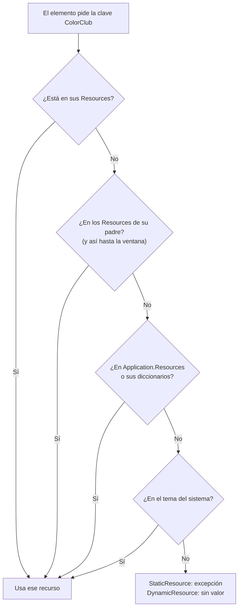
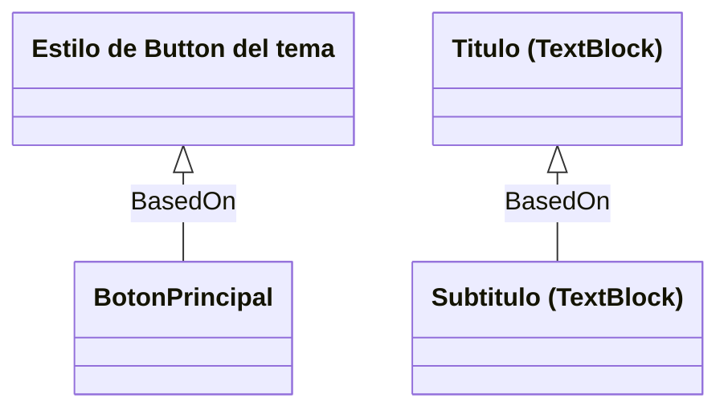
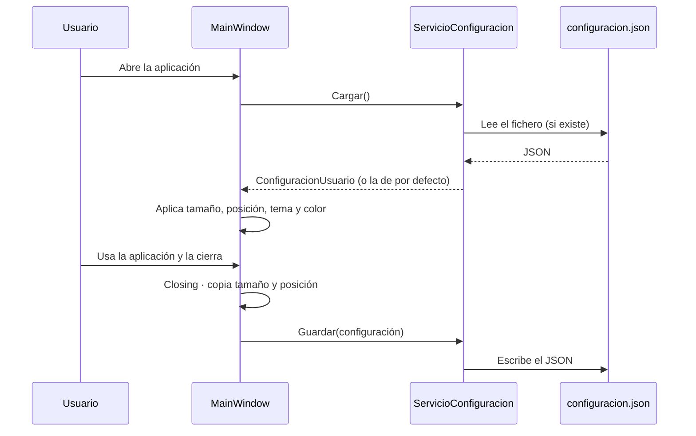
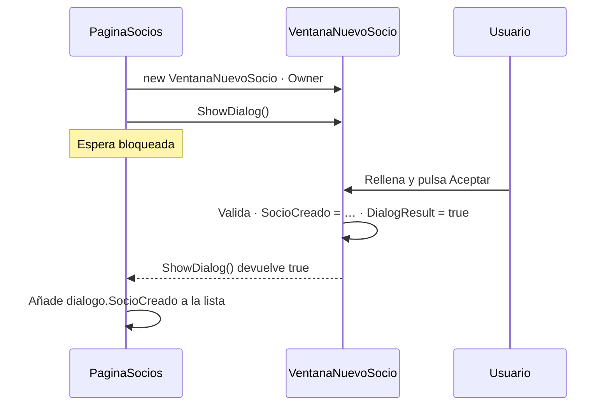
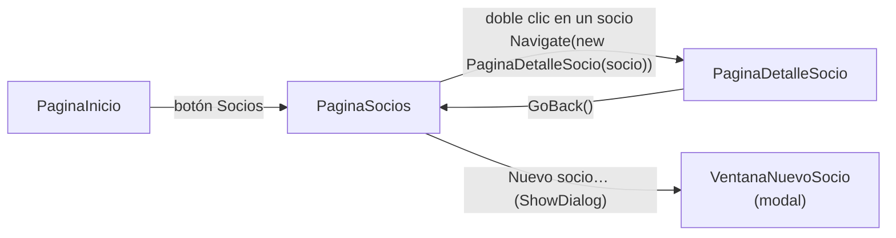

# 7. Recursos, estilos y navegación

[⬅️ Volver a la unidad](./README.md)

**CE que trabaja este tema:** RA1 d, f, h.

## Índice

- [7.1. El problema: el mismo aspecto copiado en cada control](#71-el-problema-el-mismo-aspecto-copiado-en-cada-control)
- [7.2. Recursos](#72-recursos)
  - [7.2.1. Qué es un recurso y dónde se define](#721-qué-es-un-recurso-y-dónde-se-define)
  - [7.2.2. `StaticResource` y `DynamicResource`](#722-staticresource-y-dynamicresource)
  - [7.2.3. Cómo se busca un recurso](#723-cómo-se-busca-un-recurso)
  - [7.2.4. Diccionarios de recursos](#724-diccionarios-de-recursos)
- [7.3. Estilos](#73-estilos)
  - [7.3.1. `Style` y `Setter`](#731-style-y-setter)
  - [7.3.2. Estilos con clave e implícitos](#732-estilos-con-clave-e-implícitos)
  - [7.3.3. Heredar un estilo con `BasedOn`](#733-heredar-un-estilo-con-basedon)
  - [7.3.4. Desencadenadores](#734-desencadenadores)
- [7.4. Tema claro y oscuro con el estilo Fluent](#74-tema-claro-y-oscuro-con-el-estilo-fluent)
- [7.5. Configuración del usuario](#75-configuración-del-usuario)
- [7.6. Varias ventanas](#76-varias-ventanas)
  - [7.6.1. Ventanas modales y no modales](#761-ventanas-modales-y-no-modales)
  - [7.6.2. Un diálogo propio](#762-un-diálogo-propio)
- [7.7. Navegar dentro de una ventana](#77-navegar-dentro-de-una-ventana)
  - [7.7.1. `Frame` y `Page`](#771-frame-y-page)
  - [7.7.2. `UserControl`: una pieza reutilizable](#772-usercontrol-una-pieza-reutilizable)
  - [7.7.3. `UserControl` como vista intercambiable](#773-usercontrol-como-vista-intercambiable)
  - [7.7.4. Cuál elegir](#774-cuál-elegir)
- [7.8. Ejemplos integradores](#78-ejemplos-integradores)
- [7.9. Errores frecuentes](#79-errores-frecuentes)
- [Resumen](#resumen)
- [Ejercicios de reflexión](#ejercicios-de-reflexión)

---

## 7.1. El problema: el mismo aspecto copiado en cada control

En la UD1 decidiste un **UI Kit**: unos colores, unos tamaños de letra y un espaciado de 8. Llevarlo a WPF control a control acaba así:

```xml
<Button Content="Guardar" Background="#2E7D32" Foreground="White" Padding="16,6" FontWeight="SemiBold" />
<Button Content="Inscribir" Background="#2E7D32" Foreground="White" Padding="16,6" FontWeight="SemiBold" />
<Button Content="Exportar" Background="#2E7D32" Foreground="White" Padding="16,6" FontWeight="SemiBold" />
```

Funciona, pero tiene tres problemas que ya conoces de la programación:

| Problema | Consecuencia |
|----------|--------------|
| **Duplicación** | El mismo color está escrito en 30 sitios |
| **Cambiar cuesta** | Si el club cambia su color, hay que buscarlo y sustituirlo en cada ventana |
| **Inconsistencia** | Basta con olvidar uno para que un botón se vea distinto |

La solución es la de siempre: **dar nombre a lo que se repite** y usarlo por su nombre. En WPF eso son los **recursos** (el valor con nombre) y los **estilos** (un conjunto de propiedades con nombre). Con ellos, el código de arriba queda así:

```xml
<Button Content="Guardar" Style="{StaticResource BotonPrincipal}" />
<Button Content="Inscribir" Style="{StaticResource BotonPrincipal}" />
<Button Content="Exportar" Style="{StaticResource BotonPrincipal}" />
```

> 📝 **Nota del Profesor**: este tema es el puente entre el diseño de la UD1 y la aplicación. Los valores del UI Kit (colores, tipografía, márgenes) pasan a ser **recursos**, y los componentes del UI Kit (botón principal, tarjeta, título) pasan a ser **estilos**. Si tu aplicación tiene un color escrito más de una vez, algo falta.

---

## 7.2. Recursos

### 7.2.1. Qué es un recurso y dónde se define

Un **recurso** es **cualquier objeto con una clave** (`x:Key`) guardado en un diccionario: un color, un pincel, un número, un margen, un texto, un estilo, una plantilla… Todos los elementos de WPF tienen una propiedad `Resources` donde guardarlos.

```xml
<Window.Resources>
    <SolidColorBrush x:Key="ColorClub" Color="#2E7D32" />
    <Thickness x:Key="MargenCampo">0,0,0,8</Thickness>
    <sys:String x:Key="NombreClub">Club Deportivo</sys:String>
</Window.Resources>
```

(Para usar `sys:String` hay que declarar en la cabecera el espacio de nombres de .NET donde está la clase `String`: `xmlns:sys="clr-namespace:System;assembly=System.Runtime"`. Es la misma sintaxis `clr-namespace` del tema 3.)

Un recurso se usa con una **extensión de marcado**:

```xml
<Border Background="{StaticResource ColorClub}"
        Margin="{StaticResource MargenCampo}" />
```

El sitio donde se define decide **quién lo ve** (su **ámbito**):

| Dónde | Lo ven |
|-------|--------|
| `Resources` de un elemento (`<Grid.Resources>`) | Ese elemento y lo que contiene |
| `Window.Resources` | Toda la ventana |
| `Application.Resources` (en `App.xaml`) | **Toda la aplicación** |
| Un diccionario de recursos (apartado 7.2.4) | Donde se incorpore |

> ✅ **Buena práctica**: lo que pertenece al UI Kit (colores, márgenes, estilos de botón) va a **`App.xaml`** o a un diccionario que se incorpora en ella. Lo que solo tiene sentido en una ventana, a su `Window.Resources`.

### 7.2.2. `StaticResource` y `DynamicResource`

Hay dos formas de usar un recurso:

| | `{StaticResource Clave}` | `{DynamicResource Clave}` |
|---|---|---|
| Cuándo busca el recurso | **Una vez**, al cargar el XAML | Cada vez que el recurso **se sustituye** |
| Si después se sustituye el recurso | El elemento **se queda con el antiguo** | El elemento **se actualiza** |
| Si la clave no existe | **Excepción** al abrir la ventana | No falla: la propiedad se queda sin valor |
| Rendimiento | Mejor | Algo peor (vigila los cambios) |
| Úsalo para | Casi todo | Lo que cambia en tiempo de ejecución: **color del club, tema** |

Para ver la diferencia, el ejemplo [`ejemplos/07-EstilosYTemas`](./ejemplos/07-EstilosYTemas) tiene dos rectángulos con el mismo recurso:

```xml
<Border Background="{StaticResource ColorClub}">…</Border>
<Border Background="{DynamicResource ColorClub}">…</Border>
```

Al elegir otro color, el código **sustituye** el recurso en los de la aplicación:

```csharp
var color = (Color)ColorConverter.ConvertFromString(codigo);
Application.Current.Resources["ColorClub"] = new SolidColorBrush(color);
```

El primer rectángulo sigue verde; el segundo cambia. Todo lo que usa `DynamicResource ColorClub` (la cabecera, los botones principales, los bordes de las tarjetas) cambia a la vez.

> ⚠️ **Cuidado**: «sustituir» es asignar **otro objeto** a la clave, como arriba. Si en lugar de eso cambias una propiedad del pincel que ya existe (`pincel.Color = …`), cambian **todos** los que lo usan, también los de `StaticResource`, porque comparten el mismo objeto. Sustituir el recurso es lo seguro.

> 💡 **Tip del Examinador**: *«¿Cuándo usarías `DynamicResource`?»* Cuando el recurso **se va a sustituir mientras la aplicación está abierta**: cambiar de tema, de color corporativo o de tamaño de letra sin reiniciar. Para el resto, `StaticResource`, que es más rápido y avisa enseguida si la clave está mal escrita.

### 7.2.3. Cómo se busca un recurso

Cuando un elemento pide `{StaticResource ColorClub}`, WPF busca la clave **subiendo por el árbol**, desde el propio elemento hasta la aplicación:



Lo importante es que **gana el más cercano**: si una ventana define su propio `ColorClub`, sus elementos usan ese y no el de la aplicación. Es como el ámbito de las variables: una local tapa a una global con el mismo nombre.

### 7.2.4. Diccionarios de recursos

Con muchos recursos, `App.xaml` crece sin control. Se separan en **diccionarios de recursos**: ficheros XAML cuya raíz es un `ResourceDictionary`. En Visual Studio se crean con **Proyecto > Agregar nuevo elemento > Diccionario de recursos (WPF)**.

```xml
<!-- Recursos/Colores.xaml -->
<ResourceDictionary xmlns="http://schemas.microsoft.com/winfx/2006/xaml/presentation"
                    xmlns:x="http://schemas.microsoft.com/winfx/2006/xaml">
    <SolidColorBrush x:Key="ColorClub"
                     Color="#2E7D32" />
    <SolidColorBrush x:Key="TextoSobreClub"
                     Color="White" />
</ResourceDictionary>
```

Y se **incorporan** en `App.xaml` con `MergedDictionaries`:

```xml
<Application.Resources>
    <ResourceDictionary>
        <ResourceDictionary.MergedDictionaries>
            <ResourceDictionary Source="Recursos/Colores.xaml" />
            <ResourceDictionary Source="Recursos/Estilos.xaml" />
        </ResourceDictionary.MergedDictionaries>
    </ResourceDictionary>
</Application.Resources>
```

Una organización habitual:

| Fichero | Contiene |
|---------|----------|
| `Recursos/Colores.xaml` | Pinceles de la paleta del UI Kit |
| `Recursos/Estilos.xaml` | Estilos de texto, botones, tarjetas, campos; y los márgenes que usan |
| `Recursos/Plantillas.xaml` | Plantillas de datos (tema 9) |

> ⚠️ **Cuidado**: si un diccionario usa con `StaticResource` un recurso de **otro** diccionario, puede no encontrarlo, porque cada diccionario se carga por separado. Por eso en el ejemplo los márgenes (`MargenCampo`, `MargenSeccion`) están en `Estilos.xaml`, junto a los estilos que los usan. Si necesitas compartir recursos entre diccionarios, incorpora uno dentro del otro o usa `DynamicResource`.

> 🔁 **Transferencia**: es la misma idea que las **variables CSS** (`--color-club: #2E7D32;` y `var(--color-club)`) o los ficheros `colors.xml` y `styles.xml` de Android. En Figma, los **estilos de color y de texto** del UI Kit de la UD1 cumplen el mismo papel.

---

## 7.3. Estilos

### 7.3.1. `Style` y `Setter`

Un **estilo** (`Style`) es un recurso que agrupa **valores de propiedades** para un tipo de control. Cada valor es un `Setter` con la propiedad y el valor:

```xml
<Style x:Key="BotonPrincipal"
       TargetType="Button">
    <Setter Property="Background"
            Value="{DynamicResource ColorClub}" />
    <Setter Property="Foreground"
            Value="{DynamicResource TextoSobreClub}" />
    <Setter Property="Padding"
            Value="16,6" />
    <Setter Property="FontWeight"
            Value="SemiBold" />
</Style>
```

`TargetType` indica el tipo de control al que se aplica, y solo admite propiedades de ese tipo (el editor avisa si escribes una que no existe). Un `Setter` puede usar recursos, como aquí el color del club.

> 📝 **Nota del Profesor**: un estilo solo puede dar valor a **propiedades de dependencia** (tema 3). Es una de las razones por las que existen: el sistema de propiedades de WPF sabe combinar el valor del estilo con el local, el heredado y el del tema.

Recuerda el **orden de prioridad** del tema 3: un **valor local** gana al estilo. Si un botón con `Style="{StaticResource BotonPrincipal}"` declara también `Background="Red"`, se ve rojo.

### 7.3.2. Estilos con clave e implícitos

| | Con clave | Implícito |
|---|---|---|
| Cómo se declara | `<Style x:Key="BotonPrincipal" TargetType="Button">` | `<Style TargetType="TextBox">` (sin `x:Key`) |
| A quién se aplica | Solo a los controles que lo piden: `Style="{StaticResource BotonPrincipal}"` | A **todos** los controles de ese tipo de su ámbito |
| Para qué | Variantes: botón principal, título, nota | Lo común a todos: margen de los campos, fuente |

```xml
<!-- Implícito: todas las cajas de texto tienen margen inferior de 8 sin pedirlo -->
<Style TargetType="TextBox"
       BasedOn="{StaticResource {x:Type TextBox}}">
    <Setter Property="Margin"
            Value="{StaticResource MargenCampo}" />
</Style>
```

Un estilo implícito se aplica al **tipo exacto**: el de `TextBox` no afecta a un `PasswordBox`, aunque se parezcan.

> ⚠️ **Cuidado**: un estilo implícito definido en `App.xaml` afecta a **todas** las ventanas. Es muy cómodo y muy peligroso: un `Margin` en el estilo implícito de `TextBlock` desplaza también los textos de dentro de los botones, las listas y las cabeceras. Para `TextBlock`, mejor estilos con clave.

### 7.3.3. Heredar un estilo con `BasedOn`

Un estilo puede **partir de otro** con `BasedOn` y cambiar o añadir `Setter`. Es la herencia de la POO aplicada al aspecto:

```xml
<Style x:Key="Titulo"
       TargetType="TextBlock">
    <Setter Property="FontSize" Value="22" />
    <Setter Property="FontWeight" Value="SemiBold" />
    <Setter Property="Margin" Value="{StaticResource MargenSeccion}" />
</Style>

<Style x:Key="Subtitulo"
       TargetType="TextBlock"
       BasedOn="{StaticResource Titulo}">
    <Setter Property="FontSize" Value="16" />
    <Setter Property="Margin" Value="{StaticResource MargenCampo}" />
</Style>
```

`Subtitulo` hereda `FontWeight` y redefine el tamaño y el margen.

El caso más importante de `BasedOn` es **partir del estilo del tema**: `BasedOn="{StaticResource {x:Type Button}}"` significa «el estilo que ya tienen los botones». Sin él, tu estilo **sustituye** al del tema y, con el estilo Fluent (apartado 7.4), el control pierde su aspecto moderno.



Las flechas son de herencia, como en un diagrama de clases: cada estilo recibe los `Setter` de su base y puede redefinirlos.

### 7.3.4. Desencadenadores

Un **desencadenador** (*trigger*) aplica unos `Setter` **solo mientras se cumple una condición**. Ya viste uno en el tema 3 (el botón que crece al pasar el ratón). Hay tres tipos principales:

| Tipo | Condición | Ejemplo |
|------|-----------|---------|
| `Trigger` | Una **propiedad del propio control** tiene un valor | `IsEnabled = False` → opacidad 0,5 |
| `DataTrigger` | Un ***binding*** tiene un valor (tema 9) | La casilla `chkGrande` está marcada → letra de 24 |
| `MultiTrigger` | **Varias** propiedades a la vez | Con foco **y** vacío → borde naranja |

```xml
<Style x:Key="BotonPrincipal"
       TargetType="Button"
       BasedOn="{StaticResource {x:Type Button}}">
    <!-- … Setter de antes … -->
    <Style.Triggers>
        <Trigger Property="IsEnabled"
                 Value="False">
            <Setter Property="Opacity"
                    Value="0.5" />
        </Trigger>
    </Style.Triggers>
</Style>
```

Cuando la condición deja de cumplirse, la propiedad **vuelve sola** a su valor anterior: no hay que escribir el «si no».

> ✅ **Buena práctica**: los cambios de aspecto que dependen del **estado del control** (deshabilitado, con foco, con error) van en desencadenadores del estilo, no en manejadores de eventos que cambian propiedades. Así el aspecto queda descrito en un solo sitio y no depende de que el código se acuerde de restablecerlo.

> ⚠️ **Cuidado**: algunos estados, como el fondo de un botón al pasar el ratón, los dibuja la **plantilla** del control, que tiene sus propios desencadenadores. Un `Trigger` de `IsMouseOver` sobre `Background` en tu estilo puede no notarse porque la plantilla pinta encima. Cambiar la plantilla (`ControlTemplate`) se ve en la UD4.

---

## 7.4. Tema claro y oscuro con el estilo Fluent

Desde .NET 9, WPF incluye el **estilo Fluent**, el de Windows 11: esquinas redondeadas, colores del sistema y **tema claro y oscuro**. Se activa con la propiedad `ThemeMode`, en la aplicación (afecta a todas las ventanas) o en una ventana:

```xml
<Application x:Class="EstilosYTemas.App"
             …
             ThemeMode="System"
             StartupUri="MainWindow.xaml">
```

| Valor | Efecto |
|-------|--------|
| `None` (por defecto) | El aspecto clásico de WPF, sin Fluent |
| `Light` | Fluent claro |
| `Dark` | Fluent oscuro |
| `System` | Fluent claro u oscuro según la configuración de Windows (y lo sigue si cambia) |

Para cambiarlo mientras la aplicación está abierta:

```csharp
Application.Current.ThemeMode = ThemeMode.Dark;
```

**Es experimental en .NET 10.** Usar `ThemeMode` produce el aviso **`WPF0001`** («este tipo es solo para evaluación y puede cambiar o desaparecer»). Como el material compila con los avisos tratados como errores, se **suprime a propósito** en el `.csproj`, con un comentario que explica por qué:

```xml
<PropertyGroup>
    …
    <!-- ThemeMode es experimental en .NET 10: se acepta su aviso a propósito -->
    <NoWarn>$(NoWarn);WPF0001</NoWarn>
</PropertyGroup>
```

> 📝 **Nota del Profesor**: suprimir un aviso es una **decisión técnica** y se documenta. Aquí la razón es que el beneficio (tema oscuro y aspecto moderno sin librerías de terceros) compensa el riesgo de que la API cambie en una versión futura. Si cambia, solo hay que tocar dos líneas.

Tres consecuencias para tus estilos:

1. Tus estilos para controles deben llevar **`BasedOn="{StaticResource {x:Type Tipo}}"`**: si no, sustituyen al estilo Fluent y el control vuelve al aspecto clásico.
2. Los **colores fijos** que pongas (`Background="White"`) no cambian con el tema: en oscuro verás un recuadro blanco. Usa colores que funcionen en los dos, o recursos con `DynamicResource` que cambies a la vez que el tema.
3. Comprueba el **contraste** en los dos temas, como hiciste en la UD1.

> 🔁 **Transferencia**: el tema claro y oscuro existe en todas las plataformas: `prefers-color-scheme` en CSS, `AppCompatDelegate.setDefaultNightMode` en Android, `RequestedTheme` en WinUI 3. La idea es siempre la misma: los colores no se escriben fijos, sino como **recursos con nombre** que cambian con el tema.

---

## 7.5. Configuración del usuario

Si el usuario elige el tema oscuro, cambia el tamaño de la ventana y la mueve a su segundo monitor, espera que **al día siguiente esté igual**. La aplicación tiene que guardar esas preferencias al cerrar y recuperarlas al abrir.

¿Dónde? No en la carpeta del programa (en una instalación real está en `Archivos de programa` y no se puede escribir), sino en la carpeta de datos del usuario, **`%AppData%`** (`C:\Users\<usuario>\AppData\Roaming`), en una subcarpeta con el nombre de la aplicación. ¿Con qué formato? **JSON**: legible, fácil de depurar y con soporte en .NET sin paquetes (`System.Text.Json`).

Primero, una clase con lo que se guarda y sus valores por defecto:

```csharp
public class ConfiguracionUsuario
{
    public double? Izquierda { get; set; }
    public double? Arriba { get; set; }
    public double Ancho { get; set; } = 640;
    public double Alto { get; set; } = 480;
    public bool Maximizada { get; set; }
    public string Tema { get; set; } = "Sistema";
    public string ColorClub { get; set; } = "#2E7D32";
}
```

Después, un **servicio** pequeño que sabe leerla y guardarla. La ventana no sabe nada de JSON ni de rutas:

```csharp
public class ServicioConfiguracion
{
    private static readonly JsonSerializerOptions _opciones = new() { WriteIndented = true };

    private readonly string _ruta;

    public ServicioConfiguracion()
        : this(Path.Combine(
            Environment.GetFolderPath(Environment.SpecialFolder.ApplicationData),
            "ClubDeportivo",
            "configuracion.json"))
    {
    }

    public ServicioConfiguracion(string ruta)
    {
        _ruta = ruta;
    }

    public ConfiguracionUsuario Cargar()
    {
        try
        {
            if (File.Exists(_ruta))
            {
                var json = File.ReadAllText(_ruta);
                return JsonSerializer.Deserialize<ConfiguracionUsuario>(json) ?? new ConfiguracionUsuario();
            }
        }
        catch (Exception ex) when (ex is IOException or UnauthorizedAccessException or JsonException)
        {
            // Un fichero ilegible no debe impedir que la aplicación arranque
        }

        return new ConfiguracionUsuario();
    }

    public void Guardar(ConfiguracionUsuario configuracion)
    {
        Directory.CreateDirectory(Path.GetDirectoryName(_ruta)!);
        File.WriteAllText(_ruta, JsonSerializer.Serialize(configuracion, _opciones));
    }
}
```

El segundo constructor recibe la ruta: así se puede probar con un fichero temporal sin tocar la configuración real. Esa idea, **que una clase reciba lo que necesita en lugar de crearlo**, la verás con más detalle en el tema 11.

El ciclo completo:



El servicio absorbe los errores al **leer** (un fichero dañado no puede impedir arrancar: se usan los valores por defecto) y la ventana absorbe los de **guardar** (perder las preferencias no justifica impedir que la aplicación se cierre).

Dos detalles de la ventana que no son evidentes:

```csharp
private void Window_Closing(object? sender, CancelEventArgs e)
{
    // Maximizada, Width y Height valen el tamaño de la pantalla: se guarda el tamaño «normal»
    var normal = WindowState == WindowState.Normal ? new Rect(Left, Top, Width, Height) : RestoreBounds;

    _configuracion.Izquierda = normal.Left;
    _configuracion.Arriba = normal.Top;
    _configuracion.Ancho = normal.Width;
    _configuracion.Alto = normal.Height;
    _configuracion.Maximizada = WindowState == WindowState.Maximized;
    …
}
```

1. Si la ventana está **maximizada**, se guarda `RestoreBounds` (el tamaño que tenía antes de maximizar). Si no, al quitar la maximización tendría el tamaño de toda la pantalla.
2. Al abrir, la posición solo se recupera si **sigue dentro de la pantalla**: si el usuario ha desconectado el segundo monitor, la ventana aparecería fuera de la vista. Se comprueba con `SystemParameters.VirtualScreenLeft`, `VirtualScreenWidth`…

El fichero que se guarda:

```json
{
  "Izquierda": 320,
  "Arriba": 180,
  "Ancho": 640,
  "Alto": 480,
  "Maximizada": false,
  "Tema": "Oscuro",
  "ColorClub": "#1565C0"
}
```

> ✅ **Buena práctica**: se guarda solo lo que el usuario **elige** (tema, color, tamaño de la ventana), nunca datos de la aplicación (los socios van a la base de datos, tema 12), y nunca contraseñas en texto plano.

> 💡 **Tip del Examinador**: *«¿Por qué la configuración no se guarda junto al ejecutable?»* Porque en una aplicación instalada esa carpeta es de solo lectura para el usuario (UD8) y la comparten todos los usuarios del equipo. `%AppData%` es **de cada usuario** y siempre se puede escribir.

---

## 7.6. Varias ventanas

### 7.6.1. Ventanas modales y no modales

Una aplicación de escritorio tiene casi siempre más de una ventana: un diálogo para dar de alta un socio, una ventana de ayuda, otra de «Acerca de». Una ventana nueva se añade con **Proyecto > Agregar ventana (WPF)** y se abre creando un objeto de su clase.

```csharp
// Modal: bloquea la ventana que la abre hasta que se cierra
var dialogo = new VentanaNuevoSocio { Owner = this };
bool? resultado = dialogo.ShowDialog();

// No modal: las dos ventanas se usan a la vez
var ayuda = new VentanaAyuda { Owner = this };
ayuda.Show();
```

| | `ShowDialog()` (**modal**) | `Show()` (**no modal**) |
|---|---|---|
| La ventana que la abre | Queda **bloqueada** | Se puede seguir usando |
| El código | **Espera** en esa línea hasta que se cierra | Sigue en la línea siguiente |
| Devuelve | `bool?`, el `DialogResult` | Nada |
| Para qué | Pedir datos o una confirmación: el usuario tiene que terminar antes de seguir | Paneles auxiliares: ayuda, buscar y reemplazar, vista previa |

`Owner = this` hace que la ventana nueva quede **siempre encima** de la que la abre, que se minimice con ella y que se pueda centrar sobre ella con `WindowStartupLocation="CenterOwner"`. Desde una `Page` o un `UserControl`, que no son ventanas, se obtiene con `Window.GetWindow(this)`.

En una ventana no modal hay que evitar abrir **varias copias**: se guarda la referencia y, si ya está abierta, se trae al frente.

```csharp
private VentanaAyuda? _ayuda;

private void btnAyuda_Click(object sender, RoutedEventArgs e)
{
    if (_ayuda is null)
    {
        _ayuda = new VentanaAyuda { Owner = this };
        _ayuda.Closed += (_, _) => _ayuda = null;
        _ayuda.Show();
    }
    else
    {
        _ayuda.Activate();
    }
}
```

### 7.6.2. Un diálogo propio

En el tema 6 viste que `MessageBox` solo sirve para mensajes cortos. Para pedir datos se crea una ventana con las propiedades típicas de un diálogo:

```xml
<Window x:Class="Navegacion.Ventanas.VentanaNuevoSocio"
        …
        Title="Nuevo socio"
        SizeToContent="WidthAndHeight"
        ResizeMode="NoResize"
        ShowInTaskbar="False"
        WindowStartupLocation="CenterOwner">
    …
    <Button x:Name="btnAceptar"
            Content="Aceptar"
            IsDefault="True"
            Click="btnAceptar_Click" />
    <Button Content="Cancelar"
            IsCancel="True" />
</Window>
```

| Propiedad | Efecto |
|-----------|--------|
| `SizeToContent="WidthAndHeight"` | La ventana mide lo que su contenido |
| `ResizeMode="NoResize"` | No se puede cambiar de tamaño ni maximizar |
| `ShowInTaskbar="False"` | No aparece en la barra de tareas |
| `IsDefault="True"` (botón) | `Intro` lo pulsa |
| `IsCancel="True"` (botón) | `Esc` lo pulsa **y cierra** el diálogo con `DialogResult = false`, sin código |

El diálogo devuelve el resultado en dos partes: **si se aceptó** (`DialogResult`) y **qué se introdujo** (una propiedad pública):

```csharp
public Socio? SocioCreado { get; private set; }

private void btnAceptar_Click(object sender, RoutedEventArgs e)
{
    // … validar los campos y devolver el foco al que esté mal …

    SocioCreado = new Socio { Nombre = nombre, Categoria = categoria, Antiguedad = antiguedad };

    // Asignar DialogResult cierra la ventana y es lo que devuelve ShowDialog
    DialogResult = true;
}
```

Y quien lo abre:

```csharp
var dialogo = new VentanaNuevoSocio { Owner = Window.GetWindow(this) };
if (dialogo.ShowDialog() != true || dialogo.SocioCreado is null)
{
    return;
}

DatosClub.Socios.Add(dialogo.SocioCreado);
```



El diagrama muestra que el código de la página **se detiene** en `ShowDialog()` y continúa cuando el diálogo se cierra, con el resultado ya disponible.

> ⚠️ **Cuidado**: `DialogResult` solo se puede asignar en una ventana abierta con `ShowDialog()`. En una abierta con `Show()` lanza una excepción.

---

## 7.7. Navegar dentro de una ventana

Abrir una ventana nueva para cada pantalla llena el escritorio de ventanas. Muchas aplicaciones tienen **una ventana principal** con un menú lateral y una zona central cuyo contenido cambia: Socios, Actividades, Resumen. Es la estructura que diseñaste en la UD1. WPF ofrece dos formas de hacerlo.

### 7.7.1. `Frame` y `Page`

Una **página** (`Page`, con **Proyecto > Agregar página (WPF)**) es como una ventana sin marco: tiene su XAML y su *code-behind*, pero se muestra **dentro** de un `Frame`. El `Frame` funciona como un **navegador web**: guarda un historial y permite ir atrás y adelante.

```xml
<DockPanel>
    <StackPanel DockPanel.Dock="Left">
        <Button Content="_Inicio" Click="btnInicio_Click" />
        <Button Content="_Socios" Click="btnSocios_Click" />
    </StackPanel>

    <!-- El Frame muestra una Page y guarda el historial (Atrás y Adelante) -->
    <Frame x:Name="frmContenido"
           NavigationUIVisibility="Visible" />
</DockPanel>
```

```csharp
private void btnSocios_Click(object sender, RoutedEventArgs e)
{
    frmContenido.Navigate(new PaginaSocios());
}
```

Desde una página se navega a otra con su propiedad `NavigationService`, que da acceso al `Frame` que la contiene. Los datos se pasan **por el constructor** de la página siguiente:

```csharp
// En PaginaSocios: abrir la ficha del socio elegido
NavigationService.Navigate(new PaginaDetalleSocio(socio));

// En PaginaDetalleSocio: volver
if (NavigationService.CanGoBack)
{
    NavigationService.GoBack();
}
```

`NavigationUIVisibility="Visible"` muestra la barra de navegación del `Frame` con los botones Atrás y Adelante; con `Hidden` se oculta y la navegación la controlan tus botones.



El diagrama muestra las dos formas de pasar de una pantalla a otra: **navegar** dentro del `Frame` (con historial) y **abrir un diálogo** encima (sin historial).

> ⚠️ **Cuidado**: cada `Navigate(new Pagina…())` crea una página **nueva**: lo que el usuario hubiera escrito en la anterior se pierde, salvo que vuelva con *Atrás* (el historial guarda la página). Si una página tiene datos que se deben conservar, guárdalos fuera de ella.

### 7.7.2. `UserControl`: una pieza reutilizable

Un **control de usuario** (`UserControl`, con **Proyecto > Agregar control de usuario (WPF)**) es un trozo de interfaz con su XAML y su *code-behind* que se usa **como si fuera un control más**. Sirve para no repetir una parte de la interfaz que aparece en varios sitios. En el ejemplo, una tarjeta con los datos del socio que usan la página de inicio y la ficha:

```xml
<!-- Controles/TarjetaSocio.xaml -->
<UserControl x:Class="Navegacion.Controles.TarjetaSocio" …>
    <Border BorderBrush="#2E7D32"
            BorderThickness="1"
            CornerRadius="6"
            Padding="16">
        <StackPanel>
            <TextBlock x:Name="txtNombre" FontSize="18" FontWeight="SemiBold" />
            <TextBlock x:Name="txtCategoria" Margin="0,8,0,0" />
            <TextBlock x:Name="txtAntiguedad" />
        </StackPanel>
    </Border>
</UserControl>
```

```csharp
public void Mostrar(Socio socio)
{
    txtNombre.Text = socio.Nombre;
    txtCategoria.Text = $"Categoría: {socio.Categoria}";
    txtAntiguedad.Text = $"Antigüedad: {socio.Antiguedad} años";
}
```

Para usarlo en otro XAML se declara su espacio de nombres (tema 3) y se escribe como un elemento:

```xml
<Page …
      xmlns:controles="clr-namespace:Navegacion.Controles">
    <controles:TarjetaSocio x:Name="ctlTarjeta"
                            MaxWidth="360"
                            HorizontalAlignment="Left" />
</Page>
```

Aquí la tarjeta recibe los datos con un método (`ctlTarjeta.Mostrar(socio)`). En el tema 9 verás cómo darle **propiedades propias** que se puedan enlazar, y en la UD4, cómo convertir piezas así en componentes reutilizables entre aplicaciones.

### 7.7.3. `UserControl` como vista intercambiable

Un `UserControl` también puede ocupar **toda la zona central** de la ventana: cada pantalla es un control de usuario y un `ContentControl` muestra el que toque.

```xml
<ContentControl x:Name="ccContenido" />
```

```csharp
private void btnSocios_Click(object sender, RoutedEventArgs e)
{
    ccContenido.Content = new VistaSocios();
}
```

Es más sencillo que `Frame` y `Page` (sin historial ni `NavigationService`) y es la forma que se usará con MVVM: en el tema 11, el `ContentControl` mostrará un *ViewModel* y WPF elegirá solo la vista que le corresponde.

### 7.7.4. Cuál elegir

| Necesitas… | Usa |
|------------|-----|
| Pedir datos o una confirmación antes de seguir | **Ventana modal** (`ShowDialog`) |
| Un panel auxiliar que convive con la ventana principal | **Ventana no modal** (`Show`) |
| Pantallas con historial, como en un navegador (asistentes, ayuda) | **`Frame` y `Page`** |
| Pantallas que se cambian desde un menú lateral | **`UserControl` en un `ContentControl`** |
| Repetir una parte de la interfaz en varios sitios | **`UserControl`** como pieza |

> 🔁 **Transferencia**: es el mismo problema en todas las plataformas. En Android, una `Activity` es como una ventana y los `Fragment` son como los controles de usuario intercambiables; en una aplicación web de una sola página (*SPA*), el *router* hace lo que el `Frame` o el `ContentControl`; en .NET MAUI hay `NavigationPage` y `Shell`.

---

## 7.8. Ejemplos integradores

**[`ejemplos/07-EstilosYTemas`](./ejemplos/07-EstilosYTemas)** reúne los recursos, los estilos, el tema y la configuración:

| Elemento | Dónde |
|----------|-------|
| Diccionarios de recursos incorporados en `App.xaml` | `Recursos/Colores.xaml` y `Recursos/Estilos.xaml` |
| Estilos con clave (`Titulo`, `BotonPrincipal`, `Tarjeta`), con `BasedOn` (`Subtitulo`) e implícito (`TextBox`) | `Estilos.xaml` |
| Desencadenador `IsEnabled` | Estilo `BotonPrincipal` |
| Recurso local de la ventana | Estilo `Nota` en `Window.Resources` |
| `StaticResource` frente a `DynamicResource` | Los dos rectángulos de la ventana |
| Tema Fluent con `ThemeMode` y aviso `WPF0001` suprimido | `App.xaml` y `EstilosYTemas.csproj` |
| Servicio de configuración en JSON | `Servicios/ServicioConfiguracion.cs` |

| Prueba | Resultado esperado |
|--------|--------------------|
| Elegir **Oscuro** en el desplegable | Toda la ventana pasa a tema oscuro; el texto de la cabecera sigue siendo legible |
| Elegir **Azul** | La cabecera, los botones principales, los bordes de las tarjetas y el rectángulo `DynamicResource` cambian; el `StaticResource` sigue verde |
| Cerrar, volver a abrir | El tema, el color, el tamaño y la posición son los de antes |
| Maximizar, cerrar y abrir | Se abre maximizada; al restaurar recupera su tamaño anterior |
| Abrir `%AppData%\ClubDeportivo\configuracion.json` | Contiene los valores elegidos |
| Escribir basura en ese fichero y abrir | La aplicación arranca con los valores por defecto |

**[`ejemplos/07-Navegacion`](./ejemplos/07-Navegacion)** reúne las ventanas y la navegación:

| Prueba | Resultado esperado |
|--------|--------------------|
| **Socios** > **Nuevo socio…** | Se abre el diálogo centrado y la ventana principal no responde hasta cerrarlo |
| En el diálogo, pulsar `Esc` | Se cierra sin añadir nada |
| Escribir un nombre y pulsar `Intro` | Se cierra y el socio aparece elegido en la lista |
| Doble clic en un socio | Se abre su ficha; la flecha Atrás del `Frame` y el botón **Volver** regresan a la lista |
| **Ayuda** dos veces | Solo hay una ventana de ayuda, y se puede seguir usando la principal |
| **Inicio** | La tarjeta del socio más antiguo usa el mismo control que la ficha |

**Actividad.** Añade al diccionario `Estilos.xaml` un estilo `BotonSecundario`, basado en el del tema, con el borde y el texto del color del club y el fondo transparente. Úsalo en el botón **Cancelar** del diálogo de `07-Navegacion` (tendrás que copiar el diccionario a ese proyecto). ¿Qué tienes que tocar si mañana el club cambia de color?

---

## 7.9. Errores frecuentes

| Síntoma | Causa habitual | Solución |
|---------|----------------|----------|
| `XamlParseException` al abrir la ventana: «No se encuentra el recurso…» | Clave mal escrita, o el recurso está en un ámbito que el elemento no ve | Revisa la clave y dónde está definido (apartado 7.2.3) |
| El mismo error, en un estilo de un diccionario | Usa con `StaticResource` un recurso de **otro** diccionario | Pon el recurso en el mismo diccionario o incorpora uno en el otro |
| Al cambiar el recurso, algunos elementos no cambian | Usan `StaticResource` | Usa `DynamicResource` en lo que deba cambiar |
| El estilo «no hace nada» en un control | El control tiene un **valor local** de esa propiedad | Quita el valor local (tema 3) |
| Un estilo implícito no se aplica | Está en un ámbito que no incluye al control, o el control es de otro tipo (`PasswordBox` no es `TextBox`) | Muévelo a `App.xaml` o crea otro para ese tipo |
| Con Fluent, un control con tu estilo vuelve al aspecto antiguo | Falta `BasedOn="{StaticResource {x:Type …}}"` | Añádelo |
| No compila con el aviso `WPF0001` | `ThemeMode` es experimental y los avisos se tratan como errores | `<NoWarn>$(NoWarn);WPF0001</NoWarn>` en el `.csproj`, con un comentario |
| La ventana aparece fuera de la pantalla al abrirla | Se recuperó una posición de un monitor que ya no está | Comprueba la posición con `SystemParameters.VirtualScreen…` |
| Al abrir, la ventana restaurada ocupa toda la pantalla | Se guardó `Width`/`Height` estando maximizada | Guarda `RestoreBounds` |
| `InvalidOperationException` al asignar `DialogResult` | La ventana se abrió con `Show()` | Ábrela con `ShowDialog()` |
| Se abren varias ventanas de ayuda | Se crea una nueva en cada clic | Guarda la referencia y usa `Activate()` |
| El diálogo aparece en otro sitio o detrás | Falta `Owner` | `Owner = this` o `Window.GetWindow(this)` |
| Al navegar a una página se pierde lo escrito | `Navigate(new …)` crea una página nueva | Guarda los datos fuera de la página |

---

## Resumen

- Lo que se repite en la interfaz se nombra: valores con **recursos** (`x:Key`) y conjuntos de propiedades con **estilos**. Es como pasar el UI Kit de la UD1 a WPF.
- Un recurso se define en los `Resources` de un elemento, de la ventana o de la aplicación, y se busca **subiendo por el árbol**: gana el más cercano.
- `StaticResource` busca una vez y falla si no existe; `DynamicResource` sigue las sustituciones del recurso. Este último, solo para lo que cambia en ejecución.
- Los **diccionarios de recursos** separan colores, estilos y plantillas en ficheros que se incorporan con `MergedDictionaries`.
- Un `Style` agrupa `Setter` para un `TargetType`. Con `x:Key` se pide; sin clave es **implícito** y se aplica a todo ese tipo. `BasedOn` hereda de otro estilo, también del tema.
- Los **desencadenadores** (`Trigger`, `DataTrigger`, `MultiTrigger`) aplican valores mientras se cumple una condición.
- El estilo **Fluent** con `ThemeMode` (`Light`, `Dark`, `System`) da tema claro y oscuro; es experimental en .NET 10 y su aviso `WPF0001` se suprime a propósito.
- La **configuración del usuario** se guarda en JSON en `%AppData%` con un servicio pequeño, al cerrar (`Closing`, con `RestoreBounds`) y se recupera al abrir.
- `ShowDialog()` abre una ventana **modal** que devuelve `DialogResult`; `Show()` una **no modal**. Los diálogos usan `Owner`, `IsDefault` e `IsCancel`.
- Dentro de una ventana se navega con **`Frame` y `Page`** (con historial) o con **`UserControl`** en un `ContentControl`. Un `UserControl` también es una pieza reutilizable.

---

## Ejercicios de reflexión

1. En `07-EstilosYTemas`, el rectángulo `StaticResource` no cambia de color. Si en lugar de sustituir el recurso hicieras `((SolidColorBrush)Application.Current.Resources["ColorClub"]).Color = Colors.Blue;`, ¿qué pasaría? ¿Por qué?
2. Tienes un estilo implícito para `Button` en `App.xaml` y un botón concreto que no debe usarlo. Investiga cómo se consigue (pista: `Style="{x:Null}"`) y explica qué aspecto tendría ese botón con el estilo Fluent activado.
3. Escribe la jerarquía de estilos de los botones de tu proyecto (principal, secundario, peligroso…) como un diagrama de clases con `BasedOn`. ¿Qué propiedades pondrías en la base?
4. ¿Qué otras preferencias guardarías en la configuración de la aplicación de tu proyecto? ¿Cuáles **no** deberían ir en ese JSON y por qué?
5. Compara `Frame` y `Page` con `UserControl` en un `ContentControl` para la navegación de tu proyecto. ¿Necesitas historial? ¿Qué pasa con los datos de una pantalla al salir de ella en cada caso?
6. El diálogo `VentanaNuevoSocio` valida los datos en su *code-behind*. ¿Qué pasaría si mañana hay que dar de alta socios también desde otra ventana con un formulario distinto? Anota qué parte del código te gustaría poder reutilizar.

---

[⬅️ Volver a la unidad](./README.md)
