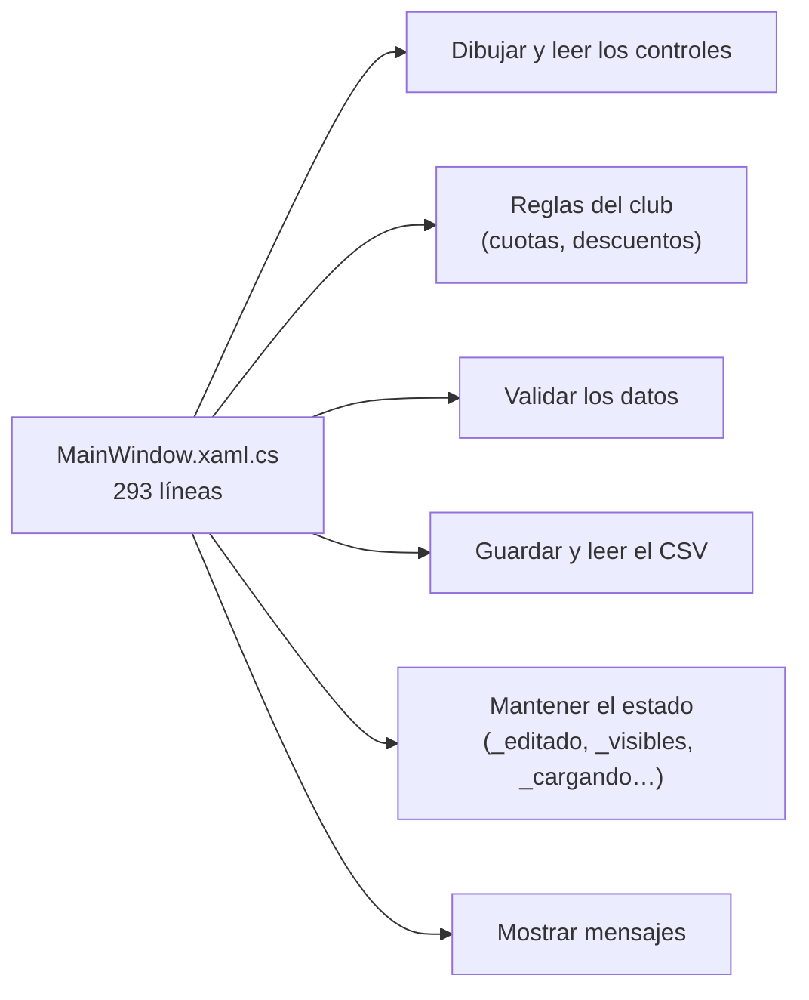
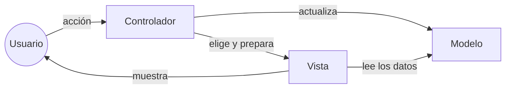
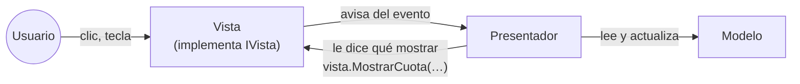
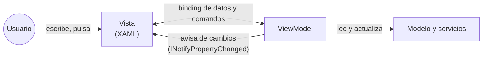
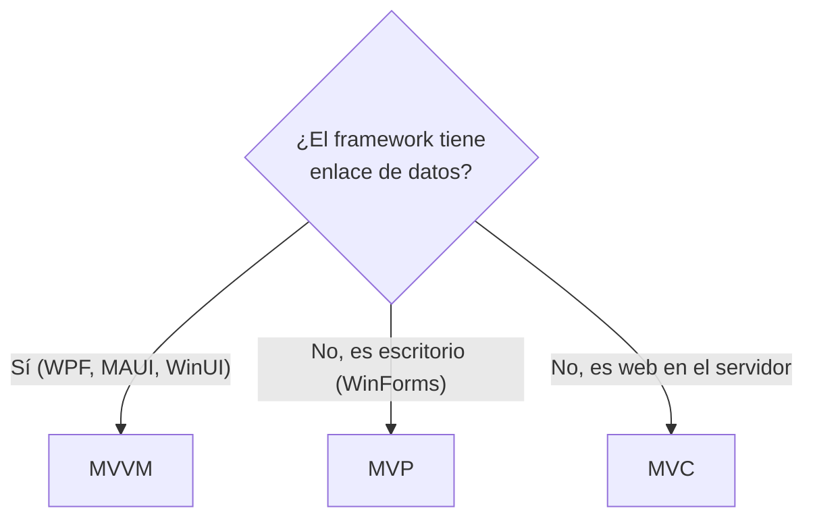
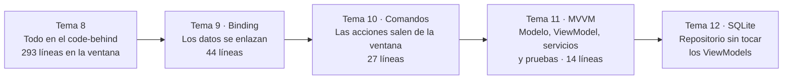

# 8. Los límites del *code-behind* y los patrones de arquitectura

[⬅️ Volver a la unidad](./README.md)

**CE que trabaja este tema:** RA1 a.

## Índice

- [8.1. Una aplicación que funciona](#81-una-aplicación-que-funciona)
- [8.2. ¿Qué problemas tendremos para mantenerla?](#82-qué-problemas-tendremos-para-mantenerla)
  - [8.2.1. Todo mezclado en una clase](#821-todo-mezclado-en-una-clase)
  - [8.2.2. Reglas duplicadas](#822-reglas-duplicadas)
  - [8.2.3. Estado que hay que sincronizar a mano](#823-estado-que-hay-que-sincronizar-a-mano)
  - [8.2.4. Lógica atada a los controles](#824-lógica-atada-a-los-controles)
  - [8.2.5. Imposible de probar](#825-imposible-de-probar)
  - [8.2.6. Ahora, multiplica por diez](#826-ahora-multiplica-por-diez)
- [8.3. La idea que lo resuelve: separar responsabilidades](#83-la-idea-que-lo-resuelve-separar-responsabilidades)
- [8.4. Patrones de arquitectura de las aplicaciones gráficas](#84-patrones-de-arquitectura-de-las-aplicaciones-gráficas)
  - [8.4.1. MVC: Modelo-Vista-Controlador](#841-mvc-modelo-vista-controlador)
  - [8.4.2. MVP: Modelo-Vista-Presentador](#842-mvp-modelo-vista-presentador)
  - [8.4.3. MVVM: Modelo-Vista-Modelo de vista](#843-mvvm-modelo-vista-modelo-de-vista)
  - [8.4.4. Comparación](#844-comparación)
- [8.5. Qué ofrece WPF para MVVM](#85-qué-ofrece-wpf-para-mvvm)
- [8.6. El plan: refactorizar paso a paso](#86-el-plan-refactorizar-paso-a-paso)
- [8.7. Lo que MVVM no es](#87-lo-que-mvvm-no-es)
- [Resumen](#resumen)
- [Ejercicios de reflexión](#ejercicios-de-reflexión)

---

## 8.1. Una aplicación que funciona

Con lo que sabes de los temas 2 a 7 puedes construir una aplicación completa. El proyecto [`ejemplos/08-SociosCodeBehind`](./ejemplos/08-SociosCodeBehind) es una gestión de socios del club:

| Función | Cómo está hecha |
|---------|-----------------|
| Lista de socios con buscador | `ListBox` que se rellena con textos en `RellenarLista()`, llamado desde `TextChanged` |
| Ficha para dar de alta o editar | Al elegir en la lista, `SelectionChanged` copia los datos a las cajas |
| Cuota calculada al escribir | `TextChanged` y `SelectionChanged` llaman a `MostrarCuota()` |
| Validación al guardar | `btnGuardar_Click` comprueba nombre, antigüedad y repetidos con `MessageBox` |
| Eliminar con confirmación | `btnEliminar_Click` |
| Resumen en la barra de estado | `ActualizarResumen()` suma las cuotas |
| Persistencia en un CSV | `CargarFichero()` y `GuardarFichero()` |

Funciona, y está escrita siguiendo las pautas del tema 6: manejadores cortos que llaman a métodos, `try-catch` en los ficheros, mensajes claros. **No es un mal programa.** Todo está en `MainWindow.xaml.cs`, que tiene 293 líneas.

> 📝 **Nota del Profesor**: el *code-behind* no es «incorrecto». Es la forma natural de empezar y para una ventana pequeña es suficiente. Este tema no va de que esté mal, sino de **qué pasa cuando la aplicación crece** y de por qué la industria ha llegado a otras estructuras. Para entenderlo hay que leer el código con ojos de quien lo tiene que mantener.

---

## 8.2. ¿Qué problemas tendremos para mantenerla?

Imagina que el club te pide tres cambios: que la cuota de los menores de 25 años tenga otro descuento, que la lista sea una tabla con columnas y que los datos se guarden en una base de datos. Vamos a ver qué partes del código tendrías que tocar.

### 8.2.1. Todo mezclado en una clase

La clase `MainWindow` hace **seis trabajos distintos**:



El diagrama muestra que cualquier cambio, sea de aspecto, de reglas o de almacenamiento, obliga a abrir **el mismo fichero**. En POO esto tiene nombre: la clase incumple el **principio de responsabilidad única** (una clase debería tener un solo motivo para cambiar). Esta tiene al menos seis.

### 8.2.2. Reglas duplicadas

La regla de la cuota (15, 35 o 25 € y un 10 % menos a partir de 10 años) está escrita **dos veces**: en `MostrarCuota()`, para la ficha, y en `ActualizarResumen()`, para el total.

```csharp
// En MostrarCuota()
decimal cuota = categoria switch
{
    "Infantil" => 15m,
    "Senior" => 25m,
    _ => 35m
};
if (antiguedad >= 10)
{
    cuota *= 0.9m; // 10 % de descuento a partir de 10 años
}

// En ActualizarResumen(): mismo cálculo, copiado
```

Con el cambio del descuento, alguien tocará una y olvidará la otra: la ficha dirá 31,50 € y el total sumará otra cosa. Y la secuencia «refrescar la lista, vaciar el formulario, actualizar el resumen, actualizar los botones» se repite en `btnGuardar_Click`, en `btnEliminar_Click` y, en parte, en el constructor. `ActualizarBotones()` se llama desde **siete** sitios.

### 8.2.3. Estado que hay que sincronizar a mano

La lista muestra **textos**, no socios:

```csharp
lstSocios.Items.Add($"{socio.Nombre} · {socio.Categoria} · {socio.Antiguedad} años");
```

Así que, para saber qué socio se ha elegido, hay una segunda lista paralela, `_visibles`, y se busca **por la posición**:

```csharp
_editado = _visibles[lstSocios.SelectedIndex];
```

Si alguien cambia el orden en un sitio y no en el otro, se edita el socio equivocado. Además, hay **indicadores** para que los eventos no se pisen entre sí: `_cargando` evita que, al copiar un socio en el formulario, `TextChanged` crea que el usuario está escribiendo. Y cada vez que cambian los datos, el código tiene que acordarse de **actualizar a mano** todo lo que depende de ellos: la lista, el resumen, los botones, el título. Si olvida uno, la pantalla miente.

> ⚠️ **Cuidado**: este es el problema más traicionero, porque no da errores de compilación: la aplicación funciona **casi siempre**. El fallo aparece cuando alguien añade un botón nuevo y no llama a `ActualizarBotones()`.

### 8.2.4. Lógica atada a los controles

Las reglas leen los datos **directamente de los controles**:

```csharp
var categoria = ((ComboBoxItem)cmbCategoria.SelectedItem).Content.ToString();
if (!int.TryParse(txtAntiguedad.Text, out var antiguedad) || antiguedad < 0) …
```

Si se cambia el `ComboBox` por unos `RadioButton`, o la lista por un `DataGrid`, hay que reescribir las reglas, aunque las reglas no hayan cambiado. Y si el club quiere la misma gestión **en una web o en el móvil**, no se puede aprovechar nada: el cálculo de la cuota está enredado con `txtAntiguedad.Text`.

### 8.2.5. Imposible de probar

En la UD2 escribiste pruebas con xUnit para tus clases. Intenta escribir esta:

```csharp
[Fact]
public void SocioConDiezAnios_TieneDescuento()
{
    var ventana = new MainWindow();          // ❌ Necesita un hilo STA y carga la interfaz
    ventana.txtAntiguedad.Text = "10";       // ❌ Los controles son internos de su proyecto
    ventana.cmbCategoria.SelectedIndex = 1;
    // ❌ ¿Cómo se lee el resultado? ¿Analizando el texto de txtCuota?
    Assert.Equal("Cuota: 31,50 € al mes", ventana.txtCuota.Text);
}
```

No se puede, o es tan frágil que no merece la pena:

| Obstáculo | Por qué |
|-----------|---------|
| Crear la ventana | WPF exige un hilo especial (STA) y carga recursos, temas y controles |
| Acceder a los controles | Los `x:Name` generan campos `internal`: el proyecto de pruebas no los ve |
| Comprobar el resultado | Hay que leer textos formateados, que cambian con la cultura |
| Efectos secundarios | El constructor **lee un fichero** del disco y los botones muestran `MessageBox`, que bloquea la prueba esperando a que alguien pulse |
| No se ejecuta en Linux ni en un servidor de integración continua | WPF solo funciona en Windows con escritorio |

Lo que no se puede probar automáticamente se prueba **a mano**, cada vez que se toca algo. Y con 30 ventanas, nadie lo hace.

### 8.2.6. Ahora, multiplica por diez

La aplicación del ejemplo tiene una ventana, cuatro campos y tres botones. Una aplicación real de gestión tiene **decenas de ventanas** con decenas de campos. Con la misma estructura, cada `*.xaml.cs` acaba con 800 o 1.000 líneas donde conviven el aspecto, las reglas, la validación y el acceso a datos de esa pantalla, y las mismas reglas aparecen copiadas en varias ventanas.

| Pregunta del mantenimiento | Con todo en el *code-behind* |
|----------------------------|-------------------------------|
| ¿Dónde está la regla de la cuota? | En varias ventanas, quizá distintas |
| ¿Puedo cambiar la lista por una tabla sin romper nada? | Hay que revisar todos los sitios que usan `SelectedIndex` |
| ¿Puedo pasar de CSV a una base de datos? | Hay que tocar cada ventana que lee o guarda |
| ¿Cómo sé que un cambio no ha roto nada? | Probando a mano todas las pantallas |
| ¿Pueden trabajar dos personas a la vez? | En el mismo fichero, con conflictos constantes |

> 💡 **Tip del Examinador**: *«Enumera tres problemas de poner toda la lógica en el code-behind.»* Responsabilidades mezcladas (la clase cambia por cualquier motivo), código y estado duplicados que hay que sincronizar a mano, y que **no se puede probar sin abrir la ventana**. Añade un ejemplo de cada uno y tendrás la respuesta completa.

---

## 8.3. La idea que lo resuelve: separar responsabilidades

Todos los problemas anteriores tienen la misma causa: **cosas que cambian por motivos distintos están en el mismo sitio**. La solución es la **separación de responsabilidades** (*separation of concerns*): repartir el programa en partes con un solo trabajo cada una.

| Responsabilidad | Pregunta que responde | Cambia cuando… |
|-----------------|-----------------------|----------------|
| **Modelo** | ¿Qué datos hay y qué reglas cumplen? | Cambian las reglas del club |
| **Vista** | ¿Cómo se ve y cómo interactúa el usuario? | Cambia el diseño |
| **Lógica de presentación** | ¿Qué se muestra, qué está habilitado, qué pasa al pulsar? | Cambia el comportamiento de la pantalla |
| **Servicios** (datos, ficheros, mensajes) | ¿Dónde se guarda y cómo se comunica con el exterior? | Cambia el almacenamiento |

La regla de oro: **la vista depende de la lógica, nunca al revés**. Si la lógica no sabe nada de los controles, se puede probar sin ventana, reutilizar con otra vista y cambiar la vista sin tocar la lógica.

> 🔁 **Transferencia**: esta idea no es de WPF. Es la misma que separa el HTML (estructura), el CSS (aspecto) y el JavaScript (comportamiento) en una web, o las capas «presentación, negocio y datos» de una aplicación empresarial. Los patrones de este tema son distintas formas de aplicarla a las interfaces gráficas.

---

## 8.4. Patrones de arquitectura de las aplicaciones gráficas

Un **patrón de arquitectura** es una solución probada a un problema de organización del código que se repite. Para las interfaces gráficas hay tres familias principales. Las tres separan el **modelo** de la **vista**; se distinguen en **quién hace de intermediario** y **quién conoce a quién**.

### 8.4.1. MVC: Modelo-Vista-Controlador

Es el más antiguo (Smalltalk, finales de los años 70) y hoy se usa sobre todo en la **web en el servidor**.



- El **controlador** recibe la acción del usuario (una petición HTTP en la web), actualiza el modelo y elige qué vista mostrar.
- La **vista** lee los datos del modelo para dibujarse.
- Ejemplos: **ASP.NET Core MVC** (UD10), Spring MVC, Ruby on Rails, Laravel.

### 8.4.2. MVP: Modelo-Vista-Presentador

Nace para las aplicaciones de escritorio, donde la vista (un formulario) recibe ella misma los eventos.



- La **vista** es pasiva: reenvía los eventos al presentador y tiene métodos para que este le diga qué mostrar.
- El **presentador** conoce a la vista **a través de una interfaz** (`IVistaSocios`), así que se puede probar con una vista falsa.
- Ejemplos: Windows Forms bien estructurado, Android antes de los componentes de arquitectura, GWT.

```csharp
// MVP: el presentador habla con la vista a través de una interfaz
public interface IVistaSocios
{
    string NombreEscrito { get; }
    void MostrarCuota(decimal cuota);
    void MostrarError(string mensaje);
}
```

### 8.4.3. MVVM: Modelo-Vista-Modelo de vista

Lo presentó Microsoft en 2005 precisamente **para WPF**, aprovechando que WPF sabe **enlazar** propiedades automáticamente.



- El ***ViewModel*** (modelo de vista) expone **propiedades** con los datos que muestra la pantalla (`Nombre`, `Cuota`, `Socios`) y **comandos** con lo que se puede hacer (`GuardarCommand`).
- La **vista** se **enlaza** a esas propiedades y comandos en el XAML con `{Binding …}`. Cuando el *ViewModel* cambia una propiedad, **avisa** y la vista se actualiza sola.
- **El *ViewModel* no conoce a la vista**: ni sus controles, ni una interfaz de la vista. No sabe si lo muestra un `ListBox`, un `DataGrid` o una prueba automática.
- Ejemplos: WPF, .NET MAUI, WinUI 3, Avalonia, Android con Jetpack (`ViewModel` y `LiveData`/`StateFlow`), Knockout.js; Angular y Vue usan ideas muy parecidas.

### 8.4.4. Comparación

| | MVC | MVP | MVVM |
|---|---|---|---|
| Intermediario | Controlador | Presentador | *ViewModel* |
| Quién recibe la acción del usuario | El controlador | La vista, que la reenvía | La vista, que la convierte en un comando enlazado |
| ¿El intermediario conoce a la vista? | La elige | **Sí**, por una interfaz | **No** |
| Cómo llegan los datos a la vista | La vista lee el modelo | El presentador llama a métodos de la vista | **Binding**: la vista se suscribe a los avisos |
| Código «pegamento» | Medio | **Mucho** (un método de la vista por dato) | **Poco** (lo hace el *binding*) |
| Se prueba sin interfaz | El controlador | El presentador, con una vista falsa | El *ViewModel*, sin nada falso de la vista |
| Requiere | — | — | Un *framework* con enlace de datos |
| Dónde se usa | Web en el servidor | WinForms, Android antiguo | WPF, MAUI, WinUI, Android moderno |



El diagrama resume por qué en esta unidad usaremos MVVM: WPF tiene el mejor sistema de enlace de datos de los tres casos, y MVVM es el patrón que lo aprovecha.

> 💡 **Tip del Examinador**: *«¿Cuál es la diferencia clave entre MVP y MVVM?»* En MVP el presentador **conoce a la vista** (por una interfaz) y le dice qué mostrar llamando a sus métodos. En MVVM el *ViewModel* **no conoce a la vista**: expone propiedades y comandos, y la vista se enlaza a ellos. El enlace de datos hace el trabajo que en MVP hace el presentador a mano.

> 🔁 **Transferencia**: hay una cuarta familia que conviene conocer de nombre, **MVU** (*Model-View-Update*, de Elm), con estado inmutable y una función que redibuja la vista: es la idea detrás de React con Redux, Flutter con BLoC o Jetpack Compose. Las ideas de este tema (separar, no depender de la vista, probar la lógica) siguen valiendo.

---

## 8.5. Qué ofrece WPF para MVVM

MVVM funciona en WPF porque el *framework* trae las piezas que necesita. Cada una tiene su tema:

| Pieza de WPF | Para qué sirve en MVVM | Tema |
|--------------|------------------------|------|
| `DataContext` | Dice a la vista cuál es su *ViewModel* (y se hereda por el árbol) | 9 |
| `{Binding …}` | Une una propiedad de un control con una del *ViewModel* | 9 |
| `INotifyPropertyChanged` | El *ViewModel* avisa de que ha cambiado una propiedad | 9 |
| `ObservableCollection<T>` | Una colección que avisa cuando se añaden o quitan elementos | 9 |
| `DataTemplate` | Dice cómo se dibuja cada objeto (cada socio de una lista, o cada *ViewModel*) | 9 y 11 |
| `ICommand` | Una acción del *ViewModel* que un botón puede ejecutar y que sabe si está disponible | 10 |
| `INotifyDataErrorInfo` | El *ViewModel* informa de errores de validación | 11 |
| `IValueConverter` | Adapta un valor del *ViewModel* a lo que necesita un control | 11 |

Todo lo que falta (dónde se guardan los datos, cómo se muestran los mensajes) son **clases normales de C#**: servicios con una interfaz, como la `IRepositorio` del tema 12.

---

## 8.6. El plan: refactorizar paso a paso

**Refactorizar** es cambiar la estructura del código **sin cambiar lo que hace**. No vamos a tirar la aplicación y escribir otra: la vamos a transformar en cuatro pasos, y después de cada uno debe seguir funcionando igual.



Las cifras son las líneas de `MainWindow.xaml.cs` en los ejemplos `08-SociosCodeBehind`, `09-SociosBinding`, `10-SociosComandos` y `11-ClubMvvm`. Lo que sale de la ventana no desaparece: se va a clases con una sola responsabilidad, más fáciles de leer y de probar.

| Problema del apartado 8.2 | Se resuelve en… | Con… |
|---------------------------|-----------------|------|
| Regla de la cuota duplicada | Tema 9 | Una clase `CalculadoraCuotas` y una propiedad `Cuota` en el socio |
| Lista de textos y `_visibles` por posición | Tema 9 | La lista muestra **objetos** con un `DataTemplate` y `SelectedItem` enlazado |
| Copiar a mano de los controles a los datos (`_cargando`) | Tema 9 | *Binding* en los dos sentidos |
| Acordarse de llamar a `ActualizarResumen()` y `ActualizarBotones()` | Temas 9 y 10 | `INotifyPropertyChanged` y `CanExecute` de los comandos |
| Reglas que leen de los controles | Tema 11 | El *ViewModel* tiene sus propias propiedades |
| `MessageBox` y ficheros dentro de la lógica | Temas 11 y 12 | Servicios con interfaz (`IServicioDialogos`, `IRepositorioClub`) |
| No se puede probar | Tema 11 (y 13) | Pruebas xUnit del *ViewModel*, en un proyecto sin WPF |

> 📝 **Nota del Profesor**: guarda una copia de tu aplicación del proyecto antes de empezar a refactorizarla. Al terminar el tema 11, compara las dos versiones: cuántas líneas tiene cada ventana, dónde está cada regla y qué puedes probar. Esa comparación es la mejor justificación técnica que puedes escribir en el README de entrega.

---

## 8.7. Lo que MVVM no es

Antes de empezar, conviene desmontar algunas ideas equivocadas:

| Idea equivocada | En realidad |
|-----------------|-------------|
| «Con MVVM el *code-behind* tiene que estar vacío» | Puede tener **lógica puramente visual**: dar el foco, una animación, pasar la contraseña de un `PasswordBox` (tema 11). Lo que no debe tener son reglas ni datos |
| «MVVM es más corto» | Al principio hay **más ficheros y más clases**. Se gana en mantenimiento y pruebas, no en líneas totales |
| «Hay que usar una librería de MVVM» | Las piezas están en WPF. Una librería (CommunityToolkit.Mvvm, tema 11) solo ahorra código repetitivo |
| «El *ViewModel* es el modelo» | El modelo son los datos y las reglas del dominio (el socio, la cuota). El *ViewModel* es el estado de **una pantalla** (qué socio está elegido, qué texto hay en el buscador) |
| «Para una ventana pequeña siempre merece la pena» | Para un diálogo de «Acerca de», no. MVVM compensa cuando hay lógica que probar o que reutilizar |

> ✅ **Buena práctica**: la pregunta para decidir si algo va al *code-behind* o al *ViewModel* es: **¿tendría sentido probarlo con xUnit?** Si es una regla, un cálculo, una validación o una decisión («¿se puede guardar?»), va al *ViewModel* o al modelo. Si es una cuestión de cómo se ve o de qué control tiene el foco, puede quedarse en la vista.

---

## Resumen

- Una aplicación con toda la lógica en el ***code-behind*** funciona y es la forma natural de empezar, pero **escala mal**.
- Problemas típicos: **responsabilidades mezcladas** en una clase, **reglas y llamadas duplicadas**, **estado sincronizado a mano**, **lógica atada a los controles** y que **no se puede probar** sin abrir la ventana.
- La solución es **separar responsabilidades**: modelo, vista, lógica de presentación y servicios. La vista depende de la lógica, nunca al revés.
- **MVC**: un controlador recibe la acción, actualiza el modelo y elige la vista (web en el servidor).
- **MVP**: la vista reenvía los eventos a un presentador que la conoce por una interfaz y le dice qué mostrar (WinForms).
- **MVVM**: la vista se **enlaza** a las propiedades y comandos de un ***ViewModel*** que **no la conoce** (WPF, MAUI, WinUI, Android moderno).
- WPF ofrece las piezas de MVVM: `DataContext`, *binding*, `INotifyPropertyChanged`, `ObservableCollection<T>`, `DataTemplate`, `ICommand`, `INotifyDataErrorInfo` e `IValueConverter`.
- Se llega a MVVM **refactorizando paso a paso**: *binding* (tema 9), comandos (tema 10), MVVM y pruebas (tema 11) y repositorio (tema 12).
- MVVM no exige un *code-behind* vacío: la lógica **puramente visual** puede quedarse en la vista.

---

## Ejercicios de reflexión

1. Abre `08-SociosCodeBehind/MainWindow.xaml.cs` y clasifica cada método en una de las responsabilidades del apartado 8.3. ¿Hay alguno que tenga dos?
2. El club decide que los socios infantiles con más de 5 años de antigüedad paguen 12 €. Señala todas las líneas que tendrías que cambiar. ¿Cuántas pruebas a mano harías después para quedarte tranquilo?
3. Explica con tus palabras por qué la lista de textos y la lista `_visibles` son un problema. ¿Qué pasaría si alguien ordena la lista por categoría en `RellenarLista()` pero no en `_visibles`?
4. Busca un *framework* actual que use cada uno de los tres patrones (distinto de los citados en el tema) y justifica cuál usa.
5. Escribe la interfaz `IVistaSocios` que necesitaría un presentador MVP para esta aplicación. ¿Cuántos métodos tiene? ¿Por qué con MVVM no hace falta?
6. Mira el *code-behind* de tu aplicación del proyecto. ¿Qué tres cosas sacarías primero? ¿Por qué esas?

---

[⬅️ Volver a la unidad](./README.md)
