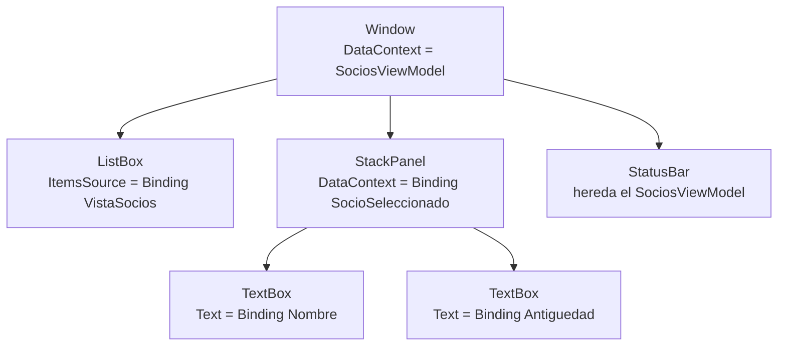
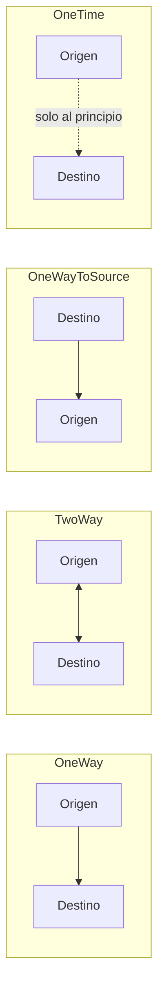
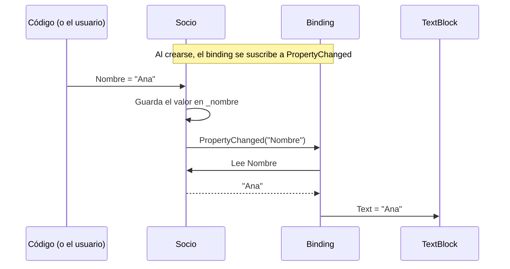

# 9. Enlace a datos

[⬅️ Volver a la unidad](./README.md)

**CE que trabaja este tema:** RA1 h.

## Índice

- [9.1. El problema: copiar datos a mano](#91-el-problema-copiar-datos-a-mano)
- [9.2. Qué es un *binding*](#92-qué-es-un-binding)
- [9.3. El `DataContext`](#93-el-datacontext)
- [9.4. La sintaxis del *binding*](#94-la-sintaxis-del-binding)
  - [9.4.1. `Path`](#941-path)
  - [9.4.2. Enlazar con otro control: `ElementName`](#942-enlazar-con-otro-control-elementname)
  - [9.4.3. Modos](#943-modos)
  - [9.4.4. Cuándo se actualiza el origen: `UpdateSourceTrigger`](#944-cuándo-se-actualiza-el-origen-updatesourcetrigger)
  - [9.4.5. Dar formato: `StringFormat` y valores de reserva](#945-dar-formato-stringformat-y-valores-de-reserva)
- [9.5. `INotifyPropertyChanged`](#95-inotifypropertychanged)
  - [9.5.1. El problema: el objeto cambia y la pantalla no](#951-el-problema-el-objeto-cambia-y-la-pantalla-no)
  - [9.5.2. Implementarlo a mano](#952-implementarlo-a-mano)
  - [9.5.3. Una clase base para no repetirlo](#953-una-clase-base-para-no-repetirlo)
  - [9.5.4. Propiedades calculadas](#954-propiedades-calculadas)
- [9.6. Colecciones: `ObservableCollection<T>`](#96-colecciones-observablecollectiont)
- [9.7. Plantillas de datos](#97-plantillas-de-datos)
- [9.8. Maestro-detalle con `SelectedItem`](#98-maestro-detalle-con-selecteditem)
- [9.9. Filtrar y ordenar con `ICollectionView`](#99-filtrar-y-ordenar-con-icollectionview)
- [9.10. Una propiedad de dependencia propia como destino](#910-una-propiedad-de-dependencia-propia-como-destino)
- [9.11. Ejemplo integrador: los socios con *binding*](#911-ejemplo-integrador-los-socios-con-binding)
- [9.12. Errores frecuentes](#912-errores-frecuentes)
- [Resumen](#resumen)
- [Ejercicios de reflexión](#ejercicios-de-reflexión)

---

## 9.1. El problema: copiar datos a mano

En el tema 8 viste cuánto código de `08-SociosCodeBehind` se dedica a **copiar datos** entre los controles y los objetos:

```csharp
// Del socio a los controles, al elegirlo en la lista
_cargando = true;
txtNombre.Text = _editado.Nombre;
cmbCategoria.SelectedIndex = _editado.Categoria switch { "Infantil" => 0, "Senior" => 2, _ => 1 };
txtAntiguedad.Text = _editado.Antiguedad.ToString();
_cargando = false;

// De los controles al socio, al guardar
socio.Nombre = nombre;
socio.Categoria = ((ComboBoxItem)cmbCategoria.SelectedItem).Content.ToString()!;
socio.Antiguedad = antiguedad;
```

Y cada vez que cambia un dato, hay que acordarse de **actualizar todo lo que depende de él**: la lista, la cuota, el resumen, los botones. Es código repetitivo, frágil y que nadie quiere escribir.

¿Y si pudieras decir en el XAML «esta caja muestra el **nombre del socio**» y que WPF se encargara de copiar el valor en los dos sentidos, y de redibujar cuando cambie? Eso es el **enlace de datos** (*data binding*).

---

## 9.2. Qué es un *binding*

Un ***binding*** es un **vínculo** entre dos propiedades: una del control (el **destino**, *target*) y otra de un objeto de datos (el **origen**, *source*). WPF copia el valor de una a otra cuando cambia.

```xml
<TextBox Text="{Binding Nombre}" />
```

Se lee así: «la propiedad `Text` de esta caja está enlazada con la propiedad `Nombre` del objeto de datos».

| | Destino | Origen |
|---|---|---|
| Qué es | La propiedad del control (`Text`, `IsChecked`, `ItemsSource`) | La propiedad del objeto de datos (`Nombre`, `Socios`) |
| Requisito | Tiene que ser **de dependencia** (tema 3) | Cualquier propiedad pública con `get` (y `set` si se escribe) |
| Avisa de sus cambios | Siempre (lo hace WPF) | Solo si el objeto implementa **`INotifyPropertyChanged`** (apartado 9.5) |

Ya has usado *bindings* sin saberlo: el `Target="{Binding ElementName=txtNombre}"` de las etiquetas del tema 5 y el `{Binding Nombre}` de las columnas del `DataGrid`.

> 📝 **Nota del Profesor**: el *binding* es la pieza que hace posible MVVM. Con él, la lógica puede trabajar con **propiedades normales de C#** (`Nombre`, `Cuota`) y la vista se mantiene al día sola. El *code-behind* deja de ser el intermediario que copia datos.

---

## 9.3. El `DataContext`

`{Binding Nombre}` dice **qué** propiedad, pero no **de qué objeto**. El objeto lo da el **`DataContext`**: una propiedad de todos los elementos que indica el objeto de datos por defecto de sus *bindings*.

```csharp
public MainWindow()
{
    InitializeComponent();

    // Todos los {Binding} sin ElementName buscan sus propiedades en este objeto
    DataContext = _datos;
}
```

El `DataContext` **se hereda** por el árbol lógico (como `FontSize`, tema 3): si se asigna a la ventana, lo reciben todos sus controles. Y cualquier elemento puede cambiarlo para su parte del árbol:

```xml
<!-- El panel cambia su DataContext al socio elegido: sus bindings leen del socio -->
<StackPanel DataContext="{Binding SocioSeleccionado}">
    <TextBox Text="{Binding Nombre}" />       <!-- SocioSeleccionado.Nombre -->
    <TextBox Text="{Binding Antiguedad}" />   <!-- SocioSeleccionado.Antiguedad -->
</StackPanel>
```



El diagrama muestra cómo el `StackPanel` cambia el `DataContext` para sus hijos, mientras que la barra de estado sigue con el de la ventana.

**En el diseñador.** En tiempo de diseño no se ejecuta el constructor, así que Visual Studio no sabe qué tipo de objeto será el `DataContext` y no puede ayudarte. Se le indica con un `DataContext` **solo de diseño**:

```xml
<Window …
        xmlns:d="http://schemas.microsoft.com/expression/blend/2008"
        mc:Ignorable="d"
        d:DataContext="{d:DesignInstance Type=local:SociosViewModel}">
```

Con esa línea, el IntelliSense del XAML **sugiere las propiedades** al escribir `{Binding …}` y marca las que no existen. No tiene efecto al ejecutar.

> ✅ **Buena práctica**: pon siempre `d:DataContext` en las ventanas y controles de usuario con *bindings*. Es la forma más barata de evitar el error más frecuente: un nombre de propiedad mal escrito.

---

## 9.4. La sintaxis del *binding*

La extensión `{Binding}` tiene muchas propiedades. Estas son las que usarás:

| Propiedad | Para qué | Ejemplo |
|-----------|----------|---------|
| `Path` | Qué propiedad del origen (es la primera, se puede omitir el nombre) | `{Binding Nombre}` = `{Binding Path=Nombre}` |
| `ElementName` | Origen: otro control por su nombre | `{Binding Value, ElementName=sldVolumen}` |
| `RelativeSource` | Origen: un elemento relativo (él mismo, un antepasado) | `{Binding DataContext.Total, RelativeSource={RelativeSource AncestorType=Window}}` |
| `Mode` | En qué sentido se copia | `Mode=OneWay` |
| `UpdateSourceTrigger` | Cuándo se copia del control al origen | `UpdateSourceTrigger=PropertyChanged` |
| `StringFormat` | Formato del texto | `StringFormat='{}{0:0.00} €'` |
| `TargetNullValue` | Qué se muestra si el valor es `null` | `TargetNullValue='—'` |
| `FallbackValue` | Qué se muestra si el *binding* no puede obtener el valor | `FallbackValue='(sin datos)'` |
| `Converter` | Una clase que transforma el valor (tema 11) | `Converter={StaticResource CategoriaAColor}` |
| `Delay` | Milisegundos de espera antes de actualizar el origen | `Delay=300` (útil en buscadores) |

### 9.4.1. `Path`

`Path` admite **rutas** con puntos, como en C#:

```xml
<TextBlock Text="{Binding SocioSeleccionado.Nombre}" />
<TextBlock Text="{Binding Socios.Count}" />
```

Si alguna parte de la ruta vale `null` (no hay socio elegido), el *binding* no falla: el control se queda vacío (o muestra el `FallbackValue`).

### 9.4.2. Enlazar con otro control: `ElementName`

El origen puede ser **otro control**. Es útil para relaciones puramente visuales que no necesitan código:

```xml
<Slider x:Name="sldVolumen"
        Minimum="0"
        Maximum="100"
        Value="40" />

<!-- El texto sigue al deslizador -->
<TextBlock Text="{Binding ElementName=sldVolumen, Path=Value, StringFormat='Volumen: {0:0} %'}" />

<!-- Escribir en la caja mueve el deslizador, y al revés -->
<TextBox Text="{Binding ElementName=sldVolumen, Path=Value, StringFormat=0}" />
```

Y no solo para textos: cualquier propiedad de dependencia puede ser destino. En el laboratorio, un `DataTrigger` (tema 7) cambia el tamaño de un texto según una casilla:

```xml
<DataTrigger Binding="{Binding ElementName=chkGrande, Path=IsChecked}"
             Value="True">
    <Setter Property="FontSize"
            Value="24" />
</DataTrigger>
```

El proyecto [`ejemplos/09-LaboratorioBinding`](./ejemplos/09-LaboratorioBinding) tiene estos ejemplos en la pestaña **Entre controles**.

### 9.4.3. Modos

El **modo** decide **en qué sentido** viaja el valor:



El diagrama muestra los cuatro sentidos posibles entre el objeto de datos (origen) y el control (destino).

| Modo | Sentido | Ejemplo |
|------|---------|---------|
| `OneWay` | Del origen al control | Un `TextBlock` que muestra la cuota |
| `TwoWay` | En los dos sentidos | Un `TextBox` donde se edita el nombre |
| `OneWayToSource` | Del control al origen, sin leer de él | Raro: un control que solo informa al objeto |
| `OneTime` | Del origen al control, **una sola vez** | Un dato que no cambia; ahorra la vigilancia |
| `Default` (si no se indica) | Depende de la propiedad destino | `TwoWay` en `TextBox.Text`, `IsChecked`, `SelectedItem`, `Slider.Value`; `OneWay` en casi todo lo demás |

La pestaña **Modos** del laboratorio tiene cinco cajas enlazadas con modos distintos. Escribe en cada una y observa qué cajas se actualizan.

> ⚠️ **Cuidado**: un `Run` dentro de un `TextBlock` (tema 5) enlaza su `Text` en `TwoWay` por defecto. Si el origen es de solo lectura (una propiedad calculada), lanza una excepción al abrir la ventana. Por eso en los ejemplos verás `<Run Text="{Binding Cuota, Mode=OneWay}" />`.

### 9.4.4. Cuándo se actualiza el origen: `UpdateSourceTrigger`

En un `TwoWay`, el valor del control pasa al origen **en un momento** que decide `UpdateSourceTrigger`:

| Valor | Cuándo | Por defecto en |
|-------|--------|----------------|
| `LostFocus` | Al **salir** del control | `TextBox.Text` |
| `PropertyChanged` | **En cada cambio** (cada tecla) | Casi todas las demás |
| `Explicit` | Solo cuando el código llama a `UpdateSource()` | — |

```xml
<!-- Por defecto (LostFocus): el nombre llega al objeto al pulsar Tab -->
<TextBox Text="{Binding Nombre}" />

<!-- PropertyChanged: llega con cada tecla, y la cuota o el buscador reaccionan al momento -->
<TextBox Text="{Binding Nombre, UpdateSourceTrigger=PropertyChanged}" />
```

> 💡 **Tip del Examinador**: *«He enlazado un `TextBox` y el resto de la pantalla no se entera de lo que escribo hasta que salgo de la caja. ¿Por qué?»* Porque `TextBox.Text` actualiza el origen con `UpdateSourceTrigger=LostFocus` por defecto. Para que se actualice al escribir, `UpdateSourceTrigger=PropertyChanged`.

### 9.4.5. Dar formato: `StringFormat` y valores de reserva

`StringFormat` aplica un formato como el de `string.Format` de la UD2:

```xml
<TextBlock Text="{Binding Cuota, StringFormat='Cuota: {0:0.00} € al mes'}" />
<TextBlock Text="{Binding Cuota, StringFormat='{}{0:0.00} €'}" />
<TextBlock Text="{Binding Fecha, StringFormat='{}{0:dd/MM/yyyy}'}" />
```

Si el formato **empieza por `{`**, hay que anteponer `{}` para que el XAML no lo confunda con una extensión de marcado. `TargetNullValue` da un texto para cuando el valor es `null`:

```xml
<TextBlock Text="{Binding Cuota, StringFormat='Cuota: {0:0.00} €', TargetNullValue='Cuota: —'}" />
```

> ⚠️ **Cuidado**: `StringFormat` solo se aplica cuando el destino es de tipo `string` (`Text`, `ToolTip`). En `Content` de un botón o una etiqueta, que es `object`, se ignora: se usa `ContentStringFormat`.

**El idioma de los *bindings*.** Los *bindings* convierten los números y las fechas con el idioma de cada control (su propiedad `Language`), y ese idioma **es `en-US` por defecto**, aunque Windows esté en español. Sin cambiarlo, `{0:0.00} €` muestra `35.00 €` con punto, y un `TextBox` enlazado a un `double` lee `7,5` como `75`. Se corrige una sola vez, al arrancar la aplicación, en `App.xaml.cs`:

```csharp
using System.Globalization;
using System.Windows;
using System.Windows.Markup;

public partial class App : Application
{
    public App()
    {
        // Todos los controles usan el idioma de Windows para convertir números y fechas
        FrameworkElement.LanguageProperty.OverrideMetadata(
            typeof(FrameworkElement),
            new FrameworkPropertyMetadata(XmlLanguage.GetLanguage(CultureInfo.CurrentCulture.IetfLanguageTag)));
    }
}
```

Todos los ejemplos de esta unidad que enlazan números lo hacen así.

---

## 9.5. `INotifyPropertyChanged`

### 9.5.1. El problema: el objeto cambia y la pantalla no

Prueba esto: una clase normal, enlazada, y un botón que cambia el valor desde código.

```csharp
public class Ficha
{
    public int Visitas { get; set; }
}
```

```xml
<TextBlock Text="{Binding Visitas}" />
```

```csharp
private void btnVisitar_Click(object sender, RoutedEventArgs e)
{
    _ficha.Visitas++;   // el objeto cambia… pero el texto sigue en 0
}
```

El `TextBlock` muestra `0` y **no cambia**. ¿Por qué? Porque WPF no tiene forma de saber que `Visitas` ha cambiado: una propiedad automática no avisa a nadie. El *binding* leyó el valor al principio y no tiene motivos para volver a leerlo.

### 9.5.2. Implementarlo a mano

La solución es que el objeto **avise** cuando cambia una propiedad, con la interfaz `INotifyPropertyChanged` de `System.ComponentModel`. Solo tiene un miembro: el **evento** `PropertyChanged`, con el patrón de eventos de la UD2.

```csharp
public class Socio : INotifyPropertyChanged
{
    private string _nombre = "";

    public event PropertyChangedEventHandler? PropertyChanged;

    public string Nombre
    {
        get => _nombre;
        set
        {
            if (_nombre == value)
            {
                return; // sin cambio, sin aviso
            }

            _nombre = value;
            PropertyChanged?.Invoke(this, new PropertyChangedEventArgs(nameof(Nombre)));
        }
    }
}
```

Cada propiedad que la pantalla deba seguir necesita un **campo privado** y un `set` que, si el valor cambia, lanza el evento con el **nombre de la propiedad**. El *binding* está suscrito a `PropertyChanged` y, al recibir el aviso con el nombre de su propiedad, vuelve a leerla.



El diagrama muestra que el objeto no sabe nada del `TextBlock`: solo lanza un evento con el nombre de la propiedad. Es el patrón **observador** (publicador y suscriptor) de la UD2, y el *binding* es el suscriptor.

> ⚠️ **Cuidado**: el nombre que se envía tiene que coincidir **exactamente** con el de la propiedad. Escribirlo como texto (`"Nombre"`) es frágil: si renombras la propiedad, el aviso deja de funcionar sin ningún error. Usa `nameof(Nombre)` o, mejor, la clase base del apartado siguiente.

### 9.5.3. Una clase base para no repetirlo

Escribir eso en cada propiedad de cada clase es repetitivo. Se saca a una **clase base** abstracta:

```csharp
public abstract class ObjetoObservable : INotifyPropertyChanged
{
    public event PropertyChangedEventHandler? PropertyChanged;

    protected void OnPropertyChanged([CallerMemberName] string? propiedad = null)
    {
        PropertyChanged?.Invoke(this, new PropertyChangedEventArgs(propiedad));
    }

    protected bool Asignar<T>(ref T campo, T valor, [CallerMemberName] string? propiedad = null)
    {
        if (EqualityComparer<T>.Default.Equals(campo, valor))
        {
            return false;
        }

        campo = valor;
        OnPropertyChanged(propiedad);
        return true;
    }
}
```

Dos detalles del lenguaje:

- **`[CallerMemberName]`** (de `System.Runtime.CompilerServices`) hace que el compilador rellene el parámetro con el **nombre del miembro que llama**. Llamado desde el `set` de `Nombre`, `propiedad` vale `"Nombre"` sin escribirlo.
- **`ref T campo`** permite que el método modifique el campo privado de la clase hija. `EqualityComparer<T>.Default` compara valores de cualquier tipo.

Con la base, cada propiedad queda en una línea:

```csharp
public class Socio : ObjetoObservable
{
    private string _nombre = "";

    public string Nombre
    {
        get => _nombre;
        set => Asignar(ref _nombre, value);
    }
}
```

`Asignar` devuelve `true` si el valor ha cambiado, para poder hacer algo más en ese caso (apartado siguiente).

> 🔁 **Transferencia**: es la misma idea que las propiedades observables de JavaFX (`StringProperty`), `LiveData` y `StateFlow` en Android, las señales (*signals*) de Angular o `ref()` de Vue: un valor que **avisa a quien lo usa** cuando cambia. Y es exactamente lo que el CommunityToolkit.Mvvm generará por ti en el tema 11.

### 9.5.4. Propiedades calculadas

La cuota no se guarda: se **calcula** a partir de la categoría y la antigüedad.

```csharp
public decimal Cuota => CalculadoraCuotas.Calcular(Categoria, Antiguedad);
```

Una propiedad calculada no tiene `set`, así que nadie lanza su aviso. Hay que avisar **desde las propiedades de las que depende**:

```csharp
public int Antiguedad
{
    get => _antiguedad;
    set
    {
        if (Asignar(ref _antiguedad, value))
        {
            OnPropertyChanged(nameof(Cuota));
        }
    }
}
```

Fíjate en que la regla de la cuota ya no está en la ventana: está en `CalculadoraCuotas`, **una sola vez**, y la usan el socio y el total. Es el primer problema del tema 8 resuelto.

> 💡 **Tip del Examinador**: *«Una propiedad calculada no se actualiza en la pantalla. ¿Qué falta?»* El aviso. Como no tiene `set`, hay que llamar a `OnPropertyChanged(nameof(Calculada))` desde el `set` de cada propiedad de la que depende.

---

## 9.6. Colecciones: `ObservableCollection<T>`

Para mostrar una lista se enlaza la propiedad **`ItemsSource`** del control (`ListBox`, `ComboBox`, `DataGrid`, `ItemsControl`) con una colección:

```xml
<ListBox ItemsSource="{Binding Socios}" />
```

Pero, igual que una propiedad normal no avisa, una `List<T>` **no avisa cuando se añade o se quita un elemento**: la lista de la pantalla no cambia. En el tema 7 había que llamar a `lstSocios.Items.Refresh()`. La solución es **`ObservableCollection<T>`** (`System.Collections.ObjectModel`), una lista que implementa `INotifyCollectionChanged` y lanza un aviso con cada `Add`, `Remove`, `Insert` o `Clear`.

| | `List<T>` | `ObservableCollection<T>` |
|---|---|---|
| Añadir y quitar | `Add`, `Remove`, `Insert`, `Clear` | Los mismos |
| Avisa de altas y bajas | **No** | **Sí** (`CollectionChanged`) |
| La pantalla se actualiza al añadir | No (hay que refrescar a mano) | **Sí** |
| Ordenar en el sitio (`Sort`) | Sí | No (se ordena con una vista, apartado 9.9) |
| Úsala para | Datos internos, resultados de consultas | Lo que se **enlaza** a la pantalla y cambia |

Hay **dos niveles** de aviso que conviene no confundir:

| Cambio | Quién avisa |
|--------|-------------|
| Se añade o se quita un socio de la colección | La colección (`ObservableCollection<T>`) |
| Cambia el nombre de un socio que ya está | El socio (`INotifyPropertyChanged`) |

Si el resumen depende de **los datos de los elementos** (la suma de las cuotas), el que lo calcula tiene que escuchar los dos: las altas y bajas de la colección y los cambios de cada elemento.

```csharp
Socios.CollectionChanged += Socios_CollectionChanged;

private void Socios_CollectionChanged(object? sender, NotifyCollectionChangedEventArgs e)
{
    // Los socios nuevos se escuchan; los que se van, se dejan de escuchar
    foreach (Socio socio in e.NewItems ?? Array.Empty<Socio>())
    {
        socio.PropertyChanged += Socio_PropertyChanged;
    }

    foreach (Socio socio in e.OldItems ?? Array.Empty<Socio>())
    {
        socio.PropertyChanged -= Socio_PropertyChanged;
    }

    OnPropertyChanged(nameof(NumeroSocios));
    OnPropertyChanged(nameof(TotalCuotas));
}

private void Socio_PropertyChanged(object? sender, PropertyChangedEventArgs e)
{
    if (e.PropertyName == nameof(Socio.Cuota))
    {
        OnPropertyChanged(nameof(TotalCuotas));
    }
}
```

> ⚠️ **Cuidado**: no sustituyas la colección entera (`Socios = new ObservableCollection<Socio>(…)`) si la propiedad no avisa: la pantalla seguiría enlazada a la colección antigua. Haz `Clear()` y `Add()`, o que la propiedad avise del cambio.

---

## 9.7. Plantillas de datos

Si la lista enlaza objetos `Socio`, ¿qué texto muestra? Por defecto, el resultado de `ToString()`: `SociosBinding.Socio`. Hay dos formas de decirle qué mostrar.

**`DisplayMemberPath`**, para mostrar una sola propiedad:

```xml
<ListBox ItemsSource="{Binding Socios}"
         DisplayMemberPath="Nombre" />
```

**Una plantilla de datos** (`DataTemplate`), para decidir **cómo se dibuja cada elemento** con cualquier XAML. Dentro de la plantilla, el `DataContext` es **cada elemento** de la lista:

```xml
<ListBox ItemsSource="{Binding VistaSocios}"
         SelectedItem="{Binding SocioSeleccionado}">
    <ListBox.ItemTemplate>
        <DataTemplate DataType="local:Socio">
            <StackPanel Margin="0,2">
                <TextBlock Text="{Binding Nombre}"
                           FontWeight="SemiBold" />
                <TextBlock Foreground="Gray">
                    <Run Text="{Binding Categoria, Mode=OneWay}" />
                    <Run Text="·" />
                    <Run Text="{Binding Cuota, Mode=OneWay, StringFormat='{}{0:0.00} €'}" />
                </TextBlock>
            </StackPanel>
        </DataTemplate>
    </ListBox.ItemTemplate>
</ListBox>
```

`DataType` le dice al editor qué tipo tiene cada elemento, para que sugiera sus propiedades. Si cambia el nombre de un socio, su elemento de la lista se redibuja solo, porque cada `TextBlock` de la plantilla está enlazado con el socio.

Con plantillas se puede usar **`ItemsControl`**, el control de lista más simple (sin selección ni barra de desplazamiento), para repetir cualquier cosa. En el tema 5 la casilla **Todos los extras** de la reserva necesitaba tocar cada casilla desde el código. La pestaña **Extras** del laboratorio lo resuelve con una colección de objetos `Extra` y una plantilla:

```xml
<CheckBox Content="_Todos los extras"
          IsChecked="{Binding TodosSeleccionados}" />

<ItemsControl ItemsSource="{Binding Extras}">
    <ItemsControl.ItemTemplate>
        <DataTemplate DataType="local:Extra">
            <CheckBox IsChecked="{Binding Seleccionado}"
                      Content="{Binding Nombre}" />
        </DataTemplate>
    </ItemsControl.ItemTemplate>
</ItemsControl>
```

```csharp
public bool? TodosSeleccionados
{
    get
    {
        var marcados = Extras.Count(e => e.Seleccionado);
        return marcados == 0 ? false : marcados == Extras.Count ? true : null;
    }
    set
    {
        var marcar = value != false;
        foreach (var extra in Extras)
        {
            extra.Seleccionado = marcar;
        }
    }
}
```

La casilla **Todos** muestra el estado indeterminado (`null`) cuando hay algunos marcados, sin una línea de *code-behind*. Y el botón **Añadir «Agua»** añade un extra a la colección: aparece una casilla nueva y **Todos** sigue funcionando. En el tema 5 había que tocar varios sitios del código para lo mismo.

En el `DataGrid` (tema 5) cada columna tiene su propio *binding*:

```xml
<DataGrid ItemsSource="{Binding Socios}"
          AutoGenerateColumns="False">
    <DataGrid.Columns>
        <DataGridTextColumn Header="Nombre" Binding="{Binding Nombre}" />
        <DataGridTextColumn Header="Cuota" Binding="{Binding Cuota, StringFormat='{}{0:0.00} €'}" />
    </DataGrid.Columns>
</DataGrid>
```

> 🔁 **Transferencia**: una plantilla de datos es lo mismo que el `RecyclerView.Adapter` con su *layout* de elemento en Android, una `cellFactory` en JavaFX, `*ngFor` en Angular o `.map()` en React: se describe cómo se dibuja **un** elemento y el *framework* lo repite.

---

## 9.8. Maestro-detalle con `SelectedItem`

Un **maestro-detalle** es una pantalla con una lista (el maestro) y los datos del elemento elegido (el detalle). Con *binding* se monta con dos piezas:

1. **`SelectedItem`** de la lista enlazado en `TwoWay` (su modo por defecto) con una propiedad del objeto de datos.
2. El **`DataContext`** del panel de detalle enlazado con esa misma propiedad.

```xml
<ListBox ItemsSource="{Binding VistaSocios}"
         SelectedItem="{Binding SocioSeleccionado}" />

<StackPanel DataContext="{Binding SocioSeleccionado}">
    <TextBox Text="{Binding Nombre, UpdateSourceTrigger=PropertyChanged}" />
    <ComboBox ItemsSource="{x:Static local:CalculadoraCuotas.Categorias}"
              SelectedItem="{Binding Categoria}" />
    <TextBox Text="{Binding Antiguedad, UpdateSourceTrigger=PropertyChanged}" />
    <TextBlock Text="{Binding Cuota, StringFormat='Cuota: {0:0.00} € al mes'}" />
</StackPanel>
```

Al elegir un socio, `SocioSeleccionado` cambia, el panel recibe el socio como `DataContext` y sus cajas muestran sus datos. Al escribir en una caja, el valor va **directamente al socio**, y la lista (que muestra el mismo objeto) se actualiza a la vez.

Ya no hay `_visibles`, ni índices, ni `_cargando`: la lista contiene **objetos** y `SelectedItem` devuelve **el objeto**.

`{x:Static …}` (tema 3) da como origen una propiedad estática: la lista de categorías está una sola vez, en `CalculadoraCuotas`.

> ⚠️ **Cuidado**: aquí se edita **el objeto original**: lo que se escribe se aplica al momento y no hay «Cancelar». Para un formulario que solo guarda al pulsar **Guardar**, se edita una **copia** y se aplica al guardar. Lo verás en el tema 11.

**Errores de conversión.** La antigüedad es un `int` y la caja es texto: el *binding* **convierte** solo. Si el usuario escribe «abc», la conversión falla: el valor **no llega al socio** y la caja se marca con un **borde rojo**. Es la validación más básica; en el tema 11 se muestran mensajes claros.

---

## 9.9. Filtrar y ordenar con `ICollectionView`

Para que el buscador filtre, en `08-SociosCodeBehind` se rehacía la lista entera. Con *binding* no se toca la colección: se crea una **vista** de la colección, un `ICollectionView`, que filtra y ordena **lo que se muestra** sin cambiar los datos.

```csharp
// Vista de la colección: filtra y ordena sin tocar la colección original
VistaSocios = CollectionViewSource.GetDefaultView(Socios);
VistaSocios.Filter = CumpleFiltro;
VistaSocios.SortDescriptions.Add(new SortDescription(nameof(Socio.Nombre), ListSortDirection.Ascending));

private bool CumpleFiltro(object elemento) =>
    elemento is Socio socio && socio.Nombre.Contains(Buscar.Trim(), StringComparison.CurrentCultureIgnoreCase);
```

Al cambiar el texto del buscador, se pide a la vista que vuelva a aplicar el filtro:

```csharp
public string Buscar
{
    get => _buscar;
    set
    {
        if (Asignar(ref _buscar, value))
        {
            VistaSocios.Refresh();
        }
    }
}
```

| Operación | Cómo |
|-----------|------|
| Filtrar | `Filter`: un método que recibe cada elemento y devuelve si se muestra |
| Ordenar | `SortDescriptions` con la propiedad y el sentido |
| Agrupar | `GroupDescriptions` (por categoría, por ejemplo) |
| Reaplicar filtro y orden | `Refresh()` |
| Reordenar cuando cambia un dato de un elemento | `IsLiveSorting` y `LiveSortingProperties` (*live shaping*) |

Por defecto, si cambias el nombre de un socio, la lista **no se reordena** hasta el siguiente `Refresh()`. Con *live shaping* se reordena y refiltra al momento:

```csharp
if (VistaSocios is ICollectionViewLiveShaping vista)
{
    vista.IsLiveSorting = true;
    vista.IsLiveFiltering = true;
    vista.LiveSortingProperties.Add(nameof(Socio.Nombre));
    vista.LiveFilteringProperties.Add(nameof(Socio.Nombre));
}
```

> 📝 **Nota del Profesor**: `CollectionViewSource` es una clase de WPF. En el tema 11, cuando la lógica pase a una biblioteca sin WPF para poder probarla, el filtro se hará de otra forma (en la propia lógica, o en la consulta a la base de datos en el tema 12). Es una decisión de diseño: aquí se prioriza lo cómodo; allí, lo que se puede probar.

---

## 9.10. Una propiedad de dependencia propia como destino

En el tema 7 la tarjeta del socio era un `UserControl` que recibía los datos con un método, `Mostrar(socio)`. ¿Se le puede enlazar un dato, como a un control de WPF?

```xml
<controles:Medidor Titulo="Plazas:"
                   Maximo="20"
                   Valor="{Binding NumeroSocios}" />
```

Solo si `Valor` es una **propiedad de dependencia**: el destino de un *binding* tiene que serlo (apartado 9.2). En el tema 3 viste que `FontSize` tiene detrás un `FontSizeProperty`. Ahora crearás la tuya:

```csharp
public partial class Medidor : UserControl
{
    // 1. El identificador: estático, de solo lectura y con el nombre de la propiedad + Property
    public static readonly DependencyProperty ValorProperty =
        DependencyProperty.Register(
            nameof(Valor),                 // nombre de la propiedad
            typeof(double),                // su tipo
            typeof(Medidor),               // la clase que la define
            new PropertyMetadata(0.0));    // valor por defecto

    // 2. La propiedad normal, que solo envuelve GetValue y SetValue
    public double Valor
    {
        get => (double)GetValue(ValorProperty);
        set => SetValue(ValorProperty, value);
    }
}
```

| Pieza | Para qué |
|-------|----------|
| `DependencyProperty.Register` | Registra la propiedad en el sistema de propiedades de WPF (que gestiona *binding*, estilos, animaciones y herencia) |
| `ValorProperty` | El identificador que usan WPF y el XAML |
| `Valor` (envoltorio) | Para usarla cómodamente desde C# |
| `PropertyMetadata` | Valor por defecto y, opcionalmente, un método que se llama cuando cambia |

En Visual Studio, el fragmento de código **`propdp`** + `Tab` + `Tab` escribe el esqueleto.

Dentro del XAML del control, sus elementos se enlazan con **sus propias propiedades** buscando el `UserControl` como antepasado:

```xml
<ProgressBar Maximum="{Binding Maximo, RelativeSource={RelativeSource AncestorType=UserControl}}"
             Value="{Binding Valor, RelativeSource={RelativeSource AncestorType=UserControl}}" />
```

> ⚠️ **Cuidado**: un error muy frecuente es poner `DataContext = this;` en el constructor del `UserControl` para que sus *bindings* internos funcionen. Así **rompe** los *bindings* de quien lo usa: `Valor="{Binding NumeroSocios}"` buscaría `NumeroSocios` en el propio medidor. Usa `RelativeSource` (o `ElementName` sobre el elemento raíz) dentro del control y deja el `DataContext` en paz.

> ⚠️ **Cuidado**: el envoltorio (`Valor`) **no se llama** cuando el valor cambia por un *binding*: WPF usa `SetValue` directamente. No pongas lógica en su `set`; si necesitas reaccionar al cambio, usa el método de cambio de `PropertyMetadata`. Lo verás a fondo en la UD4.

---

## 9.11. Ejemplo integrador: los socios con *binding*

El proyecto [`ejemplos/09-SociosBinding`](./ejemplos/09-SociosBinding) es la misma aplicación de `08-SociosCodeBehind`, **refactorizada con *binding***:

| Clase | Qué hace |
|-------|----------|
| `ObjetoObservable` | Clase base con `INotifyPropertyChanged` y `Asignar` |
| `CalculadoraCuotas` | La regla de la cuota y las categorías, **una sola vez** |
| `Socio` | Datos del socio con aviso de cambios y `Cuota` calculada |
| `SociosViewModel` | La colección, la vista filtrada, el buscador, el socio elegido, los totales y los métodos `Nuevo()` y `Eliminar()` |
| `Controles/Medidor` | Control de usuario con propiedades de dependencia propias |
| `MainWindow` | XAML con *bindings*; el *code-behind* solo asigna el `DataContext` y atiende dos botones |

La clase se llama `SociosViewModel` porque lo es, aunque el nombre no se explicará hasta el tema 11. Compara el *code-behind*:

| | `08-SociosCodeBehind` | `09-SociosBinding` |
|---|---|---|
| Líneas de `MainWindow.xaml.cs` | 293 | 44 |
| Manejadores de eventos | 7 | 2 |
| Copias entre controles y datos | En cuatro métodos | Ninguna |
| Llamadas a métodos de «refrescar» (`RellenarLista`, `ActualizarBotones`…) | 22 | Ninguna |
| Dónde está la regla de la cuota | En 2 sitios de la ventana | En `CalculadoraCuotas` |

```csharp
public partial class MainWindow : Window
{
    private readonly SociosViewModel _vm = new();

    public MainWindow()
    {
        InitializeComponent();
        DataContext = _vm;
    }

    private void btnNuevo_Click(object sender, RoutedEventArgs e)
    {
        _vm.Nuevo();
        txtNombre.Focus();
        txtNombre.SelectAll();
    }

    private void btnEliminar_Click(object sender, RoutedEventArgs e)
    {
        // … pide confirmación con MessageBox y llama a _vm.Eliminar()
    }
}
```

Para no complicar el ejemplo, esta versión **no guarda en fichero**: los datos están en memoria. La persistencia vuelve en el tema 12, con una base de datos.

**Prueba la aplicación así:**

| Prueba | Resultado esperado |
|--------|--------------------|
| Elegir un socio | La ficha muestra sus datos |
| Cambiar el nombre | La lista cambia **mientras escribes** y se reordena |
| Cambiar la categoría o la antigüedad | La cuota de la ficha, la de la lista y el total de la barra de estado cambian a la vez |
| Escribir «abc» en la antigüedad | Borde rojo; la cuota no cambia |
| Escribir en **Buscar** | La lista se filtra |
| **Nuevo** | Aparece «Nuevo socio» elegido, con el nombre seleccionado para escribir encima; el medidor sube |
| **Eliminar** sin socio elegido | El botón está deshabilitado |

**Actividad.** Añade una propiedad `Activo` (`bool`) al socio, una casilla en la ficha y un texto en la plantilla de la lista que diga «(baja)» si no está activo. Pista: un `DataTrigger` sobre `Activo` puede poner el nombre en gris. ¿Cuántas líneas de *code-behind* has escrito?

---

## 9.12. Errores frecuentes

| Síntoma | Causa habitual | Solución |
|---------|----------------|----------|
| El control sale vacío y no hay ningún error visible | Nombre de propiedad mal escrito o `DataContext` sin asignar | Mira la ventana **Salida** (tema 13) y usa `d:DataContext` para que el editor lo marque |
| El objeto cambia y la pantalla no | La clase no implementa `INotifyPropertyChanged`, o la propiedad no lanza el aviso | Implementa la interfaz y avisa en el `set` |
| Una propiedad calculada no se actualiza | Nadie avisa de ella | `OnPropertyChanged(nameof(Calculada))` desde las propiedades de las que depende |
| Se añaden elementos y la lista no cambia | Es una `List<T>` | Usa `ObservableCollection<T>` |
| Lo escrito no llega al objeto hasta salir de la caja | `TextBox.Text` usa `LostFocus` | `UpdateSourceTrigger=PropertyChanged` |
| La lista muestra «Espacio.Clase» | No hay plantilla ni `DisplayMemberPath` | Añade uno de los dos |
| `InvalidOperationException` sobre un *binding* `TwoWay` en una propiedad de solo lectura | Un `Run` o un `TextBox` enlazado a una propiedad sin `set` | `Mode=OneWay` |
| `StringFormat` no se aplica en un botón o etiqueta | El destino es `Content` (`object`) | `ContentStringFormat` |
| El formato `{0:0.00} €` da un error de XAML | Empieza por `{` | Antepón `{}`: `'{}{0:0.00} €'` |
| El *binding* a una propiedad del `UserControl` no funciona | No es una propiedad de dependencia | Regístrala con `DependencyProperty.Register` |
| Los *bindings* de quien usa el control de usuario se rompen | `DataContext = this` dentro del control | Usa `RelativeSource` dentro del control |
| El filtro no se aplica al escribir | Falta `Refresh()` | Llámalo en el `set` del texto de búsqueda |
| Fugas de memoria al quitar elementos | Se siguen escuchando sus `PropertyChanged` | `-=` en `OldItems` |

---

## Resumen

- Un ***binding*** une una propiedad de un control (**destino**, de dependencia) con una de un objeto (**origen**). WPF copia el valor cuando cambia.
- El **`DataContext`** es el objeto de datos por defecto de los *bindings*. Se hereda por el árbol y cada elemento puede cambiarlo. `d:DataContext` ayuda al editor.
- `{Binding}` tiene `Path`, `ElementName`, `RelativeSource`, `Mode`, `UpdateSourceTrigger`, `StringFormat`, `TargetNullValue`, `FallbackValue`, `Converter` y `Delay`.
- **Modos:** `OneWay`, `TwoWay`, `OneWayToSource` y `OneTime`. `TextBox.Text` es `TwoWay` y actualiza el origen al **perder el foco**.
- **`INotifyPropertyChanged`**: el objeto lanza `PropertyChanged` con el nombre de la propiedad. Una clase base con `[CallerMemberName]` y `Asignar` evita repetirlo. Las propiedades calculadas se avisan desde sus dependencias.
- **`ObservableCollection<T>`** avisa de altas y bajas; los elementos avisan de sus propios cambios.
- Una **plantilla de datos** (`DataTemplate`) describe cómo se dibuja cada elemento; dentro, el `DataContext` es el elemento.
- **Maestro-detalle:** `SelectedItem` enlazado con una propiedad y el `DataContext` del detalle enlazado con la misma.
- **`ICollectionView`** filtra, ordena y agrupa lo que se muestra sin tocar la colección.
- Para enlazar una propiedad de un control propio, tiene que ser una **propiedad de dependencia** (`DependencyProperty.Register`).
- Con *binding*, el *code-behind* de la aplicación de socios pasa de 293 a 44 líneas.

---

## Ejercicios de reflexión

1. En la pestaña **Modos** del laboratorio, escribe en la caja `OneTime` y después en la `TwoWay, al escribir`. Explica lo que ves en cada caja usando el diagrama de los modos.
2. ¿Por qué la lista de socios se actualiza al cambiar un nombre, si nadie llama a ningún método de la lista? Describe la cadena de avisos.
3. Quita `OnPropertyChanged(nameof(Cuota))` del `set` de `Antiguedad` en `Socio`. ¿Qué deja de funcionar? ¿Y el total de la barra de estado?
4. Compara `ObservableCollection<T>` con una `List<T>` que se refresca con `Items.Refresh()`. ¿Qué ventaja tiene cada una?
5. La ficha edita el socio original y no hay forma de cancelar. ¿Qué cambiarías para que los cambios solo se apliquen al pulsar **Guardar**? (Lo resolverá el tema 11.)
6. Explica por qué `Medidor` no puede tener una propiedad `Valor` normal (`public double Valor { get; set; }`) si quieres escribir `Valor="{Binding NumeroSocios}"`.
7. La ventana todavía tiene dos manejadores de eventos y llama a `MessageBox`. ¿Qué problema del tema 8 siguen teniendo? ¿Cómo lo resolverías?

---

[⬅️ Volver a la unidad](./README.md)
