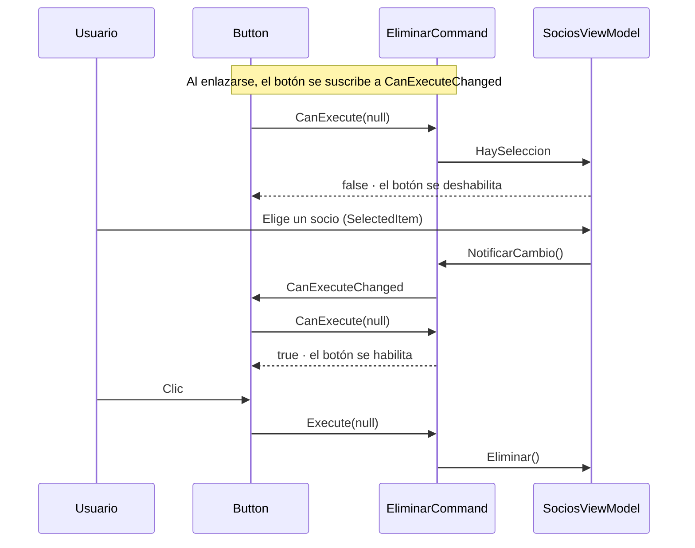
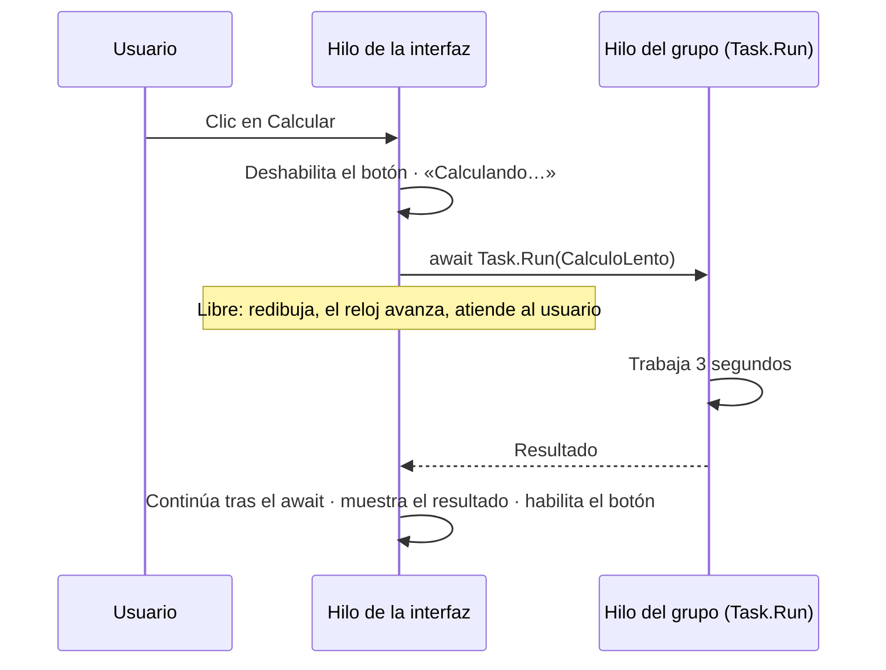

# 10. Comandos

[⬅️ Volver a la unidad](./README.md)

**CE que trabaja este tema:** RA1 g.

## Índice

- [10.1. El problema: los manejadores que quedan](#101-el-problema-los-manejadores-que-quedan)
- [10.2. La interfaz `ICommand`](#102-la-interfaz-icommand)
- [10.3. Un comando propio: `RelayCommand`](#103-un-comando-propio-relaycommand)
  - [10.3.1. Escribirlo a mano](#1031-escribirlo-a-mano)
  - [10.3.2. Avisar de que `CanExecute` ha cambiado](#1032-avisar-de-que-canexecute-ha-cambiado)
- [10.4. De `Click` a `Command`](#104-de-click-a-command)
  - [10.4.1. Botones, menús y atajos](#1041-botones-menús-y-atajos)
  - [10.4.2. Comandos con parámetro](#1042-comandos-con-parámetro)
  - [10.4.3. Eventos frente a comandos](#1043-eventos-frente-a-comandos)
- [10.5. Preguntar al usuario sin `MessageBox` en la lógica](#105-preguntar-al-usuario-sin-messagebox-en-la-lógica)
- [10.6. No bloquear el hilo de la interfaz](#106-no-bloquear-el-hilo-de-la-interfaz)
  - [10.6.1. El problema: una ventana «colgada»](#1061-el-problema-una-ventana-colgada)
  - [10.6.2. `async` y `await` en un manejador](#1062-async-y-await-en-un-manejador)
  - [10.6.3. Un solo hilo para la interfaz: el `Dispatcher`](#1063-un-solo-hilo-para-la-interfaz-el-dispatcher)
  - [10.6.4. Progreso y cancelación](#1064-progreso-y-cancelación)
  - [10.6.5. Comandos asíncronos](#1065-comandos-asíncronos)
- [10.7. Ejemplo integrador: los socios con comandos](#107-ejemplo-integrador-los-socios-con-comandos)
- [10.8. Errores frecuentes](#108-errores-frecuentes)
- [Resumen](#resumen)
- [Ejercicios de reflexión](#ejercicios-de-reflexión)

---

## 10.1. El problema: los manejadores que quedan

Con el *binding* del tema 9, los **datos** ya no pasan por el *code-behind*. Pero las **acciones**, sí:

```xml
<Button x:Name="btnEliminar"
        Content="_Eliminar"
        IsEnabled="{Binding HaySeleccion}"
        Click="btnEliminar_Click" />
```

```csharp
private void btnEliminar_Click(object sender, RoutedEventArgs e)
{
    // … MessageBox para confirmar …
    _vm.Eliminar();
}
```

Quedan tres problemas:

1. El **manejador** está en la ventana: si la misma acción se lanza desde un botón, un menú y un atajo, hay tres sitios que la conectan.
2. **Si la acción está disponible** se resuelve aparte, con `IsEnabled` enlazado a otra propiedad (`HaySeleccion`) que hay que mantener en paralelo.
3. La ventana sigue haciendo de intermediaria: el *ViewModel* no es completo sin ella, así que no se puede probar «pulsar Eliminar» sin abrir la ventana.

En el tema 6 viste la solución para las acciones predefinidas (`ApplicationCommands.Save`): un **comando** reúne **qué hace la acción** y **si se puede hacer**, y cualquier botón, menú o atajo lo usa. Ahora vas a crear **comandos propios** dentro del *ViewModel*.

---

## 10.2. La interfaz `ICommand`

Un comando es cualquier objeto que implemente `ICommand` (`System.Windows.Input`):

```csharp
public interface ICommand
{
    event EventHandler? CanExecuteChanged;
    bool CanExecute(object? parameter);
    void Execute(object? parameter);
}
```

| Miembro | Qué hace | Quién lo usa |
|---------|----------|--------------|
| `Execute` | **Ejecuta** la acción | El botón, al pulsarlo |
| `CanExecute` | Dice si **se puede ejecutar** ahora | El botón, para habilitarse o deshabilitarse |
| `CanExecuteChanged` | **Avisa** de que la respuesta de `CanExecute` puede haber cambiado | El botón se suscribe y vuelve a preguntar |

Los `ApplicationCommands` del tema 6 son comandos **enrutados** (`RoutedCommand`): implementan `ICommand`, pero su código está en los `CommandBinding` de la ventana. Para MVVM se necesitan comandos cuyo código esté **en el *ViewModel***, y eso requiere una clase propia.

> 📝 **Nota del Profesor**: `ICommand` no depende de WPF. Está en una biblioteca básica de .NET, así que un *ViewModel* con comandos se puede compilar y probar en un proyecto sin WPF (lo harás en el tema 11). Es la pieza que permite sacar las acciones de la ventana.

---

## 10.3. Un comando propio: `RelayCommand`

### 10.3.1. Escribirlo a mano

Escribir una clase para cada comando (`EliminarSocioCommand`, `NuevoSocioCommand`…) sería pesado. Lo habitual es **una sola clase** que recibe dos delegados (UD2): uno con lo que se hace y otro con la condición. Se suele llamar `RelayCommand` (o `DelegateCommand`) porque **retransmite** (*relays*) la llamada a esos métodos:

```csharp
public class RelayCommand : ICommand
{
    private readonly Action _ejecutar;
    private readonly Func<bool>? _puedeEjecutar;

    public RelayCommand(Action ejecutar, Func<bool>? puedeEjecutar = null)
    {
        _ejecutar = ejecutar;
        _puedeEjecutar = puedeEjecutar;
    }

    public event EventHandler? CanExecuteChanged;

    public bool CanExecute(object? parameter) => _puedeEjecutar?.Invoke() ?? true;

    public void Execute(object? parameter) => _ejecutar();

    public void NotificarCambio() => CanExecuteChanged?.Invoke(this, EventArgs.Empty);
}
```

Y el *ViewModel* crea sus comandos en el constructor, pasando métodos o lambdas:

```csharp
NuevoCommand = new RelayCommand(Nuevo);
EliminarCommand = new RelayCommand(Eliminar, () => HaySeleccion);
```

```csharp
public RelayCommand NuevoCommand { get; }
public RelayCommand EliminarCommand { get; }

private void Nuevo()
{
    Buscar = "";
    var socio = new Socio { Nombre = "Nuevo socio" };
    Socios.Add(socio);
    SocioSeleccionado = socio;
}
```

Por convención, las propiedades de comando terminan en **`Command`**, y los métodos que ejecutan son **privados**: desde fuera, la acción se lanza con el comando.

### 10.3.2. Avisar de que `CanExecute` ha cambiado

El botón pregunta `CanExecute` al enlazarse, pero ¿cuándo vuelve a preguntar? Cuando el comando lanza **`CanExecuteChanged`**. Así que, cuando cambia algo de lo que depende la condición, el *ViewModel* debe avisar:

```csharp
public Socio? SocioSeleccionado
{
    get => _socioSeleccionado;
    set
    {
        if (Asignar(ref _socioSeleccionado, value))
        {
            OnPropertyChanged(nameof(HaySeleccion));
            EliminarCommand.NotificarCambio();   // ← «vuelve a preguntar si se puede eliminar»
        }
    }
}
```

Hay otra forma, propia de WPF: conectar el evento a **`CommandManager.RequerySuggested`**, que WPF lanza cada vez que **algo cambia en la interfaz** (un clic, una tecla, el foco).

```csharp
// Alternativa: WPF decide cuándo volver a preguntar
public event EventHandler? CanExecuteChanged
{
    add => CommandManager.RequerySuggested += value;
    remove => CommandManager.RequerySuggested -= value;
}
```

| | Aviso manual (`NotificarCambio`) | `CommandManager.RequerySuggested` |
|---|---|---|
| Quién decide cuándo volver a preguntar | Tu código | WPF, ante cualquier cambio en la interfaz |
| Olvidar el aviso | El botón se queda en el estado anterior | Imposible olvidarlo |
| Coste | Solo se pregunta cuando hace falta | Se preguntan **todos** los comandos muchas veces |
| Si el cambio llega sin que el usuario toque nada (un temporizador, una tarea que termina) | Funciona | **No se entera** hasta el siguiente clic |
| Depende de WPF | **No** (se puede probar sin WPF) | Sí |

En el material se usa el **aviso manual**, porque el *ViewModel* pasará a una biblioteca sin WPF y porque hace explícito de qué depende cada comando. Es lo mismo que hace el CommunityToolkit.Mvvm (tema 11).

> 💡 **Tip del Examinador**: *«Un botón con `Command` se queda deshabilitado aunque ya se pueda ejecutar la acción. ¿Por qué?»* Porque nadie ha lanzado `CanExecuteChanged`: el botón no sabe que debe volver a preguntar a `CanExecute`. Hay que avisar cuando cambia lo que la condición consulta.

---

## 10.4. De `Click` a `Command`

### 10.4.1. Botones, menús y atajos

Los controles que lanzan acciones (`Button`, `MenuItem`, `CheckBox`, `Hyperlink`…) tienen la propiedad **`Command`**, que se enlaza con el comando del *ViewModel*:

```xml
<!-- Antes -->
<Button x:Name="btnEliminar"
        Content="_Eliminar"
        IsEnabled="{Binding HaySeleccion}"
        Click="btnEliminar_Click" />

<!-- Después: Command sustituye a Click; IsEnabled lo gestiona CanExecute -->
<Button Content="_Eliminar"
        Command="{Binding EliminarCommand}" />
```

Desaparecen el `x:Name`, el `Click`, el `IsEnabled` y el manejador. El botón se habilita y se deshabilita **solo**, según `CanExecute`.

Los atajos de teclado se enlazan igual, con un `KeyBinding` en la ventana:

```xml
<Window.InputBindings>
    <KeyBinding Gesture="Ctrl+N"
                Command="{Binding NuevoCommand}" />
    <KeyBinding Gesture="Ctrl+E"
                Command="{Binding ExportarCommand}" />
</Window.InputBindings>
```

Y una opción de menú, con el mismo comando que el botón:

```xml
<MenuItem Header="_Nuevo socio"
          InputGestureText="Ctrl+N"
          Command="{Binding NuevoCommand}" />
```

A diferencia de los `ApplicationCommands`, un comando propio no trae su atajo: el `KeyBinding` lo activa e `InputGestureText` lo muestra en el menú.



El diagrama muestra el ciclo completo: el botón **pregunta** antes de habilitarse, el *ViewModel* **avisa** cuando la respuesta puede cambiar y el clic **ejecuta** el método del *ViewModel*. La ventana no interviene.

### 10.4.2. Comandos con parámetro

`Execute` y `CanExecute` reciben un `object? parameter`, que se rellena con **`CommandParameter`**. Es útil cuando el mismo comando actúa sobre cosas distintas, por ejemplo un botón **Eliminar** dentro de cada elemento de una lista:

```xml
<ListBox ItemsSource="{Binding Socios}">
    <ListBox.ItemTemplate>
        <DataTemplate DataType="local:Socio">
            <DockPanel>
                <!-- El parámetro es el propio socio (el DataContext de la plantilla).
                     Se escribe antes que Command (apartado 10.8) -->
                <Button DockPanel.Dock="Right"
                        Content="✕"
                        CommandParameter="{Binding}"
                        Command="{Binding DataContext.EliminarSocioCommand, RelativeSource={RelativeSource AncestorType=ListBox}}" />
                <TextBlock Text="{Binding Nombre}" />
            </DockPanel>
        </DataTemplate>
    </ListBox.ItemTemplate>
</ListBox>
```

Fíjate en dos detalles: dentro de la plantilla el `DataContext` es **el socio**, así que el comando se busca en el `DataContext` de la lista con `RelativeSource`; y `{Binding}` sin ruta significa «el propio `DataContext`».

Para no tener que convertir el `object`, se usa una versión **genérica** del comando:

```csharp
public class RelayCommand<T> : ICommand
{
    private readonly Action<T> _ejecutar;
    private readonly Func<T, bool>? _puedeEjecutar;

    public RelayCommand(Action<T> ejecutar, Func<T, bool>? puedeEjecutar = null)
    {
        _ejecutar = ejecutar;
        _puedeEjecutar = puedeEjecutar;
    }

    public event EventHandler? CanExecuteChanged;

    public bool CanExecute(object? parameter) =>
        parameter is T valor && (_puedeEjecutar?.Invoke(valor) ?? true);

    public void Execute(object? parameter)
    {
        if (parameter is T valor)
        {
            _ejecutar(valor);
        }
    }

    public void NotificarCambio() => CanExecuteChanged?.Invoke(this, EventArgs.Empty);
}
```

```csharp
EliminarSocioCommand = new RelayCommand<Socio>(socio => Socios.Remove(socio));
```

### 10.4.3. Eventos frente a comandos

| | Evento (`Click`) | Comando (`Command`) |
|---|---|---|
| Dónde está el código | Manejador en el *code-behind* | Método del *ViewModel* |
| Habilitar y deshabilitar | A mano (`IsEnabled`) | Automático (`CanExecute`) |
| Misma acción desde botón, menú y atajo | Tres conexiones | Un comando, enlazado tres veces |
| Se prueba sin ventana | No | **Sí**: `vm.EliminarCommand.Execute(null)` |
| Información del evento (`sender`, posición del ratón, tecla) | Sí | No (solo un parámetro) |
| Disponible en | Todos los eventos | Solo en controles con `Command` (botones, menús, `KeyBinding`…) |

> ✅ **Buena práctica**: las **acciones del usuario** (guardar, eliminar, buscar, exportar) son comandos del *ViewModel*. Los **eventos de bajo nivel** que solo afectan a la vista (arrastrar con el ratón, `Ctrl` + rueda para el zoom, dar el foco) pueden quedarse como eventos en el *code-behind*.

> 🔁 **Transferencia**: es la misma idea que las `Action` de Swing (una acción con nombre, icono y `setEnabled` que comparten botón y menú), los `onClick` que llaman a un método del `ViewModel` en Android con Jetpack, o los *handlers* de un componente de React que el padre le pasa. El principio es **separar la acción de quien la dispara**.

---

## 10.5. Preguntar al usuario sin `MessageBox` en la lógica

`Eliminar` debe pedir confirmación. Si el *ViewModel* llama a `MessageBox.Show`, vuelve a depender de WPF y una prueba se quedaría **bloqueada** esperando a que alguien pulse «Sí». La solución provisional del ejemplo es que el *ViewModel* tenga un **delegado** para preguntar, y que **la ventana** lo rellene:

```csharp
// En el ViewModel
public Func<string, bool> Confirmar { get; set; } = _ => true;

private void Eliminar()
{
    if (SocioSeleccionado is null || !Confirmar($"¿Seguro que quieres eliminar a {SocioSeleccionado.Nombre}?"))
    {
        return;
    }

    Socios.Remove(SocioSeleccionado);
    SocioSeleccionado = null;
}
```

```csharp
// En la ventana
var vm = new SociosViewModel
{
    Confirmar = mensaje => MessageBox.Show(
        this,
        mensaje,
        "Socios del club",
        MessageBoxButton.YesNo,
        MessageBoxImage.Warning,
        MessageBoxResult.No) == MessageBoxResult.Yes
};
DataContext = vm;
```

El *ViewModel* sabe **qué preguntar** y **qué hacer con la respuesta**, pero no **cómo se pregunta**. En una prueba, `Confirmar = _ => false` simula que el usuario dice que no.

> 📝 **Nota del Profesor**: es una primera versión de una idea importante: **la lógica pide un servicio y otro decide cómo se presta**. En el tema 11 el delegado se convierte en una interfaz, `IServicioDialogos`, con varios métodos, y la recibe el *ViewModel* en su constructor.

---

## 10.6. No bloquear el hilo de la interfaz

### 10.6.1. El problema: una ventana «colgada»

Una aplicación WPF tiene **un hilo de la interfaz** (*UI thread*) que hace todo lo visual: atiende el ratón y el teclado, ejecuta los manejadores y los comandos, y **redibuja** la ventana. Si un manejador tarda tres segundos, durante esos tres segundos el hilo no hace nada más: la ventana no se redibuja, no responde a los clics y Windows puede mostrar «(No responde)» en el título.

El proyecto [`ejemplos/10-LaboratorioAsincrono`](./ejemplos/10-LaboratorioAsincrono) tiene un **reloj** que se actualiza cada décima de segundo con un `DispatcherTimer`, que se ejecuta en el hilo de la interfaz. Si el reloj **se para**, la ventana está bloqueada.

```csharp
// 1. El manejador hace el trabajo en el hilo de la interfaz: la ventana se congela
private void btnBloquear_Click(object sender, RoutedEventArgs e)
{
    txtResultado.Text = "Calculando…"; // no llega a verse: la ventana no se redibuja hasta el final
    var resultado = CalculoLento();    // Thread.Sleep(3000) simula un trabajo de 3 segundos
    txtResultado.Text = $"Resultado: {resultado}. ¿Se ha parado el reloj?";
}
```

Al pulsar el botón 1, el reloj se detiene tres segundos y el texto «Calculando…» **no llega a verse**: se asigna, pero la ventana no se redibuja hasta que el manejador termina.

Lo mismo ocurre con todo lo que **espera**: leer un fichero grande, una consulta a una base de datos lenta, una petición a un servidor. En el tema 6 la pauta era «nada lento dentro de un manejador». Ahora verás cómo cumplirla.

### 10.6.2. `async` y `await` en un manejador

En la UD2 viste `async` y `await` en consola: `await` **espera a que termine una tarea sin bloquear el hilo**. En una ventana, eso significa que el hilo de la interfaz queda **libre** mientras tanto:

```csharp
// 2. El trabajo va a otro hilo y el manejador espera sin bloquear
private async void btnAsincrono_Click(object sender, RoutedEventArgs e)
{
    btnAsincrono.IsEnabled = false;
    txtResultado.Text = "Calculando…";

    var resultado = await Task.Run(CalculoLento);

    // Después del await se vuelve al hilo de la interfaz: se pueden tocar los controles
    txtResultado.Text = $"Resultado: {resultado}. El reloj no se ha parado.";
    btnAsincrono.IsEnabled = true;
}
```



El diagrama muestra lo importante: durante los tres segundos el hilo de la interfaz **no está esperando**, sino atendiendo la ventana. Cuando la tarea termina, el código que hay **después del `await`** continúa **en el hilo de la interfaz**, así que puede tocar los controles.

| Si el trabajo… | Usa |
|----------------|-----|
| **Espera** algo externo (fichero, red, base de datos) | El método asíncrono de la API: `await File.ReadAllTextAsync(…)`, `await http.GetStringAsync(…)` |
| **Calcula** mucho en memoria (CPU) | `await Task.Run(() => Calcular(…))` |

> ⚠️ **Cuidado**: `async void` solo se admite en **manejadores de eventos** (y en `Execute` de un comando asíncrono, apartado 10.6.5), porque su firma la fija el evento. En cualquier otro método asíncrono, devuelve `Task`. Una excepción dentro de un `async void` que no se capture **cierra la aplicación**.

> ⚠️ **Cuidado**: deshabilita el botón mientras dura la operación. Si no, el usuario puede pulsarlo cinco veces y lanzar cinco cálculos a la vez.

### 10.6.3. Un solo hilo para la interfaz: el `Dispatcher`

Los controles de WPF solo se pueden tocar **desde el hilo que los creó**, el de la interfaz. Si otro hilo lo intenta, WPF lanza una excepción:

```csharp
// 3. Un control solo se puede tocar desde el hilo que lo creó
private async void btnOtroHilo_Click(object sender, RoutedEventArgs e)
{
    try
    {
        await Task.Run(() => txtResultado.Text = "Esto no se llega a escribir");
    }
    catch (InvalidOperationException ex)
    {
        txtResultado.Text = $"Excepción: {ex.Message}";
    }
}
```

El mensaje es del estilo de «El subproceso que realiza la llamada no puede obtener acceso a este objeto porque el propietario es otro subproceso». Si de verdad necesitas actualizar la interfaz **desde otro hilo**, se le pide al **`Dispatcher`** (la cola de trabajo del hilo de la interfaz) que lo haga:

```csharp
// 4. Desde otro hilo, se pide al Dispatcher que ejecute el cambio en el hilo de la interfaz
await Task.Run(() =>
{
    var hilo = Environment.CurrentManagedThreadId;
    Dispatcher.Invoke(() => txtResultado.Text = $"Escrito desde el hilo {hilo} a través del Dispatcher.");
});
```

| Método | Qué hace |
|--------|----------|
| `Dispatcher.Invoke(acción)` | Ejecuta la acción en el hilo de la interfaz y **espera** a que termine |
| `Dispatcher.InvokeAsync(acción)` | La encola y **no espera** (devuelve una operación que se puede esperar con `await`) |
| `Dispatcher.CheckAccess()` | `true` si ya estás en el hilo de la interfaz |

> 📝 **Nota del Profesor**: con `async` y `await` bien usados, casi nunca necesitas el `Dispatcher`: el código que va después del `await` ya vuelve al hilo de la interfaz. Lo necesitarás con temporizadores de otros hilos, eventos de bibliotecas que avisan desde su propio hilo o código antiguo. Si lo usas a menudo, revisa el diseño.

> 🔁 **Transferencia**: la regla «un solo hilo toca la interfaz» es universal. En Android es el *main thread* (con `runOnUiThread` o las corrutinas de Kotlin con `Dispatchers.Main`), en JavaFX `Platform.runLater`, en Swing `SwingUtilities.invokeLater`, y en el navegador JavaScript tiene un solo hilo con su bucle de eventos.

### 10.6.4. Progreso y cancelación

Una operación larga debe **informar del progreso** y **dejar cancelarla**. .NET ofrece dos piezas estándar:

| Pieza | Para qué | Cómo |
|-------|----------|------|
| `IProgress<T>` y `Progress<T>` | Avisar del progreso | La operación llama a `progreso.Report(valor)` |
| `CancellationTokenSource` y `CancellationToken` | Pedir que se detenga | El botón llama a `Cancel()` y la operación comprueba el *token* |

```csharp
// 5. Operación asíncrona con progreso y cancelación
private async void btnDescargar_Click(object sender, RoutedEventArgs e)
{
    _cancelacion = new CancellationTokenSource();
    btnDescargar.IsEnabled = false;
    btnCancelar.IsEnabled = true;

    // Progress<T> llama a su acción en el hilo donde se creó: aquí, el de la interfaz
    var progreso = new Progress<int>(porcentaje => prgDescarga.Value = porcentaje);

    try
    {
        await DescargarAsync(progreso, _cancelacion.Token);
        txtResultado.Text = "Descarga terminada.";
    }
    catch (OperationCanceledException)
    {
        txtResultado.Text = "Descarga cancelada.";
        prgDescarga.Value = 0;
    }
    finally
    {
        btnDescargar.IsEnabled = true;
        btnCancelar.IsEnabled = false;
        _cancelacion.Dispose();
        _cancelacion = null;
    }
}

private void btnCancelar_Click(object sender, RoutedEventArgs e)
{
    _cancelacion?.Cancel();
}

private static async Task DescargarAsync(IProgress<int> progreso, CancellationToken cancelacion)
{
    for (var bloque = 1; bloque <= 20; bloque++)
    {
        await Task.Delay(150, cancelacion);   // lanza OperationCanceledException si se cancela
        progreso.Report(bloque * 5);
    }
}
```

Tres cosas que conviene fijarse:

- `Progress<T>` ejecuta su acción **en el hilo donde se creó**. Como se crea en el manejador (hilo de la interfaz), puede tocar la `ProgressBar` sin `Dispatcher`.
- Cancelar **no detiene** la tarea a la fuerza: le **pide** que pare. La tarea lo comprueba (aquí, `Task.Delay` con el *token*) y lanza `OperationCanceledException`, que se captura como un caso normal, no como un error.
- El `finally` deja la interfaz en su estado inicial pase lo que pase.

### 10.6.5. Comandos asíncronos

`ICommand.Execute` devuelve `void`, así que un comando que ejecuta algo asíncrono necesita una clase que lo adapte. Además debe **impedir que se lance dos veces** mientras está en marcha:

```csharp
public class ComandoAsincrono : ICommand
{
    private readonly Func<Task> _ejecutar;
    private readonly Func<bool>? _puedeEjecutar;
    private bool _enMarcha;

    public ComandoAsincrono(Func<Task> ejecutar, Func<bool>? puedeEjecutar = null)
    {
        _ejecutar = ejecutar;
        _puedeEjecutar = puedeEjecutar;
    }

    public event EventHandler? CanExecuteChanged;

    public bool CanExecute(object? parameter) => !_enMarcha && (_puedeEjecutar?.Invoke() ?? true);

    public async void Execute(object? parameter)
    {
        _enMarcha = true;
        NotificarCambio();
        try
        {
            await _ejecutar();
        }
        finally
        {
            _enMarcha = false;
            NotificarCambio();
        }
    }

    public void NotificarCambio() => CanExecuteChanged?.Invoke(this, EventArgs.Empty);
}
```

Mientras la tarea está en marcha, `CanExecute` devuelve `false` y el botón **se deshabilita solo**. En el *ViewModel*, la exportación ya no toca controles: actualiza **propiedades** (`Progreso`, `Estado`) a las que se enlazan la `ProgressBar` y la barra de estado.

```csharp
ExportarCommand = new ComandoAsincrono(ExportarAsync, () => Socios.Count > 0);
CancelarExportacionCommand = new RelayCommand(() => _cancelacion?.Cancel(), () => _cancelacion is not null);

private async Task ExportarAsync()
{
    // … prepara las líneas del CSV y el CancellationTokenSource …
    Estado = "Exportando…";
    try
    {
        for (var i = 0; i < lineas.Count; i++)
        {
            await Task.Delay(500, _cancelacion.Token);   // simula una exportación lenta
            Progreso = (i + 1) * 100 / lineas.Count;
        }

        await File.WriteAllLinesAsync(ruta, lineas, _cancelacion.Token);
        Estado = $"Exportados {lineas.Count} socios a {ruta}";
    }
    catch (OperationCanceledException)
    {
        Estado = "Exportación cancelada";
    }
    catch (Exception ex) when (ex is IOException or UnauthorizedAccessException)
    {
        Estado = $"No se ha podido exportar: {ex.Message}";
    }
    finally
    {
        Progreso = 0;
        // … libera el CancellationTokenSource y avisa al comando de cancelar …
    }
}
```

```xml
<ProgressBar Value="{Binding Progreso}" />
<TextBlock Text="{Binding Estado}" />
<Button Content="E_xportar" Command="{Binding ExportarCommand}" />
<Button Content="_Cancelar" Command="{Binding CancelarExportacionCommand}" />
```

Como el comando se ejecuta en el hilo de la interfaz y `await` vuelve a él, cambiar `Progreso` desde `ExportarAsync` es seguro: el *binding* recibe el aviso en el hilo correcto.

> 💡 **Tip del Examinador**: *«¿Por qué se queda bloqueada una ventana mientras se ejecuta un manejador, y cómo se evita?»* Porque el manejador se ejecuta en el **hilo de la interfaz**, que es el que redibuja y atiende al usuario. Se evita con `async`/`await`: el trabajo que espera se hace con métodos asíncronos (y el de cálculo con `Task.Run`), y el hilo de la interfaz queda libre mientras tanto.

---

## 10.7. Ejemplo integrador: los socios con comandos

El proyecto [`ejemplos/10-SociosComandos`](./ejemplos/10-SociosComandos) es `09-SociosBinding` con comandos:

| Cambio | Dónde |
|--------|-------|
| `RelayCommand` y `ComandoAsincrono` escritos a mano | `Comandos/` |
| `NuevoCommand`, `EliminarCommand` (con `CanExecute`), `ExportarCommand` (asíncrono) y `CancelarExportacionCommand` | `SociosViewModel` |
| Botones con `Command` y atajos `Ctrl+N` y `Ctrl+E` con `KeyBinding` | `MainWindow.xaml` |
| Confirmación con un delegado `Confirmar` que rellena la ventana | `MainWindow.xaml.cs` |
| Exportación a `Documentos\socios.csv` con progreso, estado y cancelación | `ExportarAsync` |

El *code-behind* queda así:

```csharp
public partial class MainWindow : Window
{
    public MainWindow()
    {
        InitializeComponent();

        var vm = new SociosViewModel
        {
            Confirmar = mensaje => MessageBox.Show(…) == MessageBoxResult.Yes
        };
        DataContext = vm;
    }
}
```

**Ningún manejador de eventos.** La ventana solo crea el *ViewModel* y le da una forma de preguntar.

**Prueba la aplicación así:**

| Prueba | Resultado esperado |
|--------|--------------------|
| Al abrir, sin socio elegido | **Eliminar** está deshabilitado |
| Elegir un socio | **Eliminar** se habilita solo |
| `Ctrl+N` | Se añade «Nuevo socio» elegido (igual que el botón **Nuevo**) |
| **Eliminar** y responder **No** | No se elimina |
| **Exportar** (o `Ctrl+E`) | La barra avanza, el estado dice «Exportando…», **Exportar** se deshabilita y **Cancelar** se habilita |
| Mientras exporta, escribir en la ficha o en el buscador | La ventana responde con normalidad |
| **Cancelar** durante la exportación | «Exportación cancelada» y la barra vuelve a cero |
| Exportar hasta el final | `Documentos\socios.csv` contiene una línea por socio |

**Actividad.** Añade un comando `DuplicarCommand` que cree una copia del socio elegido con el nombre «… (copia)». Solo debe estar disponible si hay un socio elegido. Añádelo como botón y como atajo `Ctrl+D`. ¿Has tenido que tocar el *code-behind*?

---

## 10.8. Errores frecuentes

| Síntoma | Causa habitual | Solución |
|---------|----------------|----------|
| El botón con `Command` no hace nada y no da error | Nombre del comando mal escrito en el *binding* | Mira la ventana **Salida** (tema 13) y usa `d:DataContext` |
| El botón se queda deshabilitado (o habilitado) cuando no debe | Falta `NotificarCambio()` al cambiar lo que consulta `CanExecute` | Avisa en el `set` de las propiedades de las que depende |
| Se usa `Click` y `Command` a la vez | Se ejecutan los dos | Quita el `Click` |
| El comando de un botón dentro de una plantilla no se encuentra | El `DataContext` de la plantilla es el elemento, no el *ViewModel* | `RelativeSource={RelativeSource AncestorType=ListBox}` y `DataContext.ElComando` |
| `CommandParameter` llega `null` en `CanExecute` | El parámetro se evalúa después que el comando | Escribe `CommandParameter` **antes** que `Command` en el XAML, o comprueba el `null` |
| La ventana se queda colgada | Trabajo lento en un manejador o comando síncrono | `async`/`await`, con `Task.Run` si es cálculo |
| `InvalidOperationException`: «el propietario es otro subproceso» | Se toca un control desde otro hilo | Hazlo después del `await` o con `Dispatcher.Invoke` |
| La aplicación se cierra sin aviso durante una operación asíncrona | Excepción sin capturar en un `async void` | `try-catch` dentro del manejador o del comando |
| Se lanza la operación varias veces | El botón sigue habilitado durante la operación | Deshabilítalo o usa un comando asíncrono que lo haga |
| Cancelar no detiene la operación | La operación no comprueba el `CancellationToken` | Pasa el *token* a los métodos asíncronos o llama a `ThrowIfCancellationRequested()` |
| `.Result` o `.Wait()` sobre una tarea y la ventana se bloquea para siempre | El hilo de la interfaz espera a una tarea que necesita volver a él (bloqueo mutuo) | Usa `await`, nunca `.Result` ni `.Wait()` en la interfaz |

---

## Resumen

- Un **comando** (`ICommand`) reúne una acción (`Execute`), su disponibilidad (`CanExecute`) y un aviso (`CanExecuteChanged`). No depende de WPF.
- **`RelayCommand`** es una clase propia que recibe delegados: `new RelayCommand(Eliminar, () => HaySeleccion)`. Las propiedades terminan en `Command`.
- Hay que **avisar** con `CanExecuteChanged` cuando cambia algo de lo que depende `CanExecute`. `CommandManager.RequerySuggested` es la alternativa automática de WPF.
- `Command="{Binding …}"` sustituye a `Click`: el botón se habilita solo. Los atajos propios se enlazan con `KeyBinding` e `InputGestureText`.
- `CommandParameter` pasa un dato al comando; `RelayCommand<T>` evita convertirlo.
- Las **acciones del usuario** son comandos del *ViewModel*; los eventos puramente visuales pueden quedarse en la vista.
- Para preguntar al usuario sin `MessageBox` en la lógica, el *ViewModel* recibe **cómo preguntar** (un delegado, y en el tema 11 un servicio).
- El **hilo de la interfaz** dibuja y atiende al usuario: no se bloquea. **`async`/`await`** lo deja libre; `Task.Run` para cálculo.
- Los controles solo se tocan desde el hilo de la interfaz: después del `await`, o con el **`Dispatcher`**.
- **`Progress<T>`** informa del progreso y **`CancellationToken`** permite cancelar.
- Un **comando asíncrono** se deshabilita mientras se ejecuta y actualiza propiedades enlazadas (`Progreso`, `Estado`).

---

## Ejercicios de reflexión

1. En `10-SociosComandos`, quita la línea `EliminarCommand.NotificarCambio();` del `set` de `SocioSeleccionado`. ¿Qué pasa con el botón **Eliminar**? ¿Y si cambias `RelayCommand` para usar `CommandManager.RequerySuggested`?
2. Explica qué ventajas tiene que **Nuevo** sea un comando y no un manejador, si al final hace lo mismo.
3. En el laboratorio, pulsa el botón 1 y, mientras el reloj está parado, haz clic tres veces en el botón 2. ¿Qué ocurre cuando termina? ¿Por qué?
4. ¿Por qué el botón 3 del laboratorio lanza una excepción y el 2 no, si los dos usan `Task.Run`?
5. En `ExportarAsync`, ¿por qué se puede asignar `Progreso` sin usar el `Dispatcher`? ¿Qué pasaría si el bucle estuviera dentro de un `Task.Run`?
6. El delegado `Confirmar` tiene como valor por defecto `_ => true`. ¿Es una buena idea? ¿Qué valor pondrías tú y por qué?
7. Busca en tu proyecto una operación que pueda tardar (leer muchos datos, exportar, importar). Describe cómo la harías asíncrona, con progreso y cancelación.

---

[⬅️ Volver a la unidad](./README.md)
