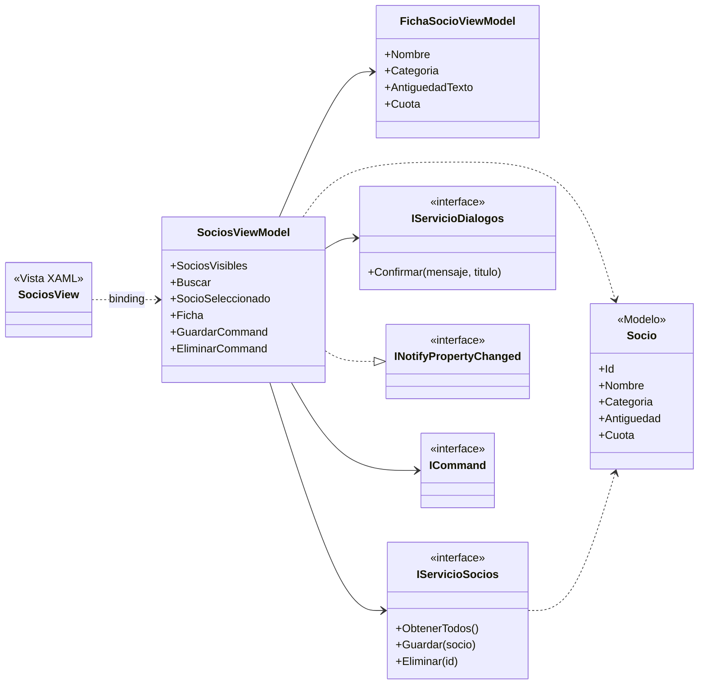
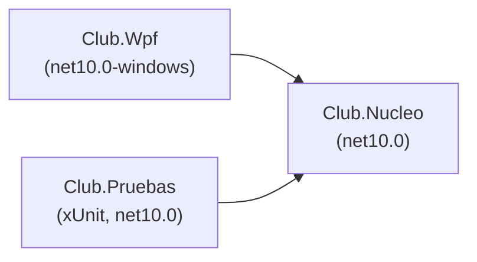
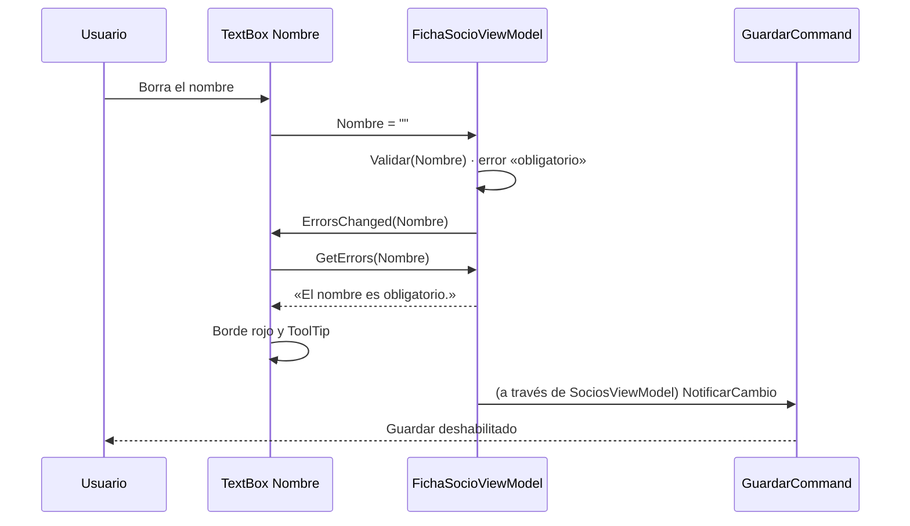
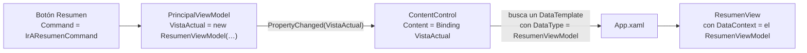

# 11. El patrón MVVM

[⬅️ Volver a la unidad](./README.md)

**CE que trabaja este tema:** RA1 f, h.

## Índice

- [11.1. Lo que todavía falta](#111-lo-que-todavía-falta)
- [11.2. Las piezas de MVVM](#112-las-piezas-de-mvvm)
- [11.3. Organizar la solución](#113-organizar-la-solución)
  - [11.3.1. De la solución de la UD2 a una con WPF](#1131-de-la-solución-de-la-ud2-a-una-con-wpf)
  - [11.3.2. Añadir el proyecto WPF en Visual Studio](#1132-añadir-el-proyecto-wpf-en-visual-studio)
  - [11.3.3. Carpetas y nombres](#1133-carpetas-y-nombres)
- [11.4. El modelo](#114-el-modelo)
- [11.5. Servicios e inyección de dependencias](#115-servicios-e-inyección-de-dependencias)
  - [11.5.1. Un servicio para los datos](#1151-un-servicio-para-los-datos)
  - [11.5.2. Un servicio para los mensajes](#1152-un-servicio-para-los-mensajes)
  - [11.5.3. Recibir las dependencias en el constructor](#1153-recibir-las-dependencias-en-el-constructor)
  - [11.5.4. La raíz de composición](#1154-la-raíz-de-composición)
- [11.6. Los *ViewModels*](#116-los-viewmodels)
  - [11.6.1. La pantalla de socios](#1161-la-pantalla-de-socios)
  - [11.6.2. La ficha: editar una copia](#1162-la-ficha-editar-una-copia)
- [11.7. Validación con `INotifyDataErrorInfo`](#117-validación-con-inotifydataerrorinfo)
- [11.8. Convertidores](#118-convertidores)
- [11.9. La contraseña: un caso para el *code-behind*](#119-la-contraseña-un-caso-para-el-code-behind)
- [11.10. Navegación entre vistas](#1110-navegación-entre-vistas)
- [11.11. Probar el *ViewModel*](#1111-probar-el-viewmodel)
- [11.12. CommunityToolkit.Mvvm](#1112-communitytoolkitmvvm)
  - [11.12.1. Propiedades observables](#11121-propiedades-observables)
  - [11.12.2. Comandos](#11122-comandos)
  - [11.12.3. Mensajería entre *ViewModels*](#11123-mensajería-entre-viewmodels)
  - [11.12.4. A mano o con el Toolkit](#11124-a-mano-o-con-el-toolkit)
- [11.13. Ejemplo integrador: el club con MVVM](#1113-ejemplo-integrador-el-club-con-mvvm)
- [11.14. Errores frecuentes](#1114-errores-frecuentes)
- [Resumen](#resumen)
- [Ejercicios de reflexión](#ejercicios-de-reflexión)

---

## 11.1. Lo que todavía falta

Después de los temas 9 y 10, la aplicación de socios tiene *binding*, comandos y un *code-behind* sin manejadores. Pero `SociosViewModel` todavía tiene problemas:

| Problema | Dónde se ve |
|----------|-------------|
| **Crea sus propios datos** | Los tres socios de ejemplo están escritos en su constructor: para usar una base de datos habría que reescribirlo |
| **Sigue dependiendo de WPF** | Usa `CollectionViewSource` para filtrar y la ventana le pasa un delegado `Confirmar` |
| **No se valida** | La ficha edita el socio original, sin «Cancelar», y un nombre vacío se acepta |
| **Una sola pantalla** | No hay forma de cambiar de pantalla sin volver al *code-behind* |
| **Sin pruebas** | Todo está en el proyecto WPF, que no se puede probar fuera de Windows |

Este tema termina la refactorización: reparte las responsabilidades del tema 8 en **modelo, *ViewModels*, servicios y vistas**, con cada pieza en el sitio que le corresponde, y la lógica en un proyecto que **se puede probar**.

---

## 11.2. Las piezas de MVVM



El diagrama muestra quién conoce a quién. Lo importante es la **dirección de las flechas**: la vista conoce al *ViewModel* (por *binding*), el *ViewModel* conoce al modelo y a las **interfaces** de los servicios, y **nadie conoce a la vista**.

| Pieza | Responsabilidad | Sabe de WPF | En el ejemplo |
|-------|-----------------|:-----------:|---------------|
| **Modelo** | Datos y reglas del dominio | No | `Socio`, `CalculadoraCuotas` |
| ***ViewModel*** | Estado y comportamiento de **una pantalla**: qué se muestra, qué se puede hacer | No | `SociosViewModel`, `FichaSocioViewModel`, `ResumenViewModel`, `PrincipalViewModel` |
| **Servicios** | Lo que habla con el exterior: datos, mensajes, ficheros | Su interfaz no; la implementación puede | `IServicioSocios`, `IServicioDialogos` |
| **Vista** | Cómo se ve: XAML, estilos, plantillas, convertidores | Sí | `MainWindow`, `SociosView`, `ResumenView` |

> 📝 **Nota del Profesor**: la pregunta de cada línea de código es **«¿en qué pieza va esto?»**. Una regla del club, al modelo. «El botón Guardar solo se habilita si no hay errores», al *ViewModel*. «Guardar en SQLite», a un servicio. «El nombre en negrita y el círculo de color según la categoría», a la vista.

---

## 11.3. Organizar la solución

La forma más eficaz de garantizar que los *ViewModels* no dependen de WPF es que **no puedan**: se ponen en un proyecto de **biblioteca de clases** que no referencia WPF. Si alguien escribe `MessageBox.Show` en un *ViewModel*, el proyecto **no compila**.

```text
11-ClubMvvm/
├── ClubMvvm.slnx
├── Club.Nucleo/                     # Biblioteca de clases, net10.0 (sin WPF)
│   ├── Modelos/                     #   Socio, CalculadoraCuotas
│   ├── Mvvm/                        #   ObjetoObservable, RelayCommand
│   ├── Servicios/                   #   IServicioSocios, ServicioSociosMemoria, IServicioDialogos
│   └── ViewModels/                  #   PrincipalViewModel, SociosViewModel, FichaSocioViewModel, ResumenViewModel
├── Club.Wpf/                        # Aplicación WPF, net10.0-windows
│   ├── App.xaml(.cs)                #   Raíz de composición y plantillas de navegación
│   ├── MainWindow.xaml(.cs)
│   ├── Vistas/                      #   SociosView, ResumenView (UserControl)
│   ├── Conversores/                 #   CategoriaAColorConverter
│   └── Servicios/                   #   ServicioDialogosWpf (con MessageBox)
└── Club.Pruebas/                    # Pruebas xUnit, net10.0
```



Las flechas son **referencias entre proyectos** (UD2, tema 1): la aplicación y las pruebas usan el núcleo, pero el núcleo no conoce a ninguno de los dos. Por eso las pruebas se ejecutan en cualquier sistema, también en Linux o en un servidor de integración continua.

En el XAML, para usar tipos de otro proyecto se añade el nombre del ensamblado al espacio de nombres:

```xml
xmlns:vm="clr-namespace:Club.Nucleo.ViewModels;assembly=Club.Nucleo"
```

> ✅ **Buena práctica**: el `TargetFramework` del núcleo es `net10.0`, **no** `net10.0-windows`. Es tu garantía de que la lógica es portable: el mismo núcleo podría servir para una aplicación de .NET MAUI, una web con ASP.NET Core (UD10) o una de consola.

### 11.3.1. De la solución de la UD2 a una con WPF

La solución de este tema es la de **tres proyectos** de la UD2 (tema 1, apartado 1.5), con una sola diferencia: la consola se sustituye por una aplicación WPF.

| UD2 | Ahora | Plataforma | Contiene |
|-----|-------|------------|----------|
| `<Nombre>.Logica` | `Club.Nucleo` | `net10.0` | Modelos, servicios, *ViewModels* |
| `<Nombre>.Consola` | `Club.Wpf` | `net10.0-windows` | Ventanas, vistas, convertidores, servicios que usan WPF |
| `<Nombre>.Pruebas` | `Club.Pruebas` | `net10.0` | Pruebas del núcleo |

> 📝 **Nota del Profesor**: ¿por qué `Nucleo` y no `Logica`, como en la UD2? Porque el proyecto ha cambiado de contenido. En la UD2 solo guardaba la **lógica** (cálculos y reglas), y `Logica` lo describía bien. Ahora guarda también los *ViewModels* y los servicios, que no son lógica de negocio sino el **comportamiento de la interfaz**: qué se puede pulsar, qué se muestra y cuándo. Para todo eso `Logica` se queda corto, y `Nucleo` dice lo que es: **todo lo que no depende de WPF**, y por tanto lo que se puede probar y reutilizar. Lo que define a este proyecto no es el nombre, sino lo que **no** puede tener: nada de WPF.

Las referencias van **en un solo sentido**:

- `Club.Wpf` referencia a `Club.Nucleo`, y `Club.Pruebas` también.
- `Club.Nucleo` **no referencia a ninguno**.

Que el proyecto WPF sea `net10.0-windows` y el núcleo `net10.0` no es un problema: un proyecto de Windows puede usar una biblioteca genérica. Al revés **no funciona**: una biblioteca `net10.0` no puede referenciar un proyecto `net10.0-windows`.

### 11.3.2. Añadir el proyecto WPF en Visual Studio

Los pasos son los de la UD2 con otras plantillas. Para una solución llamada `Club`:

1. `Archivo > Nuevo > Proyecto`, plantilla **Biblioteca de clases** (C#). Proyecto `Club.Nucleo`, solución `Club`, y desmarca *Colocar la solución y el proyecto en el mismo directorio*. Elige **.NET 10.0**. Borra el `Class1.cs`.
2. Botón derecho sobre la **solución** > `Agregar > Nuevo proyecto`, plantilla **Aplicación WPF** (la de C# que **no** dice «.NET Framework», apartado 2.2) y nombre `Club.Wpf`.
3. Botón derecho sobre la solución > `Agregar > Nuevo proyecto`, plantilla **xUnit.net v3 Test Project** y nombre `Club.Pruebas`.
4. Botón derecho sobre `Club.Wpf` > `Agregar > Referencia de proyecto…` y marca `Club.Nucleo`. Haz lo mismo con `Club.Pruebas`.
5. Botón derecho sobre `Club.Wpf` > `Establecer como proyecto de inicio`. Sin esto, F5 intentará ejecutar otro proyecto y fallará.

> ⚠️ **Cuidado**: si pulsas F5 y aparece «Un proyecto con un tipo de salida de biblioteca de clases no se puede iniciar directamente», el proyecto de inicio es el núcleo o el de pruebas. Está en **negrita** en el Explorador de soluciones.

Los paquetes NuGet se instalan **en el proyecto que los usa** (UD2, apartado 1.8): `CommunityToolkit.Mvvm` en el núcleo, donde están los *ViewModels*; `Microsoft.Data.Sqlite` (tema 12) en el proyecto de los servicios de datos.

### 11.3.3. Carpetas y nombres

Dentro de cada proyecto, los ficheros se agrupan en **carpetas por tipo**, en español y en plural:

| Carpeta | Va en | Contiene |
|---------|-------|----------|
| `Modelos/` | Núcleo | Clases con los datos y las reglas (`Socio`) |
| `Servicios/` | Núcleo (interfaces y versión sin WPF) y WPF (versión que usa `MessageBox`) | Acceso a datos, diálogos |
| `ViewModels/` | Núcleo | Un *ViewModel* por pantalla |
| `Vistas/` | WPF | `UserControl` y ventanas secundarias |
| `Conversores/` | WPF | `IValueConverter` |
| `Recursos/` | WPF | Diccionarios de recursos (colores, estilos, temas) |
| `Imagenes/` | WPF | Iconos e imágenes (acción de compilación `Resource`, tema 5) |

Para crearlas: botón derecho sobre el proyecto > `Agregar > Nueva carpeta`. El **espacio de nombres sigue a la carpeta**: una clase en `Club.Nucleo/ViewModels/` está en `Club.Nucleo.ViewModels`, que es lo que ya usa el `xmlns:vm` de más arriba.

> ✅ **Buena práctica**: crea las vistas **dentro de su carpeta** (botón derecho sobre `Vistas` > `Agregar > Control de usuario…`), de modo que Visual Studio genere bien el espacio de nombres y el `x:Class`. Si arrastras después un fichero a otra carpeta, el espacio de nombres **no cambia solo** y el XAML deja de coincidir con su *code-behind*.

`MainWindow` se queda en la raíz del proyecto WPF, junto a `App.xaml`: es la ventana de arranque y así se encuentra enseguida. Los proyectos pequeños de los temas anteriores no necesitan carpetas; se crean cuando hay varios ficheros del mismo tipo.

---

## 11.4. El modelo

El modelo es lo más sencillo: **datos y reglas**, sin interfaz.

```csharp
public class Socio
{
    public int Id { get; set; }
    public string Nombre { get; set; } = "";
    public string Categoria { get; set; } = "Adulto";
    public int Antiguedad { get; set; }

    public decimal Cuota => CalculadoraCuotas.Calcular(Categoria, Antiguedad);
}
```

Fíjate en que **ya no implementa `INotifyPropertyChanged`**. En el tema 9 lo hacía porque la ficha lo editaba directamente. Ahora la ficha tiene su propio *ViewModel* (apartado 11.6.2) y el modelo vuelve a ser una clase de datos normal, como las que escribiste en la UD2.

| ¿El modelo implementa `INotifyPropertyChanged`? | Cuándo |
|-------------------------------------------------|--------|
| **No** (el modelo es solo datos; el *ViewModel* expone lo que se edita) | Cuando se edita una copia y se guarda al final. Es lo que hace este tema |
| **Sí** (la vista enlaza directamente con el modelo) | Aplicaciones sencillas donde lo que se escribe se aplica al momento (tema 9) |

Las dos son MVVM válido. La primera separa más y encaja mejor con una base de datos.

---

## 11.5. Servicios e inyección de dependencias

### 11.5.1. Un servicio para los datos

El *ViewModel* necesita **leer y guardar socios**, pero no debe saber **dónde**. Lo que necesita se describe con una **interfaz**:

```csharp
public interface IServicioSocios
{
    IReadOnlyList<Socio> ObtenerTodos();
    bool ExisteNombre(string nombre, int idExcluido);
    void Guardar(Socio socio);
    void Eliminar(int id);
}
```

Y de momento se implementa **en memoria**:

```csharp
public class ServicioSociosMemoria : IServicioSocios
{
    private readonly List<Socio> _socios = [];
    private int _ultimoId;

    public IReadOnlyList<Socio> ObtenerTodos() =>
        _socios.OrderBy(s => s.Nombre).Select(Copiar).ToList();

    public void Guardar(Socio socio)
    {
        if (socio.Id == 0)
        {
            socio.Id = ++_ultimoId;
            _socios.Add(Copiar(socio));
            return;
        }

        // … sustituye el socio con ese Id …
    }

    // … ExisteNombre, Eliminar …

    private static Socio Copiar(Socio s) =>
        new() { Id = s.Id, Nombre = s.Nombre, Categoria = s.Categoria, Antiguedad = s.Antiguedad };
}
```

El servicio guarda y devuelve **copias**, como haría una base de datos: quien recibe un socio no puede cambiar lo guardado sin llamar a `Guardar`. En el tema 12 se sustituye por un repositorio de SQLite **sin tocar ningún *ViewModel***.

### 11.5.2. Un servicio para los mensajes

El delegado `Confirmar` del tema 10 se convierte en una interfaz con todo lo que la lógica puede necesitar comunicar al usuario:

```csharp
public interface IServicioDialogos
{
    bool Confirmar(string mensaje, string titulo);
    void MostrarError(string mensaje, string titulo);
}
```

La implementación con `MessageBox` vive en el proyecto WPF, que es el único que puede usarlo:

```csharp
public class ServicioDialogosWpf : IServicioDialogos
{
    public bool Confirmar(string mensaje, string titulo) =>
        MessageBox.Show(
            Application.Current.MainWindow,
            mensaje,
            titulo,
            MessageBoxButton.YesNo,
            MessageBoxImage.Warning,
            MessageBoxResult.No) == MessageBoxResult.Yes;

    public void MostrarError(string mensaje, string titulo) =>
        MessageBox.Show(Application.Current.MainWindow, mensaje, titulo, MessageBoxButton.OK, MessageBoxImage.Error);
}
```

Y las pruebas tienen la suya, que **responde lo que se le diga** y anota lo que se le pregunta:

```csharp
public class DialogosFalsos : IServicioDialogos
{
    public bool Respuesta { get; set; } = true;
    public List<string> Preguntas { get; } = [];

    public bool Confirmar(string mensaje, string titulo)
    {
        Preguntas.Add(mensaje);
        return Respuesta;
    }

    public void MostrarError(string mensaje, string titulo) => Preguntas.Add(mensaje);
}
```

### 11.5.3. Recibir las dependencias en el constructor

El *ViewModel* **no crea** sus servicios: los **recibe** en el constructor. Es la **inyección de dependencias** (*dependency injection*), aplicada de la forma más sencilla:

```csharp
public SociosViewModel(IServicioSocios servicio, IServicioDialogos dialogos)
{
    _servicio = servicio;
    _dialogos = dialogos;
    …
}
```

| Si el *ViewModel*… | Entonces… |
|--------------------|-----------|
| Hace `new ServicioSociosMemoria()` dentro | Está atado a esa clase: para usar SQLite hay que cambiarlo, y las pruebas usan los datos reales |
| Recibe un `IServicioSocios` | Funciona con **cualquier** implementación: memoria, SQLite, una falsa para las pruebas |

Es el principio de **inversión de dependencias**: la lógica depende de **abstracciones** (interfaces), no de clases concretas. La UD2 ya te enseñó las interfaces; aquí ves para qué sirven en una aplicación real.

### 11.5.4. La raíz de composición

Alguien tiene que crear los servicios concretos y entregarlos. Se hace en **un solo sitio**, al arrancar: la **raíz de composición** (*composition root*). En WPF, el método `OnStartup` de `App`:

```csharp
public partial class App : Application
{
    protected override void OnStartup(StartupEventArgs e)
    {
        base.OnStartup(e);

        IServicioSocios servicio = new ServicioSociosMemoria(
        [
            new Socio { Nombre = "Lucía Pérez", Categoria = "Adulto", Antiguedad = 12 },
            new Socio { Nombre = "Mario Gil", Categoria = "Infantil", Antiguedad = 2 },
            new Socio { Nombre = "Carmen Ruiz", Categoria = "Senior", Antiguedad = 25 }
        ]);
        IServicioDialogos dialogos = new ServicioDialogosWpf();

        var ventana = new MainWindow { DataContext = new PrincipalViewModel(servicio, dialogos) };
        ventana.Show();
    }
}
```

Para que esto funcione, se quita `StartupUri="MainWindow.xaml"` de `App.xaml`: si no, WPF crearía **otra** ventana sin `DataContext`.

> 💡 **Tip del Examinador**: *«¿Qué es la inyección de dependencias y para qué sirve en MVVM?»* Que una clase **reciba** los objetos que necesita (normalmente por el constructor y como interfaces) en lugar de crearlos ella. En MVVM permite cambiar la implementación de un servicio sin tocar el *ViewModel* y, sobre todo, **probar el *ViewModel* con servicios falsos**.

**Ampliación: un contenedor de inyección de dependencias.** Con muchos servicios y *ViewModels*, crearlos a mano en `OnStartup` se alarga. Un **contenedor** (`Microsoft.Extensions.DependencyInjection`, el mismo que usa ASP.NET Core) los crea solo a partir de una lista de registros:

```csharp
var servicios = new ServiceCollection();
servicios.AddSingleton<IServicioSocios, ServicioSociosMemoria>();
servicios.AddSingleton<IServicioDialogos, ServicioDialogosWpf>();
servicios.AddTransient<PrincipalViewModel>();

var proveedor = servicios.BuildServiceProvider();
var ventana = new MainWindow { DataContext = proveedor.GetRequiredService<PrincipalViewModel>() };
```

El contenedor ve que `PrincipalViewModel` pide un `IServicioSocios` y un `IServicioDialogos` en su constructor y se los da. Para esta unidad basta con la composición a mano.

> 🔁 **Transferencia**: la inyección de dependencias está en todas partes: Spring en Java (`@Autowired`), Hilt en Android (`@Inject`), Angular (servicios en el constructor de los componentes) y ASP.NET Core (UD10). La idea es siempre la misma: **la clase pide, otro decide qué le da**.

---

## 11.6. Los *ViewModels*

### 11.6.1. La pantalla de socios

`SociosViewModel` ya no depende de WPF. El filtro, que antes hacía `CollectionViewSource`, ahora lo hace el propio *ViewModel* con LINQ, y la lista se rellena desde el servicio:

```csharp
public ObservableCollection<Socio> SociosVisibles { get; } = [];

private void Recargar(int? idSeleccionar = null)
{
    var todos = _servicio.ObtenerTodos();
    NumeroSocios = todos.Count;
    TotalCuotas = todos.Sum(s => s.Cuota);
    OnPropertyChanged(nameof(NumeroSocios));
    OnPropertyChanged(nameof(TotalCuotas));

    SociosVisibles.Clear();
    foreach (var socio in todos.Where(s => s.Nombre.Contains(Buscar.Trim(), StringComparison.CurrentCultureIgnoreCase)))
    {
        SociosVisibles.Add(socio);
    }

    SocioSeleccionado = SociosVisibles.FirstOrDefault(s => s.Id == idSeleccionar);
}
```

Al elegir un socio no se edita el socio: se abre una **ficha** con sus datos.

```csharp
public Socio? SocioSeleccionado
{
    get => _socioSeleccionado;
    set
    {
        if (Asignar(ref _socioSeleccionado, value))
        {
            Ficha = value is null ? null : new FichaSocioViewModel(value);
            EliminarCommand.NotificarCambio();
        }
    }
}
```

Y los comandos trabajan con el servicio:

```csharp
private void Guardar()
{
    if (Ficha is null || Ficha.HasErrors)
    {
        return;
    }

    var socio = Ficha.CrearSocio();
    if (_servicio.ExisteNombre(socio.Nombre, socio.Id))
    {
        Ficha.AnadirError(nameof(FichaSocioViewModel.Nombre), "Ya hay un socio con ese nombre.");
        return;
    }

    _servicio.Guardar(socio);
    Recargar(socio.Id);
}

private void Eliminar()
{
    if (SocioSeleccionado is not { } socio
        || !_dialogos.Confirmar($"¿Seguro que quieres eliminar a {socio.Nombre}?", Titulo))
    {
        return;
    }

    _servicio.Eliminar(socio.Id);
    Recargar();
}
```

### 11.6.2. La ficha: editar una copia

`FichaSocioViewModel` representa el **formulario**: tiene sus propias propiedades, inicializadas con los datos del socio, y solo al guardar se crea un `Socio` con ellas. Hasta entonces, el socio guardado no cambia.

```csharp
public FichaSocioViewModel(Socio? socio)
{
    _id = socio?.Id ?? 0;
    _nombre = socio?.Nombre ?? "";
    _categoria = socio?.Categoria ?? "Adulto";
    _antiguedadTexto = (socio?.Antiguedad ?? 0).ToString();
    ValidarTodo();
}

public string Titulo => EsNuevo ? "Nuevo socio" : "Editar socio";

public Socio CrearSocio() => new()
{
    Id = _id,
    Nombre = Nombre.Trim(),
    Categoria = Categoria,
    Antiguedad = LeerAntiguedad() ?? 0
};
```

La antigüedad es **texto** (`AntiguedadTexto`) a propósito. Si fuera un `int`, cuando el usuario escribe «abc» el *binding* no podría convertirlo y el valor no llegaría al *ViewModel*: el *ViewModel* no sabría que hay un error y podría habilitar **Guardar**. Con texto, el *ViewModel* recibe «abc», lo valida y lo sabe.

**Cancelar** solo cierra la ficha (`SocioSeleccionado = null`): como no se ha tocado el socio, no hay nada que deshacer.

---

## 11.7. Validación con `INotifyDataErrorInfo`

Para que la vista muestre los errores de validación del *ViewModel*, este implementa **`INotifyDataErrorInfo`** (`System.ComponentModel`), que WPF entiende de serie:

```csharp
public interface INotifyDataErrorInfo
{
    bool HasErrors { get; }
    IEnumerable GetErrors(string? propertyName);
    event EventHandler<DataErrorsChangedEventArgs>? ErrorsChanged;
}
```

| Miembro | Qué hace |
|---------|----------|
| `HasErrors` | Si hay algún error |
| `GetErrors(propiedad)` | Los mensajes de error de una propiedad |
| `ErrorsChanged` | Avisa de que han cambiado los errores de una propiedad |

La implementación guarda los errores en un diccionario y valida cada propiedad al cambiar:

```csharp
private readonly Dictionary<string, List<string>> _errores = [];

public string Nombre
{
    get => _nombre;
    set
    {
        if (Asignar(ref _nombre, value))
        {
            Validar(nameof(Nombre));
        }
    }
}

private void Validar(string propiedad)
{
    string? error = propiedad switch
    {
        nameof(Nombre) when string.IsNullOrWhiteSpace(Nombre) => "El nombre es obligatorio.",
        nameof(Nombre) when Nombre.Trim().Length > 60 => "El nombre no puede pasar de 60 caracteres.",
        nameof(AntiguedadTexto) when LeerAntiguedad() is null => "La antigüedad debe ser un número de años entre 0 y 100.",
        _ => null
    };

    var teniaError = _errores.Remove(propiedad);
    if (error is not null)
    {
        _errores[propiedad] = [error];
    }

    if (teniaError || error is not null)
    {
        ErrorsChanged?.Invoke(this, new DataErrorsChangedEventArgs(propiedad));
        OnPropertyChanged(nameof(HasErrors));
    }
}

public bool HasErrors => _errores.Count > 0;

public IEnumerable GetErrors(string? propertyName) =>
    string.IsNullOrEmpty(propertyName)
        ? _errores.Values.SelectMany(e => e).ToList()
        : _errores.TryGetValue(propertyName, out var errores) ? errores : Array.Empty<string>();
```

Algunas reglas no se pueden comprobar dentro de la ficha, como **que el nombre no esté repetido** (hay que preguntar al servicio). Para eso, la ficha tiene un método público `AnadirError`, que usa `SociosViewModel` al guardar.

**En la vista.** Cuando el `DataContext` implementa `INotifyDataErrorInfo`, el *binding* consulta sus errores (lo hace por defecto: `ValidatesOnNotifyDataErrors` vale `true`). Si la propiedad tiene errores, el control se marca con un **borde rojo** y la propiedad adjunta `Validation.HasError` se pone a `true`. Un estilo muestra el mensaje en el `ToolTip`:

```xml
<Style TargetType="TextBox">
    <Setter Property="Margin" Value="0,0,0,8" />
    <Style.Triggers>
        <Trigger Property="Validation.HasError"
                 Value="True">
            <Setter Property="ToolTip"
                    Value="{Binding RelativeSource={RelativeSource Self}, Path=(Validation.Errors)[0].ErrorContent}" />
        </Trigger>
    </Style.Triggers>
</Style>
```

Y el comando **Guardar** solo está disponible si no hay errores:

```csharp
GuardarCommand = new RelayCommand(Guardar, () => Ficha is { HasErrors: false });

// Cuando cambian los errores de la ficha, el botón vuelve a preguntar
private void Ficha_ErrorsChanged(object? sender, DataErrorsChangedEventArgs e)
{
    GuardarCommand.NotificarCambio();
}
```



El diagrama muestra que la **regla** está en el *ViewModel* y la **forma de mostrarla** en la vista. Una prueba puede comprobar la regla sin ninguna ventana.

Hay otras formas de validar en WPF. Conviene reconocerlas:

| Forma | Cómo | Valoración |
|-------|------|------------|
| Lanzar una excepción en el `set` y `ValidatesOnExceptions=True` | El *binding* captura la excepción | Antigua. Usa excepciones para algo que no es excepcional |
| `IDataErrorInfo` | Un indexador que devuelve el error de cada propiedad | Antigua (de Windows Forms): un solo error por propiedad y sin avisos |
| `ValidationRule` en el *binding* | Una clase que valida el valor en la vista | La regla queda en la vista: no se puede probar con el *ViewModel* |
| **`INotifyDataErrorInfo`** | El *ViewModel* gestiona los errores y avisa | **La recomendada**: varios errores, avisos y reglas que se prueban |

> ✅ **Buena práctica**: valida **en el *ViewModel*** y, además, **en el último sitio que guarda** (el servicio o la base de datos, con restricciones como `NOT NULL` o `UNIQUE`, tema 12). La validación de la interfaz es para ayudar al usuario; la del almacenamiento, para proteger los datos.

---

## 11.8. Convertidores

A veces el valor del *ViewModel* no es del tipo que necesita el control: la vista quiere un **color** según la categoría, o **ocultar** un panel si un `bool` es `false`. Un **convertidor** (`IValueConverter`, `System.Windows.Data`) transforma el valor en el *binding*:

```csharp
public class CategoriaAColorConverter : IValueConverter
{
    public object Convert(object? value, Type targetType, object? parameter, CultureInfo culture) =>
        value switch
        {
            "Infantil" => Brushes.SteelBlue,
            "Senior" => Brushes.DarkOrange,
            _ => Brushes.SeaGreen
        };

    public object ConvertBack(object? value, Type targetType, object? parameter, CultureInfo culture) =>
        throw new NotSupportedException();
}
```

| Método | Sentido | Cuándo se llama |
|--------|---------|-----------------|
| `Convert` | Del origen (*ViewModel*) al destino (control) | Siempre |
| `ConvertBack` | Del control al origen | Solo en `TwoWay` y `OneWayToSource`. Si no tiene sentido, lanza `NotSupportedException` |

Se declara como **recurso** y se usa en el *binding*:

```xml
<Application.Resources>
    <conversores:CategoriaAColorConverter x:Key="CategoriaAColor" />
    <BooleanToVisibilityConverter x:Key="BoolAVisibilidad" />
</Application.Resources>
```

```xml
<Ellipse Width="10"
         Height="10"
         Fill="{Binding Categoria, Converter={StaticResource CategoriaAColor}}" />

<StackPanel Visibility="{Binding HayFicha, Converter={StaticResource BoolAVisibilidad}}">
```

`BooleanToVisibilityConverter` viene con WPF: `true` → `Visible`, `false` → `Collapsed`.

¿Convertidor o propiedad en el *ViewModel*?

| Si la transformación… | Haz |
|-----------------------|-----|
| Es **de aspecto** (colores, visibilidad, iconos) | Un **convertidor**: el *ViewModel* no debe conocer `Brush` ni `Visibility`, que son tipos de WPF |
| Es **de lógica** (la cuota, si se puede guardar, un texto de estado) | Una **propiedad del *ViewModel***: así se prueba |

> ⚠️ **Cuidado**: el convertidor del ejemplo **repite** las categorías con sus nombres. Si el modelo cambia una categoría, hay que acordarse del convertidor. Es aceptable porque el color es una decisión de la vista, pero conviene saberlo.

---

## 11.9. La contraseña: un caso para el *code-behind*

En el tema 5 viste que `PasswordBox.Password` **no admite *binding***. Es una decisión de seguridad: una propiedad de dependencia guardaría la contraseña en memoria en más sitios de los necesarios. ¿Cómo llega entonces la contraseña al *ViewModel*?

La solución más sencilla es un manejador **en el *code-behind* de la vista** que la pase:

```xml
<PasswordBox x:Name="pwdContrasena"
             PasswordChanged="pwdContrasena_PasswordChanged" />
```

```csharp
private void pwdContrasena_PasswordChanged(object sender, RoutedEventArgs e)
{
    if (DataContext is AccesoViewModel vm)
    {
        vm.Contrasena = pwdContrasena.Password;
    }
}
```

¿Rompe esto MVVM? **No.** El manejador no tiene lógica: solo traslada un dato que WPF no deja enlazar. La regla («la contraseña tiene al menos 8 caracteres», «comprobar el usuario») sigue en el *ViewModel* y se puede probar. Es el ejemplo de lo que el tema 8 llamaba **lógica puramente visual** que puede quedarse en la vista.

> 📝 **Nota del Profesor**: hay soluciones «más puras» (una propiedad adjunta que hace de puente, o pasar el `PasswordBox` como `CommandParameter`), pero añaden complejidad sin mejorar la seguridad. Recuerda la pregunta del tema 8: **¿tendría sentido probar esto con xUnit?** Copiar un valor de un control a una propiedad, no.

---

## 11.10. Navegación entre vistas

En el tema 7 la navegación se hacía desde el *code-behind*: `ccContenido.Content = new VistaSocios()`. En MVVM, **el *ViewModel* decide qué pantalla se ve** y **la vista decide cómo se dibuja**.

1. Un *ViewModel* principal tiene una propiedad con el ***ViewModel* de la pantalla actual** y comandos para cambiarla:

```csharp
public class PrincipalViewModel : ObjetoObservable
{
    private ObjetoObservable _vistaActual;

    public PrincipalViewModel(IServicioSocios servicio, IServicioDialogos dialogos)
    {
        _socios = new SociosViewModel(servicio, dialogos);
        _vistaActual = _socios;

        IrASociosCommand = new RelayCommand(() => VistaActual = _socios);
        IrAResumenCommand = new RelayCommand(() => VistaActual = new ResumenViewModel(servicio));
    }

    public ObjetoObservable VistaActual
    {
        get => _vistaActual;
        private set => Asignar(ref _vistaActual, value);
    }

    public RelayCommand IrASociosCommand { get; }
    public RelayCommand IrAResumenCommand { get; }
}
```

2. La ventana muestra ese *ViewModel* en un `ContentControl`:

```xml
<ContentControl Content="{Binding VistaActual}" />
```

3. Unas **plantillas de datos sin clave**, en `App.xaml`, dicen con qué vista se dibuja cada tipo de *ViewModel*:

```xml
<DataTemplate DataType="{x:Type vm:SociosViewModel}">
    <vistas:SociosView />
</DataTemplate>
<DataTemplate DataType="{x:Type vm:ResumenViewModel}">
    <vistas:ResumenView />
</DataTemplate>
```



El diagrama muestra la cadena: el comando cambia el *ViewModel*, el `ContentControl` recibe un objeto que no es un control y **busca una plantilla** para su tipo. La vista que crea la plantilla recibe automáticamente ese *ViewModel* como `DataContext`.

| | Tema 7 (*code-behind*) | Tema 11 (MVVM) |
|---|---|---|
| Quién decide la pantalla | El manejador del botón | Un comando del *ViewModel* principal |
| Qué se asigna | Un control (`new VistaSocios()`) | Un *ViewModel* (`new ResumenViewModel(…)`) |
| Quién elige la vista | El manejador | Un `DataTemplate` con `DataType` |
| Se prueba sin ventana | No | Sí: «al ejecutar `IrAResumenCommand`, `VistaActual` es un `ResumenViewModel`» |

El *ViewModel* de socios se crea **una vez** y se reutiliza (el usuario vuelve y encuentra su búsqueda); el de resumen se crea **cada vez** para que recalcule los totales. Es una decisión de diseño que se toma en el *ViewModel* principal.

---

## 11.11. Probar el *ViewModel*

Todo lo anterior tiene una recompensa: el comportamiento de la pantalla **se puede probar** con xUnit, como en la UD2, sin abrir ninguna ventana.

```csharp
public class SociosViewModelPruebas
{
    private readonly DialogosFalsos _dialogos = new();

    private SociosViewModel CrearViewModel() =>
        new(new ServicioSociosMemoria(
            [
                new Socio { Nombre = "Lucía Pérez", Categoria = "Adulto", Antiguedad = 12 },
                new Socio { Nombre = "Mario Gil", Categoria = "Infantil", Antiguedad = 2 }
            ]),
            _dialogos);

    [Fact]
    public void Guardar_NombreRepetido_MarcaErrorYNoGuarda()
    {
        var vm = CrearViewModel();
        vm.NuevoCommand.Execute(null);
        vm.Ficha!.Nombre = "lucía pérez";

        vm.GuardarCommand.Execute(null);

        Assert.Equal(2, vm.NumeroSocios);
        Assert.True(vm.Ficha.HasErrors);
    }

    [Theory]
    [InlineData(true, 1)]
    [InlineData(false, 2)]
    public void Eliminar_PreguntaYSoloBorraSiSeConfirma(bool respuesta, int quedan)
    {
        var vm = CrearViewModel();
        _dialogos.Respuesta = respuesta;
        vm.SocioSeleccionado = vm.SociosVisibles[0];

        vm.EliminarCommand.Execute(null);

        Assert.Single(_dialogos.Preguntas);
        Assert.Equal(quedan, vm.NumeroSocios);
    }
}
```

La prueba hace exactamente lo que haría el usuario: **pulsar Nuevo** (`NuevoCommand.Execute`), **escribir un nombre** (asignar `Ficha.Nombre`, que es lo que haría el *binding*) y **pulsar Guardar**. Y comprueba lo que vería: que no se ha guardado y que hay un error. El proyecto `Club.Pruebas` del ejemplo tiene 16 pruebas de este tipo. En el tema 13 verás cómo organizarlas y qué más se puede probar.

> 💡 **Tip del Examinador**: *«¿Por qué se dice que MVVM facilita las pruebas?»* Porque el *ViewModel* tiene **todo el comportamiento de la pantalla** (qué se muestra, qué se valida, qué está habilitado, qué pasa al pulsar) y **no depende de la vista** ni de servicios concretos. Se puede crear con servicios falsos y probar con xUnit, sin ventana y en cualquier sistema.

---

## 11.12. CommunityToolkit.Mvvm

Has escrito a mano `ObjetoObservable`, `Asignar`, `RelayCommand` y `ComandoAsincrono`. Ahora que sabes **qué hacen y por qué**, puedes usar una librería que los genera por ti. La más extendida en .NET es **CommunityToolkit.Mvvm** (de la .NET Foundation, gratuita y de código abierto), que se añade con NuGet (UD2, tema 1).

El Toolkit usa **generadores de código** (*source generators*): tú escribes atributos y el compilador escribe el código repetitivo en ficheros que no ves (puedes verlos en el Explorador de soluciones, en **Dependencias > Analizadores**). El proyecto [`ejemplos/11-MvvmToolkit`](./ejemplos/11-MvvmToolkit) tiene la lista de socios hecha con él.

### 11.12.1. Propiedades observables

```csharp
using CommunityToolkit.Mvvm.ComponentModel;

public partial class Socio : ObservableObject
{
    [ObservableProperty]
    public partial string Nombre { get; set; }

    [ObservableProperty]
    [NotifyPropertyChangedFor(nameof(Cuota))]
    public partial int Antiguedad { get; set; }

    public decimal Cuota => …;
}
```

| Pieza | Qué hace | Equivale a |
|-------|----------|------------|
| `ObservableObject` | Clase base con `INotifyPropertyChanged` y `SetProperty` | Tu `ObjetoObservable` con `Asignar` |
| `[ObservableProperty]` sobre una **propiedad parcial** | Genera el campo, el `get` y el `set` que avisa | Las 5 líneas de cada propiedad |
| `[NotifyPropertyChangedFor(nameof(Cuota))]` | Avisa también de otra propiedad | `OnPropertyChanged(nameof(Cuota))` en el `set` |

La clase y la propiedad son **`partial`** (UD2): tú declaras una parte y el generador escribe la otra. Las propiedades parciales llegaron en C# 13; en versiones anteriores del Toolkit verás `[ObservableProperty]` sobre **campos** (`private string _nombre;`), la forma que encontrarás en código más antiguo.

### 11.12.2. Comandos

```csharp
using CommunityToolkit.Mvvm.Input;

public partial class SociosViewModel : ObservableObject
{
    [ObservableProperty]
    [NotifyCanExecuteChangedFor(nameof(EliminarCommand))]
    public partial Socio? SocioSeleccionado { get; set; }

    [RelayCommand]
    private void Nuevo() { … }                          // genera NuevoCommand

    [RelayCommand(CanExecute = nameof(HaySeleccion))]
    private void Eliminar() { … }                       // genera EliminarCommand con CanExecute

    private bool HaySeleccion() => SocioSeleccionado is not null;

    [RelayCommand(IncludeCancelCommand = true)]
    private async Task ExportarAsync(CancellationToken cancelacion) { … }
    // genera ExportarCommand (asíncrono) y ExportarCancelCommand
}
```

| Pieza | Qué hace | Equivale a |
|-------|----------|------------|
| `[RelayCommand]` sobre un método | Genera una propiedad `NombreCommand` | `new RelayCommand(Nombre)` |
| `CanExecute = nameof(Metodo)` | Usa ese método como condición | El segundo parámetro de `RelayCommand` |
| `[NotifyCanExecuteChangedFor(nameof(XCommand))]` | Al cambiar la propiedad, avisa al comando | `XCommand.NotificarCambio()` en el `set` |
| `[RelayCommand]` sobre un método `async Task` | Genera un comando asíncrono que se deshabilita mientras se ejecuta (quita el sufijo `Async` del nombre) | Tu `ComandoAsincrono` |
| `IncludeCancelCommand = true` | Genera además un comando para cancelar, que activa el `CancellationToken` | `CancelarExportacionCommand` y el `CancellationTokenSource` |

### 11.12.3. Mensajería entre *ViewModels*

A veces un *ViewModel* tiene que **enterarse** de algo que pasa en otro, sin que se conozcan. Por ejemplo, un panel de **registro de actividad** que anota cada socio eliminado. El Toolkit tiene un **mensajero** (*messenger*): uno envía un mensaje y los que se han suscrito a ese tipo de mensaje lo reciben.

```csharp
// El mensaje: una clase que lleva el dato
public class SocioEliminadoMensaje(string nombre) : ValueChangedMessage<string>(nombre);

// Quien envía (SociosViewModel)
WeakReferenceMessenger.Default.Send(new SocioEliminadoMensaje(socio.Nombre));

// Quien recibe (RegistroViewModel)
public class RegistroViewModel : ObservableRecipient, IRecipient<SocioEliminadoMensaje>
{
    public RegistroViewModel()
    {
        IsActive = true;   // al activarse se suscribe a los mensajes de las interfaces que implementa
    }

    public ObservableCollection<string> Entradas { get; } = [];

    public void Receive(SocioEliminadoMensaje message)
    {
        Entradas.Insert(0, $"{DateTime.Now:HH:mm:ss} · Eliminado: {message.Value}");
    }
}
```

`SociosViewModel` no sabe que existe un registro, y el registro no sabe quién elimina socios. `WeakReferenceMessenger` guarda **referencias débiles** a los receptores: si un *ViewModel* deja de usarse, el mensajero no impide que se libere de memoria.

> ⚠️ **Cuidado**: la mensajería es cómoda, pero si todo se comunica con mensajes, cuesta seguir quién provoca qué. Úsala para avisos entre partes **independientes** de la aplicación; si un *ViewModel* contiene a otro (como `SociosViewModel` a su ficha), basta con una referencia o un evento.

### 11.12.4. A mano o con el Toolkit

| | A mano (temas 9 a 11) | CommunityToolkit.Mvvm |
|---|---|---|
| Código por propiedad | 5-10 líneas | 2 líneas |
| Se entiende lo que pasa | **Sí**, está todo a la vista | Si ya lo has escrito a mano |
| Errores típicos (olvidar un aviso, un nombre mal escrito) | Posibles | Los evita el generador |
| Dependencias | Ninguna | Un paquete NuGet |
| Mensajería, comandos asíncronos con cancelación | Hay que escribirlos | Incluidos |

> ✅ **Buena práctica**: en un proyecto profesional, usa el Toolkit. Pero **no antes de saber escribirlo a mano**: cuando un aviso no llega o un comando no se habilita, tienes que saber qué hay debajo para encontrar el fallo. Por eso esta unidad lo presenta al final.

> 🔁 **Transferencia**: el patrón «atributos que generan código» es el mismo de **Lombok** en Java (`@Getter`, `@Setter`), de **Room** y **Hilt** en Android o de los decoradores de Angular (`@Input`, `@Output`). En todos, entender el código generado es lo que permite depurarlo.

---

## 11.13. Ejemplo integrador: el club con MVVM

El proyecto [`ejemplos/11-ClubMvvm`](./ejemplos/11-ClubMvvm) es la aplicación de socios terminada con MVVM, en tres proyectos (apartado 11.3). Añade una segunda pantalla, **Resumen**, con los socios y las cuotas por categoría en un `DataGrid`.

| Pieza | Clase | Novedad del tema |
|-------|-------|------------------|
| Modelo | `Socio`, `CalculadoraCuotas` | Sin `INotifyPropertyChanged` |
| Servicios | `IServicioSocios`, `ServicioSociosMemoria`, `IServicioDialogos`, `ServicioDialogosWpf` | Interfaces e implementaciones |
| *ViewModels* | `PrincipalViewModel` | Navegación con `VistaActual` |
| | `SociosViewModel` | Filtro sin WPF, comandos con servicios |
| | `FichaSocioViewModel` | Edición de una copia y `INotifyDataErrorInfo` |
| | `ResumenViewModel` | Totales por categoría |
| Vistas | `MainWindow`, `SociosView`, `ResumenView` | `UserControl` con `DataTemplate` en `App.xaml` |
| Conversores | `CategoriaAColorConverter`, `BooleanToVisibilityConverter` | `IValueConverter` |
| Raíz de composición | `App.OnStartup` | Inyección de dependencias a mano |
| Pruebas | `FichaSocioViewModelPruebas`, `SociosViewModelPruebas` | 16 pruebas sin ventana |

El *code-behind* de las vistas solo tiene `InitializeComponent()`.

**Para ejecutar las pruebas**, abre `ClubMvvm.slnx` en Visual Studio y usa el Explorador de pruebas (UD2, tema 12), o desde un terminal en la carpeta de la solución:

```bash
dotnet test --solution ClubMvvm.slnx
```

**Prueba la aplicación así:**

| Prueba | Resultado esperado |
|--------|--------------------|
| Al abrir | Pantalla **Socios**, sin ficha visible |
| Elegir un socio | Se ve su ficha con el título «Editar socio» |
| Borrar el nombre | Borde rojo, el `ToolTip` dice «El nombre es obligatorio.» y **Guardar** se deshabilita |
| Escribir «abc» en la antigüedad | Borde rojo, «Cuota: —» y **Guardar** deshabilitado |
| Cambiar la categoría y pulsar **Cancelar** | La ficha se cierra y la lista no ha cambiado |
| Cambiar el nombre y pulsar **Guardar** (o `Intro`) | La lista se actualiza, se reordena y el socio sigue elegido |
| **Nuevo** con el nombre de un socio existente y **Guardar** | Error «Ya hay un socio con ese nombre.» en la caja del nombre |
| **Eliminar** y **No** | No se elimina |
| **Resumen** | Tabla por categoría con el total; tras añadir un socio, al volver a **Resumen** los números han cambiado |
| **Socios** después de **Resumen** | La búsqueda que había se conserva |

**Actividad.** Añade a `ResumenViewModel` la **cuota media** por categoría y muéstrala en una columna nueva. Escribe primero una prueba que falle (UD2, tema 12) y después el código. ¿Has necesitado abrir la aplicación para saber que funciona?

---

## 11.14. Errores frecuentes

| Síntoma | Causa habitual | Solución |
|---------|----------------|----------|
| Al arrancar se abren dos ventanas, una vacía | `StartupUri` en `App.xaml` y además `OnStartup` crea la ventana | Quita `StartupUri` |
| `ContentControl` muestra «Club.Nucleo.ViewModels.ResumenViewModel» | No hay `DataTemplate` para ese tipo o le falta el espacio de nombres | Añade la plantilla con `DataType="{x:Type vm:…}"` |
| El XAML no encuentra un tipo del núcleo | Falta `;assembly=Club.Nucleo` en el `xmlns` o la referencia al proyecto | Añade los dos |
| `MessageBox` no existe en el *ViewModel* | El núcleo no referencia WPF (¡es lo que se busca!) | Usa `IServicioDialogos` |
| No hay borde rojo con errores | El *ViewModel* no lanza `ErrorsChanged`, o el *binding* apunta a otro objeto | Lanza el evento con el nombre de la propiedad |
| **Guardar** no se habilita al corregir el error | Nadie avisa al comando cuando cambian los errores | Suscríbete a `ErrorsChanged` y llama a `NotificarCambio()` |
| Con un `int` enlazado, se habilita **Guardar** con «abc» en la caja | El valor no convertible no llega al *ViewModel* | Enlaza un `string` y valida en el *ViewModel* |
| El convertidor lanza `NotSupportedException` | El *binding* es `TwoWay` y `ConvertBack` no está implementado | `Mode=OneWay` o implementa `ConvertBack` |
| Al volver a una pantalla se ha perdido lo que había | Se crea un *ViewModel* nuevo cada vez | Guarda la instancia en el *ViewModel* principal |
| Con el Toolkit, «la clase debe ser `partial`» | Falta `partial` en la clase o en la propiedad | Añádelo en las dos |
| Con el Toolkit, el *binding* a `ExportarAsyncCommand` no funciona | El generador quita el sufijo `Async` | Usa `ExportarCommand` |
| Un mensaje no llega | El receptor no está activo (`IsActive = true`) o se envía otro tipo de mensaje | Activa el receptor y revisa el tipo |

---

## Resumen

- **MVVM** reparte la aplicación en **modelo** (datos y reglas), ***ViewModel*** (estado y comportamiento de una pantalla), **servicios** (datos, mensajes, exterior) y **vista** (XAML). Nadie conoce a la vista.
- Los modelos, *ViewModels* e interfaces de servicios van en una **biblioteca `net10.0` sin WPF**: así no pueden depender de la vista y se prueban en cualquier sistema.
- Los *ViewModels* **reciben sus servicios en el constructor** como interfaces (**inyección de dependencias**). Se crean en la **raíz de composición** (`App.OnStartup`, sin `StartupUri`).
- Un formulario se edita en su propio *ViewModel* (**una copia**) y se aplica al guardar.
- **`INotifyDataErrorInfo`** (`HasErrors`, `GetErrors`, `ErrorsChanged`) lleva los errores de validación del *ViewModel* a la vista, que los marca en rojo; el comando de guardar se deshabilita si hay errores.
- Un **convertidor** (`IValueConverter`) adapta valores para la vista (colores, visibilidad). La lógica, en propiedades del *ViewModel*.
- La contraseña de un `PasswordBox` se pasa al *ViewModel* desde el *code-behind*: es lógica puramente visual.
- **Navegación MVVM:** una propiedad `VistaActual` con un *ViewModel*, un `ContentControl` enlazado y un `DataTemplate` por tipo de *ViewModel*.
- El *ViewModel* se **prueba con xUnit** usando servicios falsos.
- **CommunityToolkit.Mvvm** genera el código repetitivo: `ObservableObject`, `[ObservableProperty]` en propiedades parciales, `[NotifyPropertyChangedFor]`, `[RelayCommand]` (también asíncrono y con cancelación), `[NotifyCanExecuteChangedFor]` y mensajería con `WeakReferenceMessenger`.

---

## Ejercicios de reflexión

1. Cambia el `TargetFramework` de `Club.Nucleo` a `net10.0-windows` con `<UseWPF>true</UseWPF>`. ¿Qué podrías hacer entonces que ahora no? ¿Por qué es mejor no poder hacerlo?
2. `SociosViewModel` recibe un `IServicioSocios`. Describe qué tendrías que cambiar, y en qué fichero, para que los socios se guarden en un fichero JSON en lugar de en memoria.
3. ¿Por qué `FichaSocioViewModel` usa `AntiguedadTexto` (`string`) y no `Antiguedad` (`int`)? Pon un ejemplo de lo que fallaría con el `int`.
4. Clasifica en **convertidor** o **propiedad del *ViewModel*** cada una de estas: el texto «3 socios», el color rojo de una cuota impagada, si el botón **Inscribir** está habilitado, ocultar la ficha si no hay socio, el icono según la categoría.
5. El *ViewModel* de socios se reutiliza al navegar y el de resumen se crea cada vez. ¿Qué pasaría si fuera al revés? ¿Cuál elegirías para una pantalla de «Nuevo pedido»?
6. Compara `11-MvvmToolkit/SociosViewModel.cs` con `10-SociosComandos/SociosViewModel.cs`. ¿Cuántas líneas ahorra el Toolkit? ¿Qué parte del código generado te costaría más depurar si fallara?
7. Para tu proyecto, haz una lista de los *ViewModels* que necesitarás (uno por pantalla) y de los servicios que usarán. ¿Cuáles necesitan `IServicioDialogos`?

---

[⬅️ Volver a la unidad](./README.md)
