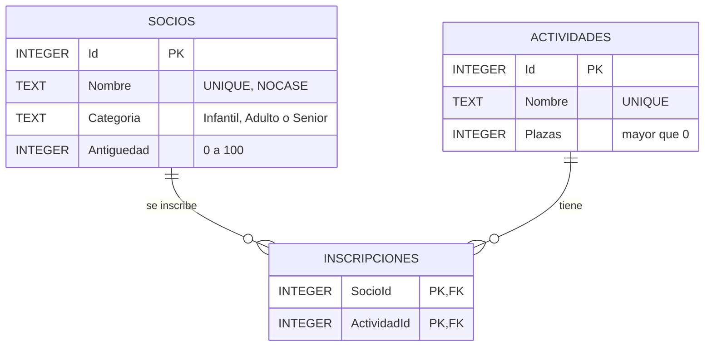
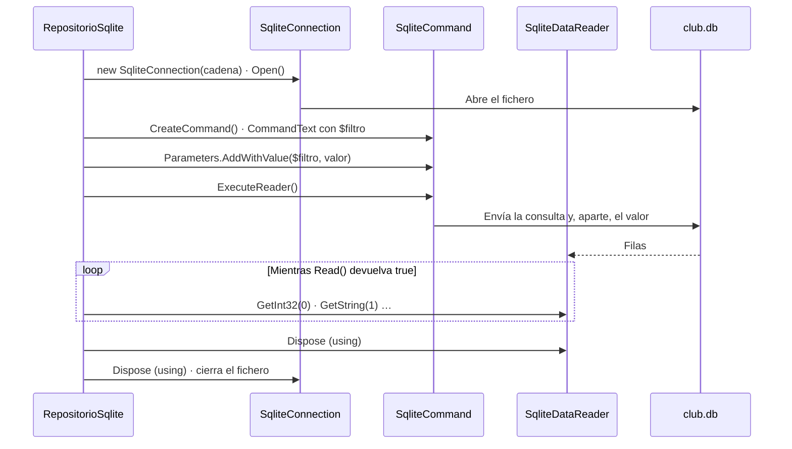
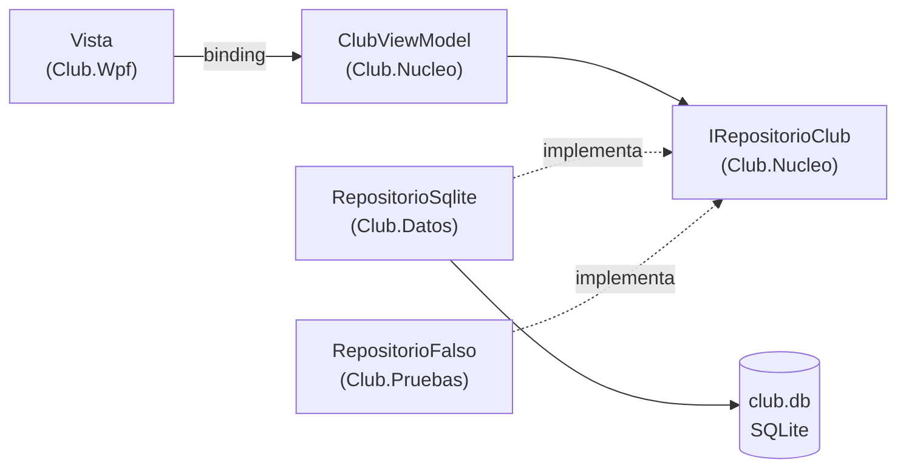

# 12. Datos con SQLite

[⬅️ Volver a la unidad](./README.md)

**CE que trabaja este tema:** RA1 h.

## Índice

- [12.1. Los datos tienen que sobrevivir](#121-los-datos-tienen-que-sobrevivir)
- [12.2. El modelo de datos](#122-el-modelo-de-datos)
- [12.3. `Microsoft.Data.Sqlite`](#123-microsoftdatasqlite)
  - [12.3.1. Instalar el paquete](#1231-instalar-el-paquete)
  - [12.3.2. Conexión, comando y `using`](#1232-conexión-comando-y-using)
  - [12.3.3. Los tres métodos de ejecución](#1233-los-tres-métodos-de-ejecución)
- [12.4. El primer intento: SQL en el *code-behind*](#124-el-primer-intento-sql-en-el-code-behind)
- [12.5. Parámetros: nunca concatenar](#125-parámetros-nunca-concatenar)
- [12.6. Leer los resultados](#126-leer-los-resultados)
- [12.7. Claves ajenas en SQLite](#127-claves-ajenas-en-sqlite)
- [12.8. Transacciones](#128-transacciones)
- [12.9. Relación varios a varios y `JOIN`](#129-relación-varios-a-varios-y-join)
- [12.10. El repositorio](#1210-el-repositorio)
- [12.11. Maestro-detalle y CRUD en el *ViewModel*](#1211-maestro-detalle-y-crud-en-el-viewmodel)
- [12.12. El fichero `.db` en el repositorio](#1212-el-fichero-db-en-el-repositorio)
- [12.13. Probar con una base de datos en memoria](#1213-probar-con-una-base-de-datos-en-memoria)
- [12.14. Ampliación: Entity Framework Core](#1214-ampliación-entity-framework-core)
- [12.15. Ejemplo integrador: el club con SQLite](#1215-ejemplo-integrador-el-club-con-sqlite)
- [12.16. Errores frecuentes](#1216-errores-frecuentes)
- [Resumen](#resumen)
- [Ejercicios de reflexión](#ejercicios-de-reflexión)

---

## 12.1. Los datos tienen que sobrevivir

En `11-ClubMvvm` los socios están en memoria: al cerrar la aplicación se pierden. Una aplicación de gestión necesita **persistencia**, y casi siempre en una **base de datos**: consultas, relaciones entre tablas, integridad de los datos y acceso simultáneo.

Para el material se usa **SQLite**, un motor de base de datos que es una **biblioteca**, no un servidor:

| | SQLite | Un servidor (SQL Server, MySQL, PostgreSQL) |
|---|---|---|
| Instalación | **Ninguna**: viene dentro del paquete NuGet | Instalar y configurar el servidor |
| Dónde están los datos | En **un fichero** (`club.db`) | En el servidor |
| Usuarios a la vez | Una aplicación (o pocas) | Muchas, en red |
| Se puede entregar en un repositorio | **Sí**: el fichero va con el código | No |
| Uso típico | Aplicaciones de escritorio y móviles, configuración, cachés, pruebas | Aplicaciones empresariales y web |

SQLite está en casi todos los móviles (Android e iOS lo usan para sus propias apps), en los navegadores y en muchas aplicaciones de escritorio. Lo que aprendas aquí de **ADO.NET** (las clases de .NET para hablar con una base de datos) vale para cualquier otro motor: solo cambian el paquete y el nombre de las clases (`SqlConnection` en SQL Server, `NpgsqlConnection` en PostgreSQL).

Para ver y editar el fichero `.db` fuera de la aplicación se usa **DB Browser for SQLite** (gratuito y de código abierto, `sqlitebrowser.org`): abre el fichero, muestra las tablas y permite ejecutar consultas.

> 📝 **Nota del Profesor**: el objetivo del tema no es aprender SQL (ya lo conoces del módulo de bases de datos), sino **cómo una aplicación gráfica habla con una base de datos sin que el SQL se mezcle con la interfaz**. Al terminar, la vista y los *ViewModels* no sabrán que existe SQLite.

---

## 12.2. El modelo de datos

El club tiene **socios** y **actividades** (pádel, natación, yoga…). Un socio se puede inscribir en varias actividades y una actividad tiene varios socios: es una **relación varios a varios**, que se resuelve con una **tabla de relación**, `Inscripciones`.



El diagrama muestra las tres tablas: cada inscripción une **un** socio con **una** actividad, y la clave primaria compuesta (`SocioId`, `ActividadId`) impide inscribir dos veces al mismo socio en la misma actividad.

El esquema en SQL, con las **restricciones** que protegen los datos:

```sql
CREATE TABLE IF NOT EXISTS Socios (
    Id         INTEGER PRIMARY KEY AUTOINCREMENT,
    Nombre     TEXT    NOT NULL UNIQUE COLLATE NOCASE,
    Categoria  TEXT    NOT NULL CHECK (Categoria IN ('Infantil', 'Adulto', 'Senior')),
    Antiguedad INTEGER NOT NULL CHECK (Antiguedad BETWEEN 0 AND 100)
);

CREATE TABLE IF NOT EXISTS Actividades (
    Id     INTEGER PRIMARY KEY AUTOINCREMENT,
    Nombre TEXT    NOT NULL UNIQUE,
    Plazas INTEGER NOT NULL CHECK (Plazas > 0)
);

CREATE TABLE IF NOT EXISTS Inscripciones (
    SocioId     INTEGER NOT NULL REFERENCES Socios (Id) ON DELETE CASCADE,
    ActividadId INTEGER NOT NULL REFERENCES Actividades (Id) ON DELETE CASCADE,
    PRIMARY KEY (SocioId, ActividadId)
);
```

| Restricción | Qué impide |
|-------------|------------|
| `NOT NULL` | Socios sin nombre |
| `UNIQUE COLLATE NOCASE` | Dos socios con el mismo nombre, aunque cambien las mayúsculas (`COLLATE NOCASE` solo compara sin mayúsculas las letras sin tilde) |
| `CHECK` | Categorías inventadas o antigüedades negativas |
| `REFERENCES … ON DELETE CASCADE` | Inscripciones de socios que no existen; al borrar un socio, se borran sus inscripciones |
| `PRIMARY KEY (SocioId, ActividadId)` | Inscribir dos veces lo mismo |

Son las mismas reglas que valida `FichaSocioViewModel` (tema 11). Validar en los dos sitios no es duplicar: la interfaz **ayuda** al usuario; la base de datos **protege** los datos de cualquier error del programa.

`IF NOT EXISTS` permite ejecutar el esquema **cada vez que arranca** la aplicación: si las tablas existen, no hace nada.

---

## 12.3. `Microsoft.Data.Sqlite`

### 12.3.1. Instalar el paquete

El proveedor de SQLite para .NET es el paquete NuGet **`Microsoft.Data.Sqlite`**, de Microsoft. Se instala como cualquier paquete (UD2, tema 1): botón derecho en el proyecto > **Administrar paquetes NuGet** > **Examinar**. Incluye la propia biblioteca de SQLite para Windows, Linux y macOS: no hay que instalar nada más.

```xml
<ItemGroup>
    <PackageReference Include="Microsoft.Data.Sqlite" Version="10.0.13" />
</ItemGroup>
```

### 12.3.2. Conexión, comando y `using`

Hablar con la base de datos tiene siempre los mismos pasos:

```csharp
using Microsoft.Data.Sqlite;

using var conexion = new SqliteConnection("Data Source=club.db");   // 1. Crear la conexión
conexion.Open();                                                   // 2. Abrirla

using var comando = conexion.CreateCommand();                      // 3. Crear un comando
comando.CommandText = "SELECT COUNT(*) FROM Socios";               // 4. Darle el SQL

var total = (long)comando.ExecuteScalar()!;                        // 5. Ejecutarlo
// 6. Al salir del bloque, using cierra el comando y la conexión
```

La **cadena de conexión** (`Data Source=club.db`) indica el fichero. Si no existe, SQLite **lo crea** vacío al abrir la conexión.

La conexión, el comando y el lector de resultados usan **recursos del sistema** (el fichero abierto). Hay que liberarlos siempre, también si hay una excepción: para eso está **`using`** (UD2), que llama a `Dispose()` al salir del bloque.

> ⚠️ **Cuidado**: una conexión que no se cierra mantiene el fichero **bloqueado**: otra conexión no podrá escribir y obtendrás un error «database is locked». Usa siempre `using` con conexiones, comandos y lectores.

### 12.3.3. Los tres métodos de ejecución

| Método | Para | Devuelve |
|--------|------|----------|
| `ExecuteNonQuery()` | `INSERT`, `UPDATE`, `DELETE`, `CREATE TABLE` | `int`: filas afectadas |
| `ExecuteScalar()` | Una consulta que devuelve **un solo valor** (`COUNT(*)`, `RETURNING Id`) | `object?`: el valor de la primera columna de la primera fila |
| `ExecuteReader()` | Una consulta que devuelve **filas** (`SELECT`) | `SqliteDataReader` para recorrerlas |

SQLite guarda los enteros como enteros de 64 bits: `ExecuteScalar` devuelve un `long`, no un `int`. Por eso verás `(long)comando.ExecuteScalar()!`.

---

## 12.4. El primer intento: SQL en el *code-behind*

La forma más directa de usar la base de datos es escribir el SQL **en el manejador del botón**:

```csharp
// ❌ Primer intento: funciona, pero tiene tres problemas graves
private void btnBuscar_Click(object sender, RoutedEventArgs e)
{
    using var conexion = new SqliteConnection("Data Source=club.db");
    conexion.Open();

    using var comando = conexion.CreateCommand();
    comando.CommandText = "SELECT Nombre FROM Socios WHERE Nombre LIKE '%" + txtBuscar.Text + "%'";

    lstSocios.Items.Clear();
    using var lector = comando.ExecuteReader();
    while (lector.Read())
    {
        lstSocios.Items.Add(lector.GetString(0));
    }
}
```

| Problema | Por qué |
|----------|---------|
| **Inyección de SQL** | Lo que escribe el usuario **forma parte del SQL** (apartado siguiente) |
| **Todo mezclado** | Interfaz, SQL y cadena de conexión en el mismo método: es el problema del tema 8 multiplicado |
| **No se puede probar** | Ni sin ventana ni sin la base de datos real |

El resto del tema arregla los tres: **parámetros** para el primero y un **repositorio** para los otros dos.

---

## 12.5. Parámetros: nunca concatenar

Si el usuario escribe en el buscador:

```text
' OR '1'='1
```

la consulta concatenada queda:

```sql
SELECT Nombre FROM Socios WHERE Nombre LIKE '%' OR '1'='1%'
```

El texto del usuario ha **cambiado el significado** de la consulta. Es la **inyección de SQL** (*SQL injection*), uno de los fallos de seguridad más graves y frecuentes. Con un `DELETE` o un `UPDATE`, alguien podría borrar o modificar datos escribiendo en un cuadro de texto.

La solución es **no construir nunca el SQL con lo que escribe el usuario**, sino usar **parámetros**: marcadores en el SQL cuyo valor se envía **aparte**, como dato:

```csharp
comando.CommandText = """
    SELECT Id, Nombre, Categoria, Antiguedad
    FROM Socios
    WHERE Nombre LIKE '%' || $filtro || '%'
    ORDER BY Nombre
    """;
comando.Parameters.AddWithValue("$filtro", filtro);
```

El motor recibe la consulta con el marcador `$filtro` y, por separado, su valor. Lo que haya en el valor **nunca se interpreta como SQL**: una comilla es una comilla más. En SQLite los parámetros se escriben con `$`, `@` o `:` delante (`$filtro`, `@filtro`); en el material se usa `$`.

La consulta usa una **cadena literal sin procesar** (*raw string literal*, `"""…"""`, C# 11): permite escribir el SQL en varias líneas, con su sangría, sin escapar nada.



El diagrama muestra el ciclo de una consulta: el valor del parámetro viaja **separado** de la consulta, y los `using` cierran el lector y la conexión al terminar.

> ⚠️ **Cuidado**: los parámetros sirven para **valores** (un nombre, un número, una fecha). No sirven para nombres de tablas o columnas: si necesitas ordenar por una columna que elige el usuario, compara su elección con una lista cerrada de columnas permitidas.

> 💡 **Tip del Examinador**: *«¿Qué es la inyección de SQL y cómo se evita?»* Es construir el SQL concatenando datos del usuario, de forma que estos pueden cambiar el significado de la consulta. Se evita con **consultas parametrizadas**: el SQL lleva marcadores (`$filtro`) y los valores se pasan aparte con `Parameters.AddWithValue`. Nunca se concatena.

> 🔁 **Transferencia**: es la misma regla con JDBC en Java (`PreparedStatement` y `?`), con `sqlite3` en Python (`cursor.execute("… ?", (valor,))`), en PHP con PDO o en Node.js con cualquier biblioteca de base de datos. Si alguna vez ves un SQL construido con `+` y un dato del usuario, es un fallo de seguridad.

---

## 12.6. Leer los resultados

`ExecuteReader()` devuelve un **lector** que se recorre fila a fila con `Read()`. Cada columna se lee por su **posición** (empezando en 0) con el método de su tipo:

```csharp
using var lector = comando.ExecuteReader();
var socios = new List<Socio>();
while (lector.Read())
{
    socios.Add(new Socio
    {
        Id = lector.GetInt32(0),
        Nombre = lector.GetString(1),
        Categoria = lector.GetString(2),
        Antiguedad = lector.GetInt32(3)
    });
}
```

| Método | Tipo de C# |
|--------|------------|
| `GetInt32(i)`, `GetInt64(i)` | `int`, `long` |
| `GetString(i)` | `string` |
| `GetDouble(i)`, `GetDecimal(i)` | `double`, `decimal` |
| `GetBoolean(i)` | `bool` (SQLite lo guarda como 0 o 1) |
| `GetDateTime(i)` | `DateTime` (SQLite lo guarda como texto) |
| `IsDBNull(i)` | `true` si la columna es `NULL` en esa fila |

Si una columna admite `NULL`, compruébalo antes: `GetString` sobre un `NULL` lanza una excepción.

```csharp
Email = lector.IsDBNull(4) ? null : lector.GetString(4)
```

---

## 12.7. Claves ajenas en SQLite

SQLite tiene una particularidad que sorprende: **no comprueba las claves ajenas** salvo que se active, y se activa **en cada conexión**:

```sql
PRAGMA foreign_keys = ON;
```

Sin esta línea, `REFERENCES` y `ON DELETE CASCADE` se ignoran: se podría insertar una inscripción de un socio que no existe y, al borrar un socio, sus inscripciones se quedarían huérfanas. Por eso el repositorio ejecuta el `PRAGMA` cada vez que abre una conexión (apartado 12.10).

> ⚠️ **Cuidado**: es un error muy frecuente y silencioso: todo parece funcionar hasta que aparecen datos incoherentes. Si usas SQLite, **activa las claves ajenas en cada conexión**.

---

## 12.8. Transacciones

Inscribir a un socio requiere **dos pasos**: comprobar que quedan plazas e insertar la inscripción. Si entre los dos pasos otra parte del programa ocupa la última plaza, se inscribirían más socios de los permitidos. Y si una operación con varias escrituras falla a mitad, la base de datos se quedaría a medias.

Una **transacción** agrupa varias operaciones para que se hagan **todas o ninguna**:

```csharp
using var transaccion = conexion.BeginTransaction();

using var plazas = conexion.CreateCommand();
plazas.Transaction = transaccion;
plazas.CommandText = """
    SELECT a.Plazas - (SELECT COUNT(*) FROM Inscripciones WHERE ActividadId = a.Id)
    FROM Actividades a
    WHERE a.Id = $actividad
    """;
plazas.Parameters.AddWithValue("$actividad", actividadId);
var libres = plazas.ExecuteScalar() as long?
    ?? throw new DatosException("La actividad ya no existe.");
if (libres <= 0)
{
    throw new DatosException("La actividad está completa: no quedan plazas libres.");
}

using var insertar = conexion.CreateCommand();
insertar.Transaction = transaccion;
insertar.CommandText = "INSERT INTO Inscripciones (SocioId, ActividadId) VALUES ($socio, $actividad)";
insertar.Parameters.AddWithValue("$socio", socioId);
insertar.Parameters.AddWithValue("$actividad", actividadId);
insertar.ExecuteNonQuery();

transaccion.Commit();
```

| Paso | Qué hace |
|------|----------|
| `BeginTransaction()` | Empieza la transacción: hasta confirmarla, los cambios no son definitivos |
| `comando.Transaction = transaccion` | Cada comando debe ir dentro de ella |
| `Commit()` | **Confirma** todos los cambios a la vez |
| (sin `Commit`) | Si se sale del `using` sin confirmar, por ejemplo por una excepción, se **deshacen** todos (*rollback*) |

> 📝 **Nota del Profesor**: además de la integridad, las transacciones aceleran mucho las escrituras en SQLite. Insertar mil filas una a una puede tardar segundos; dentro de una transacción, milisegundos. Lo notarás en la UD6, en las pruebas de volumen.

---

## 12.9. Relación varios a varios y `JOIN`

Para obtener las actividades de un socio hay que **unir** la tabla de actividades con la de relación:

```sql
SELECT a.Id, a.Nombre, a.Plazas,
       (SELECT COUNT(*) FROM Inscripciones x WHERE x.ActividadId = a.Id) AS Inscritos
FROM Actividades a
JOIN Inscripciones i ON i.ActividadId = a.Id
WHERE i.SocioId = $socio
ORDER BY a.Nombre
```

Y para la lista de actividades con su número de inscritos, un `LEFT JOIN` con `GROUP BY`, para que también salgan las que no tienen ninguno:

```sql
SELECT a.Id, a.Nombre, a.Plazas, COUNT(i.SocioId) AS Inscritos
FROM Actividades a
LEFT JOIN Inscripciones i ON i.ActividadId = a.Id
GROUP BY a.Id, a.Nombre, a.Plazas
ORDER BY a.Nombre
```

| Consulta | Une | Devuelve |
|----------|-----|----------|
| Actividades de un socio | `Actividades` `JOIN` `Inscripciones` | Solo las actividades en que está inscrito |
| Actividades con inscritos | `Actividades` `LEFT JOIN` `Inscripciones` | Todas, con 0 si no tienen inscritos |

El modelo `Actividad` recoge el resultado, con una propiedad calculada:

```csharp
public class Actividad
{
    public int Id { get; set; }
    public string Nombre { get; set; } = "";
    public int Plazas { get; set; }
    public int Inscritos { get; set; }
    public int PlazasLibres => Plazas - Inscritos;
}
```

---

## 12.10. El repositorio

Todo el SQL de la aplicación se reúne en **una clase**, el **repositorio**, detrás de una interfaz que **no menciona SQLite**:

```csharp
// En Club.Nucleo: lo que necesitan los ViewModels
public interface IRepositorioClub
{
    IReadOnlyList<Socio> ObtenerSocios(string filtro = "");
    bool ExisteNombre(string nombre, int idExcluido);
    int AgregarSocio(Socio socio);
    void ActualizarSocio(Socio socio);
    void EliminarSocio(int id);
    IReadOnlyList<Actividad> ObtenerActividades();
    IReadOnlyList<Actividad> ObtenerActividadesDeSocio(int socioId);
    void Inscribir(int socioId, int actividadId);
    void DarDeBaja(int socioId, int actividadId);
}
```

La implementación va en **otro proyecto**, `Club.Datos`, que es el único que referencia `Microsoft.Data.Sqlite`:



El diagrama muestra las capas de la persistencia: el *ViewModel* solo conoce la **interfaz**. En la aplicación, detrás está SQLite; en las pruebas, una implementación falsa en memoria. Cambiar de SQLite a otro motor solo afecta a `Club.Datos`.

Cada método del repositorio abre su conexión, hace su trabajo y la cierra. Lo común está en un método privado que, además, **activa las claves ajenas** y **traduce las excepciones**:

```csharp
private T Consultar<T>(Func<SqliteConnection, T> operacion)
{
    try
    {
        using var conexion = new SqliteConnection(_cadenaConexion);
        conexion.Open();

        // SQLite no comprueba las claves ajenas si no se activa en cada conexión
        using (var pragma = conexion.CreateCommand())
        {
            pragma.CommandText = "PRAGMA foreign_keys = ON";
            pragma.ExecuteNonQuery();
        }

        return operacion(conexion);
    }
    catch (SqliteException ex) when (ex.SqliteErrorCode == ErrorRestriccion)
    {
        throw new DatosException("Los datos no cumplen las reglas de la base de datos (un valor repetido o no permitido).", ex);
    }
    catch (SqliteException ex)
    {
        throw new DatosException($"No se ha podido acceder a la base de datos: {ex.Message}", ex);
    }
}
```

```csharp
public int AgregarSocio(Socio socio)
{
    return Consultar(conexion =>
    {
        using var comando = conexion.CreateCommand();
        comando.CommandText = """
            INSERT INTO Socios (Nombre, Categoria, Antiguedad)
            VALUES ($nombre, $categoria, $antiguedad)
            RETURNING Id
            """;
        AnadirParametros(comando, socio);
        return (int)(long)comando.ExecuteScalar()!;
    });
}
```

`RETURNING Id` (SQLite 3.35 o posterior) devuelve el `Id` que la base de datos asigna al insertar, con `ExecuteScalar`.

¿Por qué traducir `SqliteException` a una excepción propia, `DatosException`, definida en el núcleo? Porque si el *ViewModel* tuviera que capturar `SqliteException`, **conocería SQLite**, y cambiar de motor obligaría a tocarlo. `DatosException` es parte del «idioma» del núcleo: «algo ha fallado con los datos, y este es el mensaje para el usuario».

| Excepción de SQLite | Código | Se traduce a |
|---------------------|--------|--------------|
| `UNIQUE`, `CHECK`, `NOT NULL`, `FOREIGN KEY` | 19 (`SQLITE_CONSTRAINT`) | `DatosException` con «los datos no cumplen las reglas» |
| Fichero bloqueado, dañado, sin permiso… | Otros | `DatosException` con el mensaje original |
| Regla del negocio (actividad completa) | — | `DatosException` lanzada por el propio repositorio |

> ✅ **Buena práctica**: el SQL vive **solo en el repositorio**. Si encuentras una cadena con `SELECT` en un *ViewModel* o en una vista, está en el sitio equivocado.

> 🔁 **Transferencia**: el **patrón repositorio** es universal: los `Repository` de Spring Data en Java, los DAO de Room en Android, los repositorios de Laravel o de cualquier aplicación por capas. En todas partes, la lógica pide datos a una interfaz y no sabe de dónde vienen.

---

## 12.11. Maestro-detalle y CRUD en el *ViewModel*

`ClubViewModel` reúne la pantalla del ejemplo: el **maestro** (la lista de socios con su buscador), dos **detalles** (la ficha del socio y sus actividades) y una pestaña con todas las actividades. El buscador ya no filtra en memoria: el filtro va **en la consulta** (`ObtenerSocios(Buscar)`), que es lo que haría una aplicación con miles de socios.

Cada acción del usuario corresponde a una operación del **CRUD** (*Create, Read, Update, Delete*):

| Acción | Comando | Repositorio | SQL |
|--------|---------|-------------|-----|
| Ver los socios, buscar | — (`Buscar`) | `ObtenerSocios(filtro)` | `SELECT … WHERE Nombre LIKE …` |
| Elegir un socio | — (`SocioSeleccionado`) | `ObtenerActividadesDeSocio(id)` | `SELECT … JOIN …` |
| Alta | `NuevoCommand` + `GuardarCommand` | `AgregarSocio(socio)` | `INSERT … RETURNING Id` |
| Modificación | `GuardarCommand` | `ActualizarSocio(socio)` | `UPDATE … WHERE Id = $id` |
| Baja | `EliminarCommand` | `EliminarSocio(id)` | `DELETE … WHERE Id = $id` (y `CASCADE`) |
| Inscribir | `InscribirCommand` | `Inscribir(socio, actividad)` | Transacción: `SELECT` + `INSERT` |
| Dar de baja de una actividad | `DarDeBajaCommand` | `DarDeBaja(socio, actividad)` | `DELETE FROM Inscripciones …` |

Al elegir un socio se cargan sus dos listas del detalle: **sus actividades** y **las que le quedan** (las disponibles para inscribirse):

```csharp
private void CargarDetalle()
{
    var todas = _repositorio.ObtenerActividades();
    Rellenar(Actividades, todas);

    if (SocioSeleccionado is null)
    {
        ActividadesDelSocio.Clear();
        ActividadesDisponibles.Clear();
        return;
    }

    var suyas = _repositorio.ObtenerActividadesDeSocio(SocioSeleccionado.Id);
    Rellenar(ActividadesDelSocio, suyas);
    Rellenar(ActividadesDisponibles, todas.Where(a => suyas.All(s => s.Id != a.Id)));
}
```

Todas las operaciones con datos pasan por un método que convierte un fallo en un **mensaje al usuario**, en lugar de cerrar la aplicación:

```csharp
private void Ejecutar(Action operacion)
{
    try
    {
        operacion();
    }
    catch (DatosException ex)
    {
        _dialogos.MostrarError(ex.Message, Titulo);
    }
}

private void Inscribir()
{
    if (SocioSeleccionado is not { } socio || ActividadParaInscribir is not { } actividad)
    {
        return;
    }

    Ejecutar(() =>
    {
        _repositorio.Inscribir(socio.Id, actividad.Id);
        CargarDetalle();
    });
}
```

El *ViewModel* captura `DatosException`, **no** `Exception`: un fallo de programación (un `NullReferenceException`) no debe esconderse detrás de un mensaje genérico.

> 📝 **Nota del Profesor**: en este ejemplo las operaciones con la base de datos son **síncronas** porque SQLite con un fichero local responde en milisegundos. Con un servidor remoto o consultas pesadas, el repositorio tendría métodos `async` (`ExecuteReaderAsync`, `OpenAsync`) y los comandos serían asíncronos, como la exportación del tema 10.

---

## 12.12. El fichero `.db` en el repositorio

En este módulo el fichero de la base de datos **se entrega con el código**, en el repositorio de Git: así cualquiera que clone el proyecto tiene los datos de ejemplo sin instalar nada.

```text
Club.Wpf/
└── Datos/
    └── club.db          # base de datos con los datos de ejemplo
```

Para que esté junto al ejecutable al compilar, se marca en el `.csproj` para **copiarlo al directorio de salida**:

```xml
<!-- La base de datos está en el repositorio y se copia junto al ejecutable al compilar.
     PreserveNewest: no se sobrescribe la copia si ya se ha modificado al usar la aplicación -->
<ItemGroup>
    <None Update="Datos\club.db"
          CopyToOutputDirectory="PreserveNewest" />
</ItemGroup>
```

En Visual Studio se hace igual desde las **Propiedades** del fichero: **Copiar en el directorio de salida** = **Copiar si es posterior**. La aplicación abre la copia que hay junto al ejecutable:

```csharp
var fichero = Path.Combine(AppContext.BaseDirectory, "Datos", "club.db");
var cadena = $"Data Source={fichero}";
BaseDatosClub.Inicializar(cadena, conDatosDeEjemplo: true);
```

`BaseDatosClub.Inicializar` ejecuta el esquema (`CREATE TABLE IF NOT EXISTS`) y, si la tabla de socios está vacía, inserta los datos de ejemplo. Así la aplicación funciona aunque falte el fichero: lo crea.

| Situación | Qué pasa |
|-----------|----------|
| Primera compilación | Se copia `club.db` a `bin/Debug/net10.0-windows/Datos/` |
| Usas la aplicación | Los cambios van a la **copia** de `bin/`, no al fichero del repositorio |
| Vuelves a compilar | `PreserveNewest` no sobrescribe la copia, porque es más reciente |
| Borras `bin/` (o **Limpiar solución**) | Se vuelve a copiar el original: vuelves a los datos de ejemplo |

> ⚠️ **Cuidado**: un `.db` es un fichero **binario**: Git no puede mezclar dos versiones. El `.gitattributes` de la unidad lo marca como binario (`*.db binary`). Si cambias los datos de ejemplo, súbelo en un commit propio y no lo edites a la vez que un compañero.

> 💡 **Tip del Examinador**: *«¿Dónde guardaría la base de datos una aplicación instalada?»* No junto al ejecutable (en `Archivos de programa` no se puede escribir), sino en la carpeta de datos del usuario: `%LocalAppData%\<Aplicación>\` (como la configuración del tema 7, pero en `Local`, porque una base de datos no debe viajar con el perfil). En la UD8 el instalador lo tendrá en cuenta.

---

## 12.13. Probar con una base de datos en memoria

El repositorio también se prueba. ¿Contra el `club.db` real? No: las pruebas lo modificarían, dependerían de su contenido y no se podrían ejecutar a la vez. SQLite permite una **base de datos en memoria**: se crea al abrirla, es muy rápida y desaparece al cerrarla.

```text
Data Source=:memory:
```

Hay un detalle: una base en memoria **desaparece al cerrar su conexión**, y el repositorio abre y cierra una por cada operación. La solución es darle **un nombre**, pedir que las conexiones la **compartan** y mantener **una conexión abierta** mientras dure la prueba:

```csharp
public sealed class RepositorioSqlitePruebas : IDisposable
{
    private readonly SqliteConnection _mantenerViva;
    private readonly RepositorioSqlite _repositorio;

    public RepositorioSqlitePruebas()
    {
        // Una base en memoria desaparece al cerrar su última conexión. Con un nombre propio
        // y Cache=Shared, las conexiones del repositorio comparten la misma base mientras
        // esta primera conexión siga abierta
        var cadena = $"Data Source=prueba-{Guid.NewGuid()};Mode=Memory;Cache=Shared";
        _mantenerViva = new SqliteConnection(cadena);
        _mantenerViva.Open();

        BaseDatosClub.Inicializar(cadena, conDatosDeEjemplo: true);
        _repositorio = new RepositorioSqlite(cadena);
    }

    public void Dispose() => _mantenerViva.Dispose();
```

xUnit crea **una instancia de la clase por cada prueba** y llama a `Dispose` al terminarla. Con el `Guid` en el nombre, cada prueba tiene **su propia base**, con los mismos datos de ejemplo: las pruebas no se influyen entre sí.

```csharp
[Fact]
public void ObtenerSocios_UnFiltroConComillas_NoRompeLaConsulta()
{
    // Con los parámetros, una comilla es un carácter más, no parte del SQL
    var socios = _repositorio.ObtenerSocios("' OR '1'='1");

    Assert.Empty(socios);
}

[Fact]
public void Inscribir_ActividadCompleta_LanzaDatosExceptionYNoInscribe()
{
    var mario = _repositorio.ObtenerSocios("Mario")[0];
    var yoga = _repositorio.ObtenerActividades().Single(a => a.Nombre == "Yoga");

    Assert.Throws<DatosException>(() => _repositorio.Inscribir(mario.Id, yoga.Id));
    Assert.DoesNotContain(_repositorio.ObtenerActividadesDeSocio(mario.Id), a => a.Id == yoga.Id);
}

[Fact]
public void EliminarSocio_BorraTambienSusInscripciones()
{
    var lucia = _repositorio.ObtenerSocios("Lucía")[0];

    _repositorio.EliminarSocio(lucia.Id);

    // Lucía estaba en Yoga: ahora queda un inscrito (ON DELETE CASCADE)
    var yoga = _repositorio.ObtenerActividades().Single(a => a.Nombre == "Yoga");
    Assert.Equal(1, yoga.Inscritos);
}
```

La primera prueba demuestra que la consulta **no es vulnerable** a la inyección. La última, que el `PRAGMA foreign_keys` funciona: sin él, Yoga seguiría con dos inscritos.

Las pruebas del *ViewModel* no necesitan ninguna base de datos: usan un `RepositorioFalso` con listas en memoria, que además puede **simular fallos** (`FallarAlInscribir = true`) para comprobar que el usuario recibe el mensaje. Lo verás en el tema 13.

---

## 12.14. Ampliación: Entity Framework Core

Escribir el SQL y leer cada columna a mano es lo que hace **ADO.NET**, la capa más básica. **Entity Framework Core** (EF Core) es un **ORM** (*object-relational mapper*): genera el SQL a partir de clases y consultas LINQ.

```csharp
// Con EF Core (paquete Microsoft.EntityFrameworkCore.Sqlite)
public class ClubContext : DbContext
{
    public DbSet<Socio> Socios => Set<Socio>();

    protected override void OnConfiguring(DbContextOptionsBuilder opciones) =>
        opciones.UseSqlite("Data Source=club.db");
}

using var contexto = new ClubContext();
var socios = contexto.Socios
    .Where(s => s.Nombre.Contains(filtro))
    .OrderBy(s => s.Nombre)
    .ToList();   // EF Core genera el SELECT con parámetros
```

| | ADO.NET (este tema) | EF Core |
|---|---|---|
| SQL | Lo escribes tú | Lo genera a partir de LINQ |
| Leer filas a objetos | A mano, columna a columna | Automático |
| Control y transparencia | Total | Menor: hay que vigilar el SQL que genera |
| Curva de aprendizaje | Baja si sabes SQL | Mayor (migraciones, seguimiento de cambios, relaciones) |
| Inyección de SQL | Evitada con parámetros | Evitada por diseño |

En esta unidad se usa ADO.NET para que **veas lo que pasa** entre tu programa y la base de datos. Con el repositorio, cambiar a EF Core solo afectaría a `Club.Datos`.

---

## 12.15. Ejemplo integrador: el club con SQLite

El proyecto [`ejemplos/12-ClubSqlite`](./ejemplos/12-ClubSqlite) es la aplicación del club con la base de datos:

```text
12-ClubSqlite/
├── ClubSqlite.slnx
├── Club.Nucleo/          # Modelos (Socio, Actividad), IRepositorioClub, DatosException,
│                         # ClubViewModel, FichaSocioViewModel, RelayCommand…  (net10.0, sin WPF ni SQLite)
├── Club.Datos/           # BaseDatosClub (esquema y datos de ejemplo), RepositorioSqlite  (net10.0)
├── Club.Pruebas/         # RepositorioSqlitePruebas (en memoria), ClubViewModelPruebas (repositorio falso)
└── Club.Wpf/             # App (raíz de composición), MainWindow, Datos/club.db
```

La ventana tiene dos pestañas: **Socios** (maestro-detalle: lista, ficha y actividades del socio) y **Actividades** (todas, con plazas, inscritos y libres). El `FichaSocioViewModel` es **el mismo** del tema 11, sin ningún cambio.

| Datos de ejemplo | |
|------------------|---|
| Socios | Lucía Pérez, Mario Gil, Carmen Ruiz, Javier Soto, Elena Martín |
| Actividades | Pádel (8 plazas), Natación (12), Yoga (2), Atletismo (10) |
| Inscripciones | Lucía en Pádel y Yoga, Mario en Natación, Carmen en Yoga, Javier en Pádel, Elena en Natación y Atletismo |

Las pruebas (17) se ejecutan con `dotnet test --solution ClubSqlite.slnx` o desde el Explorador de pruebas.

**Prueba la aplicación así:**

| Prueba | Resultado esperado |
|--------|--------------------|
| Al abrir | Los cinco socios ordenados por nombre |
| Escribir «ar» en **Buscar** | Carmen Ruiz, Elena Martín y Mario Gil (el filtro lo hace la consulta) |
| Elegir a Lucía | Ficha con sus datos y, a la derecha, Pádel y Yoga; en el desplegable, Atletismo y Natación |
| Elegir a Mario, elegir **Yoga** en el desplegable e **Inscribir** | Mensaje de error: «La actividad está completa: no quedan plazas libres.» |
| Elegir a Mario, **Atletismo** e **Inscribir** | Atletismo pasa a sus actividades; en la pestaña **Actividades**, Atletismo tiene 2 inscritos |
| **Dar de baja** con una actividad del socio elegida | Desaparece de sus actividades y vuelve al desplegable |
| **Nuevo**, escribir «Ana Torres» y **Guardar** | Aparece en la lista, elegida, sin actividades |
| **Eliminar** a Lucía y confirmar | Desaparece; en **Actividades**, Yoga pasa a 1 inscrito (`ON DELETE CASCADE`) |
| Cerrar y volver a abrir | Los cambios siguen ahí |
| Abrir `bin/…/Datos/club.db` con DB Browser for SQLite | Las tablas tienen los mismos datos que la aplicación |
| Borrar la carpeta `bin` y compilar | Vuelven los datos de ejemplo |

**Actividad.** Añade a `Actividades` una columna `Precio` (`REAL`, `NOT NULL`, `DEFAULT 0`) y muéstrala en la pestaña **Actividades**. ¿Qué ficheros tocas? ¿Ha cambiado algo en la vista de socios o en `FichaSocioViewModel`? (Pista: `CREATE TABLE IF NOT EXISTS` no añade columnas a una tabla que ya existe; tendrás que borrar la copia de `bin/` o usar `ALTER TABLE`.)

---

## 12.16. Errores frecuentes

| Síntoma | Causa habitual | Solución |
|---------|----------------|----------|
| `SqliteException`: «no such table: Socios» | Se ha abierto otro fichero (ruta relativa, carpeta de trabajo distinta) o no se creó el esquema | Usa `AppContext.BaseDirectory` y llama a `Inicializar` al arrancar |
| Los datos «se pierden» al compilar | `CopyToOutputDirectory="Always"` sobrescribe la copia | Usa `PreserveNewest` |
| Los cambios no están en el `club.db` del repositorio | La aplicación modifica la copia de `bin/` | Es lo esperado; para cambiar los datos de ejemplo, edita el original con DB Browser |
| «database is locked» | Una conexión o un lector sin cerrar, o DB Browser con cambios sin guardar | `using` en todo; cierra o guarda en DB Browser |
| Se borra un socio y sus inscripciones se quedan | Falta `PRAGMA foreign_keys = ON` en esa conexión | Actívalo en cada conexión |
| `InvalidCastException` al leer un `COUNT(*)` o un `Id` | SQLite devuelve `long` | `(long)comando.ExecuteScalar()!` o `GetInt32` en el lector |
| `InvalidOperationException` al leer una columna | La columna es `NULL` | Comprueba `IsDBNull` antes |
| Búsquedas que fallan con un apóstrofo («O'Brien») | SQL concatenado | **Parámetros** |
| «Execute requires the command to have a transaction…» | Un comando sin `Transaction` dentro de una transacción abierta | Asigna `comando.Transaction = transaccion` |
| Los cambios de una transacción no se guardan | Falta `Commit()` | Llama a `Commit()` al final |
| La base en memoria está vacía en la segunda operación | Cada conexión a `:memory:` crea una base nueva | Nombre propio, `Mode=Memory;Cache=Shared` y una conexión abierta |
| El *ViewModel* captura `SqliteException` | El núcleo conoce SQLite | Traduce a `DatosException` en el repositorio |

---

## Resumen

- **SQLite** es una base de datos en **un fichero**, sin servidor ni instalación. Se usa con el paquete **`Microsoft.Data.Sqlite`** (ADO.NET) y se inspecciona con **DB Browser for SQLite**.
- El modelo del club tiene una **relación varios a varios** (socios, actividades e inscripciones) con **restricciones** (`NOT NULL`, `UNIQUE`, `CHECK`, `REFERENCES`, clave primaria compuesta).
- Una operación: `SqliteConnection` + `Open`, `CreateCommand` + `CommandText`, y `ExecuteNonQuery`, `ExecuteScalar` o `ExecuteReader`. Todo con **`using`**.
- **Nunca se concatena** lo que escribe el usuario en el SQL: se usan **parámetros** (`$filtro` y `Parameters.AddWithValue`) para evitar la **inyección de SQL**.
- Los resultados se leen con `Read()` y `GetInt32`, `GetString`…; `IsDBNull` para las columnas que admiten `NULL`.
- SQLite exige **`PRAGMA foreign_keys = ON`** en cada conexión para respetar las claves ajenas.
- Una **transacción** (`BeginTransaction`, `Commit`) hace varias operaciones **todas o ninguna**.
- `JOIN` con la tabla de relación da las actividades de un socio; `LEFT JOIN` con `GROUP BY`, los inscritos de cada actividad.
- El **repositorio** reúne todo el SQL detrás de una interfaz (`IRepositorioClub`) que los *ViewModels* usan sin saber que existe SQLite. Traduce las excepciones a `DatosException`.
- El `club.db` va **en el repositorio** y se copia al compilar (`PreserveNewest`); el esquema se crea con `IF NOT EXISTS` al arrancar.
- El repositorio se prueba con una **base en memoria** compartida y con nombre; el *ViewModel*, con un **repositorio falso**.

---

## Ejercicios de reflexión

1. Escribe tres textos que un usuario podría poner en el buscador para atacar la consulta concatenada del apartado 12.4. ¿Qué haría cada uno? ¿Por qué ninguno funciona con parámetros?
2. Quita `PRAGMA foreign_keys = ON` del repositorio y ejecuta las pruebas. ¿Cuál falla? ¿Qué te dice eso sobre la utilidad de esa prueba?
3. ¿Qué pasaría en `Inscribir` sin la transacción si dos usuarios inscribieran a la vez a dos socios en la última plaza de Yoga? Dibuja la secuencia.
4. `ClubViewModel` captura `DatosException` y no `Exception`. ¿Qué pasaría con un error de programación si capturase `Exception`? ¿Es mejor o peor para el usuario? ¿Y para quien mantiene el programa?
5. El buscador hace una consulta a la base de datos con cada tecla. Investiga la propiedad `Delay` del *binding* (tema 9) y explica cómo la usa `MainWindow.xaml` del ejemplo y por qué.
6. Diseña las tablas de tu proyecto con un `erDiagram`. ¿Tienes alguna relación varios a varios? ¿Qué restricciones pondrías?
7. Compara este tema con el `CargarFichero` y `GuardarFichero` de `08-SociosCodeBehind`. ¿Qué ventajas tiene la base de datos sobre el CSV? ¿Hay alguna desventaja?

---

[⬅️ Volver a la unidad](./README.md)
