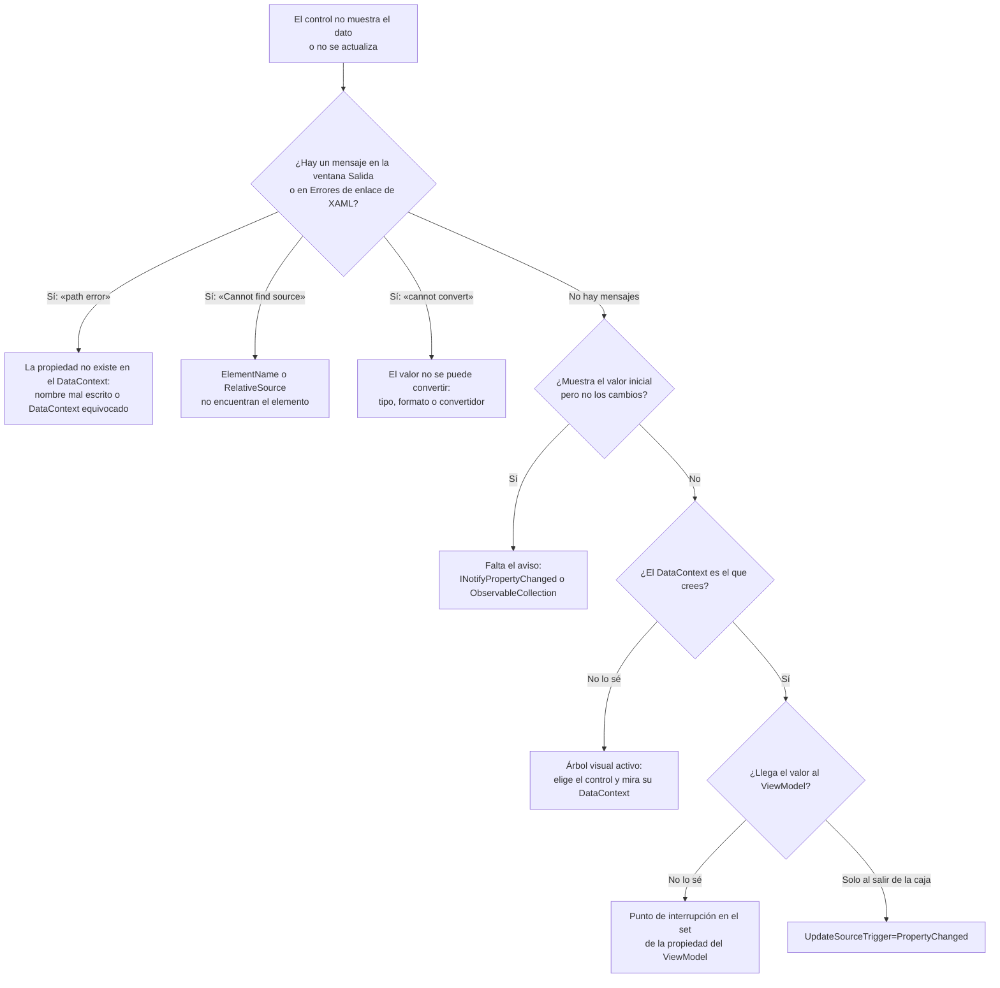
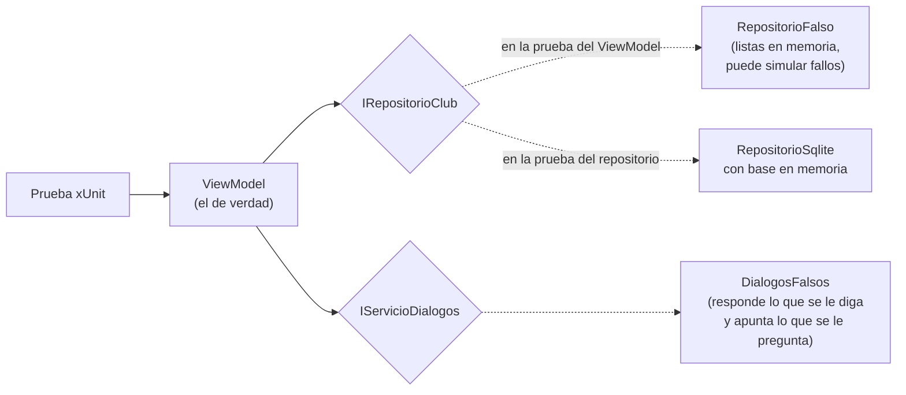

# 13. Depurar, probar y documentar una aplicación WPF

[⬅️ Volver a la unidad](./README.md)

**CE que trabaja este tema:** RA1 h.

## Índice

- [13.1. Cuando algo no se ve](#131-cuando-algo-no-se-ve)
- [13.2. Los errores de *binding*](#132-los-errores-de-binding)
  - [13.2.1. La ventana Salida](#1321-la-ventana-salida)
  - [13.2.2. La ventana de errores de enlace](#1322-la-ventana-de-errores-de-enlace)
  - [13.2.3. Seguir un *binding* paso a paso](#1323-seguir-un-binding-paso-a-paso)
  - [13.2.4. Laboratorio: seis *bindings* rotos](#1324-laboratorio-seis-bindings-rotos)
- [13.3. Árbol visual activo y Recarga activa de XAML](#133-árbol-visual-activo-y-recarga-activa-de-xaml)
- [13.4. Depurar el *ViewModel*](#134-depurar-el-viewmodel)
- [13.5. Probar el *ViewModel* sin ventana](#135-probar-el-viewmodel-sin-ventana)
  - [13.5.1. Dobles de prueba](#1351-dobles-de-prueba)
  - [13.5.2. Qué se prueba en un *ViewModel*](#1352-qué-se-prueba-en-un-viewmodel)
  - [13.5.3. Ejemplos](#1353-ejemplos)
  - [13.5.4. Lo que no se puede probar así](#1354-lo-que-no-se-puede-probar-así)
- [13.6. Pruebas manuales con una lista de comprobación](#136-pruebas-manuales-con-una-lista-de-comprobación)
- [13.7. Documentar ventanas, *ViewModels* y servicios](#137-documentar-ventanas-viewmodels-y-servicios)
- [13.8. Errores frecuentes](#138-errores-frecuentes)
- [Resumen](#resumen)
- [Ejercicios de reflexión](#ejercicios-de-reflexión)

---

## 13.1. Cuando algo no se ve

Con eventos, si un botón no hacía nada, ponías un punto de interrupción en su manejador. Con *binding* y MVVM aparece un fallo nuevo y muy desconcertante: **el control sale vacío o no cambia, y no hay ningún error**. La aplicación no se cierra, no hay excepción y el compilador no se queja.

Esto pasa porque un *binding* es **texto** en el XAML (`{Binding Nombr}`) que se resuelve **al ejecutar**. Si no encuentra la propiedad, WPF lo anota y sigue: prefiere una pantalla con un hueco a una aplicación que se cierra.

Para encontrar el fallo hay que saber **dónde mirar**:



El diagrama es la guía de este tema: casi todos los fallos de una vista con *binding* se encuentran en uno de esos cinco sitios.

---

## 13.2. Los errores de *binding*

### 13.2.1. La ventana Salida

Cuando un *binding* falla durante la depuración, WPF escribe un mensaje en la ventana **Salida** de Visual Studio (`Ver > Salida`, `Ctrl+Alt+O`). Los mensajes son en inglés y largos, pero tienen siempre la misma forma. Estos son los tres que verás casi siempre:

```text
System.Windows.Data Error: 40 : BindingExpression path error: 'Nombr' property not found on 'object' ''FichaViewModel' (HashCode=…)'. BindingExpression:Path=Nombr; DataItem='FichaViewModel' (HashCode=…); target element is 'TextBlock' (Name=''); target property is 'Text' (type 'String')
```

```text
System.Windows.Data Error: 4 : Cannot find source for binding with reference 'ElementName=sldVolumn'. BindingExpression:Path=Value; DataItem=null; target element is 'TextBlock' (Name=''); target property is 'Text' (type 'String')
```

```text
System.Windows.Data Error: 7 : ConvertBack cannot convert value 'abc' (type 'String'). BindingExpression:Path=Antiguedad; DataItem='FichaViewModel' (HashCode=…); target element is 'TextBox' (Name=''); target property is 'Text' (type 'String') FormatException:…
```

| Código | Mensaje | Significa |
|--------|---------|-----------|
| **40** | `BindingExpression path error: 'X' property not found on 'object' ''Y'` | El objeto `Y` (el `DataContext`) **no tiene** la propiedad `X` |
| **4** | `Cannot find source for binding with reference …` | `ElementName` o `RelativeSource` no encuentran el elemento |
| **7** | `ConvertBack cannot convert value …` | Lo que hay en el control no se puede convertir al tipo del origen |
| **5** | `Value produced by BindingExpression is not valid for target property` | El valor del origen no sirve para el destino (por ejemplo, un texto en una propiedad numérica) |

Cada mensaje dice **cuatro cosas**: qué ruta se buscaba (`Path`), en qué objeto (`DataItem`), en qué control (`target element`) y en qué propiedad (`target property`). Con eso sabes exactamente qué *binding* falla.

> 💡 **Tip del Examinador**: *«Un `TextBlock` enlazado sale vacío y la aplicación no da ningún error. ¿Cómo lo investigas?»* Ejecutando con depuración y buscando en la ventana **Salida** (o en **Errores de enlace de XAML**) un mensaje `System.Windows.Data Error`. El error 40 dice qué propiedad no encuentra y en qué objeto la busca.

### 13.2.2. La ventana de errores de enlace

Las versiones actuales de Visual Studio reúnen estos mensajes en una ventana propia, **Errores de enlace de XAML** (*XAML Binding Failures*), que se abre desde `Ver > Otras ventanas` o desde el indicador de errores de la **barra de herramientas en la aplicación** (apartado 13.3). Muestra una fila por *binding* que falla, con sus columnas ya separadas (control, propiedad, ruta, objeto) y un recuento, y permite saltar al XAML con doble clic. Es más cómoda que la ventana Salida, que mezcla los errores con otros mensajes.

Si no ves mensajes de *binding* en ninguna de las dos, comprueba el nivel de detalle en `Herramientas > Opciones > Depuración > Ventana de salida > Configuración de seguimiento de WPF > Enlace de datos`: debe estar al menos en **Advertencia** (*Warning*).

### 13.2.3. Seguir un *binding* paso a paso

Para un *binding* concreto que no entiendes, WPF puede contar **todo lo que hace**: qué `DataContext` encuentra, qué valor obtiene, qué conversión aplica. Se activa con una propiedad adjunta en ese *binding*:

```xml
<Window …
        xmlns:diag="clr-namespace:System.Diagnostics;assembly=WindowsBase">

<TextBox Text="{Binding Antiguedad, UpdateSourceTrigger=PropertyChanged, diag:PresentationTraceSources.TraceLevel=High}" />
```

La ventana Salida mostrará decenas de líneas de ese *binding* («Found data context element», «GetValue at level 0 … using RuntimePropertyInfo(Antiguedad): '12'», «TransferValue - got raw value '12'»…). Es como un punto de interrupción dentro del motor de *binding*. Quítalo cuando termines: genera mucho texto.

### 13.2.4. Laboratorio: seis *bindings* rotos

El proyecto [`ejemplos/13-BindingsRotos`](./ejemplos/13-BindingsRotos) es una ventana con **seis fallos puestos a propósito**, marcados en el XAML con comentarios `ERROR n`. Ejecútalo con depuración (`F5`), busca cada fallo con las herramientas de este tema y arréglalo.

| Fallo | Síntoma en la ventana | Dónde se ve | Causa | Arreglo |
|-------|-----------------------|-------------|-------|---------|
| **1** | El nombre no aparece | Salida: error 40 `'Nombr' property not found` | Ruta mal escrita | `{Binding Nombre}`; con `d:DataContext` el editor lo habría subrayado |
| **2** | El valor del volumen no aparece | Salida: error 4 `Cannot find source … 'ElementName=sldVolumn'` | Nombre del control mal escrito | `ElementName=sldVolumen` |
| **3** | Al escribir «abc», borde rojo y la cuota no cambia | Salida: error 7 `ConvertBack cannot convert value 'abc'`, y el seguimiento completo por `TraceLevel=High` | El texto no se puede convertir a `int` | Es el comportamiento esperado de la conversión; para un mensaje claro, valida un `string` en el *ViewModel* (tema 11) |
| **4** | Al pulsar **Visitar**, el número no cambia | **Ningún mensaje** | `Visitas` cambia pero no lanza `PropertyChanged` | Implementa el aviso en el `set` (tema 9); un punto de interrupción en `Visitar()` confirma que el valor sí cambia |
| **5** | Las actividades se ven sin precio y hay errores repetidos | Salida: error 40 `'Cuota' property not found on 'object' ''Actividad'` (uno por elemento) | Dentro de la plantilla, el `DataContext` es cada `Actividad` | Quita el `Run` o busca el dato en el `DataContext` de la ventana con `RelativeSource` |
| **6** | El texto «En el ViewModel» solo cambia al salir de la caja | **Ningún mensaje** | `TextBox.Text` actualiza el origen con `LostFocus` | `UpdateSourceTrigger=PropertyChanged` |

Fíjate en los fallos **4** y **6**: no dejan rastro en la ventana Salida, porque para WPF **no son errores**. Son decisiones (no avisar, actualizar al perder el foco) que no son las que querías. Por eso el diagrama del apartado 13.1 tiene una rama para «no hay mensajes».

> ⚠️ **Cuidado**: los errores de *binding* **no aparecen** en la Lista de errores al compilar, y en una aplicación publicada no los ve nadie. Revisa la ventana de errores de enlace cada vez que cambies una vista: un error 40 que «no se nota» hoy es un dato que falta mañana.

---

## 13.3. Árbol visual activo y Recarga activa de XAML

Mientras la aplicación se ejecuta con depuración, Visual Studio muestra una **barra de herramientas en la aplicación**: una pequeña barra flotante en la parte superior de tu ventana.

| Herramienta | Dónde | Para qué |
|-------------|-------|----------|
| **Árbol visual activo** | `Depurar > Ventanas > Árbol visual activo` (tema 3) | Ver el árbol de elementos **tal como está ahora**, con lo que han creado las plantillas |
| **Seleccionar elemento** | Botón de la barra en la aplicación | Hacer clic en un control de la ventana y saltar a él en el árbol |
| **Mostrar adornos de diseño** | Botón de la barra en la aplicación | Ver los márgenes y el tamaño del elemento elegido |
| **Explorador de propiedades dinámicas** | Botón junto al Árbol visual activo | Ver las propiedades del elemento elegido: **su valor y de dónde sale** (local, estilo, herencia, *binding*), y su **`DataContext`** |
| **Recarga activa de XAML** | Automática al guardar el XAML | Cambiar el XAML **sin parar** la aplicación |

El **Explorador de propiedades dinámicas** resuelve la pregunta «¿cuál es el `DataContext` de este control?»: elige el control en el árbol y busca la propiedad `DataContext`. Si es `null`, o es un objeto distinto del que esperabas, ya sabes por qué fallan sus *bindings*. También muestra si el valor de una propiedad viene de un estilo o de un valor local, que es la causa del «mi estilo no hace nada» del tema 7.

La **Recarga activa de XAML** (*XAML Hot Reload*) aplica los cambios del XAML a la aplicación que se está ejecutando: cambias un margen, un color o un *binding*, guardas, y lo ves al momento, **con los mismos datos** en pantalla. Para corregir el fallo 1 del laboratorio no hace falta reiniciar: escribe `Nombre`, guarda y el nombre aparece. Los cambios en C# se pueden aplicar con la **Recarga activa de .NET** (el botón de la llama), con más limitaciones (no admite todos los cambios).

> ✅ **Buena práctica**: ajusta el diseño de una ventana con la aplicación **en marcha** y la Recarga activa: es más rápido que el diseñador para ver cómo queda con datos reales, y combina con el Árbol visual activo para ver qué elemento ocupa cada sitio.

---

## 13.4. Depurar el *ViewModel*

Para todo lo que pasa **dentro** del *ViewModel*, el depurador funciona como en la UD2 (tema 12): puntos de interrupción, inspección de variables, pila de llamadas. Algunos sitios útiles donde ponerlos:

| Duda | Punto de interrupción en… | Qué mirar |
|------|---------------------------|-----------|
| ¿Llega lo que escribe el usuario? | El `set` de la propiedad | El valor de `value`; la **pila de llamadas** muestra que llama el motor de *binding* |
| ¿Por qué no se habilita el botón? | El método de `CanExecute` | Si se llama (si no, falta `NotificarCambio`) y qué devuelve |
| ¿Se ejecuta el comando? | El método del comando | Si no se para, el *binding* de `Command` falla (mira la Salida) |
| ¿Por qué se guarda un dato incorrecto? | El método del repositorio | Los parámetros del comando SQL |

Un punto de interrupción en un `set` se para **muchas veces** (con `UpdateSourceTrigger=PropertyChanged`, en cada tecla). Usa un **punto de interrupción condicional** (botón derecho sobre el punto > **Condiciones**): por ejemplo, `value == ""` para pararte solo cuando se borra el nombre.

---

## 13.5. Probar el *ViewModel* sin ventana

En el tema 11 viste la recompensa de MVVM: el comportamiento de una pantalla se prueba con xUnit, como cualquier clase de la UD2. Este apartado organiza **cómo** hacerlo.

> 📝 **Nota del Profesor**: en esta unidad las pruebas se **practican**, pero no se evalúan: las pruebas unitarias se evalúan en la UD4 (RA3) y la estrategia de pruebas completa en la UD6 (RA8). Practicarlas ahora te permitirá refactorizar tu proyecto con confianza: si las pruebas siguen en verde, no has roto nada.

### 13.5.1. Dobles de prueba

Un *ViewModel* necesita sus servicios. En una prueba no se usan los reales (el `MessageBox` bloquearía la prueba y SQLite la haría lenta y dependiente de los datos), sino **dobles de prueba** (*test doubles*): clases que implementan la misma interfaz y que la prueba controla.



El diagrama muestra que el *ViewModel* que se prueba es el **real**: lo único que cambia son los objetos que recibe en el constructor. Esa es la razón de la inyección de dependencias del tema 11.

| Doble | Qué hace | En los ejemplos |
|-------|----------|-----------------|
| **Falso** (*fake*) | Una implementación sencilla que funciona de verdad, pero en memoria | `RepositorioFalso`, `ServicioSociosMemoria` |
| **Stub** | Devuelve respuestas fijas | `DialogosFalsos.Respuesta` |
| **Espía** (*spy*) | Apunta cómo se le ha llamado, para comprobarlo después | `DialogosFalsos.Preguntas` |

En la UD6 verás bibliotecas que crean dobles automáticamente (*mocks*). Escribirlos a mano, como aquí, basta para empezar y se entiende mejor.

### 13.5.2. Qué se prueba en un *ViewModel*

| Qué | Ejemplo de prueba |
|-----|-------------------|
| **Estado inicial** | Al crearse, carga los socios y calcula los totales |
| **Disponibilidad de los comandos** | `EliminarCommand.CanExecute` es `false` sin socio elegido y `true` con uno |
| **Efecto de los comandos** | Tras `GuardarCommand.Execute`, el socio está en el repositorio y elegido |
| **Avisos de cambio** | Al cambiar `Categoria`, se lanza `PropertyChanged` para `Cuota` |
| **Validación** | Con un nombre vacío, `HasErrors` es `true` y `GetErrors("Nombre")` tiene un mensaje |
| **Interacción con los servicios** | `Eliminar` pregunta una vez, y solo borra si la respuesta es sí |
| **Errores** | Si el repositorio falla al inscribir, se muestra el mensaje y la lista no cambia |

Cada prueba sigue la estructura **Organizar, Actuar, Afirmar** (*Arrange, Act, Assert*) de la UD2, y su nombre dice **qué**, **en qué situación** y **qué se espera**: `Inscribir_SiElRepositorioFalla_AvisaAlUsuario`.

### 13.5.3. Ejemplos

**Un comando y su disponibilidad** (`12-ClubSqlite`):

```csharp
[Fact]
public void Inscribir_SoloSePuedeConSocioYActividadElegidos()
{
    // Organizar
    var vm = CrearViewModel();
    vm.SocioSeleccionado = vm.Socios[0];
    Assert.False(vm.InscribirCommand.CanExecute(null));

    // Actuar
    vm.ActividadParaInscribir = vm.ActividadesDisponibles[0];

    // Afirmar
    Assert.True(vm.InscribirCommand.CanExecute(null));
}
```

**Un aviso de cambio** (`11-ClubMvvm`): la prueba se suscribe a `PropertyChanged`, como haría el *binding*, y apunta los nombres que recibe.

```csharp
[Fact]
public void CambiarCategoria_AvisaDeLaCuota()
{
    var ficha = new FichaSocioViewModel(null) { Nombre = "Ana Torres" };
    var cambios = new List<string?>();
    ficha.PropertyChanged += (_, e) => cambios.Add(e.PropertyName);

    ficha.Categoria = "Infantil";

    Assert.Contains(nameof(FichaSocioViewModel.Cuota), cambios);
    Assert.Equal(15m, ficha.Cuota);
}
```

Esta prueba habría detectado el fallo 4 del laboratorio: es la forma de comprobar que **la pantalla se va a actualizar** sin abrirla.

**Varios casos con `[Theory]`** (UD2): la validación de la antigüedad con cuatro entradas no válidas.

```csharp
[Theory]
[InlineData("abc")]
[InlineData("-1")]
[InlineData("101")]
[InlineData("")]
public void AntiguedadNoValida_TieneErrorYNoHayCuota(string texto)
{
    var ficha = new FichaSocioViewModel(null) { Nombre = "Ana Torres", AntiguedadTexto = texto };

    Assert.True(ficha.HasErrors);
    Assert.Null(ficha.Cuota);
}
```

**Un fallo de un servicio**, simulado con el repositorio falso:

```csharp
[Fact]
public void Inscribir_SiElRepositorioFalla_AvisaAlUsuario()
{
    _repositorio.FallarAlInscribir = true;
    var vm = CrearViewModel();
    vm.SocioSeleccionado = vm.Socios[0];
    vm.ActividadParaInscribir = vm.ActividadesDisponibles[0];

    vm.InscribirCommand.Execute(null);

    Assert.Contains("completa", Assert.Single(_dialogos.Preguntas));
    Assert.Empty(vm.ActividadesDelSocio);
}
```

Probar a mano que «si la actividad está completa, sale un mensaje» exige preparar datos hasta llenar una actividad. Con el doble, es una línea.

Las pruebas de los ejemplos se ejecutan desde el **Explorador de pruebas** de Visual Studio (`Prueba > Explorador de pruebas`, UD2) o con `dotnet test --solution <solución>.slnx`. Las de `11-ClubMvvm` (16) y `12-ClubSqlite` (17) tardan menos de un segundo en total.

> ✅ **Buena práctica**: cuando encuentres un fallo en la aplicación, escribe primero una prueba que lo reproduzca (en rojo), arréglalo y comprueba que pasa a verde. Ese fallo no volverá a aparecer sin que te enteres.

### 13.5.4. Lo que no se puede probar así

Las pruebas del *ViewModel* comprueban el **comportamiento**, pero no la **vista**:

| No comprueban… | Porque… |
|----------------|---------|
| Que el XAML enlace bien (un `{Binding Nombr}`) | La prueba no carga el XAML |
| El aspecto: colores, tamaños, alineación, tema oscuro | No hay ventana |
| El orden de tabulación, las teclas de acceso, el foco | Son de la vista |
| Que la ventana se adapte al cambiar de tamaño | Ídem |

Para eso hay herramientas de **pruebas de interfaz** que manejan la aplicación como un usuario (con la automatización de la interfaz de Windows), que verás en la UD6. Y, sobre todo, las **pruebas manuales** del apartado siguiente.

---

## 13.6. Pruebas manuales con una lista de comprobación

Lo que no prueban las pruebas automáticas se prueba **a mano**, pero no «probando un poco»: con una **lista de comprobación** escrita, que se repite igual cada vez y que cualquiera puede seguir. En todos los temas de esta unidad has visto una: las tablas **«Prueba la aplicación así»**.

Una buena lista de comprobación:

| Columna | Qué contiene |
|---------|--------------|
| **Prueba** | Una acción concreta y observable: «Elegir a Mario, elegir Yoga e Inscribir» |
| **Resultado esperado** | Lo que se debe ver, sin ambigüedad: «Mensaje de error: "La actividad está completa…"» |
| **Resultado obtenido** | ✅ o ❌, con una nota si falla (al ejecutarla) |

Y cubre, además del funcionamiento:

| Aspecto | Ejemplo de prueba |
|---------|-------------------|
| Casos normales | Dar de alta un socio con datos correctos |
| Casos límite | Nombre de 60 caracteres, antigüedad 0 y 100, lista vacía |
| Errores del usuario | Nombre vacío, «abc» en un número, nombre repetido |
| Teclado | Recorrer el formulario con `Tab`, usar `Alt` + tecla de acceso, `Intro` y `Esc` en los diálogos |
| Ventana | Redimensionar, maximizar, tema claro y oscuro |
| Persistencia | Cerrar, volver a abrir y comprobar que los datos siguen |
| Pautas de la UD1 | Contraste, mensajes claros, botón por defecto no destructivo |

En el README de entrega de cada paso del proyecto hay una sección **Pruebas realizadas** con esta tabla. Rellenarla con lo que **de verdad** has probado, incluidos los fallos que encontraste y corregiste, es parte del trabajo.

> 🔁 **Transferencia**: las listas de comprobación manuales son habituales en la industria (*test cases* en herramientas como TestRail o en las *issues* de GitHub), especialmente para la aceptación de una versión. Y en aviación o medicina, las listas de comprobación salvan vidas por la misma razón: la memoria falla, la lista no.

---

## 13.7. Documentar ventanas, *ViewModels* y servicios

Una aplicación MVVM tiene **muchas clases pequeñas**. Quien llega al proyecto (otra persona, o tú dentro de seis meses) necesita saber qué hace cada una y cómo se relacionan. Hay dos niveles de documentación.

**En el código: comentarios de documentación XML** (`///`, UD2). Visual Studio los muestra en el IntelliSense al usar la clase, y en la UD4 aprenderás a generar con ellos la documentación de un componente. En MVVM, lo que más conviene documentar:

| Elemento | Qué contar |
|----------|------------|
| Clase *ViewModel* | Qué pantalla representa y qué vista la dibuja |
| Propiedad | Qué significa para el usuario (`Socio elegido: al elegirlo se abre su ficha`) |
| Comando | Qué hace y **cuándo está disponible** (`Guarda la ficha. Solo se puede si no tiene errores`) |
| Interfaz de servicio | El contrato: qué devuelve, qué excepciones lanza (`<exception cref="DatosException">`) |
| Implementación | Lo que la distingue (`Abre una conexión por operación`); el resto, `<inheritdoc />` |

```csharp
/// <summary>Inscribe a un socio en una actividad.</summary>
/// <param name="socioId">Id del socio.</param>
/// <param name="actividadId">Id de la actividad.</param>
/// <exception cref="DatosException">Si la actividad está completa o el socio ya estaba inscrito.</exception>
void Inscribir(int socioId, int actividadId);
```

En el XAML, los **comentarios** (`<!-- … -->`) explican las decisiones que no se ven a simple vista: por qué un `RelativeSource`, por qué `UpdateSourceTrigger` o `Delay`, qué hace una plantilla.

**En el proyecto: el README.** Explica lo que no está en ninguna clase:

1. **Qué es** la aplicación y qué pantallas tiene.
2. **Cómo se ejecuta** y cómo se ejecutan las pruebas.
3. **Estructura**: los proyectos, sus carpetas y qué va en cada una (como el árbol del apartado 11.3).
4. **Decisiones técnicas** y su porqué: MVVM a mano o con el Toolkit, SQLite, editar una copia en la ficha, qué se valida y dónde.
5. **Pruebas realizadas**: las automáticas y la lista de comprobación manual.

> ✅ **Buena práctica**: un comentario explica **por qué**, no **qué**. `// incrementa i` no aporta nada; `// PreserveNewest: no se sobrescribe la copia si ya se ha modificado al usar la aplicación` evita que alguien lo «arregle» y pierda los datos.

---

## 13.8. Errores frecuentes

| Síntoma | Causa habitual | Solución |
|---------|----------------|----------|
| No aparecen mensajes de *binding* en la Salida | Se ejecutó sin depuración (`Ctrl+F5`) o el nivel de seguimiento es bajo | Ejecuta con `F5` y revisa `Herramientas > Opciones > Depuración > Ventana de salida` |
| Cientos de errores 40 iguales | Un *binding* dentro de una plantilla falla una vez por elemento | Arregla la plantilla: el `DataContext` es cada elemento |
| El Árbol visual activo no muestra nada | La aplicación no se ejecuta con depuración | `F5` |
| La Recarga activa no aplica un cambio | Algunos cambios exigen reiniciar (nuevos eventos en el XAML, cambios en `App.xaml`) | Para y vuelve a ejecutar |
| Una prueba del *ViewModel* se queda bloqueada | El *ViewModel* llama a un servicio real que muestra un `MessageBox` | Usa un doble de prueba |
| Las pruebas pasan solas pero fallan juntas | Comparten datos: un campo estático, el mismo fichero o la misma base | Cada prueba crea sus objetos; base en memoria con nombre único |
| Una prueba pasa aunque el código esté mal | Se comprueba algo que siempre se cumple, o falta el `Assert` | Haz que falle primero (rojo) antes de arreglar el código |
| La prueba del aviso de cambio no detecta nada | Se suscribe a `PropertyChanged` **después** de cambiar la propiedad | Suscríbete antes de actuar |

---

## Resumen

- Un *binding* que falla **no lanza excepción**: el control sale vacío. Hay que saber dónde mirar.
- La ventana **Salida** y la de **Errores de enlace de XAML** muestran los errores `System.Windows.Data Error`: **40** (la propiedad no existe), **4** (no se encuentra el origen), **7** (no se puede convertir).
- `PresentationTraceSources.TraceLevel=High` cuenta paso a paso lo que hace un *binding*.
- Hay fallos **sin mensaje**: falta `INotifyPropertyChanged` o el `UpdateSourceTrigger` no es el que quieres.
- El **Árbol visual activo** y el **Explorador de propiedades dinámicas** muestran el `DataContext` y de dónde sale cada valor; la **Recarga activa de XAML** aplica cambios sin reiniciar.
- En el *ViewModel* se depura como en cualquier clase: puntos de interrupción (también **condicionales**) en los `set`, en `CanExecute` y en los comandos.
- El *ViewModel* se prueba con xUnit usando **dobles de prueba** (falsos, *stubs*, espías) de sus servicios: estado inicial, comandos y su disponibilidad, avisos, validación, interacción con los servicios y errores.
- Lo que las pruebas automáticas no ven (aspecto, teclado, ventana) se prueba con una **lista de comprobación manual** escrita.
- Se documenta con **comentarios XML** (sobre todo *ViewModels*, comandos e interfaces de servicio), comentarios de **por qué** en el XAML y un **README** con estructura, ejecución, decisiones y pruebas.

---

## Ejercicios de reflexión

1. Arregla los seis fallos de `13-BindingsRotos`. Para cada uno, anota en qué herramienta lo encontraste y cuánto tardaste. ¿Cuáles habría detectado `d:DataContext` sin ejecutar?
2. ¿Por qué el fallo 5 produce un error por cada actividad de la lista? ¿Qué pasaría con una lista de 1.000 elementos?
3. Escribe una prueba para `PrincipalViewModel` que compruebe que, al ejecutar `IrAResumenCommand`, `VistaActual` es un `ResumenViewModel`. ¿Qué dobles necesitas?
4. Escribe una prueba que habría detectado el fallo 4 del laboratorio (`Visitas` sin aviso). ¿Qué tendría que comprobar?
5. Elige una pantalla de tu proyecto y escribe su lista de comprobación manual con al menos diez pruebas que cubran los aspectos del apartado 13.6.
6. Revisa los comentarios XML de un *ViewModel* de los ejemplos. ¿Qué información echarías en falta si tuvieras que modificarlo sin haberlo escrito tú?

---

[⬅️ Volver a la unidad](./README.md)
