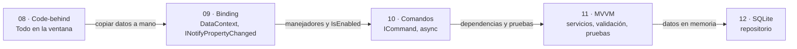
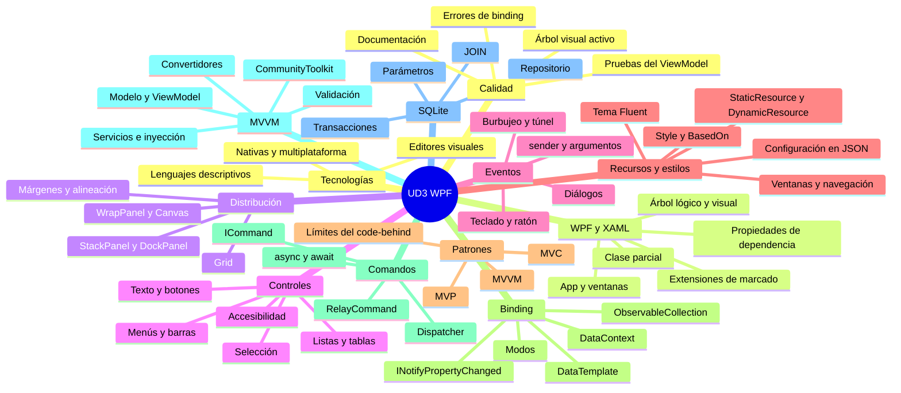

# 14. Resumen y mapa mental

[⬅️ Volver a la unidad](./README.md)

## Índice

- [14.1. Resumen ejecutivo](#141-resumen-ejecutivo)
- [14.2. La evolución de la aplicación](#142-la-evolución-de-la-aplicación)
- [14.3. Mapa mental](#143-mapa-mental)
- [14.4. Checklist de evaluación](#144-checklist-de-evaluación)

---

## 14.1. Resumen ejecutivo

1. **Tecnologías de interfaces gráficas.** Hay librerías nativas (WinForms, WPF, WinUI 3) y multiplataforma (.NET MAUI, Avalonia, Uno, Qt, Flutter), casi todas con un lenguaje descriptivo (XAML, FXML, XML de Android, HTML) y un editor visual.
2. **Primera aplicación WPF.** Un proyecto WPF tiene `App.xaml` y ventanas formadas por un XAML y su *code-behind*, unidos en una clase parcial por `InitializeComponent`; el diseñador genera XAML que se puede leer y modificar.
3. **XAML.** Es XML que crea objetos: atributos, elementos de propiedad, contenido, extensiones de marcado, espacios de nombres, árbol lógico y visual, y propiedades de dependencia con su orden de prioridad.
4. **Paneles.** `Grid` (filas y columnas `Auto`, `*` y fijas), `StackPanel`, `DockPanel`, `WrapPanel`, `UniformGrid` y `Canvas`, con márgenes y alineaciones, distribuyen la ventana y la adaptan a su tamaño.
5. **Controles.** Texto, botones, selección, fechas, imágenes, listas, tablas, pestañas, menús y barras, con sus propiedades y su accesibilidad (teclas de acceso, orden de tabulación, `AutomationProperties.Name`).
6. **Eventos.** Los manejadores reciben `sender` y unos argumentos; los eventos enrutados burbujean o hacen túnel; teclado, ratón, comandos predefinidos con atajos, `MessageBox` y diálogos de ficheros.
7. **Recursos, estilos y navegación.** Los valores se nombran como recursos (`StaticResource`, `DynamicResource`) y las propiedades repetidas como estilos (`BasedOn`, desencadenadores); tema Fluent claro y oscuro, configuración del usuario en JSON, ventanas modales, `Frame` y `Page`, y `UserControl`.
8. **Límites del *code-behind*.** Con toda la lógica en la ventana aparecen responsabilidades mezcladas, duplicación, estado sincronizado a mano y código imposible de probar; MVC, MVP y MVVM separan responsabilidades de formas distintas.
9. **Enlace a datos.** El *binding* une propiedades de los controles con las de un `DataContext`, con modos y formato; `INotifyPropertyChanged` y `ObservableCollection<T>` avisan de los cambios; plantillas de datos, maestro-detalle, `ICollectionView` y propiedades de dependencia propias.
10. **Comandos.** `ICommand` (con un `RelayCommand` propio) saca las acciones de la ventana y gestiona su disponibilidad; `async`/`await`, el `Dispatcher`, el progreso y la cancelación mantienen la ventana libre.
11. **MVVM.** Modelo, *ViewModels* y servicios en una biblioteca sin WPF, inyección de dependencias, validación con `INotifyDataErrorInfo`, convertidores, navegación con `DataTemplate` y el CommunityToolkit.Mvvm.
12. **SQLite.** Una base de datos en un fichero con `Microsoft.Data.Sqlite`: parámetros, lectores, claves ajenas, transacciones y `JOIN`, todo dentro de un repositorio que el *ViewModel* usa por su interfaz.
13. **Depurar, probar y documentar.** Errores de *binding* en la ventana Salida, Árbol visual activo y Recarga activa, pruebas del *ViewModel* con dobles, listas de comprobación manuales y documentación con comentarios XML y README.

---

## 14.2. La evolución de la aplicación

La segunda mitad de la unidad ha transformado **la misma aplicación** de socios paso a paso. Es la idea que tienes que llevarte: el *code-behind* es el punto de partida, y cada paso resuelve un problema que se veía en el anterior.

| Ejemplo | Líneas de `MainWindow.xaml.cs` | Se puede probar sin ventana |
|---------|-------------------------------:|-----------------------------|
| `08-SociosCodeBehind` | 293 | Nada |
| `09-SociosBinding` | 44 | El socio y la calculadora (si se separan) |
| `10-SociosComandos` | 27 | El *ViewModel*, salvo su filtro (depende de WPF) |
| `11-ClubMvvm` | 14 | Todo el núcleo (16 pruebas) |
| `12-ClubSqlite` | 14 | El núcleo y el repositorio (17 pruebas) |

---

## 14.3. Mapa mental

El mapa reúne los trece temas: la mitad izquierda (tecnologías a recursos) construye la interfaz y la mitad derecha (patrones a calidad) la estructura para que se pueda mantener y probar.

---

## 14.4. Checklist de evaluación

Marca cada casilla cuando puedas hacerlo **sin mirar los apuntes**.

### Herramientas y librerías (RA1 a)

- [ ] Sé nombrar librerías nativas y multiplataforma para interfaces gráficas, dentro y fuera de .NET, y para qué sistemas sirve cada una.
- [ ] Sé relacionar cada librería con su lenguaje descriptivo y su editor visual.
- [ ] Sé explicar los problemas de una aplicación con toda la lógica en el *code-behind*.
- [ ] Sé explicar las diferencias entre MVC, MVP y MVVM, y por qué MVVM encaja con WPF.

### El editor visual (RA1 b, c)

- [ ] Sé crear un proyecto WPF en Visual Studio y ejecutarlo con y sin depuración.
- [ ] Sé añadir controles con el Cuadro de herramientas y cambiar sus propiedades con la ventana Propiedades.
- [ ] Sé distribuir una ventana con un `Grid` de filas y columnas `Auto`, `*` y fijas, y combinarlo con otros paneles.
- [ ] Sé hacer que la ventana se adapte al cambiar de tamaño, sin posiciones absolutas.

### Propiedades de los componentes (RA1 d)

- [ ] Sé elegir el control adecuado para cada dato (texto, número, fecha, opción, lista).
- [ ] Sé configurar las propiedades de aspecto y comportamiento de los controles, y las de accesibilidad.
- [ ] Sé definir recursos y estilos (con clave, implícitos y con `BasedOn`) y organizarlos en diccionarios.
- [ ] Sé usar `DynamicResource` para lo que cambia en ejecución y aplicar el tema claro y oscuro.

### El código generado (RA1 e, f)

- [ ] Sé explicar qué generan el diseñador y el compilador: el XAML, la clase parcial e `InitializeComponent`.
- [ ] Sé leer y modificar a mano el XAML: atributos, elementos de propiedad, extensiones de marcado y espacios de nombres.
- [ ] Entiendo el árbol lógico y el visual, y el orden de prioridad de las propiedades de dependencia.
- [ ] Sé reestructurar el código de una ventana: sacar la lógica a *ViewModels*, modelos y servicios, y dejar en el *code-behind* solo lo visual.
- [ ] Sé crear un `UserControl` y una propiedad de dependencia propia.

### Eventos y acciones (RA1 g)

- [ ] Sé asociar un manejador a un evento desde el diseñador, desde el XAML y con `+=`.
- [ ] Entiendo los eventos enrutados (burbujeo y túnel) y sé usar `Handled` y `OriginalSource`.
- [ ] Sé atender eventos de teclado, ratón y ventana (`Closing` para preguntar antes de cerrar).
- [ ] Sé crear comandos con `ICommand`, con su `CanExecute`, y enlazarlos a botones, menús y atajos.
- [ ] Sé escribir manejadores y comandos asíncronos que no bloquean la ventana, con progreso y cancelación.

### Una aplicación completa (RA1 h)

- [ ] Sé enlazar controles con datos (`DataContext`, modos, `UpdateSourceTrigger`, `StringFormat`) e implementar `INotifyPropertyChanged`.
- [ ] Sé mostrar colecciones con `ObservableCollection<T>`, plantillas de datos y maestro-detalle.
- [ ] Sé validar con `INotifyDataErrorInfo` y adaptar valores con convertidores.
- [ ] Sé navegar entre vistas con ventanas modales, `Frame` o `DataTemplate` y un *ViewModel* principal.
- [ ] Sé guardar y leer datos de SQLite con consultas parametrizadas, transacciones y un repositorio.
- [ ] Sé guardar la configuración del usuario y recuperarla al abrir.
- [ ] Sé encontrar un *binding* que falla con la ventana Salida y el Árbol visual activo.
- [ ] Sé probar un *ViewModel* con xUnit y dobles de prueba, y escribir una lista de comprobación manual.

---

[⬅️ Volver a la unidad](./README.md)
