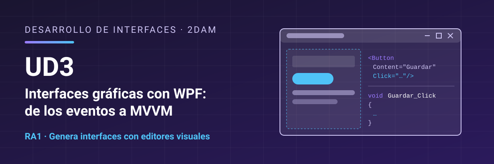

# Desarrollo de Interfaces - UD3 Interfaces gráficas con WPF: de los eventos a MVVM

Unidad 3 Interfaces gráficas con WPF: de los eventos a MVVM. 2DAM.

**Resultado de aprendizaje:** [RA1. Genera interfaces gráficos de usuario mediante editores visuales utilizando las funcionalidades del editor y adaptando el código generado](./resultados-aprendizaje.md).

## Contenidos

1. [Tecnologías de interfaces gráficas](./01-tecnologias-interfaces-graficas.md)
2. [Tu primera aplicación WPF con el editor visual](./02-primera-aplicacion-wpf.md)
3. [XAML: describir la interfaz](./03-xaml.md)
4. [Paneles y distribución](./04-paneles-distribucion.md)
5. [Controles y sus propiedades](./05-controles.md)
6. [Eventos](./06-eventos.md)
7. [Recursos, estilos y navegación](./07-recursos-estilos-navegacion.md)
8. [Los límites del *code-behind* y los patrones de arquitectura](./08-limites-code-behind-patrones.md)
9. [Enlace a datos](./09-enlace-datos.md)
10. [Comandos](./10-comandos.md)
11. [El patrón MVVM](./11-patron-mvvm.md)
12. [Datos con SQLite](./12-datos-sqlite.md)
13. [Depurar, probar y documentar una aplicación WPF](./13-depurar-probar.md)
14. [Resumen y mapa mental](./14-resumen.md)

## Cómo usar los ejemplos

La carpeta [`ejemplos/`](./ejemplos) tiene los proyectos de Visual Studio de los temas. Se usan de tres maneras:

- **Para seguirlos mientras lees.** Los temas 2 a 6 terminan con un ejemplo integrador. El del tema 2 se construye **paso a paso**: puedes hacerlo tú y comparar con el proyecto de `ejemplos/` si te atascas. En los temas 3 a 6 el ejemplo se explica y se muestra su estructura y su código, y el proyecto completo está en `ejemplos/` para que lo abras, lo ejecutes y lo estudies. Los fragmentos de código del tema no hay que teclearlos todos: sirven para entender la explicación.
- **Como etapas de una misma aplicación.** Del tema 8 al 12 se transforma la aplicación de socios del club: cada carpeta (`08-SociosCodeBehind`, `09-SociosBinding`, `10-SociosComandos`, `11-ClubMvvm`, `12-ClubSqlite`) es una etapa que compila y se ejecuta sola. Abre la que corresponda al tema que estás leyendo y compara con la anterior para ver qué ha cambiado y por qué.
- **Para experimentar.** Los laboratorios (`06-LaboratorioEventos`, `09-LaboratorioBinding`, `10-LaboratorioAsincrono`) están hechos para ejecutarlos y probar cosas, y `13-BindingsRotos` tiene fallos puestos a propósito para que los encuentres con las herramientas de depuración.

Los ejemplos **no sustituyen a los ejercicios**: los ejercicios se hacen por tu cuenta.

## Licencia

Este material se distribuye bajo licencia **Creative Commons BY-NC-SA 4.0**. Consulta las condiciones en [LICENSE.md](./LICENSE.md).
