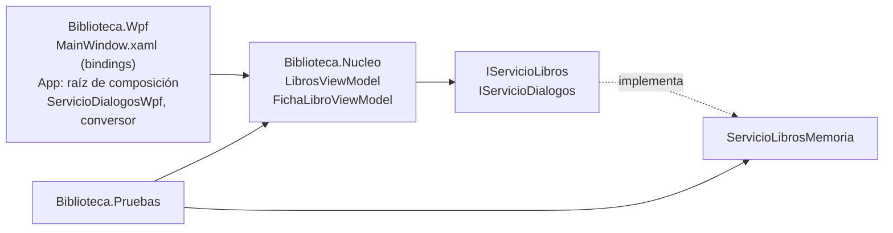

# E08 · De code-behind a MVVM

**Corrección:** autocorrección, con el profesor o con IA

Recibes la aplicación de una biblioteca escolar que **funciona**, pero con toda la lógica en la ventana. Analiza sus problemas y **reestructúrala con MVVM**: el modelo, los servicios y los *ViewModels* en una biblioteca sin WPF que se prueba sola, y la ventana reducida a XAML con *bindings* y comandos. Las pruebas ya están escritas: tu trabajo es ponerlas en verde y que la aplicación siga haciendo lo mismo.

**CE:** RA1 a, e, f, h · **Dificultad:** ★★★ · **Tiempo estimado:** 6 h · **Temas:** 8, 11 y 13

- [Punto de partida](#punto-de-partida)
- [Requisitos](#requisitos)
- [Contrato de entrega](#contrato-de-entrega)
- [Comprueba tu solución](#comprueba-tu-solución)
- [Criterios de evaluación](#criterios-de-evaluación)

## Punto de partida

Copia **todo el contenido** de esta carpeta en la carpeta `E08-Biblioteca` de tu repositorio y haz un primer commit **antes de cambiar nada**: será la referencia de tu análisis. La solución `Biblioteca.slnx` tiene tres proyectos:

| Proyecto | Qué trae | Qué haces |
|----------|----------|-----------|
| `Biblioteca.Wpf` | La aplicación completa, con toda la lógica en `MainWindow.xaml.cs` (241 líneas) | Ejecutarla y analizarla; después, dejarla solo con la vista |
| `Biblioteca.Nucleo` (`net10.0`, sin WPF) | Terminados: `Mvvm/ObjetoObservable`, `Mvvm/RelayCommand`, `Modelos/Libro`, `Modelos/Generos`, `Servicios/IServicioLibros` y `Servicios/IServicioDialogos`. Con las firmas y la documentación, pero sin hacer: `Servicios/ServicioLibrosMemoria`, `ViewModels/FichaLibroViewModel` y `ViewModels/LibrosViewModel` | Programar las tres clases |
| `Biblioteca.Pruebas` | 38 pruebas xUnit del servicio y de los dos *ViewModels*, y un doble de prueba `DialogosFalsos` | **No las modifiques**: empiezan en rojo y tienen que acabar en verde |

Las reglas de la biblioteca son las de la aplicación de partida: título y autor obligatorios; año entre 1450 y el actual; un libro prestado no se puede eliminar ni volver a prestar; para prestar hace falta el nombre del lector.

## Requisitos

**El análisis (antes de tocar el código):**

1. Ejecuta la aplicación de partida y pruébala. En el README, sección «Problemas del code-behind», escribe una tabla con **al menos seis problemas** concretos de `MainWindow.xaml.cs` (como los del tema 8): qué pasa, dónde (métodos y líneas del primer commit) y qué consecuencia tiene para mantener o probar la aplicación. Di cuántas veces se llama a `ActualizarBotones` y por qué.

**El núcleo** (hasta que pasen las 38 pruebas):

2. `ServicioLibrosMemoria`: implementa `IServicioLibros` sobre una lista en memoria, con identificadores 1, 2, 3…, **guardando y devolviendo copias**, con las excepciones que documenta la interfaz.
3. `FichaLibroViewModel`: implementa `INotifyDataErrorInfo` con los errores de título, autor y año (`AnioTexto` es texto para poder validar lo que no es un número), avisa con `ErrorsChanged` cuando cambian, y `CrearLibro()` devuelve el libro (conservando el identificador y el lector) o lanza `InvalidOperationException` si hay errores.
4. `LibrosViewModel`: recibe `IServicioLibros` e `IServicioDialogos` por el **constructor**; tiene la lista filtrada, el elegido con su ficha, el resumen, el nombre del lector, el estado y cinco `RelayCommand` con sus condiciones (los de la documentación de la clase). Vuelve a leer los libros del servicio después de cada cambio. Las confirmaciones y los errores del servicio pasan por `IServicioDialogos`.

**La aplicación WPF:**

5. `App.xaml` sin `StartupUri`; `App.xaml.cs` es la **raíz de composición**: crea `ServicioLibrosMemoria` con los seis libros de partida y `ServicioDialogosWpf`, y se los da a `LibrosViewModel`, que es el `DataContext` de la ventana. También fija el idioma de los *bindings*.
6. `Servicios/ServicioDialogosWpf` implementa `IServicioDialogos` con `MessageBox`. Es la única clase que usa `MessageBox`.
7. `MainWindow.xaml` se enlaza con el *ViewModel*: buscador, lista con una plantilla (título, autor, año y estado), ficha (visible solo si hay ficha, con `BooleanToVisibilityConverter`), préstamo, resumen y estado. Los botones usan los comandos.
8. Los campos con error se marcan solos (validación de WPF) y muestran el mensaje en un `ToolTip` (con un estilo).
9. `Conversores/PrestadoAColorConverter` (`IValueConverter`) colorea el estado de cada libro en la lista: rojo si está prestado y verde si no.
10. `MainWindow.xaml.cs` se queda **solo con el constructor y `InitializeComponent()`**. Ningún control tiene nombre salvo los que necesitan los `Label` para su `Target`.

**Documentación:**

11. Comentarios XML (`///`) en todos los miembros públicos que escribas, y el README completo. En «Reparto de responsabilidades», explica también por qué MVVM encaja con WPF mejor que MVC o MVP (tema 8).

## Contrato de entrega

| Elemento | Debe ser |
|----------|----------|
| Solución | `E08-Biblioteca/Biblioteca.slnx` con los tres proyectos de partida |
| Núcleo | Las firmas públicas de partida, sin cambiarlas (las usan las pruebas) |
| Pruebas | `Biblioteca.Pruebas` sin modificar; `dotnet test` con 38 pruebas en verde |
| WPF | `App.xaml.cs` (raíz de composición), `Servicios/ServicioDialogosWpf.cs`, `Conversores/PrestadoAColorConverter.cs`, `MainWindow.xaml` y `MainWindow.xaml.cs` (solo el constructor) |
| Historial | El primer commit con el código de partida sin cambios |
| Secciones del README | `## Problemas del code-behind`, `## Reparto de responsabilidades`, `## Pruebas`, `## Capturas`, `## Pruebas manuales` |

## Comprueba tu solución

1. `dotnet test --solution Biblioteca.slnx` (o el Explorador de pruebas): **38 pruebas superadas**.
2. La aplicación arranca con los seis libros ordenados por título y `Disponibles: 4 · Prestados: 2`; los dos prestados, en rojo.
3. Escribe `cer` en el buscador: solo queda *Don Quijote de la Mancha* (por el autor, Cervantes). El resumen no cambia.
4. **Nuevo**: la ficha aparece vacía con «Nuevo libro», los tres campos marcados en rojo y **Guardar** desactivado. Pasa el ratón por el año: se ve el mensaje. Rellena *Rayuela*, *Julio Cortázar* y `1963`: **Guardar** se activa. Guarda: aparece en la lista, elegido, y `Disponibles: 5`.
5. Elige *Platero y yo*, escribe `Ana Torres` en el lector y pulsa **Prestar**: el estado dice `«Platero y yo» prestado a Ana Torres.`, la lista lo pone en rojo, el lector se vacía y **Devolver** se activa.
6. Con *Platero y yo* elegido, **Eliminar** está desactivado. Devuélvelo: se activa. Elimínalo y responde **No**: sigue en la lista. Con **Sí**, desaparece.
7. Escribe `abc` en el año de un libro: el campo se marca y **Guardar** se desactiva; con `1999`, se activa.
8. Cuenta las líneas de `MainWindow.xaml.cs` y compáralas con las 241 de partida.

> **Desafío (opcional):** añade una prueba propia en `Biblioteca.Pruebas` que compruebe que, al prestar con el buscador activo, el libro sigue elegido.

## Criterios de evaluación

- ✅ Se analizan los problemas del *code-behind* de partida con ejemplos concretos
- ✅ El servicio cumple las reglas y devuelve copias
- ✅ La ficha valida con `INotifyDataErrorInfo` y avisa de los cambios de errores
- ✅ El *ViewModel* principal recibe sus dependencias, expone comandos con sus condiciones y no conoce WPF
- ✅ Las 38 pruebas pasan sin modificarlas
- ✅ La vista se reduce a XAML con *bindings*, comandos, validación y un convertidor; la composición está en `App`
- ✅ El código está documentado, el README explica el reparto de responsabilidades y el historial es progresivo
