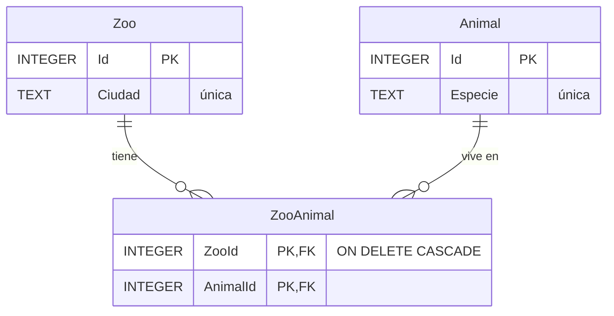

# E09 · Zoológicos con SQLite

**Corrección:** autocorrección, con el profesor o con IA

Programa una aplicación que gestiona **dos tablas relacionadas varios a varios** en una base de datos SQLite: zoológicos y animales, y qué animales hay en cada zoológico. Con un **repositorio** que usa consultas con parámetros, un `JOIN`, claves ajenas y una transacción; un *ViewModel* maestro-detalle con todas las operaciones (CRUD de las dos tablas y de la relación) y pruebas sobre una base de datos en memoria.

**CE:** RA1 f, h · **Dificultad:** ★★★ · **Tiempo estimado:** 6 h · **Temas:** 12 y 13

- [Punto de partida](#punto-de-partida)
- [Requisitos](#requisitos)
- [Contrato de entrega](#contrato-de-entrega)
- [Comprueba tu solución](#comprueba-tu-solución)
- [Criterios de evaluación](#criterios-de-evaluación)

## Punto de partida

Copia **todo el contenido** de esta carpeta en la carpeta `E09-Zoologicos` de tu repositorio y haz un primer commit antes de cambiar nada. La solución `Zoologicos.slnx` tiene cuatro proyectos:

| Proyecto | Qué trae | Qué haces |
|----------|----------|-----------|
| `Zoologicos.Nucleo` (`net10.0`) | Terminados: `Mvvm/`, `Modelos/Zoo`, `Modelos/Animal`, `Datos/IRepositorioZoos`, `Datos/DatosException` y `Servicios/IServicioDialogos`. Con las firmas y la documentación, sin hacer: `ViewModels/ZoologicosViewModel` | Programar el *ViewModel* |
| `Zoologicos.Datos` (`net10.0`, con `Microsoft.Data.Sqlite`) | Terminado: `BaseDatosZoos` (esquema y datos de ejemplo). Sin hacer: `RepositorioSqlite` | Programar el repositorio |
| `Zoologicos.Pruebas` | 32 pruebas: 19 del repositorio contra una base de datos **en memoria** y 13 del *ViewModel* con un **repositorio falso** | **No las modifiques** |
| `Zoologicos.Wpf` | El proyecto con `Datos/zoologicos.db` (los datos de ejemplo), que se copia junto al ejecutable al compilar | La aplicación |

El modelo de datos (lee el esquema en `BaseDatosZoos.cs`):



Al borrar un zoológico, sus filas de `ZooAnimal` se borran solas (`ON DELETE CASCADE`); al borrar un animal, no: hay que quitarlo antes de los zoológicos, y por eso `EliminarAnimal` necesita una transacción.

```text
┌ Zoológicos ───────┐ ┌ Animales de Madrid ──┐ ┌ Todos los animales ─┐
│ Barcelona         │ │ Elefante             │ │ Cebra               │
│ Madrid       ◄    │ │ Jirafa               │ │ Elefante            │
│ Valencia          │ │ Oso panda            │ │ Jirafa              │
│                   │ │ Tigre                │ │ Koala          ◄    │
│ [Madrid         ] │ │                      │ │ [Koala            ] │
│ [Añadir][Cambiar] │ │ [← Añadir el elegido]│ │ [Añadir][Cambiar]   │
│ [Eliminar]        │ │ [Quitar del zoo]     │ │ [Eliminar]          │
└───────────────────┘ └──────────────────────┘ └─────────────────────┘
```

## Requisitos

**El repositorio** (`Zoologicos.Datos/RepositorioSqlite`), como en el tema 12:

1. Implementa `IRepositorioZoos` con `Microsoft.Data.Sqlite`. Abre una conexión por operación (con `using`) y activa en cada una `PRAGMA foreign_keys = ON`.
2. **Todas** las consultas usan parámetros (`$ciudad`, `$id`…): nunca se concatena un dato en el SQL.
3. Las consultas devuelven los datos ordenados; `ObtenerAnimalesDe` usa un `JOIN` con `ZooAnimal`; las altas devuelven el objeto con su identificador (`RETURNING Id` o `last_insert_rowid()`).
4. `EliminarAnimal` quita el animal de `ZooAnimal` y lo borra de `Animal` dentro de **una transacción**.
5. Los errores de SQLite (`SqliteException`) se traducen a `DatosException`, con un mensaje propio para las restricciones incumplidas (código 19: nombre repetido, relación duplicada, clave ajena que no existe).

**El *ViewModel*** (`Zoologicos.Nucleo/ViewModels/ZoologicosViewModel`):

6. Recibe `IRepositorioZoos` e `IServicioDialogos` por el constructor y carga los zoológicos y los animales sin elegir nada.
7. **Maestro-detalle:** al elegir un zoológico se cargan sus animales en `AnimalesDelZoo` y su ciudad pasa a `TextoZoo`; al elegir un animal de la lista general, su especie pasa a `TextoAnimal`.
8. Ocho `RelayCommand` con sus condiciones (los de la documentación de la clase). Tras cada operación, vuelve a leer lo que haya cambiado y conserva la selección cuando tiene sentido (el zoológico o el animal recién añadido o cambiado). Las eliminaciones se confirman, y los `DatosException` se muestran con `IServicioDialogos` sin que la aplicación se cierre. `Estado` dice qué se ha hecho.

**La aplicación WPF:**

9. `App.OnStartup` es la raíz de composición: con la ruta `Datos/zoologicos.db` junto al ejecutable (`AppContext.BaseDirectory`), llama a `BaseDatosZoos.Inicializar` (si falla, muestra el error y cierra la aplicación), crea `RepositorioSqlite` y `ServicioDialogosWpf` y se los da al *ViewModel*. Sin `StartupUri`.
10. `Servicios/ServicioDialogosWpf` implementa `IServicioDialogos` con `MessageBox`.
11. La ventana tiene las tres columnas del esquema, enlazadas con el *ViewModel*: las listas con `DisplayMemberPath` y `SelectedItem`, los cuadros de texto que actualizan con cada letra, los botones con sus comandos, el título de la columna central con la ciudad elegida y el estado abajo. `MainWindow.xaml.cs` solo tiene el constructor.

**Entrega:**

12. Comentarios XML en los miembros públicos que escribas, el README completo y commits a medida que avances.

## Contrato de entrega

| Elemento | Debe ser |
|----------|----------|
| Solución | `E09-Zoologicos/Zoologicos.slnx` con los cuatro proyectos de partida |
| Clases | `RepositorioSqlite` y `ZoologicosViewModel` con las firmas de partida; `Zoologicos.Wpf/Servicios/ServicioDialogosWpf` |
| Pruebas | `Zoologicos.Pruebas` sin modificar; `dotnet test` con 32 pruebas en verde |
| Base de datos | `Zoologicos.Wpf/Datos/zoologicos.db` en el repositorio, copiada al compilar («Copiar si es posterior») |
| *Code-behind* | Solo el constructor de `MainWindow` |
| Secciones del README | `## Capturas`, `## Consultas`, `## Claves ajenas y transacciones`, `## Pruebas`, `## Pruebas manuales` |

## Comprueba tu solución

1. `dotnet test --solution Zoologicos.slnx` (o el Explorador de pruebas): **32 pruebas superadas**.
2. La aplicación arranca con Barcelona, Madrid y Valencia, los ocho animales y nada elegido; todos los botones desactivados.
3. Elige **Madrid**: en el centro, `Animales de Madrid` con Elefante, Jirafa, Oso panda y Tigre; el cuadro de la izquierda dice `Madrid`.
4. Elige **Koala** a la derecha: **← Añadir el elegido** se activa. Púlsalo: Koala aparece en Madrid y el botón se desactiva. Elige **Tigre**: sigue desactivado (Madrid ya lo tiene).
5. Escribe `Sevilla` a la izquierda y pulsa **Añadir**: aparece elegida y sin animales. Escribe `madrid` y pulsa **Añadir**: un mensaje de error y todo sigue igual.
6. Elige **Madrid** y **Jirafa** en el centro y pulsa **Quitar del zoológico**: desaparece de Madrid, pero sigue en la lista general.
7. Elige **Elefante** a la derecha y pulsa **Eliminar**: pregunta; con **Sí**, desaparece de la lista general, de Madrid y (compruébalo) de Barcelona.
8. Elige **Valencia** y pulsa **Eliminar**: desaparece, pero sus animales siguen en la lista general.
9. Cierra y vuelve a abrir: los cambios siguen ahí. Abre `bin/Debug/net10.0-windows/Datos/zoologicos.db` con DB Browser for SQLite y busca los cambios en las tres tablas.
10. Borra la carpeta `bin` del proyecto `Zoologicos.Wpf` y ejecuta: vuelven los datos de ejemplo.

> **Desafío (opcional):** añade al repositorio `TrasladarAnimal(animalId, desdeZooId, hastaZooId)` en una transacción, con su prueba, y un botón para usarlo.

## Criterios de evaluación

- ✅ El repositorio usa consultas con parámetros, lectores y altas que devuelven el identificador
- ✅ Las claves ajenas están activas, la relación se consulta con `JOIN` y la eliminación de un animal es una transacción
- ✅ Los errores de la base de datos se traducen y se muestran sin cerrar la aplicación
- ✅ El *ViewModel* maestro-detalle tiene todas las operaciones con sus condiciones y no conoce SQLite ni WPF
- ✅ La vista se enlaza con el *ViewModel* y la composición está en `App`
- ✅ Las 32 pruebas pasan sin modificarlas
- ✅ El README explica las consultas y las transacciones, y el historial de commits es progresivo
