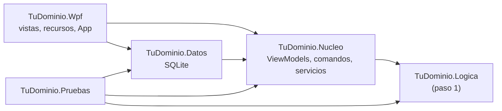

# E10 · Paso 2 del proyecto del curso: la aplicación WPF

**Corrección:** con el profesor o con IA · integrador, paso 2 del proyecto

Convierte en una **aplicación de escritorio** el diseño que hiciste en la UD1 y el modelo que programaste en la UD2. Primero, con **eventos y *code-behind***, como en la primera mitad de la unidad; después, **reestructurada con MVVM** y con los datos en una base de datos **SQLite**. Junta todo lo visto en la unidad.

**CE:** RA1 b, c, d, f, g, h · **Dificultad:** ★★★ · **Tiempo estimado:** 25 h · **Temas:** todos

- [Punto de partida](#punto-de-partida)
- [Requisitos](#requisitos)
- [Contrato de entrega](#contrato-de-entrega)
- [Comprueba tu solución](#comprueba-tu-solución)
- [Criterios de evaluación](#criterios-de-evaluación)

## Punto de partida

- **Tu proyecto de la UD1:** el *user flow*, las pantallas del prototipo (1280 × 720) y el UI Kit (colores, tipografía, espaciado, componentes).
- **Tu paso 1 de la UD2:** la solución con `<TuDominio>.Logica` (entidades, gestor, consultas, eventos) y `<TuDominio>.Pruebas`.
- La tarea de Classroom trae solo el `README.md` de entrega. **Copia en ella tu solución del paso 1** y haz un primer commit con ella, sin cambios.
- **Mínimo funcional.** Si tu paso 1 está incompleto, complétalo antes de empezar hasta tener dos entidades relacionadas con validación, un gestor con alta, modificación y baja de la entidad principal y la operación que relaciona las dos, y sus pruebas en verde. Ese trabajo no se evalúa aquí.
- El ejemplo resuelto del profesor (un club deportivo) se publicará como modelo. **No lo copies**: tu dominio es otro.

Puedes cambiar el modelo del paso 1 si lo necesitas (por ejemplo, para añadir una modificación que no tenía). Anótalo en el README.

## Requisitos

### Fase 1: la aplicación con eventos (temas 2 a 7)

1. Añade a tu solución un proyecto **Aplicación WPF** `<TuDominio>.Wpf` (.NET 10) que referencia `<TuDominio>.Logica`. Empieza la ventana principal con el **editor visual** y reorganízala después a mano.
2. La ventana principal sigue tu prototipo: 1280 × 720, maximizable y con un tamaño mínimo razonable; las zonas del prototipo con `Grid` y paneles, sin posiciones absolutas; un menú o una barra de navegación.
3. Tiene, como mínimo: el **listado** de la entidad principal con búsqueda; un **formulario** de alta y modificación con validación; la **baja** con confirmación; y la **operación que relaciona** las dos entidades (reservar, prestar, pedir…).
4. Todo funciona con **manejadores de eventos en el *code-behind*** que usan el gestor del paso 1. Cuando funcione, haz un commit cuyo mensaje empiece por `Fase 1:` y documenta esta versión en el README.

### Fase 2: MVVM y SQLite (temas 8 a 13)

5. **Núcleo.** Un proyecto `<TuDominio>.Nucleo` (`net10.0`, sin WPF) con un *ViewModel* por vista y uno principal, la base de `INotifyPropertyChanged` y los comandos (escritos a mano o con el CommunityToolkit.Mvvm 8.4), validación con `INotifyDataErrorInfo` en los formularios e interfaces para los servicios (diálogos y datos). Los *ViewModels* reciben sus dependencias por el constructor.
6. **Datos.** Un proyecto `<TuDominio>.Datos` con `Microsoft.Data.Sqlite` y, al menos: las dos tablas relacionadas con su clave ajena (`PRAGMA foreign_keys = ON`); consultas con parámetros; una consulta con `JOIN` que use alguna vista; una **transacción** donde dos escrituras tienen que ir juntas; los errores de SQLite traducidos a una excepción propia; y la creación del esquema al arrancar. El fichero `.db`, con datos de ejemplo, va en el repositorio (`<TuDominio>.Wpf/Datos/`) y se copia al compilar («Copiar si es posterior»).
7. **Vista.** `App` sin `StartupUri` y con la raíz de composición; al menos **dos vistas** con navegación (un `DataTemplate` por *ViewModel* y un *ViewModel* principal, o ventanas modales con su *ViewModel*); todo por *binding*; botones, menús y atajos con comandos y su `CanExecute`; al menos un **convertidor**; el *code-behind* sin lógica (solo `InitializeComponent` y lo que sea puramente visual).
8. **Aspecto.** Los colores, la tipografía y el espaciado de tu UI Kit, como recursos en diccionarios (`Recursos/`) incorporados en `App.xaml`, con estilos (`BasedOn` donde encaje) y sin repetir propiedades en los controles; teclas de acceso, orden de tabulación lógico y `AutomationProperties.Name` en los controles que no tienen texto; el idioma de los *bindings* fijado al arrancar.
9. **Configuración.** La ventana recuerda su tamaño y su posición (JSON en `%AppData%`).
10. **Pruebas automáticas.** Las del paso 1 siguen en verde, y añades pruebas de tus *ViewModels* (con dobles de prueba) y de tu repositorio (con una base de datos en memoria). Se practican aquí; las pruebas unitarias se evalúan en la UD4.
11. **Pruebas manuales.** Una lista de comprobación en el README, ejecutada sobre la versión final, con cada operación de tu *user flow* y sus casos de error.
12. **Documentación.** Comentarios XML en todos los miembros públicos, el README completo y commits frecuentes con mensajes que describen el cambio.

## Contrato de entrega

| Elemento | Debe ser |
|----------|----------|
| Solución | `<TuDominio>.slnx` en la raíz del repositorio, con `.Logica`, `.Nucleo`, `.Datos`, `.Wpf` y `.Pruebas` (el `.Consola` del paso 1 se puede quedar o quitar) |
| Base de datos | `<TuDominio>.Wpf/Datos/<tudominio>.db`, en el repositorio |
| Historial | El primer commit con el paso 1; un commit `Fase 1: …` con la versión con eventos; después, la fase 2 en varios commits |
| Secciones del README | `## Dominio y cambios respecto al diseño`, `## Fase 1: la aplicación con eventos`, `## Arquitectura`, `## Base de datos`, `## Interfaz`, `## Decisiones técnicas`, `## Pruebas automáticas`, `## Pruebas manuales`, `## Cómo ejecutarlo` |

## Comprueba tu solución

- [ ] Compila sin avisos y todas las pruebas pasan (`dotnet test`).
- [ ] El historial tiene el commit `Fase 1: …` y, al compararlo con la versión final, se ve cómo la lógica ha salido de la ventana.
- [ ] Cada pantalla se parece a su *frame* del prototipo, y las diferencias están justificadas en el README.
- [ ] Al agrandar y encoger la ventana, nada se descoloca; maximizada, se aprovecha el espacio.
- [ ] Puedes recorrer las pantallas con el teclado (teclas de acceso, `Tab`, atajos).
- [ ] Ningún botón está activo cuando su acción no se puede hacer.
- [ ] Los errores de validación se ven en el campo, y los de la base de datos se muestran sin que la aplicación se cierre.
- [ ] Cierra y abre la aplicación: los datos y el tamaño de la ventana se conservan. Borra la carpeta `bin`: vuelven los datos de ejemplo.
- [ ] Busca en tus `*.xaml.cs`: no hay lógica de la aplicación. Busca `using System.Windows` en `.Nucleo`: solo aparece `System.Windows.Input`, el de `ICommand`, que es de la biblioteca base de .NET y no de WPF.
- [ ] El README está completo, con capturas de cada vista.

## Criterios de evaluación

- ✅ La interfaz sigue el prototipo de la UD1 y se empezó con el editor visual
- ✅ La ventana se distribuye con paneles y se adapta al tamaño
- ✅ Los controles tienen las propiedades adecuadas y el UI Kit está en recursos y estilos
- ✅ La aplicación es accesible con el teclado y para los lectores de pantalla
- ✅ La fase 1 resuelve las operaciones con eventos en el *code-behind*
- ✅ En la versión final, las acciones son comandos con su condición, en botones, menús y atajos
- ✅ La aplicación está reestructurada con MVVM: núcleo sin WPF, inyección de dependencias y vista sin lógica
- ✅ Los datos se enlazan, se validan y se adaptan con convertidores
- ✅ Los datos se guardan en SQLite con consultas con parámetros, `JOIN`, claves ajenas y una transacción
- ✅ La ventana recuerda su configuración y los errores se tratan sin cerrar la aplicación
- ✅ El README documenta las decisiones y las pruebas manuales, y el historial es progresivo
