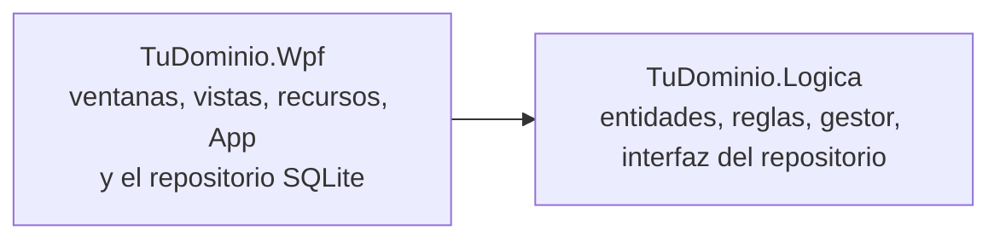

# Proyecto de la UD3 · La aplicación WPF de tu diseño

Convierte en una **aplicación de escritorio** el diseño que hiciste en la UD1. Es **una sola aplicación** con **inicio de sesión y dos pantallas de tu elección**, programada con **eventos y *code-behind***, que guarda sus datos en una base de datos **SQLite** y tiene un **inicio de sesión**. Al terminar, la **expones** delante del profesor. Junta todo lo visto en la unidad.

Las fechas de la entrega y de las exposiciones están en la tarea de Moodle.

- [Punto de partida](#punto-de-partida)
- [Trabajo con Git](#trabajo-con-git)
- [Requisitos](#requisitos)
- [Contrato de entrega](#contrato-de-entrega)
- [Exposición](#exposición)
- [Comprueba tu solución](#comprueba-tu-solución)
- [Criterios de evaluación](#criterios-de-evaluación)
- [Requisitos mínimos](#requisitos-mínimos)

## Punto de partida

- **Tu proyecto de la UD1:** el *user flow*, las pantallas del prototipo (1280 × 720) y el UI Kit (colores, tipografía, espaciado, componentes).
- **Nada más.** Las entidades y las pantallas salen de ese diseño, que ya pedía al menos dos entidades relacionadas. Si tu diseño tiene más de dos, elige las dos con las que funciona tu *user flow*. De las pantallas del prototipo programas aquí solo el inicio de sesión y dos más, las que tú elijas. El modelo lo programas aquí (requisito 1).
- La tarea de Classroom trae solo el `README.md` de entrega. **Crea en ella la solución** `<TuDominio>.slnx` con un proyecto de biblioteca `<TuDominio>.Logica`, y haz un primer commit en `main` (`chore: crear la solución`). Es el único commit que se hace directamente en `main` (ver [Trabajo con Git](#trabajo-con-git)).
- El ejemplo resuelto del profesor (un club deportivo) se publicará como modelo. **No lo copies**: tu dominio es otro.

Si al programarla cambias algo de tu diseño de la UD1, anótalo en el README.

## Trabajo con Git

El repositorio se trabaja como en el material de Git visto en clase: ramas por funcionalidad y mensajes con una convención.

**Ramas.**

- `main` siempre compila y funciona. **No se trabaja directamente en `main`**: solo recibe el commit inicial con la solución vacía y las fusiones de las ramas.
- **Cada funcionalidad, en su rama** `feat/<nombre-funcionalidad>`, en minúsculas y con guiones: `feat/modelo-dominio`, `feat/listado-socios`, `feat/alta-socio`, `feat/reservas`, `feat/inicio-sesion`, `feat/base-datos`, `feat/ui-kit`… Lo que no es una pantalla también es una funcionalidad: los recursos del UI Kit o la base de datos van en su propia rama.
- En la rama van **todos los commits de esa funcionalidad**: el código, sus correcciones y su parte del README.

**Integración en `main`.** Cuando la funcionalidad funciona, fusiónala en `main` **con un *merge commit*** (`git merge --no-ff feat/listado-socios`) para que los commits de la rama se queden en el historial que se corrige. Si prefieres hacerlo con una ***pull request*** en tu repositorio, fusiónala con «Create a merge commit», no con *squash* ni con *rebase*; es opcional. Después, borra la rama si quieres (el nombre queda en el mensaje del *merge*).

**Mensajes de commit.** Con la convención vista en clase (*Conventional Commits*): `tipo(ámbito): descripción`.

| Tipo | Cuándo | Ejemplo |
|------|--------|---------|
| `feat` | Una funcionalidad nueva | `feat(socios): añadir la búsqueda por nombre` |
| `fix` | Corregir un error | `fix(reservas): impedir reservas en el pasado` |
| `docs` | Solo documentación | `docs(readme): añadir el diagrama de la base de datos` |
| `style` | Formato, sin cambiar la lógica | `style(vistas): ordenar los atributos del XAML` |
| `refactor` | Reorganizar el código sin cambiar lo que hace | `refactor(socios): llevar la validación a un método aparte` |
| `chore` | Mantenimiento: proyectos, paquetes, configuración | `chore(datos): añadir Microsoft.Data.Sqlite` |

- El **ámbito** es la parte de la aplicación que cambia: una entidad o vista (`socios`, `reservas`, `login`), `datos`, `ui`, `readme`…
- La **descripción**, en español, empieza por un verbo en infinitivo, en minúscula y sin punto final, y dice qué cambia: no valen `cambios`, `arreglos` ni `wip`.
- Un commit hace **una sola cosa**: si necesitas dos tipos, son dos commits.
- Los mensajes de *merge* no tienen que seguir la convención.

**Versión 1.0.** Cuando termines y `main` tenga todo fusionado:

1. Crea la **etiqueta** `1.0` en el último commit de `main`: `git tag -a 1.0 -m "Versión 1.0"` y `git push origin 1.0`.
2. Crea en GitHub una **release** basada en esa etiqueta (*Releases > Draft a new release*, eligiendo la etiqueta `1.0`), con el título «1.0» y unas notas breves: qué hace la aplicación, las pantallas y cómo ejecutarla. Es opcional adjuntar la aplicación publicada en un `.zip`.
3. Pon el enlace a la release en el README, en «Cómo ejecutarlo».

**Se entrega lo que hay en `main` en la fecha límite.** Lo que se quede en una rama sin fusionar no cuenta.

## Requisitos

Toda la aplicación se programa con **eventos y *code-behind***: cada ventana lee sus controles en los manejadores de eventos, llama al gestor o al repositorio y muestra el resultado o el error.

### Modelo del dominio

1. **Modelo.** Un proyecto `<TuDominio>.Logica` (biblioteca `net10.0`, sin WPF y sin consola) con las **dos entidades** de tu diseño y su relación, y un **gestor** con los datos en memoria que ofrezca el alta, la modificación y la baja de las entidades que uses en tus pantallas y las búsquedas que necesiten. Las reglas del modelo, **al menos dos** (por ejemplo, un dato obligatorio o dentro de un rango, o no repetir un nombre), lanzan **excepciones propias** con un mensaje claro. Trae **datos de ejemplo** para poder usar la aplicación al arrancar. Es pequeño: lo que tu aplicación necesita, no más.

### La aplicación

2. Añade a tu solución un proyecto **Aplicación WPF** `<TuDominio>.Wpf` (.NET 10) que referencia `<TuDominio>.Logica`. Empieza la ventana principal con el **editor visual** y reorganízala después a mano. Anota qué generó el diseñador y qué cambiaste: lo contarás en el README y en la exposición.
3. **Pantallas.** La aplicación tiene el **inicio de sesión** y **dos pantallas más, las que tú elijas** según tu diseño de la UD1, que se muestran dentro de la **ventana principal** (requisito 4). Con ellas tienes que demostrar que has aplicado tu diseño y que sabes trabajar con eventos y *code-behind* y con los controles de la lista. Cada pantalla tiene su *frame* en el prototipo y su captura. Mínimo:

    | Pantalla | Qué tiene |
    |----------|-----------|
    | Una de las dos | El **CRUD completo de una entidad**: listado con búsqueda, alta, modificación y baja con confirmación, con validación de las reglas del modelo |
    | La otra | **Libre**, pero con algo más que mostrar datos: la segunda entidad, una operación que relaciona las dos (reservar, prestar, pedir…), un formulario con selección, un resumen con filtros… |

    Puedes usar cuadros de diálogo para los formularios.
4. La **ventana principal** sigue tu prototipo: 1280 × 720, maximizable y con un tamaño mínimo razonable; las zonas del prototipo con `Grid` y paneles, sin posiciones absolutas. Los **manejadores de eventos** de la navegación deciden qué vista se muestra en la zona de contenido.
5. **Eventos y *code-behind*.** En todas las pantallas, cada manejador lee los controles, llama al gestor o al repositorio y muestra el resultado o el error. **En las ventanas no hay SQL ni reglas del modelo.** Mientras no tengas la base de datos, los manejadores usan el gestor del modelo (requisito 1); cuando tengas el repositorio (requisito 6), cámbialos para que lo usen: cada vista lo recibe en su constructor, por su interfaz (que está en `<TuDominio>.Logica`).
6. **Datos.** El repositorio que implementa la interfaz usa `Microsoft.Data.Sqlite` y está en una carpeta `Repositorio/` de `<TuDominio>.Wpf`. **Las tablas son las que tú necesites**: las diseñas tú. El fichero `.db`, con datos de ejemplo, va en el repositorio (`<TuDominio>.Wpf/Datos/`) y se copia al compilar («Copiar si es posterior»). **Toda la aplicación guarda en esta base de datos.** Los datos que llegan a una consulta van siempre como parámetros, nunca concatenados en el SQL.
7. **Controles.** La aplicación usa, al menos una vez y donde tenga sentido para su dato, estos controles (el `Menu` es opcional):

    | Control | Para qué, por ejemplo |
    |---------|-----------------------|
    | `Grid` | La distribución de las ventanas y los formularios |
    | `TextBlock` o `Label` | Títulos y etiquetas de los campos |
    | `TextBox` | Los datos del formulario y la búsqueda |
    | `PasswordBox` | La contraseña del inicio de sesión |
    | `Button` | Guardar, borrar, buscar, navegar |
    | `CheckBox` | Un filtro («Solo activos») o un dato sí/no |
    | `RadioButton` | Un modo o un dato con pocas opciones excluyentes |
    | `ListBox` | Un listado o la selección de la entidad relacionada |
    | `ComboBox` | Elegir la entidad relacionada o un tipo |
    | `DataGrid` o `ListView` | El listado principal |
    | `Menu` (opcional) | La barra de menús; si no lo usas, navega con botones u otra barra de navegación |
    | `MessageBox` | Confirmaciones y errores |

    En el README, una tabla dice dónde se usa cada uno.
8. **Inicio de sesión.** Al arrancar se abre una **pantalla de inicio de sesión** con un `PasswordBox` llamado `pwdContrasena`; con un usuario y una contraseña correctos se pasa a la ventana principal, y si no, se avisa **sin decir cuál de los dos ha fallado**. Los usuarios están en una tabla de la base de datos, con un usuario de prueba cuyas credenciales escribes en el README. La contraseña no se muestra en ningún mensaje. **Opcional:** guardar la contraseña como *hash* con sal (`Rfc2898DeriveBytes.Pbkdf2`, SHA-256 y al menos 100 000 iteraciones) en lugar de en claro. No hace falta registrar usuarios nuevos ni gestionar permisos.
9. **Aspecto.** Los colores, la tipografía y el espaciado de tu UI Kit, como recursos en diccionarios (`Recursos/`) incorporados en `App.xaml`, con estilos (`BasedOn` donde encaje) y sin repetir propiedades en los controles.
10. **Errores.** Ningún error de validación, de una regla del modelo o de la base de datos cierra la aplicación: se muestra en un mensaje o junto al campo. Si la base de datos no se puede abrir al arrancar, la aplicación avisa y se cierra de forma ordenada.
11. **Pruebas manuales.** Una lista de comprobación en el README, ejecutada sobre la versión entregada, con cada operación de tu *user flow*, el inicio de sesión y sus casos de error.

## Contrato de entrega

| Elemento | Debe ser |
|----------|----------|
| Solución | `<TuDominio>.slnx` en la raíz del repositorio, con `.Logica` y `.Wpf` |
| Base de datos | `<TuDominio>.Wpf/Datos/<tudominio>.db`, en el repositorio, con datos de ejemplo y el usuario de prueba |
| Inicio de sesión | Pantalla de inicio de sesión con un `PasswordBox` llamado `pwdContrasena` y una tabla de usuarios con el usuario de prueba |
| Historial | En `main`: el primer commit con la solución vacía (`chore: crear la solución`) y, después, las fusiones (con *merge commit*) de las ramas `feat/…`. Mensajes con la convención `tipo(ámbito): descripción` |
| Versión | Etiqueta `1.0` en el último commit de `main` y una *release* de GitHub basada en ella, enlazada en el README |
| Ramas | Una rama `feat/<nombre-funcionalidad>` por funcionalidad, fusionada en `main` con *merge commit* (la *pull request* es opcional) |
| Secciones del README | `## Dominio y cambios respecto al diseño`, `## Ramas`, `## Editor visual y code-behind`, `## Arquitectura`, `## Base de datos`, `## Inicio de sesión`, `## Interfaz`, `## Decisiones técnicas`, `## Pruebas manuales`, `## Cómo ejecutarlo` |

## Exposición

Después de la entrega, cada alumno expone su proyecto al profesor durante **15 minutos**, con su portátil o un equipo del aula y la versión entregada (el último commit antes de la fecha límite).

| Parte | Tiempo | Qué haces |
|-------|-------:|-----------|
| 1. Demostración | 4 min | Recorres tu *user flow* con la aplicación: inicio de sesión y tus dos pantallas con todo lo que hacen; provocas un error de validación y uno de una regla del modelo. Enseñas la lista de tus ramas fusionadas |
| 2. Recorrido por el código y preguntas | 11 min | Respondes a las preguntas del profesor con el código abierto en Visual Studio: qué generó el editor visual y qué cambiaste, qué hace un manejador de eventos, qué ve una ventana del repositorio y qué no, cómo compruebas la contraseña, qué pasa si falla la base de datos… Y sobre la tecnología: por qué WPF y no otra y en qué otro *framework* aplicarías lo que has hecho |

Prepara la aplicación compilada y abierta, la solución abierta en Visual Studio, la lista de ramas y commits de tu repositorio y tu prototipo de la UD1.

**La exposición también comprueba que el trabajo es tuyo.** Si no sabes explicar una parte de tu aplicación, esa parte no se da por buena. Sin exposición, el proyecto no se puede calificar.

## Comprueba tu solución

- [ ] Compila sin avisos.
- [ ] `<TuDominio>.Logica` no usa nada de WPF ni de la consola, y sus reglas lanzan excepciones propias con un mensaje claro.
- [ ] Están el inicio de sesión y tus dos pantallas, con el CRUD completo de una entidad en una de ellas, y guardan en la misma base de datos.
- [ ] En `main` no hay commits tuyos fuera de las ramas, salvo el primero, y cada rama `feat/…` está fusionada con un *merge commit*.
- [ ] La etiqueta `1.0` está en el último commit de `main`, y hay una *release* basada en ella, con su enlace en el README.
- [ ] `git log --oneline` muestra mensajes con la forma `tipo(ámbito): descripción`, y ninguno es `cambios`, `wip` o parecido.
- [ ] Cada pantalla se parece a su *frame* del prototipo, y las diferencias están justificadas en el README.
- [ ] Al agrandar y encoger la ventana, nada se descoloca; maximizada, se aprovecha el espacio.
- [ ] Están todos los controles de la lista del requisito 7, y la tabla del README dice dónde.
- [ ] Con el usuario de prueba entras; con una contraseña equivocada, no, y el mensaje no dice qué ha fallado.
- [ ] Los errores de validación y los de la base de datos se muestran sin que la aplicación se cierre.
- [ ] Cierra y abre la aplicación: los datos se conservan. Borra la carpeta `bin`: vuelven los datos de ejemplo.
- [ ] Busca en tus `*.xaml.cs`: no hay SQL ni reglas del modelo, solo leer controles, llamar al gestor o al repositorio y mostrar el resultado.
- [ ] El README está completo, con capturas de cada vista.
- [ ] Sabes explicar cada parte de tu código.

## Criterios de evaluación

> **Esta lista es orientativa.** La rúbrica que aparece en este repositorio es **provisional**: la que cuenta para la evaluación es la que aparece en el Moodle.

- ✅ Analizas en la exposición las tecnologías de interfaces y justificas por qué usas WPF
- ✅ La interfaz sigue el prototipo de la UD1 y se empezó con el editor visual
- ✅ La ventana se distribuye con paneles y se adapta al tamaño
- ✅ Usas los controles adecuados, con sus propiedades, y el UI Kit está en recursos y estilos
- ✅ Explicas el código que generó el editor visual y lo que cambiaste
- ✅ Todas las operaciones se resuelven con manejadores de eventos en el *code-behind*
- ✅ La lógica está separada de las ventanas: modelo sin WPF, repositorio por su interfaz y sin SQL en las ventanas
- ✅ Los datos se muestran, se validan y se formatean en la interfaz
- ✅ Los datos se guardan en SQLite con consultas con parámetros
- ✅ El inicio de sesión funciona y no revela qué ha fallado
- ✅ Los errores se tratan sin cerrar la aplicación y el README documenta las decisiones y las pruebas manuales
- ✅ Trabajas con una rama `feat/…` por funcionalidad, fusionada en `main`, con un historial progresivo y mensajes que siguen la convención vista en clase

## Requisitos mínimos

Sin ellos, el proyecto se califica como insuficiente, sea cual sea la puntuación de los criterios:

- La solución compila y la aplicación arranca.
- Toda la aplicación está programada con eventos y *code-behind*, con el inicio de sesión y las dos pantallas.
- Los datos se guardan en SQLite.
- Has hecho la exposición.
