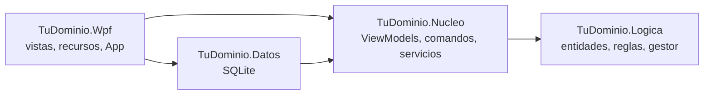

# Proyecto de la UD3 · La aplicación WPF de tu diseño

Convierte en una **aplicación de escritorio** el diseño que hiciste en la UD1. Es **una sola aplicación** con dos partes: una se programa con **eventos y *code-behind***, como en la primera mitad de la unidad, y la otra, con **MVVM**, como en la segunda. Toda ella guarda sus datos en una base de datos **SQLite** y tiene un **inicio de sesión**. Al terminar, la **expones** delante del profesor. Junta todo lo visto en la unidad.

Las fechas de la entrega y de las exposiciones están en la tarea de Moodle.

- [Punto de partida](#punto-de-partida)
- [Planificación en Trello](#planificación-en-trello)
- [Trabajo con Git](#trabajo-con-git)
- [Requisitos](#requisitos)
- [Contrato de entrega](#contrato-de-entrega)
- [Exposición](#exposición)
- [Comprueba tu solución](#comprueba-tu-solución)
- [Criterios de evaluación](#criterios-de-evaluación)
- [Requisitos mínimos](#requisitos-mínimos)

## Punto de partida

- **Tu proyecto de la UD1:** el *user flow*, las pantallas del prototipo (1280 × 720) y el UI Kit (colores, tipografía, espaciado, componentes).
- **Nada más.** Las entidades, las pantallas y las operaciones salen de ese diseño, que ya pedía al menos dos entidades relacionadas con listado, búsqueda, alta, modificación y baja. Si tu diseño tiene más de dos, elige las dos con las que funciona tu *user flow*. El modelo lo programas aquí (requisito 1).
- **Reparto de las dos entidades.** Tú decides cuál programas con eventos y *code-behind* (la «entidad con eventos») y cuál con MVVM (la «entidad con MVVM»). Lo anotas y lo justificas en el README. La tabla de [Requisitos](#requisitos) dice qué hace cada parte.
- La tarea de Classroom trae solo el `README.md` de entrega. **Crea en ella la solución** `<TuDominio>.slnx` con un proyecto de biblioteca `<TuDominio>.Logica`, y haz un primer commit en `main` (`chore: crear la solución`). Es el único commit que se hace directamente en `main` (ver [Trabajo con Git](#trabajo-con-git)).
- El ejemplo resuelto del profesor (un club deportivo) se publicará como modelo. **No lo copies**: tu dominio es otro.

Si al programarla cambias algo de tu diseño de la UD1, anótalo en el README.

## Planificación en Trello

Antes de programar, crea un tablero de Trello para el proyecto con, al menos, las columnas «Por hacer», «En curso» y «Hecho», y una tarjeta por cada operación de tu *user flow* (por ejemplo, «Alta de socio» o «Listado de actividades»), más las del modelo, el inicio de sesión, la base de datos y el README. Muévelas a medida que avances.

- El tablero tiene que poder verlo el profesor (público o compartido con él) y su enlace va en el README.
- Cada tarjeta de una funcionalidad corresponde a una **rama** del repositorio (apartado siguiente): pon el nombre de la rama en la tarjeta.
- **No puntúa**, pero lo enseñarás en la exposición: sirve para contar cómo te has organizado.

## Trabajo con Git

El repositorio se trabaja como en el material de Git visto en clase: ramas por funcionalidad, *pull requests* y mensajes con una convención.

**Ramas.**

- `main` siempre compila y funciona. **No se trabaja directamente en `main`**: solo recibe el commit inicial con la solución vacía y las fusiones de las ramas.
- **Cada funcionalidad, en su rama** `feat/<nombre-funcionalidad>`, en minúsculas y con guiones: `feat/modelo-dominio`, `feat/listado-socios`, `feat/alta-socio`, `feat/reservas`, `feat/inicio-sesion`, `feat/base-datos`, `feat/ui-kit`… Lo que no es una pantalla también es una funcionalidad: los recursos del UI Kit, la base de datos o la configuración de la ventana van en su propia rama.
- En la rama van **todos los commits de esa funcionalidad**: el código, sus correcciones y su parte del README.

**Integración en `main`.**

1. Cuando la funcionalidad funciona, sube la rama (`git push -u origin feat/listado-socios`) y abre una ***pull request*** hacia `main` en tu repositorio, con un título que siga la convención de mensajes y una descripción breve de qué hace y cómo probarla.
2. Fusiónala con **«Create a merge commit»**, no con *squash* ni con *rebase*: así los commits de la rama se quedan en el historial que se corrige.
3. Después, borra la rama si quieres (el nombre queda en el mensaje del *merge*) y actualiza tu `main` local (`git switch main` y `git pull`).

**Mensajes de commit.** Con la convención vista en clase (*Conventional Commits*): `tipo(ámbito): descripción`.

| Tipo | Cuándo | Ejemplo |
|------|--------|---------|
| `feat` | Una funcionalidad nueva | `feat(socios): añadir la búsqueda por nombre` |
| `fix` | Corregir un error | `fix(reservas): impedir reservas en el pasado` |
| `docs` | Solo documentación | `docs(readme): añadir el diagrama de la base de datos` |
| `style` | Formato, sin cambiar la lógica | `style(vistas): ordenar los atributos del XAML` |
| `refactor` | Reorganizar el código sin cambiar lo que hace | `refactor(socios): llevar la validación al ViewModel` |
| `chore` | Mantenimiento: proyectos, paquetes, configuración | `chore(datos): añadir Microsoft.Data.Sqlite` |

- El **ámbito** es la parte de la aplicación que cambia: una entidad o vista (`socios`, `reservas`, `login`), `datos`, `ui`, `readme`…
- La **descripción**, en español, empieza por un verbo en infinitivo, en minúscula y sin punto final, y dice qué cambia: no valen `cambios`, `arreglos` ni `wip`.
- Un commit hace **una sola cosa**: si necesitas dos tipos, son dos commits.
- Los mensajes de *merge* que genera GitHub no tienen que seguir la convención.

**Se entrega lo que hay en `main` en la fecha límite.** Lo que se quede en una rama sin fusionar no cuenta.

## Requisitos

La aplicación se reparte así. No se hace nada dos veces: cada pantalla se programa de una sola forma.

| Parte de la aplicación | Cómo se programa |
|------------------------|------------------|
| Ventana principal: menú, navegación entre vistas, tamaño y posición | Eventos y *code-behind* |
| **Entidad con eventos** (la que elijas): listado, alta y baja | Eventos y *code-behind* |
| Inicio de sesión | MVVM |
| **Entidad con MVVM** (la otra): listado con búsqueda, alta, modificación y baja | MVVM |
| La **operación que relaciona** las dos entidades (reservar, prestar, pedir…) | MVVM |
| Recursos y estilos, accesibilidad, base de datos y tratamiento de errores | Comunes a toda la aplicación |

Empieza por la parte con eventos mientras se explican los temas 2 a 7 y sigue con la de MVVM a partir del tema 8.

### Modelo del dominio

1. **Modelo.** Un proyecto `<TuDominio>.Logica` (biblioteca `net10.0`, sin WPF y sin consola) con las **dos entidades** de tu diseño y su relación, y un **gestor** con los datos en memoria que ofrezca: el alta, la modificación y la baja de las dos entidades (cada parte usa las que necesita); las búsquedas que necesite tu *user flow*; y la **operación que relaciona** las dos (reservar, prestar, pedir…). Las reglas del modelo, **al menos tres** (dos de validación de datos y una de la operación, como no reservar lo mismo dos veces o no superar un aforo), lanzan **excepciones propias** con un mensaje claro. Trae **datos de ejemplo** para poder usar la aplicación al arrancar. Es pequeño: lo que tu aplicación necesita, no más.

### Parte con eventos y *code-behind* (temas 2 a 7)

2. Añade a tu solución un proyecto **Aplicación WPF** `<TuDominio>.Wpf` (.NET 10) que referencia `<TuDominio>.Logica`. Empieza la ventana principal con el **editor visual** y reorganízala después a mano. Anota qué generó el diseñador y qué cambiaste: lo contarás en el README y en la exposición.
3. La **ventana principal** sigue tu prototipo: 1280 × 720, maximizable y con un tamaño mínimo razonable; las zonas del prototipo con `Grid` y paneles, sin posiciones absolutas; un menú o una barra de navegación. Los **manejadores de eventos** del menú deciden qué vista se muestra en la zona de contenido, también las vistas con MVVM.
4. La **vista de la entidad con eventos** tiene, como mínimo: el **listado**, un formulario de **alta** con validación y la **baja** con confirmación.
5. Esa vista funciona con **manejadores de eventos en el *code-behind***: cada manejador lee los controles, llama al gestor o al repositorio y muestra el resultado o el error. En la ventana no hay SQL ni reglas del modelo. Mientras no tengas la base de datos, los manejadores usan el gestor del modelo (requisito 1); cuando tengas el repositorio (requisito 7), cámbialos para que lo usen: la vista lo recibe en su constructor, por su interfaz. Documenta esta parte en el README.

### Parte con MVVM (temas 8 a 13)

6. **Núcleo.** Un proyecto `<TuDominio>.Nucleo` (`net10.0`, sin WPF) con un *ViewModel* por cada vista con MVVM, la base de `INotifyPropertyChanged` y los comandos (escritos a mano o con el CommunityToolkit.Mvvm 8.4), validación con `INotifyDataErrorInfo` en los formularios e interfaces para los servicios (diálogos, datos y autenticación). Los *ViewModels* reciben sus dependencias por el constructor.
7. **Datos.** Un proyecto `<TuDominio>.Datos` con `Microsoft.Data.Sqlite` y, al menos: las dos tablas relacionadas con su clave ajena (`PRAGMA foreign_keys = ON`); consultas con parámetros; una consulta con `JOIN` que use alguna vista; una **transacción** donde dos escrituras tienen que ir juntas; los errores de SQLite traducidos a una excepción propia; y la creación del esquema al arrancar. El fichero `.db`, con datos de ejemplo, va en el repositorio (`<TuDominio>.Wpf/Datos/`) y se copia al compilar («Copiar si es posterior»). **Toda la aplicación guarda en esta base de datos**, también la vista con eventos.
8. **Inicio de sesión.** Una tabla `Usuarios` con el nombre de usuario (único), la **sal** y el ***hash*** de la contraseña, calculado con `Rfc2898DeriveBytes.Pbkdf2` (SHA-256 y al menos 100 000 iteraciones). **La contraseña nunca se guarda en claro** ni se muestra en un mensaje. Al arrancar se abre una **vista de inicio de sesión** con un `PasswordBox`; con un usuario y una contraseña correctos se pasa a la ventana principal, y si no, se avisa sin decir cuál de los dos ha fallado. Los datos de ejemplo traen un usuario de prueba, cuyas credenciales escribes en el README. `PasswordBox.Password` no admite *binding*: decide cómo llega la contraseña al *ViewModel* y justifícalo en «Decisiones técnicas». No hace falta registrar usuarios nuevos ni gestionar permisos.
9. **Vistas con MVVM.** Además del inicio de sesión, al menos **dos vistas**: la de la **entidad con MVVM** (listado con búsqueda, formulario de alta y modificación con validación y baja con confirmación) y la de la **operación que relaciona** las dos entidades. `App`, sin `StartupUri`, es la raíz de composición: crea los servicios y los *ViewModels* y se los entrega a la ventana principal, que solo los muestra. En estas vistas, todo va por *binding*; los botones y los atajos, con comandos y su `CanExecute`; hay al menos un **convertidor**; y el *code-behind* no tiene lógica (solo `InitializeComponent` y lo que sea puramente visual).

### Toda la aplicación

10. **Controles.** La aplicación usa, al menos una vez y donde tenga sentido para su dato, estos controles:

    | Control | Para qué, por ejemplo |
    |---------|-----------------------|
    | `Grid` | La distribución de las ventanas y los formularios |
    | `TextBlock` o `Label` | Títulos y etiquetas de los campos |
    | `TextBox` | Los datos del formulario y la búsqueda |
    | `PasswordBox` | La contraseña del inicio de sesión |
    | `Button` | Guardar, borrar, buscar, navegar |
    | `CheckBox` | Un filtro («Solo activos») o un dato sí/no |
    | `RadioButton` | Un modo o un dato con pocas opciones excluyentes |
    | `ListBox` | Un listado o la selección de la entidad relacionada |
    | `ComboBox` | Elegir la entidad relacionada o un tipo |
    | `DataGrid` o `ListView` | El listado principal |
    | `Menu` | La barra de menús |
    | `MessageBox` | Confirmaciones y errores: directamente en la parte con eventos y **a través del servicio de diálogos** en la parte con MVVM |

    En el README, una tabla dice dónde se usa cada uno.
11. **Aspecto.** Los colores, la tipografía y el espaciado de tu UI Kit, como recursos en diccionarios (`Recursos/`) incorporados en `App.xaml`, con estilos (`BasedOn` donde encaje) y sin repetir propiedades en los controles; teclas de acceso, orden de tabulación lógico y `AutomationProperties.Name` en los controles que no tienen texto; el idioma de los *bindings* fijado al arrancar.
12. **Configuración.** La ventana recuerda su tamaño y su posición (JSON en `%AppData%`).
13. **Errores.** Ningún error de validación, de una regla del modelo o de la base de datos cierra la aplicación: se muestra en el campo o con un mensaje. Si la base de datos no se puede abrir al arrancar, la aplicación avisa y se cierra de forma ordenada.
14. **Pruebas manuales.** Una lista de comprobación en el README, ejecutada sobre la versión entregada, con cada operación de tu *user flow*, el inicio de sesión y sus casos de error.

## Contrato de entrega

| Elemento | Debe ser |
|----------|----------|
| Solución | `<TuDominio>.slnx` en la raíz del repositorio, con `.Logica`, `.Nucleo`, `.Datos` y `.Wpf` |
| Base de datos | `<TuDominio>.Wpf/Datos/<tudominio>.db`, en el repositorio, con datos de ejemplo y el usuario de prueba |
| Inicio de sesión | Vista de inicio de sesión con un `PasswordBox` llamado `pwdContrasena`; tabla `Usuarios` con sal y *hash* |
| Historial | En `main`: el primer commit con la solución vacía (`chore: crear la solución`) y, después, las fusiones de las ramas `feat/…`. Mensajes con la convención `tipo(ámbito): descripción` |
| Ramas | Una rama `feat/<nombre-funcionalidad>` por funcionalidad, integrada con una *pull request* y *merge commit* |
| Secciones del README | `## Dominio y cambios respecto al diseño`, `## Planificación`, `## Parte con eventos`, `## Arquitectura`, `## Base de datos`, `## Inicio de sesión`, `## Interfaz`, `## Decisiones técnicas`, `## Pruebas manuales`, `## Cómo ejecutarlo` |

## Exposición

Después de la entrega, cada alumno expone su proyecto al profesor durante **15 minutos**, con su portátil o un equipo del aula y la versión entregada (el último commit antes de la fecha límite).

| Parte | Tiempo | Qué haces |
|-------|-------:|-----------|
| 1. Demostración | 4 min | Recorres tu *user flow* con la aplicación: inicio de sesión, la entidad con eventos (listado, alta y baja), la entidad con MVVM (listado con búsqueda, alta, modificación y baja) y la operación que relaciona; provocas un error de validación y uno de una regla del modelo. Enseñas el tablero de Trello y una de tus *pull requests* |
| 2. Recorrido por el código y preguntas | 11 min | Respondes a las preguntas del profesor con el código abierto en Visual Studio: qué generó el editor visual y qué cambiaste, qué hace un manejador de la parte con eventos, cómo se enlaza un control con su *ViewModel*, por qué un botón está desactivado, dónde se traduce un error de SQLite, cómo llega la contraseña al *ViewModel*… Y sobre la tecnología y el patrón: por qué WPF y no otra tecnología, por qué MVVM y no MVC o MVP, y en qué otro *framework* aplicarías lo que has hecho |

Prepara la aplicación compilada y abierta, la solución abierta en Visual Studio, el tablero de Trello, la lista de *pull requests* de tu repositorio y tu prototipo de la UD1.

**La exposición también comprueba que el trabajo es tuyo.** Si no sabes explicar una parte de tu aplicación, esa parte no se da por buena. Sin exposición, el proyecto no se puede calificar.

## Comprueba tu solución

- [ ] Compila sin avisos.
- [ ] `<TuDominio>.Logica` no usa nada de WPF ni de la consola, y sus reglas lanzan excepciones propias con un mensaje claro.
- [ ] La vista de la entidad con eventos funciona con manejadores de eventos y la de la entidad con MVVM, con *binding* y comandos; las dos guardan en la misma base de datos.
- [ ] En la pestaña **Pull requests** de tu repositorio (filtro *Closed*) hay una por funcionalidad, todas fusionadas; en `main` no hay commits tuyos fuera de las ramas, salvo el primero.
- [ ] `git log --oneline` muestra mensajes con la forma `tipo(ámbito): descripción`, y ninguno es `cambios`, `wip` o parecido.
- [ ] Cada pantalla se parece a su *frame* del prototipo, y las diferencias están justificadas en el README.
- [ ] Al agrandar y encoger la ventana, nada se descoloca; maximizada, se aprovecha el espacio.
- [ ] Están todos los controles de la lista del requisito 10, y la tabla del README dice dónde.
- [ ] Puedes recorrer las pantallas con el teclado (teclas de acceso, `Tab`, atajos).
- [ ] Ningún botón está activo cuando su acción no se puede hacer.
- [ ] Con el usuario de prueba entras; con una contraseña equivocada, no, y el mensaje no dice qué ha fallado. Abre el `.db` con DB Browser for SQLite: en `Usuarios` no se lee ninguna contraseña.
- [ ] Los errores de validación se ven en el campo, y los de la base de datos se muestran sin que la aplicación se cierre.
- [ ] Cierra y abre la aplicación: los datos y el tamaño de la ventana se conservan. Borra la carpeta `bin`: vuelven los datos de ejemplo.
- [ ] Busca en tus `*.xaml.cs`: en los de las vistas con MVVM no hay lógica de la aplicación; en los de la ventana principal y la vista con eventos no hay SQL ni reglas del modelo. Busca `using System.Windows` en `.Nucleo`: solo aparece `System.Windows.Input`, el de `ICommand`, que es de la biblioteca base de .NET y no de WPF.
- [ ] El README está completo, con capturas de cada vista y el enlace al tablero de Trello.
- [ ] Sabes explicar cada parte de tu código.

## Criterios de evaluación

> **Esta lista es orientativa.** La rúbrica que aparece en este repositorio es **provisional**: la que cuenta para la evaluación es la que aparece en el Moodle.

- ✅ Analizas en la exposición las tecnologías de interfaces y los patrones de arquitectura y justificas por qué usas WPF y MVVM
- ✅ La interfaz sigue el prototipo de la UD1 y se empezó con el editor visual
- ✅ La ventana se distribuye con paneles y se adapta al tamaño
- ✅ Usas los controles adecuados, con sus propiedades, y el UI Kit está en recursos y estilos
- ✅ La aplicación es accesible con el teclado y para los lectores de pantalla
- ✅ Explicas el código que generó el editor visual y lo que cambiaste
- ✅ La ventana principal y la vista de la entidad con eventos resuelven sus operaciones con eventos en el *code-behind*
- ✅ En las vistas con MVVM, las acciones son comandos con su condición, en botones y atajos
- ✅ La parte con MVVM tiene el núcleo sin WPF, inyección de dependencias y vistas sin lógica
- ✅ Los datos se enlazan, se validan y se adaptan con convertidores
- ✅ Los datos se guardan en SQLite con consultas con parámetros, `JOIN`, claves ajenas y una transacción
- ✅ El inicio de sesión comprueba la contraseña con un *hash* con sal, sin guardarla ni mostrarla en claro
- ✅ La ventana recuerda su configuración y los errores se tratan sin cerrar la aplicación
- ✅ El README documenta las decisiones y las pruebas manuales
- ✅ Trabajas con una rama `feat/…` por funcionalidad, integrada con *pull request*, con un historial progresivo y mensajes que siguen la convención vista en clase

## Requisitos mínimos

Sin ellos, el proyecto se califica como insuficiente, sea cual sea la puntuación de los criterios:

- La solución compila y la aplicación arranca.
- La aplicación tiene sus dos partes: la entidad con eventos y la entidad con MVVM, elegidas por ti y justificadas en el README.
- Los datos se guardan en SQLite.
- Has hecho la exposición.
